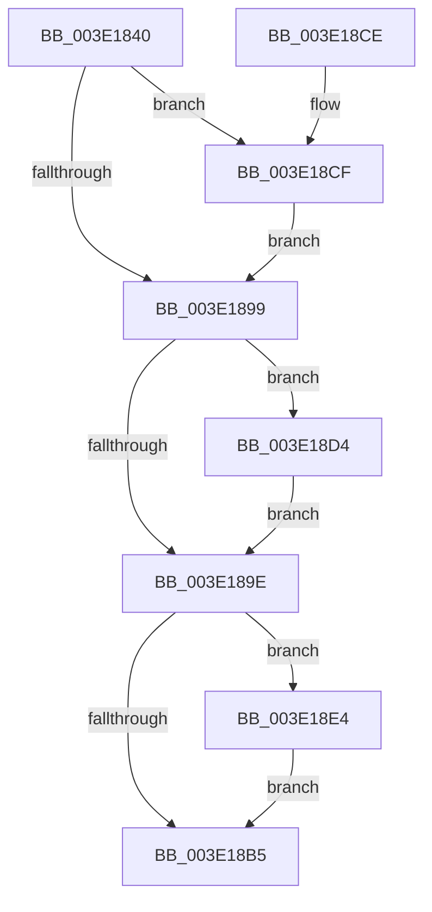

# MmStoreEvictComplete

- RVA: `0x003E1840`–`0x003E18FE` (길이 `190` bytes)
- VA: `0x00000001403E1840`
- 실행 섹션: `.text`
- PDB 이름 있음: `예`; PDB Function 태그: `아니요`
- unwind 정보 RVA: `0x00094A88`
- 디코드: `55`개 명령, `190/190` bytes 표시
- 미해석 바이트: `0` (있으면 어셈블리에 `.byte`로 보존)

> 이 문서는 커널 이미지의 기계어와 PDB 기호를 분석해 생성했습니다. 4번과 5번은 함수 원형과 자료형을 바이너리 사용 방식에서 추정한 C 해석이며 원본 소스 복구 결과는 아닙니다.

## 1. Dependencies

- 직접 호출 지점: **4**; 고유 호출 대상: **4**
- 직접 호출자로 확인된 함수: **2**
- RIP 상대 이미지 참조: **0**

### Outgoing calls
- `0x003E187A` → [ExAcquireSpinLockExclusive](../24/ExAcquireSpinLockExclusive_function_00248690.md) (function, `0x00248690`)
- `0x003E188F` → [RtlClearBits](RtlClearBits_function_003E1A90.md) (function, `0x003E1A90`)
- `0x003E18AC` → [MiReleaseSpinLockExclusive](../24/MiReleaseSpinLockExclusive_function_002482C0.md) (function, `0x002482C0`)
- `0x003E18F7` → [KeSetEvent](../33/KeSetEvent_function_0033F310.md) (function, `0x0033F310`)

### Direct callers
- [SMKM_STORE_MGR&lt;SM_TRAITS&gt;::SmIoCtxWorkItemComplete](../20/SMKM_STORE_MGR_SM_TRAITS_SmIoCtxWorkItemComplete_function_00205850.md) at `0x00205A1A`
- [SMKM_STORE_MGR&lt;SM_TRAITS&gt;::SmpPageEvict](../24/SMKM_STORE_MGR_SM_TRAITS_SmpPageEvict_function_0024A5F4.md) at `0x0024A663`

### Static image references
- 디코드된 RIP-relative 메모리 참조가 없습니다.

## 2. Other-region calls and transfers

- 다른 실행 섹션으로 향하는 call: **0**
- 별도 외부 분기/꼬리 이동을 확인하지 못했습니다.

## 3. Assembly (complete function range)

```asm
003E1840  48 89 5C 24 08                  mov qword ptr [rsp + 8], rbx
003E1845  48 89 6C 24 10                  mov qword ptr [rsp + 0x10], rbp
003E184A  48 89 74 24 18                  mov qword ptr [rsp + 0x18], rsi
003E184F  57                              push rdi
003E1850  41 56                           push r14
003E1852  41 57                           push r15
003E1854  48 83 EC 20                     sub rsp, 0x20
003E1858  8B DA                           mov ebx, edx
003E185A  41 8B E8                        mov ebp, r8d
003E185D  48 8B 11                        mov rdx, qword ptr [rcx]
003E1860  33 F6                           xor esi, esi
003E1862  8B 82 B4 04 00 00               mov eax, dword ptr [rdx + 0x4b4]
003E1868  48 8B BC C2 60 48 00 00         mov rdi, qword ptr [rdx + rax*8 + 0x4860]
003E1870  4C 8D B7 C8 00 00 00            lea r14, [rdi + 0xc8]
003E1877  49 8B CE                        mov rcx, r14
003E187A  E8 11 6E E6 FF                  call 0x140248690
003E187F  48 8B 4F 50                     mov rcx, qword ptr [rdi + 0x50]
003E1883  44 8B C5                        mov r8d, ebp
003E1886  48 83 C1 08                     add rcx, 8
003E188A  8B D3                           mov edx, ebx
003E188C  44 8A F8                        mov r15b, al
003E188F  E8 FC 01 00 00                  call 0x1403e1a90
003E1894  39 5F 58                        cmp dword ptr [rdi + 0x58], ebx
003E1897  77 36                           ja 0x1403e18cf
003E1899  39 77 0C                        cmp dword ptr [rdi + 0xc], esi
003E189C  74 36                           je 0x1403e18d4
003E189E  8B 57 0C                        mov edx, dword ptr [rdi + 0xc]
003E18A1  49 8B CE                        mov rcx, r14
003E18A4  03 D5                           add edx, ebp
003E18A6  89 57 0C                        mov dword ptr [rdi + 0xc], edx
003E18A9  41 8A D7                        mov dl, r15b
003E18AC  E8 0F 6A E6 FF                  call 0x1402482c0
003E18B1  85 F6                           test esi, esi
003E18B3  75 2F                           jne 0x1403e18e4
003E18B5  48 8B 5C 24 40                  mov rbx, qword ptr [rsp + 0x40]
003E18BA  48 8B 6C 24 48                  mov rbp, qword ptr [rsp + 0x48]
003E18BF  48 8B 74 24 50                  mov rsi, qword ptr [rsp + 0x50]
003E18C4  48 83 C4 20                     add rsp, 0x20
003E18C8  41 5F                           pop r15
003E18CA  41 5E                           pop r14
003E18CC  5F                              pop rdi
003E18CD  C3                              ret
003E18CE  CC                              int3
003E18CF  89 5F 58                        mov dword ptr [rdi + 0x58], ebx
003E18D2  EB C5                           jmp 0x1403e1899
003E18D4  B9 01 00 00 00                  mov ecx, 1
003E18D9  84 8F AE 00 00 00               test byte ptr [rdi + 0xae], cl
003E18DF  0F 45 F1                        cmovne esi, ecx
003E18E2  EB BA                           jmp 0x1403e189e
003E18E4  48 8B 8F D8 00 00 00            mov rcx, qword ptr [rdi + 0xd8]
003E18EB  45 33 C0                        xor r8d, r8d
003E18EE  48 81 C1 A0 03 00 00            add rcx, 0x3a0
003E18F5  33 D2                           xor edx, edx
003E18F7  E8 14 DA F5 FF                  call 0x14033f310
003E18FC  EB B7                           jmp 0x1403e18b5
```

## 4. C-style interpretation (structured pseudocode)

```c
__int64 __fastcall MmStoreEvictComplete(__int64 a1, int a2, int a3)
{
    __int64 result;
    __int64 v_rsi;
    __int64 v_rsp;
    unsigned __int64 v_stack_p10;
    unsigned __int64 v_stack_p18;
    unsigned __int64 v_stack_p8;

    v_stack_p8 = v_rbx;
    v_stack_p10 = v_rbp;
    v_stack_p18 = v_rsi;
    v_rsp = (v_rsp) - (32);
    v_rsi = 0;
    result = ExAcquireSpinLockExclusive(*(unsigned __int64 *)(*(unsigned __int64 *)(a1) + (unsigned int)(*(unsigned int *)(*(unsigned __int64 *)(a1) + 1204)) * 8 + 18528) + 200, *(unsigned __int64 *)(a1), a3, a4);
    a1 = (*(unsigned __int64 *)(*(unsigned __int64 *)(*(unsigned __int64 *)(a1) + (unsigned int)(*(unsigned int *)(*(unsigned __int64 *)(a1) + 1204)) * 8 + 18528) + 80)) + (8);
    result = RtlClearBits(a1, (unsigned int)((unsigned int)((unsigned int)(a2))), (unsigned int)((unsigned int)((unsigned int)(a3))), a4);
    if ((*(unsigned int *)(*(unsigned __int64 *)(*(unsigned __int64 *)(a1) + (unsigned int)(*(unsigned int *)(*(unsigned __int64 *)(a1) + 1204)) * 8 + 18528) + 88)) > ((unsigned int)((unsigned int)(a2)))) goto loc_003E18CF;
loc_003E1899:
    if ((*(unsigned int *)(*(unsigned __int64 *)(*(unsigned __int64 *)(a1) + (unsigned int)(*(unsigned int *)(*(unsigned __int64 *)(a1) + 1204)) * 8 + 18528) + 12)) == 0) goto loc_003E18D4;
loc_003E189E:
    a2 = (unsigned int)(((unsigned int)(*(unsigned int *)(*(unsigned __int64 *)(*(unsigned __int64 *)(a1) + (unsigned int)(*(unsigned int *)(*(unsigned __int64 *)(a1) + 1204)) * 8 + 18528) + 12))) + ((unsigned int)((unsigned int)(a3))));
    *(unsigned int *)(*(unsigned __int64 *)(*(unsigned __int64 *)(a1) + (unsigned int)(*(unsigned int *)(*(unsigned __int64 *)(a1) + 1204)) * 8 + 18528) + 12) = a2;
    result = MiReleaseSpinLockExclusive(*(unsigned __int64 *)(*(unsigned __int64 *)(a1) + (unsigned int)(*(unsigned int *)(*(unsigned __int64 *)(a1) + 1204)) * 8 + 18528) + 200, (unsigned __int8)((unsigned __int8)(result)), (unsigned int)((unsigned int)((unsigned int)(a3))), a4);
    if (0 != 0) goto loc_003E18E4;
loc_003E18B5:
    v_rsp = (v_rsp) + (32);
    return result;
loc_003E18CF:
    *(unsigned int *)(*(unsigned __int64 *)(*(unsigned __int64 *)(a1) + (unsigned int)(*(unsigned int *)(*(unsigned __int64 *)(a1) + 1204)) * 8 + 18528) + 88) = (unsigned int)(v_stack_p8);
    goto loc_003E1899;
loc_003E18D4:
    v_rsi = v_stack_p18;
    if (((*(unsigned __int8 *)(*(unsigned __int64 *)(*(unsigned __int64 *)(a1) + (unsigned int)(*(unsigned int *)(*(unsigned __int64 *)(a1) + 1204)) * 8 + 18528) + 174)) & (1)) != 0) { v_rsi = 1; }
    goto loc_003E189E;
loc_003E18E4:
    a3 = 0;
    a1 = (*(unsigned __int64 *)(*(unsigned __int64 *)(*(unsigned __int64 *)(a1) + (unsigned int)(*(unsigned int *)(*(unsigned __int64 *)(a1) + 1204)) * 8 + 18528) + 216)) + (928);
    a2 = 0;
    result = KeSetEvent(a1, a2, a3, a4);
    goto loc_003E18B5;
}
```

## 5. (Beta) C Style

```c
int64_t MmStoreEvictComplete(void *Arg1, int32_t Arg2, int32_t Arg3)
{
    uint8_t *arg1 = (uint8_t *)Arg1;

    int64_t result;
    int64_t local_rsi;
    int64_t local_rsp;
    uint64_t v_stack_p10;
    uint64_t v_stack_p18;
    uint64_t v_stack_p8;

    v_stack_p8 = local_rbx;
    v_stack_p10 = local_rbp;
    v_stack_p18 = local_rsi;
    local_rsp = (local_rsp) - (32);
    local_rsi = 0;
    result = ExAcquireSpinLockExclusive(*(uint64_t *)(*(uint64_t *)(arg1) + (uint32_t)(*(uint32_t *)(*(uint64_t *)(arg1) + 0x4B4)) * 8 + 0x4860) + 200, *(uint64_t *)(arg1), Arg3, a4);
    Arg1 = (*(uint64_t *)(*(uint64_t *)(*(uint64_t *)(arg1) + (uint32_t)(*(uint32_t *)(*(uint64_t *)(arg1) + 0x4B4)) * 8 + 0x4860) + 0x50)) + (8);
    result = RtlClearBits(Arg1, (uint32_t)((uint32_t)((uint32_t)(Arg2))), (uint32_t)((uint32_t)((uint32_t)(Arg3))), a4);
    if ((*(uint32_t *)(*(uint64_t *)(*(uint64_t *)(arg1) + (uint32_t)(*(uint32_t *)(*(uint64_t *)(arg1) + 0x4B4)) * 8 + 0x4860) + 0x58)) > ((uint32_t)((uint32_t)(Arg2)))) goto loc_003E18CF;
loc_003E1899:
    if ((*(uint32_t *)(*(uint64_t *)(*(uint64_t *)(arg1) + (uint32_t)(*(uint32_t *)(*(uint64_t *)(arg1) + 0x4B4)) * 8 + 0x4860) + 0xC)) == 0) goto loc_003E18D4;
loc_003E189E:
    Arg2 = (uint32_t)(((uint32_t)(*(uint32_t *)(*(uint64_t *)(*(uint64_t *)(arg1) + (uint32_t)(*(uint32_t *)(*(uint64_t *)(arg1) + 0x4B4)) * 8 + 0x4860) + 0xC))) + ((uint32_t)((uint32_t)(Arg3))));
    *(uint32_t *)(*(uint64_t *)(*(uint64_t *)(arg1) + (uint32_t)(*(uint32_t *)(*(uint64_t *)(arg1) + 0x4B4)) * 8 + 0x4860) + 0xC) = Arg2;
    result = MiReleaseSpinLockExclusive(*(uint64_t *)(*(uint64_t *)(arg1) + (uint32_t)(*(uint32_t *)(*(uint64_t *)(arg1) + 0x4B4)) * 8 + 0x4860) + 200, (uint8_t)((uint8_t)(result)), (uint32_t)((uint32_t)((uint32_t)(Arg3))), a4);
    if (0 != 0) goto loc_003E18E4;
loc_003E18B5:
    local_rsp = (local_rsp) + (32);
    return result;
loc_003E18CF:
    *(uint32_t *)(*(uint64_t *)(*(uint64_t *)(arg1) + (uint32_t)(*(uint32_t *)(*(uint64_t *)(arg1) + 0x4B4)) * 8 + 0x4860) + 0x58) = (uint32_t)(v_stack_p8);
    goto loc_003E1899;
loc_003E18D4:
    local_rsi = v_stack_p18;
    if (((*(uint8_t *)(*(uint64_t *)(*(uint64_t *)(arg1) + (uint32_t)(*(uint32_t *)(*(uint64_t *)(arg1) + 0x4B4)) * 8 + 0x4860) + 0xAE)) & (1)) != 0) { local_rsi = 1; }
    goto loc_003E189E;
loc_003E18E4:
    Arg3 = 0;
    Arg1 = (*(uint64_t *)(*(uint64_t *)(*(uint64_t *)(arg1) + (uint32_t)(*(uint32_t *)(*(uint64_t *)(arg1) + 0x4B4)) * 8 + 0x4860) + 0xD8)) + (928);
    Arg2 = 0;
    result = KeSetEvent(Arg1, Arg2, Arg3, a4);
    goto loc_003E18B5;
}
```

### 관측된 메모리 오프셋

구조체 형식이 확인되지 않은 접근은 인자 기준의 오프셋으로만 기록했습니다.

| 기준 인자 | 오프셋 표현 | 폭 (bit) | 접근 |
|---|---:|---:|---|
| `Arg1` | `+ 0x0` | `64` | `R` |

## 6. Execution-region graph

[열기: 2D/3D 그래프와 함수 탐색 컨트롤 패널](../../../control-panel.html?section=text&rva=0x003E1840&view=graph)

- 2D 그래프는 위에서 아래로 흐르고, 3D 그래프는 빈 공간을 드래그해 회전합니다. Shift+드래그는 이동, 휠은 확대·축소, 함수 노드 선택은 대상 보고서 이동입니다.

### Static fallback


