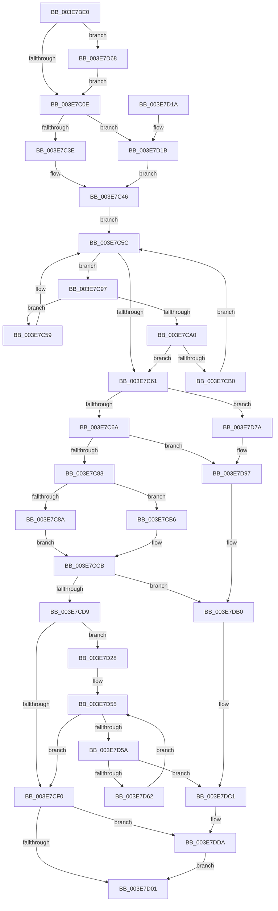

# MmUnmapReservedMapping

- RVA: `0x003E7BE0`–`0x003E7DEA` (길이 `522` bytes)
- VA: `0x00000001403E7BE0`
- 실행 섹션: `.text`
- PDB 이름 있음: `예`; PDB Function 태그: `아니요`
- unwind 정보 RVA: `0x00095740`
- 디코드: `140`개 명령, `522/522` bytes 표시
- 미해석 바이트: `0` (있으면 어셈블리에 `.byte`로 보존)

> 이 문서는 커널 이미지의 기계어와 PDB 기호를 분석해 생성했습니다. 4번과 5번은 함수 원형과 자료형을 바이너리 사용 방식에서 추정한 C 해석이며 원본 소스 복구 결과는 아닙니다.

## 1. Dependencies

- 직접 호출 지점: **9**; 고유 호출 대상: **6**
- 직접 호출자로 확인된 함수: **17**
- RIP 상대 이미지 참조: **2**

### Outgoing calls
- `0x003E7C41` → [ExAcquireSpinLockSharedAtDpcLevel](../24/ExAcquireSpinLockSharedAtDpcLevel_function_00248E30.md) (function, `0x00248E30`)
- `0x003E7C74` → [MiReleaseSpinLockShared](../34/MiReleaseSpinLockShared_function_00348BF0.md) (function, `0x00348BF0`)
- `0x003E7CE4` → [MiUnmapMdlCommon](MiUnmapMdlCommon_function_003E7DF0.md) (function, `0x003E7DF0`)
- `0x003E7D1B` → [ExAcquireSpinLockShared](../24/ExAcquireSpinLockShared_function_0024DCE0.md) (function, `0x0024DCE0`)
- `0x003E7D6B` → [MiRetardMdl](../40/MiRetardMdl_function_0040494C.md) (function, `0x0040494C`)
- `0x003E7D91` → [KeBugCheckEx](../4F/KeBugCheckEx_function_004FD660.md) (function, `0x004FD660`)
- `0x003E7DAA` → [KeBugCheckEx](../4F/KeBugCheckEx_function_004FD660.md) (function, `0x004FD660`)
- `0x003E7DBB` → [KeBugCheckEx](../4F/KeBugCheckEx_function_004FD660.md) (function, `0x004FD660`)
- `0x003E7DD4` → [KeBugCheckEx](../4F/KeBugCheckEx_function_004FD660.md) (function, `0x004FD660`)

### Direct callers
- [SMKM_STORE_MGR&lt;SM_TRAITS&gt;::SmIoCtxWorkItemComplete](../20/SMKM_STORE_MGR_SM_TRAITS_SmIoCtxWorkItemComplete_function_00205850.md) at `0x00205ABF`
- [sub_003178C4](../31/Unknown_function_003178C4.md) at `0x003178E7`
- [sub_00317914](../31/Unknown_function_00317914.md) at `0x00317950`
- [SmKmUnlockMdl](../37/SmKmUnlockMdl_function_00372A44.md) at `0x00372AC9`
- [SMKM_STORE&lt;SM_TRAITS&gt;::SmStUnmapPhysicalRegion](SMKM_STORE_SM_TRAITS_SmStUnmapPhysicalRegion_function_003E76E0.md) at `0x003E7787`
- [PspIumFreePhysicalPages](PspIumFreePhysicalPages_function_003E7874.md) at `0x003E7950`
- [SmFpFree](../43/SmFpFree_function_00436350.md) at `0x0043644A`
- [HalpDmaFlushBufferWithEmergencyResources](../4D/HalpDmaFlushBufferWithEmergencyResources_function_004D8024.md) at `0x004D813A`
- [HalpDmaSyncMapBuffersWithEmergencyResources](../4D/HalpDmaSyncMapBuffersWithEmergencyResources_function_004DE714.md) at `0x004DE94A`
- [HalpDmaSyncMapBuffersWithEmergencyResources](../4D/HalpDmaSyncMapBuffersWithEmergencyResources_function_004DE714.md) at `0x004DE95F`
- [sub_0051ADC0](../51/Unknown_function_0051ADC0.md) at `0x0051ADE8`
- [PnprCopyReservedMapping](../5A/PnprCopyReservedMapping_function_005A8864.md) at `0x005A88CD`
- [PnprSwap](../5A/PnprSwap_function_005A910C.md) at `0x005A92C2`
- [PnprSwap](../5A/PnprSwap_function_005A910C.md) at `0x005A92F5`
- [sub_006EA4E8](../6E/Unknown_function_006EA4E8.md) at `0x006EA4FA`
- [sub_006EA71E](../6E/Unknown_function_006EA71E.md) at `0x006EA723`
- [sub_006F2BBA](../6F/Unknown_function_006F2BBA.md) at `0x006F2BBF`
- [EtwpSavePersistedLogger](../../page/7B/EtwpSavePersistedLogger_function_007BF374.md) at `0x007BF6C7`
- [EtwpSavePersistedLogger](../../page/7B/EtwpSavePersistedLogger_function_007BF374.md) at `0x007BF811`
- [PnprMapPhysicalPages](../../pagelk/B6/PnprMapPhysicalPages_function_00B643BC.md) at `0x00B64468`

### Static image references
- `0x003E7C2F` → RVA `0x00E35FA8` (`.data`; read)
- `0x003E7C46` → RVA `0x00E35FB0` (`.data`; read)

## 2. Other-region calls and transfers

- 다른 실행 섹션으로 향하는 call: **0**
- 별도 외부 분기/꼬리 이동을 확인하지 못했습니다.

## 3. Assembly (complete function range)

```asm
003E7BE0  48 89 5C 24 08                  mov qword ptr [rsp + 8], rbx
003E7BE5  48 89 6C 24 10                  mov qword ptr [rsp + 0x10], rbp
003E7BEA  48 89 74 24 18                  mov qword ptr [rsp + 0x18], rsi
003E7BEF  57                              push rdi
003E7BF0  41 56                           push r14
003E7BF2  41 57                           push r15
003E7BF4  48 83 EC 30                     sub rsp, 0x30
003E7BF8  66 41 0F BA 60 0A 09            bt word ptr [r8 + 0xa], 9
003E7BFF  44 8B F2                        mov r14d, edx
003E7C02  49 8B D8                        mov rbx, r8
003E7C05  48 8B F1                        mov rsi, rcx
003E7C08  0F 82 5A 01 00 00               jb 0x1403e7d68
003E7C0E  8B 4B 2C                        mov ecx, dword ptr [rbx + 0x2c]
003E7C11  03 4B 20                        add ecx, dword ptr [rbx + 0x20]
003E7C14  8B 6B 28                        mov ebp, dword ptr [rbx + 0x28]
003E7C17  81 E1 FF 0F 00 00               and ecx, 0xfff
003E7C1D  48 81 C5 FF 0F 00 00            add rbp, 0xfff
003E7C24  48 03 E9                        add rbp, rcx
003E7C27  48 C1 ED 0C                     shr rbp, 0xc
003E7C2B  44 0F 20 C0                     mov rax, cr8
003E7C2F  48 8D 0D 72 E3 A4 00            lea rcx, [rip + 0xa4e372]
003E7C36  3C 02                           cmp al, 2
003E7C38  0F 85 DD 00 00 00               jne 0x1403e7d1b
003E7C3E  41 B7 11                        mov r15b, 0x11
003E7C41  E8 EA 11 E6 FF                  call 0x140248e30
003E7C46  48 8B 3D 63 E3 A4 00            mov rdi, qword ptr [rip + 0xa4e363]
003E7C4D  48 8B CE                        mov rcx, rsi
003E7C50  48 81 E1 00 F0 FF FF            and rcx, 0xfffffffffffff000
003E7C57  EB 03                           jmp 0x1403e7c5c
003E7C59  48 8B 3F                        mov rdi, qword ptr [rdi]
003E7C5C  48 85 FF                        test rdi, rdi
003E7C5F  75 36                           jne 0x1403e7c97
003E7C61  48 85 FF                        test rdi, rdi
003E7C64  0F 84 10 01 00 00               je 0x1403e7d7a
003E7C6A  41 8A D7                        mov dl, r15b
003E7C6D  48 8D 0D 34 E3 A4 00            lea rcx, [rip + 0xa4e334]
003E7C74  E8 77 0F F6 FF                  call 0x140348bf0
003E7C79  44 39 77 28                     cmp dword ptr [rdi + 0x28], r14d
003E7C7D  0F 85 14 01 00 00               jne 0x1403e7d97
003E7C83  8B 47 2C                        mov eax, dword ptr [rdi + 0x2c]
003E7C86  A8 01                           test al, 1
003E7C88  75 2C                           jne 0x1403e7cb6
003E7C8A  48 8B 4F 20                     mov rcx, qword ptr [rdi + 0x20]
003E7C8E  48 8B 77 18                     mov rsi, qword ptr [rdi + 0x18]
003E7C92  4C 8B C9                        mov r9, rcx
003E7C95  EB 34                           jmp 0x1403e7ccb
003E7C97  48 8B 57 18                     mov rdx, qword ptr [rdi + 0x18]
003E7C9B  48 3B CA                        cmp rcx, rdx
003E7C9E  72 B9                           jb 0x1403e7c59
003E7CA0  48 8B 47 20                     mov rax, qword ptr [rdi + 0x20]
003E7CA4  48 C1 E0 0C                     shl rax, 0xc
003E7CA8  48 03 C2                        add rax, rdx
003E7CAB  48 3B C8                        cmp rcx, rax
003E7CAE  72 B1                           jb 0x1403e7c61
003E7CB0  48 8B 7F 08                     mov rdi, qword ptr [rdi + 8]
003E7CB4  EB A6                           jmp 0x1403e7c5c
003E7CB6  4C 8B 4F 20                     mov r9, qword ptr [rdi + 0x20]
003E7CBA  48 8B C6                        mov rax, rsi
003E7CBD  48 2B 47 18                     sub rax, qword ptr [rdi + 0x18]
003E7CC1  49 8B C9                        mov rcx, r9
003E7CC4  48 C1 E8 0C                     shr rax, 0xc
003E7CC8  48 2B C8                        sub rcx, rax
003E7CCB  48 89 6C 24 20                  mov qword ptr [rsp + 0x20], rbp
003E7CD0  48 3B E9                        cmp rbp, rcx
003E7CD3  0F 87 D7 00 00 00               ja 0x1403e7db0
003E7CD9  4C 8B CB                        mov r9, rbx
003E7CDC  45 8B C6                        mov r8d, r14d
003E7CDF  33 D2                           xor edx, edx
003E7CE1  48 8B CE                        mov rcx, rsi
003E7CE4  E8 07 01 00 00                  call 0x1403e7df0
003E7CE9  8B 47 2C                        mov eax, dword ptr [rdi + 0x2c]
003E7CEC  A8 01                           test al, 1
003E7CEE  74 38                           je 0x1403e7d28
003E7CF0  66 83 63 0A DE                  and word ptr [rbx + 0xa], 0xffde
003E7CF5  0F B7 43 0A                     movzx eax, word ptr [rbx + 0xa]
003E7CF9  A8 04                           test al, 4
003E7CFB  0F 85 D9 00 00 00               jne 0x1403e7dda
003E7D01  48 8B 5C 24 50                  mov rbx, qword ptr [rsp + 0x50]
003E7D06  48 8B 6C 24 58                  mov rbp, qword ptr [rsp + 0x58]
003E7D0B  48 8B 74 24 60                  mov rsi, qword ptr [rsp + 0x60]
003E7D10  48 83 C4 30                     add rsp, 0x30
003E7D14  41 5F                           pop r15
003E7D16  41 5E                           pop r14
003E7D18  5F                              pop rdi
003E7D19  C3                              ret
003E7D1A  CC                              int3
003E7D1B  E8 C0 5F E6 FF                  call 0x14024dce0
003E7D20  44 8A F8                        mov r15b, al
003E7D23  E9 1E FF FF FF                  jmp 0x1403e7c46
003E7D28  48 8B CE                        mov rcx, rsi
003E7D2B  48 B8 F8 FF FF FF 7F 00 00 00   movabs rax, 0x7ffffffff8
003E7D35  48 C1 E9 09                     shr rcx, 9
003E7D39  48 23 C8                        and rcx, rax
003E7D3C  48 B8 00 00 00 00 80 F6 FF FF   movabs rax, 0xfffff68000000000
003E7D46  48 03 C8                        add rcx, rax
003E7D49  48 8B 47 20                     mov rax, qword ptr [rdi + 0x20]
003E7D4D  4C 8D 04 C1                     lea r8, [rcx + rax*8]
003E7D51  48 8D 14 E9                     lea rdx, [rcx + rbp*8]
003E7D55  49 3B D0                        cmp rdx, r8
003E7D58  73 96                           jae 0x1403e7cf0
003E7D5A  48 8B 02                        mov rax, qword ptr [rdx]
003E7D5D  48 85 C0                        test rax, rax
003E7D60  75 5F                           jne 0x1403e7dc1
003E7D62  48 83 C2 08                     add rdx, 8
003E7D66  EB ED                           jmp 0x1403e7d55
003E7D68  48 8B CB                        mov rcx, rbx
003E7D6B  E8 DC CB 01 00                  call 0x14040494c
003E7D70  8B C0                           mov eax, eax
003E7D72  48 2B F0                        sub rsi, rax
003E7D75  E9 94 FE FF FF                  jmp 0x1403e7c0e
003E7D7A  BA 06 01 00 00                  mov edx, 0x106
003E7D7F  48 C7 44 24 20 02 00 00 00      mov qword ptr [rsp + 0x20], 2
003E7D88  4D 8B CE                        mov r9, r14
003E7D8B  4C 8B C6                        mov r8, rsi
003E7D8E  8D 4A D4                        lea ecx, [rdx - 0x2c]
003E7D91  E8 CA 58 11 00                  call 0x1404fd660
003E7D96  CC                              int3
003E7D97  BA 02 01 00 00                  mov edx, 0x102
003E7D9C  48 89 6C 24 20                  mov qword ptr [rsp + 0x20], rbp
003E7DA1  4D 8B CE                        mov r9, r14
003E7DA4  4C 8B C6                        mov r8, rsi
003E7DA7  8D 4A D8                        lea ecx, [rdx - 0x28]
003E7DAA  E8 B1 58 11 00                  call 0x1404fd660
003E7DAF  CC                              int3
003E7DB0  BA 0A 01 00 00                  mov edx, 0x10a
003E7DB5  4C 8B C6                        mov r8, rsi
003E7DB8  8D 4A D0                        lea ecx, [rdx - 0x30]
003E7DBB  E8 A0 58 11 00                  call 0x1404fd660
003E7DC0  CC                              int3
003E7DC1  BA 0C 01 00 00                  mov edx, 0x10c
003E7DC6  48 89 6C 24 20                  mov qword ptr [rsp + 0x20], rbp
003E7DCB  4D 8B CE                        mov r9, r14
003E7DCE  4C 8B C6                        mov r8, rsi
003E7DD1  8D 4A CE                        lea ecx, [rdx - 0x32]
003E7DD4  E8 87 58 11 00                  call 0x1404fd660
003E7DD9  CC                              int3
003E7DDA  8B 43 2C                        mov eax, dword ptr [rbx + 0x2c]
003E7DDD  48 03 43 20                     add rax, qword ptr [rbx + 0x20]
003E7DE1  48 89 43 18                     mov qword ptr [rbx + 0x18], rax
003E7DE5  E9 17 FF FF FF                  jmp 0x1403e7d01
```

## 4. C-style interpretation (structured pseudocode)

```c
__int64 __fastcall MmUnmapReservedMapping(__int64 a1, int a2, __int64 a3)
{
    __int64 result;
    __int64 v_rbp;
    __int64 v_rsi;
    __int64 v_rsp;
    unsigned __int64 v_stack_m28;
    unsigned __int64 v_stack_p10;
    unsigned __int64 v_stack_p18;
    unsigned __int64 v_stack_p20;
    unsigned __int64 v_stack_p8;

    v_stack_p8 = v_rbx;
    v_stack_p10 = v_rbp;
    v_stack_p18 = v_rsi;
    v_rsp = (v_rsp) - (48);
    if (condition_is_below) goto loc_003E7D68;
loc_003E7C0E:
    a1 = (unsigned int)(((unsigned int)(*(unsigned int *)(a3 + 44))) + (*(unsigned int *)(a3 + 32)));
    a1 = (unsigned int)((a1) & (0xFFFULL));
    v_rbp = ((unsigned int)(*(unsigned int *)(a3 + 40))) + (0xFFFULL);
    v_rbp = (v_rbp) + (a1);
    v_rbp = (v_rbp) >> (12);
    if (((unsigned __int8)(v_cr8)) != 2) goto loc_003E7D1B;
    result = ExAcquireSpinLockSharedAtDpcLevel(v_rip + 10806130, a2, a3, a4);
loc_003E7C46:
    a1 = (a1) & (0xFFFFFFFFFFFFF000ULL);
    goto loc_003E7C5C;
loc_003E7C59:
loc_003E7C5C:
    if (*(unsigned __int64 *)(*(unsigned __int64 *)(v_rip + 10806115)) != 0) goto loc_003E7C97;
loc_003E7C61:
    if (*(unsigned __int64 *)(*(unsigned __int64 *)(v_rip + 10806115)) == 0) goto loc_003E7D7A;
    result = MiReleaseSpinLockShared(v_rip + 10806068, 17, a3, a4);
    if ((*(unsigned int *)(*(unsigned __int64 *)(*(unsigned __int64 *)(v_rip + 10806115)) + 40)) != ((unsigned int)((unsigned int)(a2)))) goto loc_003E7D97;
    if ((((unsigned __int8)((unsigned int)(*(unsigned int *)(*(unsigned __int64 *)(*(unsigned __int64 *)(v_rip + 10806115)) + 44)))) & (1)) != 0) goto loc_003E7CB6;
    goto loc_003E7CCB;
loc_003E7C97:
    if ((*(unsigned __int64 *)(*(unsigned __int64 *)(*(unsigned __int64 *)(v_rip + 10806115)) + 32)) < (*(unsigned __int64 *)(*(unsigned __int64 *)(*(unsigned __int64 *)(v_rip + 10806115)) + 24))) goto loc_003E7C59;
    result = (*(unsigned __int64 *)(*(unsigned __int64 *)(*(unsigned __int64 *)(v_rip + 10806115)) + 32)) << (12);
    result = (result) + (*(unsigned __int64 *)(*(unsigned __int64 *)(*(unsigned __int64 *)(v_rip + 10806115)) + 24));
    if ((*(unsigned __int64 *)(*(unsigned __int64 *)(*(unsigned __int64 *)(v_rip + 10806115)) + 32)) < result) goto loc_003E7C61;
    goto loc_003E7C5C;
loc_003E7CB6:
    result = (*(unsigned __int64 *)(*(unsigned __int64 *)(*(unsigned __int64 *)(v_rip + 10806115)) + 24)) - (*(unsigned __int64 *)(*(unsigned __int64 *)(*(unsigned __int64 *)(*(unsigned __int64 *)(v_rip + 10806115)) + 8) + 24));
    result = (result) >> (12);
    a1 = (*(unsigned __int64 *)(*(unsigned __int64 *)(*(unsigned __int64 *)(*(unsigned __int64 *)(v_rip + 10806115)) + 8) + 32)) - (result);
loc_003E7CCB:
    v_stack_m28 = v_rbp;
    if (v_rbp > a1) goto loc_003E7DB0;
    a2 = 0;
    result = MiUnmapMdlCommon(*(unsigned __int64 *)(*(unsigned __int64 *)(*(unsigned __int64 *)(v_rip + 10806115)) + 24), a2, (unsigned int)((unsigned int)((unsigned int)(a2))), a3);
    if ((((unsigned __int8)((unsigned int)(*(unsigned int *)(*(unsigned __int64 *)(*(unsigned __int64 *)(*(unsigned __int64 *)(v_rip + 10806115)) + 8) + 44)))) & (1)) == 0) goto loc_003E7D28;
loc_003E7CF0:
    if ((((unsigned __int8)(*(unsigned __int16 *)(a3 + 10))) & (4)) != 0) goto loc_003E7DDA;
loc_003E7D01:
    v_rsp = (v_rsp) + (48);
    return *(unsigned __int16 *)(a3 + 10);
loc_003E7D1B:
    result = ExAcquireSpinLockShared(*(unsigned __int64 *)(*(unsigned __int64 *)(*(unsigned __int64 *)(v_rip + 10806115)) + 24), a2, (unsigned int)((unsigned int)((unsigned int)(a2))), a3);
    goto loc_003E7C46;
loc_003E7D28:
    a1 = (v_stack_p18) >> (9);
    a1 = (a1) & (result);
    a1 = (a1) + (result);
loc_003E7D55:
    if ((a1 + v_stack_p10 * 8) >= (a1 + *(unsigned __int64 *)(*(unsigned __int64 *)(*(unsigned __int64 *)(*(unsigned __int64 *)(v_rip + 10806115)) + 8) + 32) * 8)) goto loc_003E7CF0;
    if (*(unsigned __int64 *)(a1 + v_stack_p10 * 8) != 0) goto loc_003E7DC1;
    a2 = (a1 + v_stack_p10 * 8) + (8);
    goto loc_003E7D55;
loc_003E7D68:
    result = MiRetardMdl(v_stack_p8, a2, a1 + *(unsigned __int64 *)(*(unsigned __int64 *)(*(unsigned __int64 *)(*(unsigned __int64 *)(v_rip + 10806115)) + 8) + 32) * 8, a3);
    v_rsi = (v_stack_p18) - ((unsigned int)((unsigned int)(result)));
    goto loc_003E7C0E;
loc_003E7D7A:
    v_stack_p20 = 2;
    result = KeBugCheckEx(262 - 44, 262, v_rsi, (unsigned int)(a2));
loc_003E7D97:
    v_stack_p20 = v_stack_p10;
    result = KeBugCheckEx(258 - 40, 258, v_rsi, (unsigned int)(a2));
loc_003E7DB0:
    result = KeBugCheckEx(266 - 48, 266, v_rsi, (unsigned int)(a2));
loc_003E7DC1:
    v_stack_p20 = v_stack_p10;
    result = KeBugCheckEx(268 - 50, 268, v_rsi, (unsigned int)(a2));
loc_003E7DDA:
    result = ((unsigned int)(*(unsigned int *)(v_stack_p8 + 44))) + (*(unsigned __int64 *)(v_stack_p8 + 32));
    *(unsigned __int64 *)(v_stack_p8 + 24) = result;
    goto loc_003E7D01;
}
```

## 5. (Beta) C Style

```c
int64_t MmUnmapReservedMapping(int64_t Arg1, int32_t Arg2, void *Arg3)
{
    uint8_t *arg3 = (uint8_t *)Arg3;

    int64_t result;
    int64_t local_rbp;
    int64_t local_rsi;
    int64_t local_rsp;
    uint64_t v_stack_m28;
    uint64_t v_stack_p10;
    uint64_t v_stack_p18;
    uint64_t v_stack_p20;
    uint64_t v_stack_p8;

    v_stack_p8 = local_rbx;
    v_stack_p10 = local_rbp;
    v_stack_p18 = local_rsi;
    local_rsp = (local_rsp) - (48);
    if (condition_is_below) goto loc_003E7D68;
loc_003E7C0E:
    Arg1 = (uint32_t)(((uint32_t)(*(uint32_t *)(arg3 + 0x2C))) + (*(uint32_t *)(arg3 + 0x20)));
    Arg1 = (uint32_t)((Arg1) & (0xFFFULL));
    local_rbp = ((uint32_t)(*(uint32_t *)(arg3 + 0x28))) + (0xFFFULL);
    local_rbp = (local_rbp) + (Arg1);
    local_rbp = (local_rbp) >> (12);
    if (((uint8_t)(v_cr8)) != 2) goto loc_003E7D1B;
    result = ExAcquireSpinLockSharedAtDpcLevel(v_rip + 10806130, Arg2, Arg3, a4);
loc_003E7C46:
    Arg1 = (Arg1) & (0xFFFFFFFFFFFFF000ULL);
    goto loc_003E7C5C;
loc_003E7C59:
loc_003E7C5C:
    if (*(uint64_t *)(*(uint64_t *)(v_rip + 0xA4E363)) != 0) goto loc_003E7C97;
loc_003E7C61:
    if (*(uint64_t *)(*(uint64_t *)(v_rip + 0xA4E363)) == 0) goto loc_003E7D7A;
    result = MiReleaseSpinLockShared(v_rip + 10806068, 17, Arg3, a4);
    if ((*(uint32_t *)(*(uint64_t *)(*(uint64_t *)(v_rip + 0xA4E363)) + 0x28)) != ((uint32_t)((uint32_t)(Arg2)))) goto loc_003E7D97;
    if ((((uint8_t)((uint32_t)(*(uint32_t *)(*(uint64_t *)(*(uint64_t *)(v_rip + 0xA4E363)) + 0x2C)))) & (1)) != 0) goto loc_003E7CB6;
    goto loc_003E7CCB;
loc_003E7C97:
    if ((*(uint64_t *)(*(uint64_t *)(*(uint64_t *)(v_rip + 0xA4E363)) + 0x20)) < (*(uint64_t *)(*(uint64_t *)(*(uint64_t *)(v_rip + 0xA4E363)) + 0x18))) goto loc_003E7C59;
    result = (*(uint64_t *)(*(uint64_t *)(*(uint64_t *)(v_rip + 0xA4E363)) + 0x20)) << (12);
    result = (result) + (*(uint64_t *)(*(uint64_t *)(*(uint64_t *)(v_rip + 0xA4E363)) + 0x18));
    if ((*(uint64_t *)(*(uint64_t *)(*(uint64_t *)(v_rip + 0xA4E363)) + 0x20)) < result) goto loc_003E7C61;
    goto loc_003E7C5C;
loc_003E7CB6:
    result = (*(uint64_t *)(*(uint64_t *)(*(uint64_t *)(v_rip + 0xA4E363)) + 0x18)) - (*(uint64_t *)(*(uint64_t *)(*(uint64_t *)(*(uint64_t *)(v_rip + 0xA4E363)) + 0x8) + 0x18));
    result = (result) >> (12);
    Arg1 = (*(uint64_t *)(*(uint64_t *)(*(uint64_t *)(*(uint64_t *)(v_rip + 0xA4E363)) + 0x8) + 0x20)) - (result);
loc_003E7CCB:
    v_stack_m28 = local_rbp;
    if (local_rbp > Arg1) goto loc_003E7DB0;
    Arg2 = 0;
    result = MiUnmapMdlCommon(*(uint64_t *)(*(uint64_t *)(*(uint64_t *)(v_rip + 0xA4E363)) + 0x18), Arg2, (uint32_t)((uint32_t)((uint32_t)(Arg2))), Arg3);
    if ((((uint8_t)((uint32_t)(*(uint32_t *)(*(uint64_t *)(*(uint64_t *)(*(uint64_t *)(v_rip + 0xA4E363)) + 0x8) + 0x2C)))) & (1)) == 0) goto loc_003E7D28;
loc_003E7CF0:
    if ((((uint8_t)(*(uint16_t *)(arg3 + 0xA))) & (4)) != 0) goto loc_003E7DDA;
loc_003E7D01:
    local_rsp = (local_rsp) + (48);
    return *(uint16_t *)(arg3 + 0xA);
loc_003E7D1B:
    result = ExAcquireSpinLockShared(*(uint64_t *)(*(uint64_t *)(*(uint64_t *)(v_rip + 0xA4E363)) + 0x18), Arg2, (uint32_t)((uint32_t)((uint32_t)(Arg2))), Arg3);
    goto loc_003E7C46;
loc_003E7D28:
    Arg1 = (v_stack_p18) >> (9);
    Arg1 = (Arg1) & (result);
    Arg1 = (Arg1) + (result);
loc_003E7D55:
    if ((Arg1 + v_stack_p10 * 8) >= (Arg1 + *(uint64_t *)(*(uint64_t *)(*(uint64_t *)(*(uint64_t *)(v_rip + 0xA4E363)) + 0x8) + 0x20) * 8)) goto loc_003E7CF0;
    if (*(uint64_t *)(Arg1 + v_stack_p10 * 8) != 0) goto loc_003E7DC1;
    Arg2 = (Arg1 + v_stack_p10 * 8) + (8);
    goto loc_003E7D55;
loc_003E7D68:
    result = MiRetardMdl(v_stack_p8, Arg2, Arg1 + *(uint64_t *)(*(uint64_t *)(*(uint64_t *)(*(uint64_t *)(v_rip + 0xA4E363)) + 0x8) + 0x20) * 8, Arg3);
    local_rsi = (v_stack_p18) - ((uint32_t)((uint32_t)(result)));
    goto loc_003E7C0E;
loc_003E7D7A:
    v_stack_p20 = 2;
    result = KeBugCheckEx(262 - 44, 262, local_rsi, (uint32_t)(Arg2));
loc_003E7D97:
    v_stack_p20 = v_stack_p10;
    result = KeBugCheckEx(258 - 40, 258, local_rsi, (uint32_t)(Arg2));
loc_003E7DB0:
    result = KeBugCheckEx(266 - 48, 266, local_rsi, (uint32_t)(Arg2));
loc_003E7DC1:
    v_stack_p20 = v_stack_p10;
    result = KeBugCheckEx(268 - 50, 268, local_rsi, (uint32_t)(Arg2));
loc_003E7DDA:
    result = ((uint32_t)(*(uint32_t *)(v_stack_p8 + 0x2C))) + (*(uint64_t *)(v_stack_p8 + 0x20));
    *(uint64_t *)(v_stack_p8 + 0x18) = result;
    goto loc_003E7D01;
}
```

### 관측된 메모리 오프셋

구조체 형식이 확인되지 않은 접근은 인자 기준의 오프셋으로만 기록했습니다.

| 기준 인자 | 오프셋 표현 | 폭 (bit) | 접근 |
|---|---:|---:|---|
| `Arg3` | `+ 0xA` | `16` | `R` |
| `Arg3` | `+ 0xA` | `16` | `R/W` |
| `Arg3` | `+ 0x18` | `64` | `W` |
| `Arg3` | `+ 0x20` | `32` | `R` |
| `Arg3` | `+ 0x20` | `64` | `R` |
| `Arg3` | `+ 0x28` | `32` | `R` |
| `Arg3` | `+ 0x2C` | `32` | `R` |

## 6. Execution-region graph

[열기: 2D/3D 그래프와 함수 탐색 컨트롤 패널](../../../control-panel.html?section=text&rva=0x003E7BE0&view=graph)

- 2D 그래프는 위에서 아래로 흐르고, 3D 그래프는 빈 공간을 드래그해 회전합니다. Shift+드래그는 이동, 휠은 확대·축소, 함수 노드 선택은 대상 보고서 이동입니다.

### Static fallback


