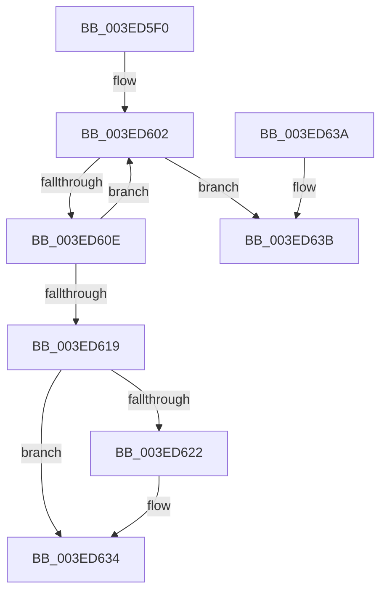

# ObFastDereferenceObject

- RVA: `0x003ED5F0`–`0x003ED642` (길이 `82` bytes)
- VA: `0x00000001403ED5F0`
- 실행 섹션: `.text`
- PDB 이름 있음: `예`; PDB Function 태그: `아니요`
- unwind 정보 RVA: `0x000968F8`
- 디코드: `25`개 명령, `82/82` bytes 표시
- 미해석 바이트: `0` (있으면 어셈블리에 `.byte`로 보존)

> 이 문서는 커널 이미지의 기계어와 PDB 기호를 분석해 생성했습니다. 4번과 5번은 함수 원형과 자료형을 바이너리 사용 방식에서 추정한 C 해석이며 원본 소스 복구 결과는 아닙니다.

## 1. Dependencies

- 직접 호출 지점: **1**; 고유 호출 대상: **1**
- 직접 호출자로 확인된 함수: **48**
- RIP 상대 이미지 참조: **1**

### Outgoing calls
- `0x003ED62F` → [ObpPushStackInfo](../21/ObpPushStackInfo_function_002109E4.md) (function, `0x002109E4`)

### Direct callers
- [IopCompleteIrpInFileObjectList](../24/IopCompleteIrpInFileObjectList_function_0024F330.md) at `0x0024F849`
- [IopDequeueIrpFromFileObject](IopDequeueIrpFromFileObject_function_003ED548.md) at `0x003ED5B5`
- [SepDesktopAppxSubProcessToken](../45/SepDesktopAppxSubProcessToken_function_0045BD90.md) at `0x0045C1AB`
- [SepVerifyDesktopAppPolicyOverrideCaller](../45/SepVerifyDesktopAppPolicyOverrideCaller_function_0045C1F0.md) at `0x0045C30F`
- [SeSetLearningModeObjectInformation](../4C/SeSetLearningModeObjectInformation_function_004C7098.md) at `0x004C711A`
- [PspIsTamperProtectedProcess](../5E/PspIsTamperProtectedProcess_function_005E36D4.md) at `0x005E3709`
- [SeSetTokenTamperProtection](../60/SeSetTokenTamperProtection_function_00609644.md) at `0x006097C4`
- [SepConstructAntiTamperBaselinePolicy](../60/SepConstructAntiTamperBaselinePolicy_function_0060A83C.md) at `0x0060A8E2`
- [SepConstructAntiTamperBaselinePolicy](../60/SepConstructAntiTamperBaselinePolicy_function_0060A83C.md) at `0x0060A902`
- [SepGetMandatoryAccessControlList](../../page/79/SepGetMandatoryAccessControlList_function_0079D5EC.md) at `0x0079D951`
- [SepReleaseMandatoryAccessControlList](../../page/79/SepReleaseMandatoryAccessControlList_function_0079D974.md) at `0x0079D996`
- [EtwpPsProvTraceProcess](../../page/8A/EtwpPsProvTraceProcess_function_008A3954.md) at `0x008A3C07`
- [EtwpPsProvTraceProcess](../../page/8A/EtwpPsProvTraceProcess_function_008A3954.md) at `0x008A3DF6`
- [EtwTraceAppStateChange](../../page/8A/EtwTraceAppStateChange_function_008A452C.md) at `0x008A46F5`
- [EtwQueryProcessTelemetryInfo](../../page/8A/EtwQueryProcessTelemetryInfo_function_008A51A0.md) at `0x008A54F4`
- [EtwpBuildProcessEvent](../../page/8A/EtwpBuildProcessEvent_function_008A552C.md) at `0x008A5631`
- [PsImpersonateClient](../../page/8C/PsImpersonateClient_function_008CBE10.md) at `0x008CC268`
- [EtwTiLogImpersonateClient](../../page/8C/EtwTiLogImpersonateClient_function_008CC9D0.md) at `0x008CCC78`
- [DbgkCreateThread](../../page/8D/DbgkCreateThread_function_008D5E34.md) at `0x008D60B8`
- [PspMapSystemDll](../../page/8D/PspMapSystemDll_function_008D6908.md) at `0x008D6A35`
- [PspExitLastThread](../../page/90/PspExitLastThread_function_00904184.md) at `0x00904232`
- [PspAllocateAndQueryNotificationChannel](../../page/91/PspAllocateAndQueryNotificationChannel_function_00917EE4.md) at `0x0091812B`
- [ExpGetProcessInformation](../../page/91/ExpGetProcessInformation_function_0091A878.md) at `0x0091ADED`
- [ExpGetProcessInformation](../../page/91/ExpGetProcessInformation_function_0091A878.md) at `0x0091B7C2`
- [PfpPrivSourceEnum](../../page/91/PfpPrivSourceEnum_function_0091BF00.md) at `0x0091C2CF`
- [PfSnCheckModernApp](../../page/95/PfSnCheckModernApp_function_0095FFF8.md) at `0x009600A0`
- [PopEtGetProcessSidAndPackageIdentity](../../page/98/PopEtGetProcessSidAndPackageIdentity_function_0098FD2C.md) at `0x0098FDB2`
- [ExpWnfQueryCurrentUserSID](../../page/98/ExpWnfQueryCurrentUserSID_function_0098FFB0.md) at `0x00990026`
- [AlpcpPortQueryConnectedSidInfo](../../page/9C/AlpcpPortQueryConnectedSidInfo_function_009CAC3C.md) at `0x009CAD80`
- [MiIsUserQueryVmCallerTrusted](../../page/9F/MiIsUserQueryVmCallerTrusted_function_009FE378.md) at `0x009FE481`
- [PspAllocateProcess](../../page/A1/PspAllocateProcess_function_00A13B3C.md) at `0x00A1620E`
- [PspAllocateProcess](../../page/A1/PspAllocateProcess_function_00A13B3C.md) at `0x00A16218`
- [PspGetNoChildProcessRestrictedPolicy](../../page/A1/PspGetNoChildProcessRestrictedPolicy_function_00A172B8.md) at `0x00A17307`
- [AlpcpCheckConnectionSecurity](../../page/A2/AlpcpCheckConnectionSecurity_function_00A227A0.md) at `0x00A2283D`
- [PsConvertToGuiThread](../../page/A2/PsConvertToGuiThread_function_00A2F8B0.md) at `0x00A2F9F0`
- [NtImpersonateAnonymousToken](../../page/A3/NtImpersonateAnonymousToken_function_00A3A150.md) at `0x00A3A367`
- [SepCopyAnonymousTokenAndSetSilo](../../page/A3/SepCopyAnonymousTokenAndSetSilo_function_00A3A510.md) at `0x00A3A5E8`
- [SeIsTokenAssignableToProcess](../../page/A3/SeIsTokenAssignableToProcess_function_00A3B2C0.md) at `0x00A3B373`
- [SepIsChildTokenByPointer](../../page/A3/SepIsChildTokenByPointer_function_00A3B478.md) at `0x00A3B4D0`
- [SepIsSiblingTokenByPointer](../../page/A3/SepIsSiblingTokenByPointer_function_00A3B514.md) at `0x00A3B574`
- [PspGetRedirectionTrustPolicy](../../page/A7/PspGetRedirectionTrustPolicy_function_00A769A8.md) at `0x00A769EE`
- [PspSetRedirectionTrustPolicy](../../page/A7/PspSetRedirectionTrustPolicy_function_00A7C2D4.md) at `0x00A7C313`
- [PspInitializeProcessSecurity](../../page/AA/PspInitializeProcessSecurity_function_00AAD368.md) at `0x00AAD52B`
- [SeSubProcessToken](../../page/AA/SeSubProcessToken_function_00AAD570.md) at `0x00AAD72D`
- [PspSetNoChildProcessRestrictedPolicy](../../page/AB/PspSetNoChildProcessRestrictedPolicy_function_00AB1BE0.md) at `0x00AB1C26`
- [EtwpGetPsmKeyExtendedHeaderItem](../../page/AC/EtwpGetPsmKeyExtendedHeaderItem_function_00AC3EE0.md) at `0x00AC3F8A`
- [sub_00B20A40](../../page/B2/Unknown_function_00B20A40.md) at `0x00B20A6A`
- [sub_00B2E606](../../page/B2/Unknown_function_00B2E606.md) at `0x00B2E658`
- [sub_00B413EC](../../page/B4/Unknown_function_00B413EC.md) at `0x00B41480`
- [sub_00B47918](../../page/B4/Unknown_function_00B47918.md) at `0x00B47A49`
- [MmInitSystemDll](../../init/BE/MmInitSystemDll_function_00BEEFB0.md) at `0x00BEEFEB`
- [PspInitPhase3](../../init/C4/PspInitPhase3_function_00C455F8.md) at `0x00C45701`
- [PspInitPhase3](../../init/C4/PspInitPhase3_function_00C455F8.md) at `0x00C4571E`

### Static image references
- `0x003ED619` → RVA `0x00FC5010` (`ALMOSTRO`; read)

## 2. Other-region calls and transfers

- 다른 실행 섹션으로 향하는 call: **0**
- 별도 외부 분기/꼬리 이동을 확인하지 못했습니다.

## 3. Assembly (complete function range)

```asm
003ED5F0  40 53                           push rbx
003ED5F2  48 83 EC 30                     sub rsp, 0x30
003ED5F6  45 8B D0                        mov r10d, r8d
003ED5F9  48 8B DA                        mov rbx, rdx
003ED5FC  0F 0D 09                        prefetchw byte ptr [rcx]
003ED5FF  48 8B 01                        mov rax, qword ptr [rcx]
003ED602  4C 8B C8                        mov r9, rax
003ED605  4C 33 CB                        xor r9, rbx
003ED608  49 83 F9 0F                     cmp r9, 0xf
003ED60C  73 2D                           jae 0x1403ed63b
003ED60E  4C 8D 40 01                     lea r8, [rax + 1]
003ED612  F0 4C 0F B1 01                  lock cmpxchg qword ptr [rcx], r8
003ED617  75 E9                           jne 0x1403ed602
003ED619  83 3D F0 79 BD 00 00            cmp dword ptr [rip + 0xbd79f0], 0
003ED620  74 12                           je 0x1403ed634
003ED622  48 8D 4A D0                     lea rcx, [rdx - 0x30]
003ED626  45 8B CA                        mov r9d, r10d
003ED629  33 D2                           xor edx, edx
003ED62B  44 8D 42 01                     lea r8d, [rdx + 1]
003ED62F  E8 B0 33 E2 FF                  call 0x1402109e4
003ED634  48 83 C4 30                     add rsp, 0x30
003ED638  5B                              pop rbx
003ED639  C3                              ret
003ED63A  CC                              int3
003ED63B  83 3D CE 79 BD 00 00            cmp dword ptr [rip + 0xbd79ce], 0
```

## 4. C-style interpretation (structured pseudocode)

```c
__int64 __fastcall ObFastDereferenceObject(__int64 a1, __int64 a2, int a3)
{
    __int64 result;
    __int64 v_rsp;

    v_rsp = (v_rsp) - (48);
loc_003ED602:
    a4 = (*(unsigned __int64 *)(a1)) ^ (a2);
    if (a4 >= 15) goto loc_003ED63B;
    if (a4 != 15) goto loc_003ED602;
    result = *(unsigned __int64 *)(a1);
    if ((*(unsigned int *)(v_rip + 12417520)) != 0) {
        a1 = a2 - 48;
        a4 = (unsigned int)((unsigned int)(a3));
        a2 = 0;
        a3 = a2 + 1;
        result = ObpPushStackInfo(a1, a2, a3, a4);
    }
    v_rsp = (v_rsp) + (48);
    return result;
loc_003ED63B:
    return result;
}
```

## 5. (Beta) C Style

```c
int64_t ObFastDereferenceObject(void *Arg1, void *Arg2, int32_t Arg3)
{
    uint8_t *arg1 = (uint8_t *)Arg1;
    uint8_t *arg2 = (uint8_t *)Arg2;

    int64_t result;
    int64_t local_rsp;

    local_rsp = (local_rsp) - (48);
loc_003ED602:
    a4 = (*(uint64_t *)(arg1)) ^ (Arg2);
    if (a4 >= 15) goto loc_003ED63B;
    if (a4 != 15) goto loc_003ED602;
    result = *(uint64_t *)(arg1);
    if ((*(uint32_t *)(v_rip + 0xBD79F0)) != 0) {
        Arg1 = Arg2 - 48;
        a4 = (uint32_t)((uint32_t)(Arg3));
        Arg2 = 0;
        Arg3 = Arg2 + 1;
        result = ObpPushStackInfo(Arg1, Arg2, Arg3, a4);
    }
    local_rsp = (local_rsp) + (48);
    return result;
loc_003ED63B:
    return result;
}
```

### 관측된 메모리 오프셋

구조체 형식이 확인되지 않은 접근은 인자 기준의 오프셋으로만 기록했습니다.

| 기준 인자 | 오프셋 표현 | 폭 (bit) | 접근 |
|---|---:|---:|---|
| `Arg1` | `+ 0x0` | `8` | `R` |
| `Arg1` | `+ 0x0` | `64` | `R` |
| `Arg2` | `- 0x30` | `64` | `R` |

## 6. Execution-region graph

[열기: 2D/3D 그래프와 함수 탐색 컨트롤 패널](../../../control-panel.html?section=text&rva=0x003ED5F0&view=graph)

- 2D 그래프는 위에서 아래로 흐르고, 3D 그래프는 빈 공간을 드래그해 회전합니다. Shift+드래그는 이동, 휠은 확대·축소, 함수 노드 선택은 대상 보고서 이동입니다.

### Static fallback


