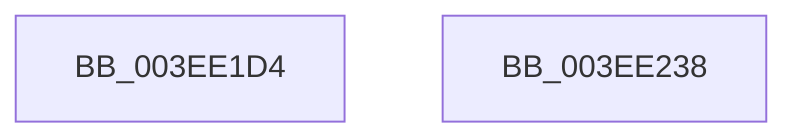

# PnpMapActivatingDeviceNodeToThread

- RVA: `0x003EE1D4`–`0x003EE239` (길이 `101` bytes)
- VA: `0x00000001403EE1D4`
- 실행 섹션: `.text`
- PDB 이름 있음: `예`; PDB Function 태그: `아니요`
- unwind 정보 RVA: `0x0006E5F8`
- 디코드: `26`개 명령, `101/101` bytes 표시
- 미해석 바이트: `0` (있으면 어셈블리에 `.byte`로 보존)

> 이 문서는 커널 이미지의 기계어와 PDB 기호를 분석해 생성했습니다. 4번과 5번은 함수 원형과 자료형을 바이너리 사용 방식에서 추정한 C 해석이며 원본 소스 복구 결과는 아닙니다.

## 1. Dependencies

- 직접 호출 지점: **3**; 고유 호출 대상: **3**
- 직접 호출자로 확인된 함수: **1**
- RIP 상대 이미지 참조: **2**

### Outgoing calls
- `0x003EE1EF` → [KeAcquireSpinLockRaiseToDpc](../20/KeAcquireSpinLockRaiseToDpc_function_00208470.md) (function, `0x00208470`)
- `0x003EE20A` → [RtlInsertElementGenericTableAvl](RtlInsertElementGenericTableAvl_function_003EE510.md) (function, `0x003EE510`)
- `0x003EE226` → [KeReleaseSpinLock](../39/KeReleaseSpinLock_function_00392BA0.md) (function, `0x00392BA0`)

### Direct callers
- [PnpPoFxActivateDevice](../../page/8F/PnpPoFxActivateDevice_function_008FB29C.md) at `0x008FB2BC`

### Static image references
- `0x003EE1E3` → RVA `0x00F8A900` (`.data`; read)
- `0x003EE1FC` → RVA `0x00F8A920` (`.data`; read)

## 2. Other-region calls and transfers

- 다른 실행 섹션으로 향하는 call: **0**
- 별도 외부 분기/꼬리 이동을 확인하지 못했습니다.

## 3. Assembly (complete function range)

```asm
003EE1D4  48 89 5C 24 08                  mov qword ptr [rsp + 8], rbx
003EE1D9  57                              push rdi
003EE1DA  48 83 EC 30                     sub rsp, 0x30
003EE1DE  48 89 4C 24 20                  mov qword ptr [rsp + 0x20], rcx
003EE1E3  48 8D 0D 16 C7 B9 00            lea rcx, [rip + 0xb9c716]
003EE1EA  48 89 54 24 28                  mov qword ptr [rsp + 0x28], rdx
003EE1EF  E8 7C A2 E1 FF                  call 0x140208470
003EE1F4  45 33 C9                        xor r9d, r9d
003EE1F7  48 8D 54 24 20                  lea rdx, [rsp + 0x20]
003EE1FC  48 8D 0D 1D C7 B9 00            lea rcx, [rip + 0xb9c71d]
003EE203  40 8A F8                        mov dil, al
003EE206  45 8D 41 10                     lea r8d, [r9 + 0x10]
003EE20A  E8 01 03 00 00                  call 0x1403ee510
003EE20F  48 F7 D8                        neg rax
003EE212  48 8D 0D E7 C6 B9 00            lea rcx, [rip + 0xb9c6e7]
003EE219  40 8A D7                        mov dl, dil
003EE21C  1B DB                           sbb ebx, ebx
003EE21E  F7 D3                           not ebx
003EE220  81 E3 01 00 00 C0               and ebx, 0xc0000001
003EE226  E8 75 49 FA FF                  call 0x140392ba0
003EE22B  8B C3                           mov eax, ebx
003EE22D  48 8B 5C 24 40                  mov rbx, qword ptr [rsp + 0x40]
003EE232  48 83 C4 30                     add rsp, 0x30
003EE236  5F                              pop rdi
003EE237  C3                              ret
003EE238  CC                              int3
```

## 4. C-style interpretation (structured pseudocode)

```c
__int64 __fastcall PnpMapActivatingDeviceNodeToThread(__int64 a1, __int64 a2, __int64 a3, int a4)
{
    __int64 result;
    __int64 v_rbx;
    __int64 v_rsp;
    unsigned __int64 v_stack_m10;
    unsigned __int64 v_stack_m18;
    unsigned __int64 v_stack_p8;

    v_stack_p8 = v_rbx;
    v_rsp = (v_rsp) - (48);
    v_stack_m18 = a1;
    v_stack_m10 = a2;
    result = KeAcquireSpinLockRaiseToDpc(v_rip + 12175126, a2, a3, a4);
    a4 = 0;
    result = RtlInsertElementGenericTableAvl(v_rip + 12175133, v_stack_m18, a4 + 16, a4);
    result = -(result);
    v_rbx = (unsigned int)(~(v_rbx));
    v_rbx = (unsigned int)((v_rbx) & (0xC0000001ULL));
    result = KeReleaseSpinLock(v_rip + 12175079, (unsigned __int8)((unsigned __int8)(result)), a4 + 16, a4);
    v_rsp = (v_rsp) + (48);
    return (unsigned int)((unsigned int)(v_rbx));
}
```

## 5. (Beta) C Style

```c
int64_t PnpMapActivatingDeviceNodeToThread(int64_t Arg1, int64_t Arg2, int64_t Arg3, int32_t Arg4)
{
    int64_t result;
    int64_t local_rbx;
    int64_t local_rsp;
    uint64_t v_stack_m10;
    uint64_t v_stack_m18;
    uint64_t v_stack_p8;

    v_stack_p8 = local_rbx;
    local_rsp = (local_rsp) - (48);
    v_stack_m18 = Arg1;
    v_stack_m10 = Arg2;
    result = KeAcquireSpinLockRaiseToDpc(v_rip + 12175126, Arg2, Arg3, Arg4);
    Arg4 = 0;
    result = RtlInsertElementGenericTableAvl(v_rip + 12175133, v_stack_m18, Arg4 + 16, Arg4);
    result = -(result);
    local_rbx = (uint32_t)(~(local_rbx));
    local_rbx = (uint32_t)((local_rbx) & (0xC0000001ULL));
    result = KeReleaseSpinLock(v_rip + 12175079, (uint8_t)((uint8_t)(result)), Arg4 + 16, Arg4);
    local_rsp = (local_rsp) + (48);
    return (uint32_t)((uint32_t)(local_rbx));
}
```

## 6. Execution-region graph

[열기: 2D/3D 그래프와 함수 탐색 컨트롤 패널](../../../control-panel.html?section=text&rva=0x003EE1D4&view=graph)

- 2D 그래프는 위에서 아래로 흐르고, 3D 그래프는 빈 공간을 드래그해 회전합니다. Shift+드래그는 이동, 휠은 확대·축소, 함수 노드 선택은 대상 보고서 이동입니다.

### Static fallback


