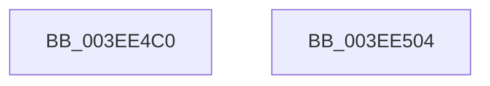

# PnpUnmapActivatingDeviceNodeToThread

- RVA: `0x003EE4C0`–`0x003EE505` (길이 `69` bytes)
- VA: `0x00000001403EE4C0`
- 실행 섹션: `.text`
- PDB 이름 있음: `예`; PDB Function 태그: `아니요`
- unwind 정보 RVA: `0x00064C80`
- 디코드: `17`개 명령, `69/69` bytes 표시
- 미해석 바이트: `0` (있으면 어셈블리에 `.byte`로 보존)

> 이 문서는 커널 이미지의 기계어와 PDB 기호를 분석해 생성했습니다. 4번과 5번은 함수 원형과 자료형을 바이너리 사용 방식에서 추정한 C 해석이며 원본 소스 복구 결과는 아닙니다.

## 1. Dependencies

- 직접 호출 지점: **3**; 고유 호출 대상: **3**
- 직접 호출자로 확인된 함수: **1**
- RIP 상대 이미지 참조: **2**

### Outgoing calls
- `0x003EE4D8` → [KeAcquireSpinLockRaiseToDpc](../20/KeAcquireSpinLockRaiseToDpc_function_00208470.md) (function, `0x00208470`)
- `0x003EE4EB` → [RtlDeleteElementGenericTableAvl](RtlDeleteElementGenericTableAvl_function_003EE750.md) (function, `0x003EE750`)
- `0x003EE4F9` → [KeReleaseSpinLock](../39/KeReleaseSpinLock_function_00392BA0.md) (function, `0x00392BA0`)

### Direct callers
- [PnpPoFxActivateDevice](../../page/8F/PnpPoFxActivateDevice_function_008FB29C.md) at `0x008FB2CD`

### Static image references
- `0x003EE4D1` → RVA `0x00F8A900` (`.data`; read)
- `0x003EE4E4` → RVA `0x00F8A920` (`.data`; read)

## 2. Other-region calls and transfers

- 다른 실행 섹션으로 향하는 call: **0**
- 별도 외부 분기/꼬리 이동을 확인하지 못했습니다.

## 3. Assembly (complete function range)

```asm
003EE4C0  40 53                           push rbx
003EE4C2  48 83 EC 30                     sub rsp, 0x30
003EE4C6  48 83 64 24 20 00               and qword ptr [rsp + 0x20], 0
003EE4CC  48 89 4C 24 28                  mov qword ptr [rsp + 0x28], rcx
003EE4D1  48 8D 0D 28 C4 B9 00            lea rcx, [rip + 0xb9c428]
003EE4D8  E8 93 9F E1 FF                  call 0x140208470
003EE4DD  48 8D 54 24 20                  lea rdx, [rsp + 0x20]
003EE4E2  8A D8                           mov bl, al
003EE4E4  48 8D 0D 35 C4 B9 00            lea rcx, [rip + 0xb9c435]
003EE4EB  E8 60 02 00 00                  call 0x1403ee750
003EE4F0  8A D3                           mov dl, bl
003EE4F2  48 8D 0D 07 C4 B9 00            lea rcx, [rip + 0xb9c407]
003EE4F9  E8 A2 46 FA FF                  call 0x140392ba0
003EE4FE  48 83 C4 30                     add rsp, 0x30
003EE502  5B                              pop rbx
003EE503  C3                              ret
003EE504  CC                              int3
```

## 4. C-style interpretation (structured pseudocode)

```c
__int64 __fastcall PnpUnmapActivatingDeviceNodeToThread(__int64 a1)
{
    __int64 result;
    __int64 v_rsp;
    unsigned __int64 v_stack_m10;
    unsigned __int64 v_stack_m18;

    v_rsp = (v_rsp) - (48);
    v_stack_m10 = a1;
    result = KeAcquireSpinLockRaiseToDpc(v_rip + 12174376, a2, a3, a4);
    result = RtlDeleteElementGenericTableAvl(v_rip + 12174389, v_stack_m18, a3, a4);
    result = KeReleaseSpinLock(v_rip + 12174343, (unsigned __int8)((unsigned __int8)(result)), a3, a4);
    v_rsp = (v_rsp) + (48);
    return result;
}
```

## 5. (Beta) C Style

```c
int64_t PnpUnmapActivatingDeviceNodeToThread(int64_t Arg1)
{
    int64_t result;
    int64_t local_rsp;
    uint64_t v_stack_m10;
    uint64_t v_stack_m18;

    local_rsp = (local_rsp) - (48);
    v_stack_m10 = Arg1;
    result = KeAcquireSpinLockRaiseToDpc(v_rip + 12174376, a2, a3, a4);
    result = RtlDeleteElementGenericTableAvl(v_rip + 12174389, v_stack_m18, a3, a4);
    result = KeReleaseSpinLock(v_rip + 12174343, (uint8_t)((uint8_t)(result)), a3, a4);
    local_rsp = (local_rsp) + (48);
    return result;
}
```

## 6. Execution-region graph

[열기: 2D/3D 그래프와 함수 탐색 컨트롤 패널](../../../control-panel.html?section=text&rva=0x003EE4C0&view=graph)

- 2D 그래프는 위에서 아래로 흐르고, 3D 그래프는 빈 공간을 드래그해 회전합니다. Shift+드래그는 이동, 휠은 확대·축소, 함수 노드 선택은 대상 보고서 이동입니다.

### Static fallback


