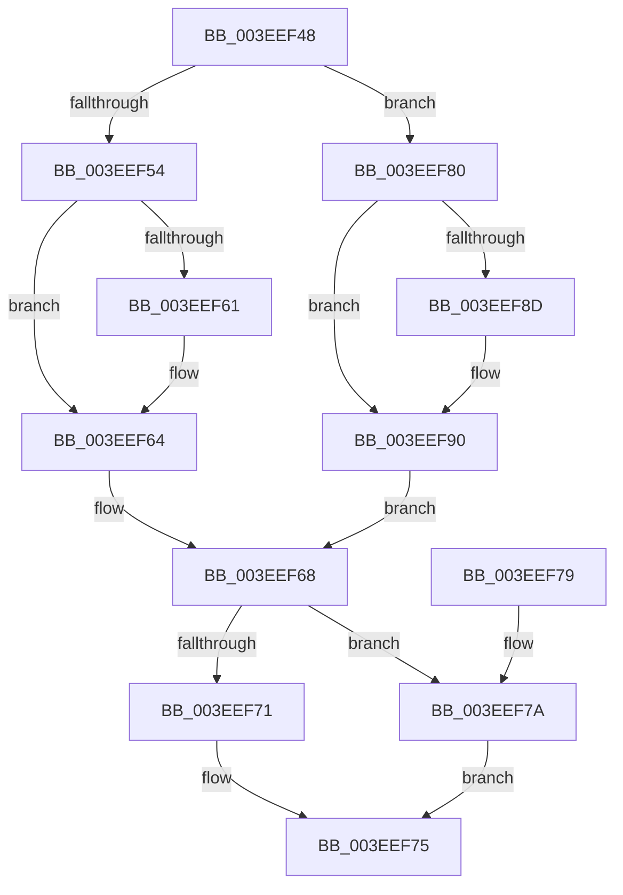

# PromoteNode

- RVA: `0x003EEF48`–`0x003EEF96` (길이 `78` bytes)
- VA: `0x00000001403EEF48`
- 실행 섹션: `.text`
- PDB 이름 있음: `예`; PDB Function 태그: `아니요`
- unwind 정보 RVA: `0x000DB714`
- 디코드: `26`개 명령, `78/78` bytes 표시
- 미해석 바이트: `0` (있으면 어셈블리에 `.byte`로 보존)

> 이 문서는 커널 이미지의 기계어와 PDB 기호를 분석해 생성했습니다. 4번과 5번은 함수 원형과 자료형을 바이너리 사용 방식에서 추정한 C 해석이며 원본 소스 복구 결과는 아닙니다.

## 1. Dependencies

- 직접 호출 지점: **0**; 고유 호출 대상: **0**
- 직접 호출자로 확인된 함수: **1**
- RIP 상대 이미지 참조: **0**

### Outgoing calls
- 직접 디코드된 call 명령이 없습니다.

### Direct callers
- [RebalanceNode](RebalanceNode_function_003EEE90.md) at `0x003EEEB9`
- [RebalanceNode](RebalanceNode_function_003EEE90.md) at `0x003EEEEC`
- [RebalanceNode](RebalanceNode_function_003EEE90.md) at `0x003EEEF1`
- [RebalanceNode](RebalanceNode_function_003EEE90.md) at `0x003EEF25`

### Static image references
- 디코드된 RIP-relative 메모리 참조가 없습니다.

## 2. Other-region calls and transfers

- 다른 실행 섹션으로 향하는 call: **0**
- 별도 외부 분기/꼬리 이동을 확인하지 못했습니다.

## 3. Assembly (complete function range)

```asm
003EEF48  48 8B 01                        mov rax, qword ptr [rcx]
003EEF4B  48 8B 10                        mov rdx, qword ptr [rax]
003EEF4E  48 39 48 08                     cmp qword ptr [rax + 8], rcx
003EEF52  74 2C                           je 0x1403eef80
003EEF54  4C 8B 41 08                     mov r8, qword ptr [rcx + 8]
003EEF58  4C 89 40 10                     mov qword ptr [rax + 0x10], r8
003EEF5C  4D 85 C0                        test r8, r8
003EEF5F  74 03                           je 0x1403eef64
003EEF61  49 89 00                        mov qword ptr [r8], rax
003EEF64  48 89 41 08                     mov qword ptr [rcx + 8], rax
003EEF68  48 89 08                        mov qword ptr [rax], rcx
003EEF6B  48 39 42 08                     cmp qword ptr [rdx + 8], rax
003EEF6F  74 09                           je 0x1403eef7a
003EEF71  48 89 4A 10                     mov qword ptr [rdx + 0x10], rcx
003EEF75  48 89 11                        mov qword ptr [rcx], rdx
003EEF78  C3                              ret
003EEF79  CC                              int3
003EEF7A  48 89 4A 08                     mov qword ptr [rdx + 8], rcx
003EEF7E  EB F5                           jmp 0x1403eef75
003EEF80  4C 8B 41 10                     mov r8, qword ptr [rcx + 0x10]
003EEF84  4C 89 40 08                     mov qword ptr [rax + 8], r8
003EEF88  4D 85 C0                        test r8, r8
003EEF8B  74 03                           je 0x1403eef90
003EEF8D  49 89 00                        mov qword ptr [r8], rax
003EEF90  48 89 41 10                     mov qword ptr [rcx + 0x10], rax
003EEF94  EB D2                           jmp 0x1403eef68
```

## 4. C-style interpretation (structured pseudocode)

```c
__int64 __fastcall PromoteNode(__int64 a1)
{
    if ((*(unsigned __int64 *)(*(unsigned __int64 *)(a1) + 8)) == a1) goto loc_003EEF80;
    *(unsigned __int64 *)(*(unsigned __int64 *)(a1) + 16) = *(unsigned __int64 *)(a1 + 8);
    if (*(unsigned __int64 *)(a1 + 8) != 0) {
        *(unsigned __int64 *)(*(unsigned __int64 *)(a1 + 8)) = *(unsigned __int64 *)(a1);
    }
    *(unsigned __int64 *)(a1 + 8) = *(unsigned __int64 *)(a1);
loc_003EEF68:
    *(unsigned __int64 *)(*(unsigned __int64 *)(a1)) = a1;
    if ((*(unsigned __int64 *)(*(unsigned __int64 *)(*(unsigned __int64 *)(a1)) + 8)) == (*(unsigned __int64 *)(a1))) goto loc_003EEF7A;
    *(unsigned __int64 *)(*(unsigned __int64 *)(*(unsigned __int64 *)(a1)) + 16) = a1;
loc_003EEF75:
    *(unsigned __int64 *)(a1) = *(unsigned __int64 *)(*(unsigned __int64 *)(a1));
    return *(unsigned __int64 *)(a1);
loc_003EEF7A:
    *(unsigned __int64 *)(*(unsigned __int64 *)(*(unsigned __int64 *)(a1)) + 8) = a1;
    goto loc_003EEF75;
loc_003EEF80:
    *(unsigned __int64 *)(*(unsigned __int64 *)(a1) + 8) = *(unsigned __int64 *)(a1 + 16);
    if (*(unsigned __int64 *)(a1 + 16) != 0) {
        *(unsigned __int64 *)(*(unsigned __int64 *)(a1 + 16)) = *(unsigned __int64 *)(a1);
    }
    *(unsigned __int64 *)(a1 + 16) = *(unsigned __int64 *)(a1);
    goto loc_003EEF68;
}
```

## 5. (Beta) C Style

```c
int64_t PromoteNode(void *Arg1)
{
    uint8_t *arg1 = (uint8_t *)Arg1;

    if ((*(uint64_t *)(*(uint64_t *)(arg1) + 0x8)) == Arg1) goto loc_003EEF80;
    *(uint64_t *)(*(uint64_t *)(arg1) + 0x10) = *(uint64_t *)(arg1 + 0x8);
    if (*(uint64_t *)(arg1 + 0x8) != 0) {
        *(uint64_t *)(*(uint64_t *)(arg1 + 0x8)) = *(uint64_t *)(arg1);
    }
    *(uint64_t *)(arg1 + 0x8) = *(uint64_t *)(arg1);
loc_003EEF68:
    *(void **)(*(uint64_t *)(arg1)) = Arg1;
    if ((*(uint64_t *)(*(uint64_t *)(*(uint64_t *)(arg1)) + 0x8)) == (*(uint64_t *)(arg1))) goto loc_003EEF7A;
    *(void **)(*(uint64_t *)(*(uint64_t *)(arg1)) + 0x10) = Arg1;
loc_003EEF75:
    *(uint64_t *)(arg1) = *(uint64_t *)(*(uint64_t *)(arg1));
    return *(uint64_t *)(arg1);
loc_003EEF7A:
    *(void **)(*(uint64_t *)(*(uint64_t *)(arg1)) + 0x8) = Arg1;
    goto loc_003EEF75;
loc_003EEF80:
    *(uint64_t *)(*(uint64_t *)(arg1) + 0x8) = *(uint64_t *)(arg1 + 0x10);
    if (*(uint64_t *)(arg1 + 0x10) != 0) {
        *(uint64_t *)(*(uint64_t *)(arg1 + 0x10)) = *(uint64_t *)(arg1);
    }
    *(uint64_t *)(arg1 + 0x10) = *(uint64_t *)(arg1);
    goto loc_003EEF68;
}
```

### 관측된 메모리 오프셋

구조체 형식이 확인되지 않은 접근은 인자 기준의 오프셋으로만 기록했습니다.

| 기준 인자 | 오프셋 표현 | 폭 (bit) | 접근 |
|---|---:|---:|---|
| `Arg1` | `+ 0x0` | `64` | `R` |
| `Arg1` | `+ 0x0` | `64` | `W` |
| `Arg1` | `+ 0x8` | `64` | `R` |
| `Arg1` | `+ 0x8` | `64` | `W` |
| `Arg1` | `+ 0x10` | `64` | `R` |
| `Arg1` | `+ 0x10` | `64` | `W` |

## 6. Execution-region graph

[열기: 2D/3D 그래프와 함수 탐색 컨트롤 패널](../../../control-panel.html?section=text&rva=0x003EEF48&view=graph)

- 2D 그래프는 위에서 아래로 흐르고, 3D 그래프는 빈 공간을 드래그해 회전합니다. Shift+드래그는 이동, 휠은 확대·축소, 함수 노드 선택은 대상 보고서 이동입니다.

### Static fallback


