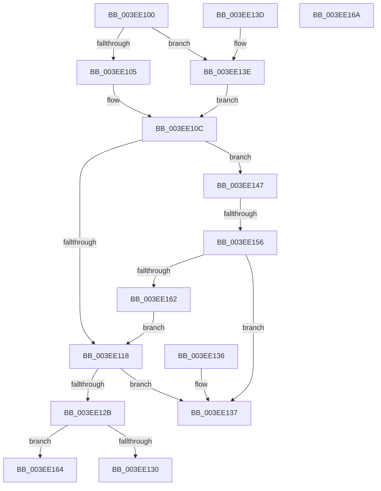

# PsGetPermanentSiloContext

- RVA: `0x003EE100`–`0x003EE16B` (길이 `107` bytes)
- VA: `0x00000001403EE100`
- 실행 섹션: `.text`
- PDB 이름 있음: `예`; PDB Function 태그: `예`
- unwind 정보 RVA: `0x000DB714`
- 디코드: `33`개 명령, `107/107` bytes 표시
- 미해석 바이트: `0` (있으면 어셈블리에 `.byte`로 보존)

> 이 문서는 커널 이미지의 기계어와 PDB 기호를 분석해 생성했습니다. 4번과 5번은 함수 원형과 자료형을 바이너리 사용 방식에서 추정한 C 해석이며 원본 소스 복구 결과는 아닙니다.

## 1. Dependencies

- 직접 호출 지점: **0**; 고유 호출 대상: **0**
- 직접 호출자로 확인된 함수: **11**
- RIP 상대 이미지 참조: **1**

### Outgoing calls
- 직접 디코드된 call 명령이 없습니다.

### Direct callers
- [ObInitServerSilo](../../page/74/ObInitServerSilo_function_0074D8FC.md) at `0x0074D97B`
- [VrpHandleIoctlCreateMultipleNamespaceNodes](../../page/83/VrpHandleIoctlCreateMultipleNamespaceNodes_function_0083B17C.md) at `0x0083B247`
- [VrpHandleIoctlModifyFlags](../../page/83/VrpHandleIoctlModifyFlags_function_0083B69C.md) at `0x0083B73E`
- [ObGetSiloRootDirectoryPath](../../page/83/ObGetSiloRootDirectoryPath_function_0083CD74.md) at `0x0083CDBE`
- [ObpLookupObjectName](../../page/89/ObpLookupObjectName_function_0089BE90.md) at `0x0089BFFF`
- [ObpLookupObjectName](../../page/89/ObpLookupObjectName_function_0089BE90.md) at `0x0089C10A`
- [ObpLookupObjectName](../../page/89/ObpLookupObjectName_function_0089BE90.md) at `0x0089CC46`
- [VRegEnabledInJob](../../page/93/VRegEnabledInJob_function_009350B0.md) at `0x009350F6`
- [VrpHandleIoctlCreateNamespaceNode](../../page/93/VrpHandleIoctlCreateNamespaceNode_function_0093511C.md) at `0x00935291`
- [VrpHandleIoctlLoadDifferencingHive](../../page/93/VrpHandleIoctlLoadDifferencingHive_function_00935C5C.md) at `0x00935E08`
- [VrpHandleIoctlUnloadDynamicallyLoadedHives](../../page/93/VrpHandleIoctlUnloadDynamicallyLoadedHives_function_0093778C.md) at `0x00937861`
- [CmpGetRegistryNamespaceRootForSilo](../../page/9D/CmpGetRegistryNamespaceRootForSilo_function_009D0470.md) at `0x009D0493`
- [CmpGetContextForSiloNoRef](../../page/9E/CmpGetContextForSiloNoRef_function_009E8020.md) at `0x009E8038`

### Static image references
- `0x003EE105` → RVA `0x00FCFE30` (`CACHEALI`; read)

## 2. Other-region calls and transfers

- 다른 실행 섹션으로 향하는 call: **0**
- call이 아닌 외부 분기/꼬리 이동: **1**
  - `0x003EE150` → `0x006EAE00` (`tail-transfer`)

## 3. Assembly (complete function range)

```asm
003EE100  48 85 C9                        test rcx, rcx
003EE103  75 39                           jne 0x1403ee13e
003EE105  48 8B 0D 24 1D BE 00            mov rcx, qword ptr [rip + 0xbe1d24]
003EE10C  49 C7 00 00 00 00 00            mov qword ptr [r8], 0
003EE113  83 FA 20                        cmp edx, 0x20
003EE116  73 2F                           jae 0x1403ee147
003EE118  8B C2                           mov eax, edx
003EE11A  48 03 C0                        add rax, rax
003EE11D  48 8B 54 C1 08                  mov rdx, qword ptr [rcx + rax*8 + 8]
003EE122  48 8B C2                        mov rax, rdx
003EE125  48 83 E0 FE                     and rax, 0xfffffffffffffffe
003EE129  74 0C                           je 0x1403ee137
003EE12B  F6 C2 01                        test dl, 1
003EE12E  74 34                           je 0x1403ee164
003EE130  49 89 00                        mov qword ptr [r8], rax
003EE133  33 C0                           xor eax, eax
003EE135  C3                              ret
003EE136  CC                              int3
003EE137  B8 25 02 00 C0                  mov eax, 0xc0000225
003EE13C  C3                              ret
003EE13D  CC                              int3
003EE13E  48 8B 89 00 06 00 00            mov rcx, qword ptr [rcx + 0x600]
003EE145  EB C5                           jmp 0x1403ee10c
003EE147  83 C2 E0                        add edx, -0x20
003EE14A  81 FA 00 01 00 00               cmp edx, 0x100
003EE150  0F 83 AA CC 2F 00               jae 0x1406eae00
003EE156  48 8B 89 00 02 00 00            mov rcx, qword ptr [rcx + 0x200]
003EE15D  48 85 C9                        test rcx, rcx
003EE160  74 D5                           je 0x1403ee137
003EE162  EB B4                           jmp 0x1403ee118
003EE164  B8 BB 00 00 C0                  mov eax, 0xc00000bb
003EE169  C3                              ret
003EE16A  CC                              int3
```

## 4. C-style interpretation (structured pseudocode)

```c
__int64 __fastcall PsGetPermanentSiloContext(__int64 a1, int a2, __int64 a3)
{
    __int64 result;

    if (a1 != 0) goto loc_003EE13E;
loc_003EE10C:
    *(unsigned __int64 *)(a3) = 0;
    if (a2 >= 32) goto loc_003EE147;
loc_003EE118:
    result = ((unsigned int)(a2)) + ((unsigned int)(a2));
    result = (*(unsigned __int64 *)(*(unsigned __int64 *)(v_rip + 12459300) + result * 8 + 8)) & (-2);
    if (condition_is_equal) goto loc_003EE137;
    if ((((unsigned __int8)(*(unsigned __int64 *)(*(unsigned __int64 *)(v_rip + 12459300) + result * 8 + 8))) & (1)) == 0) goto loc_003EE164;
    *(unsigned __int64 *)(a3) = result;
    result = 0;
    return result;
loc_003EE137:
    return (unsigned int)(0xC0000225ULL);
loc_003EE13E:
    goto loc_003EE10C;
loc_003EE147:
    a2 = (unsigned int)((*(unsigned __int64 *)(*(unsigned __int64 *)(v_rip + 12459300) + result * 8 + 8)) + (-32));
    if (*(unsigned __int64 *)(*(unsigned __int64 *)(*(unsigned __int64 *)(v_rip + 12459300) + 1536) + 512) == 0) goto loc_003EE137;
    goto loc_003EE118;
loc_003EE164:
    return (unsigned int)(0xC00000BBULL);
}
```

## 5. (Beta) C Style

```c
int64_t PsGetPermanentSiloContext(int64_t Arg1, int32_t Arg2, void *Arg3)
{
    uint8_t *arg3 = (uint8_t *)Arg3;

    int64_t result;

    if (Arg1 != 0) goto loc_003EE13E;
loc_003EE10C:
    *(uint64_t *)(arg3) = 0;
    if (Arg2 >= 32) goto loc_003EE147;
loc_003EE118:
    result = ((uint32_t)(Arg2)) + ((uint32_t)(Arg2));
    result = (*(uint64_t *)(*(uint64_t *)(v_rip + 0xBE1D24) + result * 8 + 0x8)) & (-2);
    if (condition_is_equal) goto loc_003EE137;
    if ((((uint8_t)(*(uint64_t *)(*(uint64_t *)(v_rip + 0xBE1D24) + result * 8 + 0x8))) & (1)) == 0) goto loc_003EE164;
    *(uint64_t *)(arg3) = result;
    result = 0;
    return result;
loc_003EE137:
    return (uint32_t)(0xC0000225ULL);
loc_003EE13E:
    goto loc_003EE10C;
loc_003EE147:
    Arg2 = (uint32_t)((*(uint64_t *)(*(uint64_t *)(v_rip + 0xBE1D24) + result * 8 + 0x8)) + (-32));
    if (*(uint64_t *)(*(uint64_t *)(*(uint64_t *)(v_rip + 0xBE1D24) + 0x600) + 0x200) == 0) goto loc_003EE137;
    goto loc_003EE118;
loc_003EE164:
    return (uint32_t)(0xC00000BBULL);
}
```

### 관측된 메모리 오프셋

구조체 형식이 확인되지 않은 접근은 인자 기준의 오프셋으로만 기록했습니다.

| 기준 인자 | 오프셋 표현 | 폭 (bit) | 접근 |
|---|---:|---:|---|
| `Arg3` | `+ 0x0` | `64` | `W` |

## 6. Execution-region graph

[열기: 2D/3D 그래프와 함수 탐색 컨트롤 패널](../../../control-panel.html?section=text&rva=0x003EE100&view=graph)

- 2D 그래프는 위에서 아래로 흐르고, 3D 그래프는 빈 공간을 드래그해 회전합니다. Shift+드래그는 이동, 휠은 확대·축소, 함수 노드 선택은 대상 보고서 이동입니다.

### Static fallback


