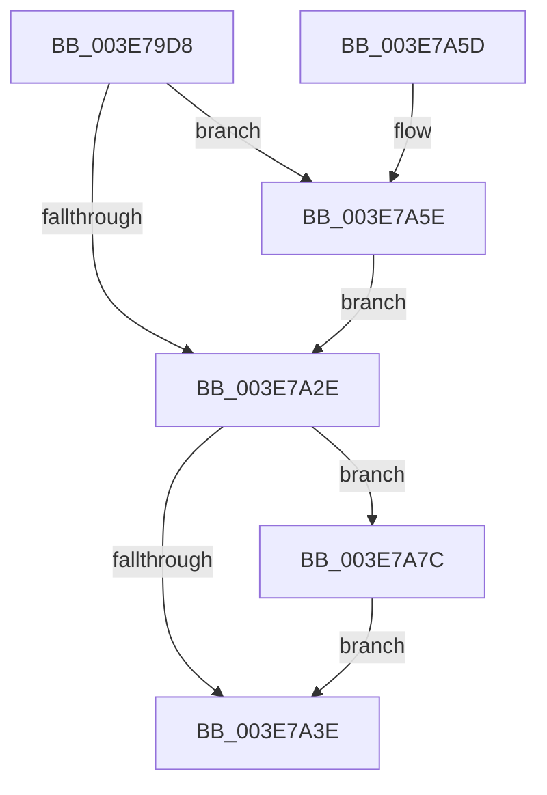

# PspIumFreePartitionPages

- RVA: `0x003E79D8`–`0x003E7A8F` (길이 `183` bytes)
- VA: `0x00000001403E79D8`
- 실행 섹션: `.text`
- PDB 이름 있음: `예`; PDB Function 태그: `아니요`
- unwind 정보 RVA: `0x000956F8`
- 디코드: `54`개 명령, `183/183` bytes 표시
- 미해석 바이트: `0` (있으면 어셈블리에 `.byte`로 보존)

> 이 문서는 커널 이미지의 기계어와 PDB 기호를 분석해 생성했습니다. 4번과 5번은 함수 원형과 자료형을 바이너리 사용 방식에서 추정한 C 해석이며 원본 소스 복구 결과는 아닙니다.

## 1. Dependencies

- 직접 호출 지점: **4**; 고유 호출 대상: **4**
- 직접 호출자로 확인된 함수: **1**
- RIP 상대 이미지 참조: **0**

### Outgoing calls
- `0x003E7A08` → [ExAcquireSpinLockExclusive](../24/ExAcquireSpinLockExclusive_function_00248690.md) (function, `0x00248690`)
- `0x003E7A35` → [ExReleaseSpinLockExclusive](../2C/ExReleaseSpinLockExclusive_function_002C0EF0.md) (function, `0x002C0EF0`)
- `0x003E7A6F` → [memcpy](../6C/memcpy_function_006C6840.md) (function, `0x006C6840`)
- `0x003E7A88` → [MmFreeNonChargedSecurePages](MmFreeNonChargedSecurePages_function_003E9218.md) (function, `0x003E9218`)

### Direct callers
- [PspIumFreePhysicalPages](PspIumFreePhysicalPages_function_003E7874.md) at `0x003E791A`
- [PspIumFreePhysicalPages](PspIumFreePhysicalPages_function_003E7874.md) at `0x003E7985`

### Static image references
- 디코드된 RIP-relative 메모리 참조가 없습니다.

## 2. Other-region calls and transfers

- 다른 실행 섹션으로 향하는 call: **0**
- 별도 외부 분기/꼬리 이동을 확인하지 못했습니다.

## 3. Assembly (complete function range)

```asm
003E79D8  48 8B C4                        mov rax, rsp
003E79DB  48 89 58 08                     mov qword ptr [rax + 8], rbx
003E79DF  48 89 68 10                     mov qword ptr [rax + 0x10], rbp
003E79E3  48 89 70 18                     mov qword ptr [rax + 0x18], rsi
003E79E7  48 89 78 20                     mov qword ptr [rax + 0x20], rdi
003E79EB  41 54                           push r12
003E79ED  41 56                           push r14
003E79EF  41 57                           push r15
003E79F1  48 83 EC 20                     sub rsp, 0x20
003E79F5  4C 8B A1 A0 00 00 00            mov r12, qword ptr [rcx + 0xa0]
003E79FC  48 8B F1                        mov rsi, rcx
003E79FF  48 83 C1 58                     add rcx, 0x58
003E7A03  4D 8B F0                        mov r14, r8
003E7A06  8B DA                           mov ebx, edx
003E7A08  E8 83 0C E6 FF                  call 0x140248690
003E7A0D  44 8B 4E 04                     mov r9d, dword ptr [rsi + 4]
003E7A11  44 8A F8                        mov r15b, al
003E7A14  8B 86 9C 00 00 00               mov eax, dword ptr [rsi + 0x9c]
003E7A1A  8B BE 98 00 00 00               mov edi, dword ptr [rsi + 0x98]
003E7A20  2B F8                           sub edi, eax
003E7A22  41 2B F9                        sub edi, r9d
003E7A25  3B FB                           cmp edi, ebx
003E7A27  0F 47 FB                        cmova edi, ebx
003E7A2A  85 FF                           test edi, edi
003E7A2C  75 30                           jne 0x1403e7a5e
003E7A2E  41 8A D7                        mov dl, r15b
003E7A31  48 8D 4E 58                     lea rcx, [rsi + 0x58]
003E7A35  E8 B6 94 ED FF                  call 0x1402c0ef0
003E7A3A  85 DB                           test ebx, ebx
003E7A3C  75 3E                           jne 0x1403e7a7c
003E7A3E  48 8B 5C 24 40                  mov rbx, qword ptr [rsp + 0x40]
003E7A43  48 8B 6C 24 48                  mov rbp, qword ptr [rsp + 0x48]
003E7A48  48 8B 74 24 50                  mov rsi, qword ptr [rsp + 0x50]
003E7A4D  48 8B 7C 24 58                  mov rdi, qword ptr [rsp + 0x58]
003E7A52  48 83 C4 20                     add rsp, 0x20
003E7A56  41 5F                           pop r15
003E7A58  41 5E                           pop r14
003E7A5A  41 5C                           pop r12
003E7A5C  C3                              ret
003E7A5D  CC                              int3
003E7A5E  2B DF                           sub ebx, edi
003E7A60  44 8B C7                        mov r8d, edi
003E7A63  49 C1 E0 03                     shl r8, 3
003E7A67  49 8D 0C C4                     lea rcx, [r12 + rax*8]
003E7A6B  49 8D 14 DE                     lea rdx, [r14 + rbx*8]
003E7A6F  E8 CC ED 2D 00                  call 0x1406c6840
003E7A74  01 BE 9C 00 00 00               add dword ptr [rsi + 0x9c], edi
003E7A7A  EB B2                           jmp 0x1403e7a2e
003E7A7C  48 8B 4E 08                     mov rcx, qword ptr [rsi + 8]
003E7A80  4D 8B CE                        mov r9, r14
003E7A83  44 8B C3                        mov r8d, ebx
003E7A86  33 D2                           xor edx, edx
003E7A88  E8 8B 17 00 00                  call 0x1403e9218
003E7A8D  EB AF                           jmp 0x1403e7a3e
```

## 4. C-style interpretation (structured pseudocode)

```c
__int64 __fastcall PspIumFreePartitionPages(__int64 a1, int a2, __int64 a3)
{
    __int64 result;
    __int64 v_rbx;
    __int64 v_rdi;
    __int64 v_rsp;
    unsigned __int64 v_stack_p10;
    unsigned __int64 v_stack_p18;
    unsigned __int64 v_stack_p20;
    unsigned __int64 v_stack_p8;

    *(unsigned __int64 *)(v_rsp + 8) = v_rbx;
    *(unsigned __int64 *)(v_rsp + 16) = v_rbp;
    *(unsigned __int64 *)(v_rsp + 24) = v_rsi;
    *(unsigned __int64 *)(v_rsp + 32) = v_rdi;
    v_rsp = (v_rsp) - (32);
    a1 = (a1) + (88);
    result = ExAcquireSpinLockExclusive(a1, a2, a3, a4);
    v_rdi = (unsigned int)(((unsigned int)(*(unsigned int *)(a1 + 152))) - ((unsigned int)((unsigned int)(*(unsigned int *)(a1 + 156)))));
    v_rdi = (unsigned int)((v_rdi) - ((unsigned int)((unsigned int)(*(unsigned int *)(a1 + 4)))));
    if (((unsigned int)(v_rdi)) > ((unsigned int)((unsigned int)(a2)))) { v_rdi = (unsigned int)((unsigned int)(a2)); }
    if ((unsigned int)(v_rdi) != 0) goto loc_003E7A5E;
loc_003E7A2E:
    result = ExReleaseSpinLockExclusive(a1 + 88, (unsigned __int8)((unsigned __int8)(result)), a3, (unsigned int)(*(unsigned int *)(a1 + 4)));
    if ((unsigned int)((unsigned int)(a2)) != 0) goto loc_003E7A7C;
loc_003E7A3E:
    v_rsp = (v_rsp) + (32);
    return result;
loc_003E7A5E:
    v_rbx = (unsigned int)((v_stack_p8) - ((unsigned int)(v_stack_p20)));
    a3 = ((unsigned int)((unsigned int)(v_stack_p20))) << (3);
    result = memcpy(*(unsigned __int64 *)(a1 + 160) + result * 8, a3 + v_rbx * 8, a3, (unsigned int)(*(unsigned int *)(a1 + 4)));
    goto loc_003E7A2E;
loc_003E7A7C:
    a2 = 0;
    result = MmFreeNonChargedSecurePages(*(unsigned __int64 *)(v_stack_p18 + 8), a2, (unsigned int)((unsigned int)(v_rbx)), a3);
    goto loc_003E7A3E;
}
```

## 5. (Beta) C Style

```c
int64_t PspIumFreePartitionPages(void *Arg1, int32_t Arg2, void *Arg3)
{
    uint8_t *arg1 = (uint8_t *)Arg1;
    uint8_t *arg3 = (uint8_t *)Arg3;

    int64_t result;
    int64_t local_rbx;
    int64_t local_rdi;
    int64_t local_rsp;
    uint64_t v_stack_p10;
    uint64_t v_stack_p18;
    uint64_t v_stack_p20;
    uint64_t v_stack_p8;

    *(uint64_t *)(local_rsp + 0x8) = local_rbx;
    *(uint64_t *)(local_rsp + 0x10) = local_rbp;
    *(uint64_t *)(local_rsp + 0x18) = local_rsi;
    *(uint64_t *)(local_rsp + 0x20) = local_rdi;
    local_rsp = (local_rsp) - (32);
    Arg1 = (Arg1) + (88);
    result = ExAcquireSpinLockExclusive(Arg1, Arg2, Arg3, a4);
    local_rdi = (uint32_t)(((uint32_t)(*(uint32_t *)(arg1 + 0x98))) - ((uint32_t)((uint32_t)(*(uint32_t *)(arg1 + 0x9C)))));
    local_rdi = (uint32_t)((local_rdi) - ((uint32_t)((uint32_t)(*(uint32_t *)(arg1 + 0x4)))));
    if (((uint32_t)(local_rdi)) > ((uint32_t)((uint32_t)(Arg2)))) { local_rdi = (uint32_t)((uint32_t)(Arg2)); }
    if ((uint32_t)(local_rdi) != 0) goto loc_003E7A5E;
loc_003E7A2E:
    result = ExReleaseSpinLockExclusive(Arg1 + 88, (uint8_t)((uint8_t)(result)), Arg3, (uint32_t)(*(uint32_t *)(arg1 + 0x4)));
    if ((uint32_t)((uint32_t)(Arg2)) != 0) goto loc_003E7A7C;
loc_003E7A3E:
    local_rsp = (local_rsp) + (32);
    return result;
loc_003E7A5E:
    local_rbx = (uint32_t)((v_stack_p8) - ((uint32_t)(v_stack_p20)));
    Arg3 = ((uint32_t)((uint32_t)(v_stack_p20))) << (3);
    result = memcpy(*(uint64_t *)(arg1 + 0xA0) + result * 8, Arg3 + local_rbx * 8, Arg3, (uint32_t)(*(uint32_t *)(arg1 + 0x4)));
    goto loc_003E7A2E;
loc_003E7A7C:
    Arg2 = 0;
    result = MmFreeNonChargedSecurePages(*(uint64_t *)(v_stack_p18 + 0x8), Arg2, (uint32_t)((uint32_t)(local_rbx)), Arg3);
    goto loc_003E7A3E;
}
```

### 관측된 메모리 오프셋

구조체 형식이 확인되지 않은 접근은 인자 기준의 오프셋으로만 기록했습니다.

| 기준 인자 | 오프셋 표현 | 폭 (bit) | 접근 |
|---|---:|---:|---|
| `Arg1` | `+ 0x4` | `32` | `R` |
| `Arg1` | `+ 0x8` | `64` | `R` |
| `Arg1` | `+ 0x58` | `64` | `R` |
| `Arg1` | `+ 0x98` | `32` | `R` |
| `Arg1` | `+ 0x9C` | `32` | `R` |
| `Arg1` | `+ 0x9C` | `32` | `R/W` |
| `Arg1` | `+ 0xA0` | `64` | `R` |
| `Arg3` | `+ 0x0 + rbx*8` | `64` | `R` |

## 6. Execution-region graph

[열기: 2D/3D 그래프와 함수 탐색 컨트롤 패널](../../../control-panel.html?section=text&rva=0x003E79D8&view=graph)

- 2D 그래프는 위에서 아래로 흐르고, 3D 그래프는 빈 공간을 드래그해 회전합니다. Shift+드래그는 이동, 휠은 확대·축소, 함수 노드 선택은 대상 보고서 이동입니다.

### Static fallback


