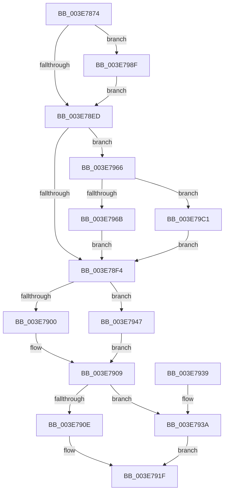

# PspIumFreePhysicalPages

- RVA: `0x003E7874`–`0x003E79D1` (길이 `349` bytes)
- VA: `0x00000001403E7874`
- 실행 섹션: `.text`
- PDB 이름 있음: `예`; PDB Function 태그: `아니요`
- unwind 정보 RVA: `0x0008A188`
- 디코드: `89`개 명령, `349/349` bytes 표시
- 미해석 바이트: `0` (있으면 어셈블리에 `.byte`로 보존)

> 이 문서는 커널 이미지의 기계어와 PDB 기호를 분석해 생성했습니다. 4번과 5번은 함수 원형과 자료형을 바이너리 사용 방식에서 추정한 C 해석이며 원본 소스 복구 결과는 아닙니다.

## 1. Dependencies

- 직접 호출 지점: **10**; 고유 호출 대상: **8**
- 직접 호출자로 확인된 함수: **1**
- RIP 상대 이미지 참조: **2**

### Outgoing calls
- `0x003E78DC` → [MmMapLockedPagesSpecifyCache](../31/MmMapLockedPagesSpecifyCache_function_00318800.md) (function, `0x00318800`)
- `0x003E7904` → [MmUnmapLockedPages](../24/MmUnmapLockedPages_function_00246E60.md) (function, `0x00246E60`)
- `0x003E791A` → [PspIumFreePartitionPages](PspIumFreePartitionPages_function_003E79D8.md) (function, `0x003E79D8`)
- `0x003E7940` → [MmFreeSecureKernelPages](MmFreeSecureKernelPages_function_003E7A98.md) (function, `0x003E7A98`)
- `0x003E7950` → [MmUnmapReservedMapping](MmUnmapReservedMapping_function_003E7BE0.md) (function, `0x003E7BE0`)
- `0x003E795F` → [KeReleaseSpinLock](../39/KeReleaseSpinLock_function_00392BA0.md) (function, `0x00392BA0`)
- `0x003E7985` → [PspIumFreePartitionPages](PspIumFreePartitionPages_function_003E79D8.md) (function, `0x003E79D8`)
- `0x003E7996` → [KeAcquireSpinLockRaiseToDpc](../20/KeAcquireSpinLockRaiseToDpc_function_00208470.md) (function, `0x00208470`)
- `0x003E79B4` → [MmMapLockedPagesWithReservedMapping](MmMapLockedPagesWithReservedMapping_function_003E8910.md) (function, `0x003E8910`)
- `0x003E79C7` → [MmFreeSecureKernelPages](MmFreeSecureKernelPages_function_003E7A98.md) (function, `0x003E7A98`)

### Direct callers
- [PsDispatchIumService](../4A/PsDispatchIumService_function_004A2F0C.md) at `0x004A3182`

### Static image references
- `0x003E78F4` → RVA `0x00FC7018` (`ALMOSTRO`; read)
- `0x003E7958` → RVA `0x00F05F00` (`.data`; read)

## 2. Other-region calls and transfers

- 다른 실행 섹션으로 향하는 call: **0**
- 별도 외부 분기/꼬리 이동을 확인하지 못했습니다.

## 3. Assembly (complete function range)

```asm
003E7874  48 8B C4                        mov rax, rsp
003E7877  48 89 58 08                     mov qword ptr [rax + 8], rbx
003E787B  48 89 70 10                     mov qword ptr [rax + 0x10], rsi
003E787F  48 89 78 18                     mov qword ptr [rax + 0x18], rdi
003E7883  4C 89 70 20                     mov qword ptr [rax + 0x20], r14
003E7887  55                              push rbp
003E7888  48 8B EC                        mov rbp, rsp
003E788B  48 83 EC 70                     sub rsp, 0x70
003E788F  83 65 DC 00                     and dword ptr [rbp - 0x24], 0
003E7893  45 33 C9                        xor r9d, r9d
003E7896  48 83 65 C0 00                  and qword ptr [rbp - 0x40], 0
003E789B  44 8B F2                        mov r14d, edx
003E789E  48 83 65 E0 00                  and qword ptr [rbp - 0x20], 0
003E78A3  48 8B F9                        mov rdi, rcx
003E78A6  83 65 EC 00                     and dword ptr [rbp - 0x14], 0
003E78AA  48 8D 4D C0                     lea rcx, [rbp - 0x40]
003E78AE  0F 57 C0                        xorps xmm0, xmm0
003E78B1  4C 89 45 F0                     mov qword ptr [rbp - 0x10], r8
003E78B5  C7 40 B0 20 00 00 40            mov dword ptr [rax - 0x50], 0x40000020
003E78BC  45 8D 41 01                     lea r8d, [r9 + 1]
003E78C0  83 60 A8 00                     and dword ptr [rax - 0x58], 0
003E78C4  33 D2                           xor edx, edx
003E78C6  F3 0F 7F 45 CC                  movdqu xmmword ptr [rbp - 0x34], xmm0
003E78CB  40 32 F6                        xor sil, sil
003E78CE  C7 45 C8 38 00 02 00            mov dword ptr [rbp - 0x38], 0x20038
003E78D5  C7 45 E8 00 10 00 00            mov dword ptr [rbp - 0x18], 0x1000
003E78DC  E8 1F 0F F3 FF                  call 0x140318800
003E78E1  48 8B D8                        mov rbx, rax
003E78E4  48 85 C0                        test rax, rax
003E78E7  0F 84 A2 00 00 00               je 0x1403e798f
003E78ED  8B 4B 28                        mov ecx, dword ptr [rbx + 0x28]
003E78F0  85 C9                           test ecx, ecx
003E78F2  75 72                           jne 0x1403e7966
003E78F4  48 3B 1D 1D F7 BD 00            cmp rbx, qword ptr [rip + 0xbdf71d]
003E78FB  48 8B CB                        mov rcx, rbx
003E78FE  74 47                           je 0x1403e7947
003E7900  48 8D 55 C0                     lea rdx, [rbp - 0x40]
003E7904  E8 57 F5 E5 FF                  call 0x140246e60
003E7909  48 85 FF                        test rdi, rdi
003E790C  74 2C                           je 0x1403e793a
003E790E  4C 8D 45 F0                     lea r8, [rbp - 0x10]
003E7912  BA 01 00 00 00                  mov edx, 1
003E7917  48 8B CF                        mov rcx, rdi
003E791A  E8 B9 00 00 00                  call 0x1403e79d8
003E791F  4C 8D 5C 24 70                  lea r11, [rsp + 0x70]
003E7924  49 8B 5B 10                     mov rbx, qword ptr [r11 + 0x10]
003E7928  49 8B 73 18                     mov rsi, qword ptr [r11 + 0x18]
003E792C  49 8B 7B 20                     mov rdi, qword ptr [r11 + 0x20]
003E7930  4D 8B 73 28                     mov r14, qword ptr [r11 + 0x28]
003E7934  49 8B E3                        mov rsp, r11
003E7937  5D                              pop rbp
003E7938  C3                              ret
003E7939  CC                              int3
003E793A  33 D2                           xor edx, edx
003E793C  48 8D 4D C0                     lea rcx, [rbp - 0x40]
003E7940  E8 53 01 00 00                  call 0x1403e7a98
003E7945  EB D8                           jmp 0x1403e791f
003E7947  4C 8D 45 C0                     lea r8, [rbp - 0x40]
003E794B  BA 56 73 6D 46                  mov edx, 0x466d7356
003E7950  E8 8B 02 00 00                  call 0x1403e7be0
003E7955  40 8A D6                        mov dl, sil
003E7958  48 8D 0D A1 E5 B1 00            lea rcx, [rip + 0xb1e5a1]
003E795F  E8 3C B2 FA FF                  call 0x140392ba0
003E7964  EB A3                           jmp 0x1403e7909
003E7966  48 85 FF                        test rdi, rdi
003E7969  74 56                           je 0x1403e79c1
003E796B  F7 C1 FF 0F 00 00               test ecx, 0xfff
003E7971  4C 8D 43 30                     lea r8, [rbx + 0x30]
003E7975  BA 00 00 00 00                  mov edx, 0
003E797A  0F 95 C2                        setne dl
003E797D  C1 E9 0C                        shr ecx, 0xc
003E7980  03 D1                           add edx, ecx
003E7982  48 8B CF                        mov rcx, rdi
003E7985  E8 4E 00 00 00                  call 0x1403e79d8
003E798A  E9 65 FF FF FF                  jmp 0x1403e78f4
003E798F  48 8D 0D 6A E5 B1 00            lea rcx, [rip + 0xb1e56a]
003E7996  E8 D5 0A E2 FF                  call 0x140208470
003E799B  48 8B 0D 76 F6 BD 00            mov rcx, qword ptr [rip + 0xbdf676]
003E79A2  4C 8D 45 C0                     lea r8, [rbp - 0x40]
003E79A6  41 B9 01 00 00 00               mov r9d, 1
003E79AC  BA 56 73 6D 46                  mov edx, 0x466d7356
003E79B1  40 8A F0                        mov sil, al
003E79B4  E8 57 0F 00 00                  call 0x1403e8910
003E79B9  48 8B D8                        mov rbx, rax
003E79BC  E9 2C FF FF FF                  jmp 0x1403e78ed
003E79C1  41 8B D6                        mov edx, r14d
003E79C4  48 8B CB                        mov rcx, rbx
003E79C7  E8 CC 00 00 00                  call 0x1403e7a98
003E79CC  E9 23 FF FF FF                  jmp 0x1403e78f4
```

## 4. C-style interpretation (structured pseudocode)

```c
__int64 __fastcall PspIumFreePhysicalPages(__int64 a1, int a2, __int64 a3, int a4)
{
    __int64 result;
    __int64 v_rsi;
    __int64 v_rsp;
    unsigned __int64 v_stack_m18;
    unsigned int v_stack_m1C;
    unsigned int v_stack_m20;
    unsigned __int64 v_stack_m28;
    unsigned int v_stack_m2C;
    unsigned __int64 v_stack_m3C;
    unsigned int v_stack_m40;
    unsigned __int64 v_stack_m48;
    unsigned __int64 v_stack_m8;

    *(unsigned __int64 *)(v_rsp + 8) = v_rbx;
    *(unsigned __int64 *)(v_rsp + 16) = v_rsi;
    *(unsigned __int64 *)(v_rsp + 24) = v_rdi;
    *(unsigned __int64 *)(v_rsp + 32) = v_r14;
    v_rsp = (v_rsp) - (112);
    a4 = 0;
    v_stack_m18 = a3;
    *(unsigned int *)(v_rsp - 80) = 0x40000020ULL;
    a2 = 0;
    v_stack_m3C = v_xmm0;
    v_rsi = 0;
    v_stack_m40 = 0x20038ULL;
    v_stack_m20 = 0x1000ULL;
    result = MmMapLockedPagesSpecifyCache(v_stack_m48, a2, a4 + 1, a4);
    if (result == 0) goto loc_003E798F;
loc_003E78ED:
    if ((unsigned int)((unsigned int)(*(unsigned int *)(result + 40))) != 0) goto loc_003E7966;
loc_003E78F4:
    if (result == (*(unsigned __int64 *)(v_rip + 12449565))) goto loc_003E7947;
    result = MmUnmapLockedPages(result, v_stack_m48, a4 + 1, a4);
loc_003E7909:
    if (a1 == 0) goto loc_003E793A;
    result = PspIumFreePartitionPages(a1, 1, v_stack_m18, a4);
loc_003E791F:
    return result;
loc_003E793A:
    a2 = 0;
    result = MmFreeSecureKernelPages(v_stack_m48, a2, v_stack_m18, a4);
    goto loc_003E791F;
loc_003E7947:
    result = MmUnmapReservedMapping(v_stack_m48, (unsigned int)(0x466D7356ULL), v_stack_m48, a4);
    result = KeReleaseSpinLock(v_rip + 11658657, (unsigned __int8)(*(unsigned __int64 *)(v_stack_m8 + 24)), v_stack_m48, a4);
    goto loc_003E7909;
loc_003E7966:
    if (*(unsigned __int64 *)(v_stack_m8 + 32) == 0) goto loc_003E79C1;
    a2 = ((((unsigned int)(v_rip + 11658657)) & (0xFFFULL)) != 0) ? 1 : 0;
    a1 = (unsigned int)((v_rip + 11658657) >> (12));
    a2 = (unsigned int)((a2) + ((unsigned int)(a1)));
    result = PspIumFreePartitionPages(*(unsigned __int64 *)(v_stack_m8 + 32), a2, *(unsigned __int64 *)(v_stack_m8 + 16) + 48, a4);
    goto loc_003E78F4;
loc_003E798F:
    result = KeAcquireSpinLockRaiseToDpc(v_rip + 11658602, a2, *(unsigned __int64 *)(v_stack_m8 + 16) + 48, a4);
    result = MmMapLockedPagesWithReservedMapping(*(unsigned __int64 *)(v_rip + 12449398), (unsigned int)(0x466D7356ULL), v_stack_m48, 1);
    goto loc_003E78ED;
loc_003E79C1:
    result = MmFreeSecureKernelPages(result, (unsigned int)((unsigned int)(*(unsigned __int64 *)(v_stack_m8 + 40))), v_stack_m48, 1);
    goto loc_003E78F4;
}
```

## 5. (Beta) C Style

```c
int64_t PspIumFreePhysicalPages(int64_t Arg1, int32_t Arg2, int64_t Arg3, int32_t Arg4)
{
    int64_t result;
    int64_t local_rsi;
    int64_t local_rsp;
    uint64_t v_stack_m18;
    uint32_t v_stack_m1C;
    uint32_t v_stack_m20;
    uint64_t v_stack_m28;
    uint32_t v_stack_m2C;
    uint64_t v_stack_m3C;
    uint32_t v_stack_m40;
    uint64_t v_stack_m48;
    uint64_t v_stack_m8;

    *(uint64_t *)(local_rsp + 0x8) = local_rbx;
    *(uint64_t *)(local_rsp + 0x10) = local_rsi;
    *(uint64_t *)(local_rsp + 0x18) = local_rdi;
    *(uint64_t *)(local_rsp + 0x20) = local_r14;
    local_rsp = (local_rsp) - (112);
    Arg4 = 0;
    v_stack_m18 = Arg3;
    *(uint32_t *)(local_rsp - 0x50) = 0x40000020ULL;
    Arg2 = 0;
    v_stack_m3C = v_xmm0;
    local_rsi = 0;
    v_stack_m40 = 0x20038ULL;
    v_stack_m20 = 0x1000ULL;
    result = MmMapLockedPagesSpecifyCache(v_stack_m48, Arg2, Arg4 + 1, Arg4);
    if (result == 0) goto loc_003E798F;
loc_003E78ED:
    if ((uint32_t)((uint32_t)(*(uint32_t *)(result + 0x28))) != 0) goto loc_003E7966;
loc_003E78F4:
    if (result == (*(uint64_t *)(v_rip + 0xBDF71D))) goto loc_003E7947;
    result = MmUnmapLockedPages(result, v_stack_m48, Arg4 + 1, Arg4);
loc_003E7909:
    if (Arg1 == 0) goto loc_003E793A;
    result = PspIumFreePartitionPages(Arg1, 1, v_stack_m18, Arg4);
loc_003E791F:
    return result;
loc_003E793A:
    Arg2 = 0;
    result = MmFreeSecureKernelPages(v_stack_m48, Arg2, v_stack_m18, Arg4);
    goto loc_003E791F;
loc_003E7947:
    result = MmUnmapReservedMapping(v_stack_m48, (uint32_t)(0x466D7356ULL), v_stack_m48, Arg4);
    result = KeReleaseSpinLock(v_rip + 11658657, (uint8_t)(*(uint64_t *)(v_stack_m8 + 0x18)), v_stack_m48, Arg4);
    goto loc_003E7909;
loc_003E7966:
    if (*(uint64_t *)(v_stack_m8 + 0x20) == 0) goto loc_003E79C1;
    Arg2 = ((((uint32_t)(v_rip + 11658657)) & (0xFFFULL)) != 0) ? 1 : 0;
    Arg1 = (uint32_t)((v_rip + 11658657) >> (12));
    Arg2 = (uint32_t)((Arg2) + ((uint32_t)(Arg1)));
    result = PspIumFreePartitionPages(*(uint64_t *)(v_stack_m8 + 0x20), Arg2, *(uint64_t *)(v_stack_m8 + 0x10) + 48, Arg4);
    goto loc_003E78F4;
loc_003E798F:
    result = KeAcquireSpinLockRaiseToDpc(v_rip + 11658602, Arg2, *(uint64_t *)(v_stack_m8 + 0x10) + 48, Arg4);
    result = MmMapLockedPagesWithReservedMapping(*(uint64_t *)(v_rip + 0xBDF676), (uint32_t)(0x466D7356ULL), v_stack_m48, 1);
    goto loc_003E78ED;
loc_003E79C1:
    result = MmFreeSecureKernelPages(result, (uint32_t)((uint32_t)(*(uint64_t *)(v_stack_m8 + 0x28))), v_stack_m48, 1);
    goto loc_003E78F4;
}
```

## 6. Execution-region graph

[열기: 2D/3D 그래프와 함수 탐색 컨트롤 패널](../../../control-panel.html?section=text&rva=0x003E7874&view=graph)

- 2D 그래프는 위에서 아래로 흐르고, 3D 그래프는 빈 공간을 드래그해 회전합니다. Shift+드래그는 이동, 휠은 확대·축소, 함수 노드 선택은 대상 보고서 이동입니다.

### Static fallback


