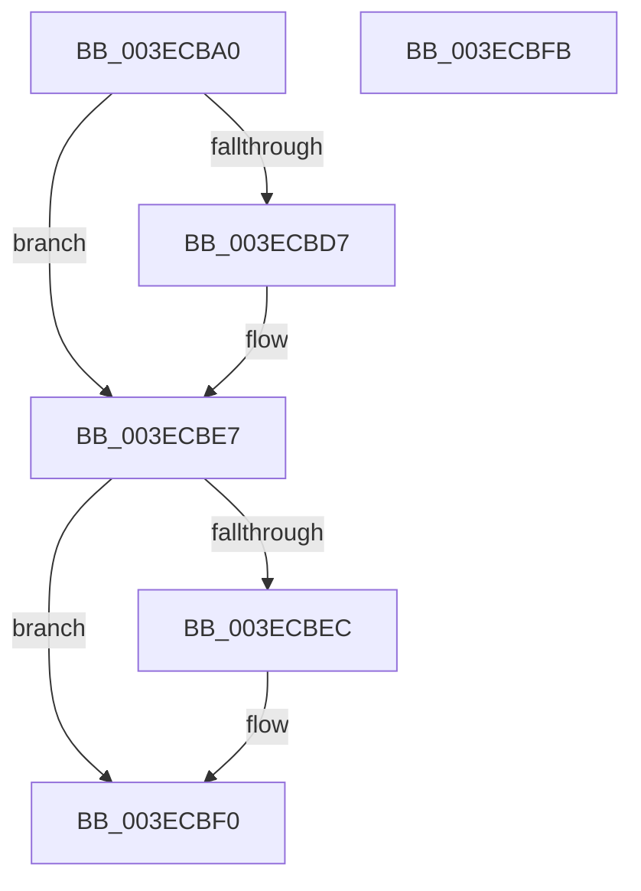

# PspLockProcessThreadListShared

- RVA: `0x003ECBA0`–`0x003ECBFC` (길이 `92` bytes)
- VA: `0x00000001403ECBA0`
- 실행 섹션: `.text`
- PDB 이름 있음: `예`; PDB Function 태그: `아니요`
- unwind 정보 RVA: `0x00068D5C`
- 디코드: `28`개 명령, `92/92` bytes 표시
- 미해석 바이트: `0` (있으면 어셈블리에 `.byte`로 보존)

> 이 문서는 커널 이미지의 기계어와 PDB 기호를 분석해 생성했습니다. 4번과 5번은 함수 원형과 자료형을 바이너리 사용 방식에서 추정한 C 해석이며 원본 소스 복구 결과는 아닙니다.

## 1. Dependencies

- 직접 호출 지점: **2**; 고유 호출 대상: **2**
- 직접 호출자로 확인된 함수: **5**
- RIP 상대 이미지 참조: **0**

### Outgoing calls
- `0x003ECBC1` → [KeAbPreAcquire](../21/KeAbPreAcquire_function_00210230.md) (function, `0x00210230`)
- `0x003ECBE2` → [ExfAcquirePushLockSharedEx](../21/ExfAcquirePushLockSharedEx_function_0021044C.md) (function, `0x0021044C`)

### Direct callers
- [PspNotifyProcessEffectiveIoLimitChanged](PspNotifyProcessEffectiveIoLimitChanged_function_003EC9C0.md) at `0x003EC9F9`
- [PsUpdateSvmProcessPasidAllThreads](../../page/78/PsUpdateSvmProcessPasidAllThreads_function_00781404.md) at `0x00781433`
- [PspEnableProcessOptionalXStateFeatures](../../page/78/PspEnableProcessOptionalXStateFeatures_function_00781EF0.md) at `0x00781FB3`
- [PsQueryProcessEnergyValues](../../page/91/PsQueryProcessEnergyValues_function_0091A4E0.md) at `0x0091A6CC`
- [PsQueryTotalCycleTimeProcess](../../page/A2/PsQueryTotalCycleTimeProcess_function_00A26840.md) at `0x00A26876`

### Static image references
- 디코드된 RIP-relative 메모리 참조가 없습니다.

## 2. Other-region calls and transfers

- 다른 실행 섹션으로 향하는 call: **0**
- 별도 외부 분기/꼬리 이동을 확인하지 못했습니다.

## 3. Assembly (complete function range)

```asm
003ECBA0  48 89 5C 24 10                  mov qword ptr [rsp + 0x10], rbx
003ECBA5  57                              push rdi
003ECBA6  48 83 EC 20                     sub rsp, 0x20
003ECBAA  66 FF 8A E4 01 00 00            dec word ptr [rdx + 0x1e4]
003ECBB1  48 8D B9 E0 05 00 00            lea rdi, [rcx + 0x5e0]
003ECBB8  48 8B CF                        mov rcx, rdi
003ECBBB  45 33 C0                        xor r8d, r8d
003ECBBE  33 D2                           xor edx, edx
003ECBC0  90                              nop
003ECBC1  E8 6A 36 E2 FF                  call 0x140210230
003ECBC6  48 8B D8                        mov rbx, rax
003ECBC9  B9 11 00 00 00                  mov ecx, 0x11
003ECBCE  33 C0                           xor eax, eax
003ECBD0  F0 48 0F B1 0F                  lock cmpxchg qword ptr [rdi], rcx
003ECBD5  74 10                           je 0x1403ecbe7
003ECBD7  4C 8B CF                        mov r9, rdi
003ECBDA  4C 8B C3                        mov r8, rbx
003ECBDD  33 D2                           xor edx, edx
003ECBDF  48 8B CF                        mov rcx, rdi
003ECBE2  E8 65 38 E2 FF                  call 0x14021044c
003ECBE7  48 85 DB                        test rbx, rbx
003ECBEA  74 04                           je 0x1403ecbf0
003ECBEC  C6 43 0A 01                     mov byte ptr [rbx + 0xa], 1
003ECBF0  48 8B 5C 24 38                  mov rbx, qword ptr [rsp + 0x38]
003ECBF5  48 83 C4 20                     add rsp, 0x20
003ECBF9  5F                              pop rdi
003ECBFA  C3                              ret
003ECBFB  CC                              int3
```

## 4. C-style interpretation (structured pseudocode)

```c
__int64 __fastcall PspLockProcessThreadListShared(__int64 a1, __int64 a2, int a3)
{
    __int64 result;
    __int64 v_rsp;
    unsigned __int64 v_stack_p10;

    v_stack_p10 = v_rbx;
    v_rsp = (v_rsp) - (32);
    a3 = 0;
    a2 = 0;
    result = KeAbPreAcquire(a1 + 1504, a2, a3, a4);
    result = 0;
    if (!(condition_is_equal)) {
        a4 = a1 + 1504;
        a3 = 0;
        a2 = 0;
        a1 = a1 + 1504;
        result = ExfAcquirePushLockSharedEx(a1, a2, a3, a4);
    }
    if (result != 0) {
        *(unsigned __int8 *)(result + 10) = 1;
    }
    v_rsp = (v_rsp) + (32);
    return result;
}
```

## 5. (Beta) C Style

```c
int64_t PspLockProcessThreadListShared(void *Arg1, void *Arg2, int32_t Arg3)
{
    uint8_t *arg1 = (uint8_t *)Arg1;
    uint8_t *arg2 = (uint8_t *)Arg2;

    int64_t result;
    int64_t local_rsp;
    uint64_t v_stack_p10;

    v_stack_p10 = local_rbx;
    local_rsp = (local_rsp) - (32);
    Arg3 = 0;
    Arg2 = 0;
    result = KeAbPreAcquire(Arg1 + 1504, Arg2, Arg3, a4);
    result = 0;
    if (!(condition_is_equal)) {
        a4 = Arg1 + 1504;
        Arg3 = 0;
        Arg2 = 0;
        Arg1 = Arg1 + 1504;
        result = ExfAcquirePushLockSharedEx(Arg1, Arg2, Arg3, a4);
    }
    if (result != 0) {
        *(uint8_t *)(result + 0xA) = 1;
    }
    local_rsp = (local_rsp) + (32);
    return result;
}
```

### 관측된 메모리 오프셋

구조체 형식이 확인되지 않은 접근은 인자 기준의 오프셋으로만 기록했습니다.

| 기준 인자 | 오프셋 표현 | 폭 (bit) | 접근 |
|---|---:|---:|---|
| `Arg1` | `+ 0x0` | `64` | `R` |
| `Arg1` | `+ 0x5E0` | `64` | `R` |
| `Arg2` | `+ 0x1E4` | `16` | `R/W` |

## 6. Execution-region graph

[열기: 2D/3D 그래프와 함수 탐색 컨트롤 패널](../../../control-panel.html?section=text&rva=0x003ECBA0&view=graph)

- 2D 그래프는 위에서 아래로 흐르고, 3D 그래프는 빈 공간을 드래그해 회전합니다. Shift+드래그는 이동, 휠은 확대·축소, 함수 노드 선택은 대상 보고서 이동입니다.

### Static fallback


