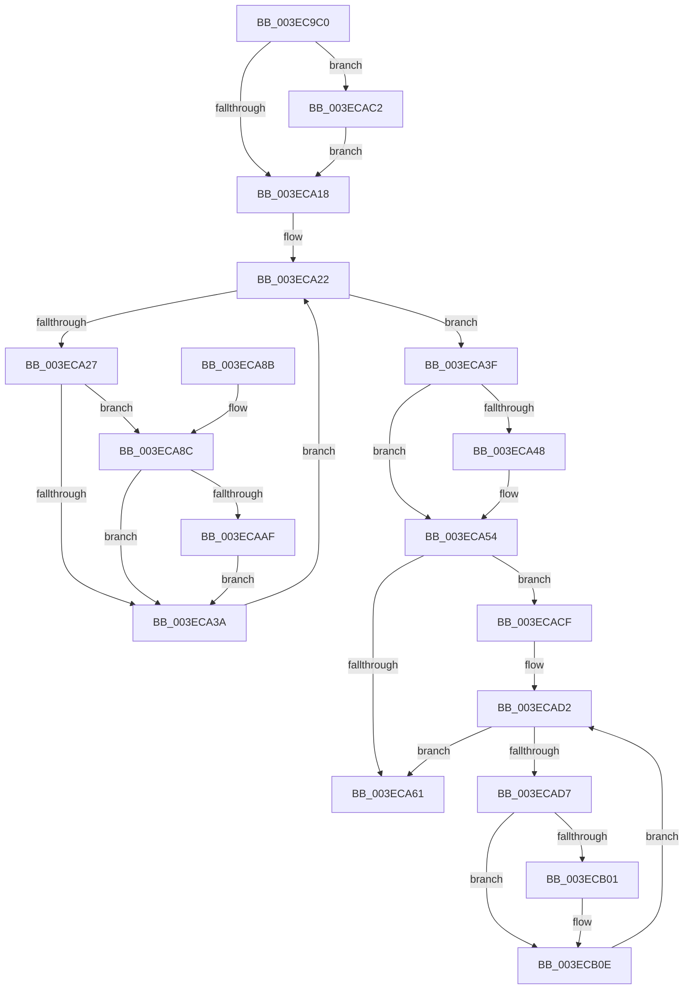

# PspNotifyProcessEffectiveIoLimitChanged

- RVA: `0x003EC9C0`–`0x003ECB13` (길이 `339` bytes)
- VA: `0x00000001403EC9C0`
- 실행 섹션: `.text`
- PDB 이름 있음: `예`; PDB Function 태그: `아니요`
- unwind 정보 RVA: `0x0006F0AC`
- 디코드: `90`개 명령, `339/339` bytes 표시
- 미해석 바이트: `0` (있으면 어셈블리에 `.byte`로 보존)

> 이 문서는 커널 이미지의 기계어와 PDB 기호를 분석해 생성했습니다. 4번과 5번은 함수 원형과 자료형을 바이너리 사용 방식에서 추정한 C 해석이며 원본 소스 복구 결과는 아닙니다.

## 1. Dependencies

- 직접 호출 지점: **9**; 고유 호출 대상: **8**
- 직접 호출자로 확인된 함수: **2**
- RIP 상대 이미지 참조: **1**

### Outgoing calls
- `0x003EC9F9` → [PspLockProcessThreadListShared](PspLockProcessThreadListShared_function_003ECBA0.md) (function, `0x003ECBA0`)
- `0x003ECA31` → [KeAbThreadAreAllEntriesFree](KeAbThreadAreAllEntriesFree_function_003ECB20.md) (function, `0x003ECB20`)
- `0x003ECA4F` → [KiLowerIrqlProcessIrqlFlags](../4F/KiLowerIrqlProcessIrqlFlags_function_004F5698.md) (function, `0x004F5698`)
- `0x003ECA67` → [PspUnlockProcessThreadListShared](PspUnlockProcessThreadListShared_function_003ECC10.md) (function, `0x003ECC10`)
- `0x003ECAA5` → [PsGetIoPriorityThread](../34/PsGetIoPriorityThread_function_00343930.md) (function, `0x00343930`)
- `0x003ECAB8` → [KeAbProcessBaseIoPriorityChange](../3C/KeAbProcessBaseIoPriorityChange_function_003C3E4C.md) (function, `0x003C3E4C`)
- `0x003ECAC5` → [KiRaiseIrqlProcessIrqlFlags](../4F/KiRaiseIrqlProcessIrqlFlags_function_004F56FC.md) (function, `0x004F56FC`)
- `0x003ECAF7` → [PsGetIoPriorityThread](../34/PsGetIoPriorityThread_function_00343930.md) (function, `0x00343930`)
- `0x003ECB09` → [IoBoostThreadIoPriority](../21/IoBoostThreadIoPriority_function_00216110.md) (function, `0x00216110`)

### Direct callers
- [PspApplyJobChainLimitsToProcess](../../page/87/PspApplyJobChainLimitsToProcess_function_0087EB5C.md) at `0x0087EC11`
- [PspSetProcessIoPriorityLimitCallback](../../page/A7/PspSetProcessIoPriorityLimitCallback_function_00A7E330.md) at `0x00A7E35B`

### Static image references
- `0x003ECA0B` → RVA `0x00FC6D20` (`ALMOSTRO`; read)

## 2. Other-region calls and transfers

- 다른 실행 섹션으로 향하는 call: **0**
- 별도 외부 분기/꼬리 이동을 확인하지 못했습니다.

## 3. Assembly (complete function range)

```asm
003EC9C0  48 8B C4                        mov rax, rsp
003EC9C3  48 89 58 08                     mov qword ptr [rax + 8], rbx
003EC9C7  48 89 68 10                     mov qword ptr [rax + 0x10], rbp
003EC9CB  48 89 70 18                     mov qword ptr [rax + 0x18], rsi
003EC9CF  48 89 78 20                     mov qword ptr [rax + 0x20], rdi
003EC9D3  41 54                           push r12
003EC9D5  41 56                           push r14
003EC9D7  41 57                           push r15
003EC9D9  48 83 EC 20                     sub rsp, 0x20
003EC9DD  48 8B 81 A0 02 00 00            mov rax, qword ptr [rcx + 0x2a0]
003EC9E4  44 8B FA                        mov r15d, edx
003EC9E7  65 4C 8B 34 25 88 01 00 00      mov r14, qword ptr gs:[0x188]
003EC9F0  45 8A E0                        mov r12b, r8b
003EC9F3  49 8B D6                        mov rdx, r14
003EC9F6  48 8B F1                        mov rsi, rcx
003EC9F9  E8 A2 01 00 00                  call 0x1403ecba0
003EC9FE  44 0F 20 C5                     mov rbp, cr8
003ECA02  BA 02 00 00 00                  mov edx, 2
003ECA07  44 0F 22 C2                     mov cr8, rdx
003ECA0B  83 3D 0E A3 BD 00 00            cmp dword ptr [rip + 0xbda30e], 0
003ECA12  0F 85 AA 00 00 00               jne 0x1403ecac2
003ECA18  48 8D BE 70 03 00 00            lea rdi, [rsi + 0x370]
003ECA1F  48 8B 1F                        mov rbx, qword ptr [rdi]
003ECA22  48 3B DF                        cmp rbx, rdi
003ECA25  74 18                           je 0x1403eca3f
003ECA27  4C 8D 9B 88 FA FF FF            lea r11, [rbx - 0x578]
003ECA2E  49 8B CB                        mov rcx, r11
003ECA31  E8 EA 00 00 00                  call 0x1403ecb20
003ECA36  85 C0                           test eax, eax
003ECA38  74 52                           je 0x1403eca8c
003ECA3A  48 8B 1B                        mov rbx, qword ptr [rbx]
003ECA3D  EB E3                           jmp 0x1403eca22
003ECA3F  83 3D DA A2 BD 00 00            cmp dword ptr [rip + 0xbda2da], 0
003ECA46  74 0C                           je 0x1403eca54
003ECA48  44 0F 20 C1                     mov rcx, cr8
003ECA4C  40 8A D5                        mov dl, bpl
003ECA4F  E8 44 8C 10 00                  call 0x1404f5698
003ECA54  40 0F B6 C5                     movzx eax, bpl
003ECA58  44 0F 22 C0                     mov cr8, rax
003ECA5C  45 84 E4                        test r12b, r12b
003ECA5F  75 6E                           jne 0x1403ecacf
003ECA61  49 8B D6                        mov rdx, r14
003ECA64  48 8B CE                        mov rcx, rsi
003ECA67  E8 A4 01 00 00                  call 0x1403ecc10
003ECA6C  48 8B 5C 24 40                  mov rbx, qword ptr [rsp + 0x40]
003ECA71  48 8B 6C 24 48                  mov rbp, qword ptr [rsp + 0x48]
003ECA76  48 8B 74 24 50                  mov rsi, qword ptr [rsp + 0x50]
003ECA7B  48 8B 7C 24 58                  mov rdi, qword ptr [rsp + 0x58]
003ECA80  48 83 C4 20                     add rsp, 0x20
003ECA84  41 5F                           pop r15
003ECA86  41 5E                           pop r14
003ECA88  41 5C                           pop r12
003ECA8A  C3                              ret
003ECA8B  CC                              int3
003ECA8C  45 8B 8B A0 05 00 00            mov r9d, dword ptr [r11 + 0x5a0]
003ECA93  49 8B CB                        mov rcx, r11
003ECA96  41 C1 E9 09                     shr r9d, 9
003ECA9A  41 83 E1 07                     and r9d, 7
003ECA9E  45 3B F9                        cmp r15d, r9d
003ECAA1  45 0F 42 CF                     cmovb r9d, r15d
003ECAA5  E8 86 6E F5 FF                  call 0x140343930
003ECAAA  44 3B C8                        cmp r9d, eax
003ECAAD  74 8B                           je 0x1403eca3a
003ECAAF  44 8B C0                        mov r8d, eax
003ECAB2  41 8B D1                        mov edx, r9d
003ECAB5  49 8B CB                        mov rcx, r11
003ECAB8  E8 8F 73 FD FF                  call 0x1403c3e4c
003ECABD  E9 78 FF FF FF                  jmp 0x1403eca3a
003ECAC2  40 8A CD                        mov cl, bpl
003ECAC5  E8 32 8C 10 00                  call 0x1404f56fc
003ECACA  E9 49 FF FF FF                  jmp 0x1403eca18
003ECACF  48 8B 1F                        mov rbx, qword ptr [rdi]
003ECAD2  48 3B DF                        cmp rbx, rdi
003ECAD5  74 8A                           je 0x1403eca61
003ECAD7  4C 8D 93 88 FA FF FF            lea r10, [rbx - 0x578]
003ECADE  45 8B 8A A0 05 00 00            mov r9d, dword ptr [r10 + 0x5a0]
003ECAE5  49 8B CA                        mov rcx, r10
003ECAE8  41 C1 E9 09                     shr r9d, 9
003ECAEC  41 83 E1 07                     and r9d, 7
003ECAF0  45 3B F9                        cmp r15d, r9d
003ECAF3  45 0F 42 CF                     cmovb r9d, r15d
003ECAF7  E8 34 6E F5 FF                  call 0x140343930
003ECAFC  44 3B C8                        cmp r9d, eax
003ECAFF  73 0D                           jae 0x1403ecb0e
003ECB01  45 33 C0                        xor r8d, r8d
003ECB04  8B D0                           mov edx, eax
003ECB06  49 8B CA                        mov rcx, r10
003ECB09  E8 02 96 E2 FF                  call 0x140216110
003ECB0E  48 8B 1B                        mov rbx, qword ptr [rbx]
003ECB11  EB BF                           jmp 0x1403ecad2
```

## 4. C-style interpretation (structured pseudocode)

```c
__int64 __fastcall PspNotifyProcessEffectiveIoLimitChanged(__int64 a1, int a2, unsigned __int8 a3)
{
    __int64 result;
    __int64 v_rsp;
    unsigned __int64 v_stack_p10;
    unsigned __int64 v_stack_p18;
    unsigned __int64 v_stack_p20;
    unsigned __int64 v_stack_p8;

    *(unsigned __int64 *)(v_rsp + 8) = v_rbx;
    *(unsigned __int64 *)(v_rsp + 16) = v_rbp;
    *(unsigned __int64 *)(v_rsp + 24) = v_rsi;
    *(unsigned __int64 *)(v_rsp + 32) = v_rdi;
    v_rsp = (v_rsp) - (32);
    result = PspLockProcessThreadListShared(a1, *(unsigned __int64 *)(gs_base + (0 + 392)), a3, a4);
    if ((*(unsigned int *)(v_rip + 12428046)) != 0) goto loc_003ECAC2;
loc_003ECA18:
loc_003ECA22:
    if ((*(unsigned __int64 *)(a1 + 880)) == (a1 + 880)) goto loc_003ECA3F;
    result = KeAbThreadAreAllEntriesFree(*(unsigned __int64 *)(a1 + 880) - 1400, 2, a3, a4);
    if ((unsigned int)(result) == 0) goto loc_003ECA8C;
loc_003ECA3A:
    goto loc_003ECA22;
loc_003ECA3F:
    if ((*(unsigned int *)(v_rip + 12427994)) != 0) {
        a1 = 2;
        a2 = (unsigned __int8)(v_cr8);
        result = KiLowerIrqlProcessIrqlFlags(a1, a2, a3, a4);
    }
    if (a3 != 0) goto loc_003ECACF;
loc_003ECA61:
    result = PspUnlockProcessThreadListShared(a1, *(unsigned __int64 *)(gs_base + (0 + 392)), a3, a4);
    v_rsp = (v_rsp) + (32);
    return result;
loc_003ECA8C:
    a4 = (unsigned int)(((unsigned int)(*(unsigned int *)(*(unsigned __int64 *)(a1 + 880) - 1400 + 1440))) >> (9));
    a4 = (unsigned int)((a4) & (7));
    if (((unsigned int)((unsigned int)(a2))) < ((unsigned int)(a4))) { a4 = (unsigned int)((unsigned int)(a2)); }
    result = PsGetIoPriorityThread(*(unsigned __int64 *)(a1 + 880) - 1400, *(unsigned __int64 *)(gs_base + (0 + 392)), a3, a4);
    if (((unsigned int)(a4)) == ((unsigned int)(result))) goto loc_003ECA3A;
    result = KeAbProcessBaseIoPriorityChange(*(unsigned __int64 *)(a1 + 880) - 1400, (unsigned int)((unsigned int)(a4)), (unsigned int)((unsigned int)(result)), a4);
    goto loc_003ECA3A;
loc_003ECAC2:
    result = KiRaiseIrqlProcessIrqlFlags((unsigned __int8)(v_stack_p10), (unsigned int)((unsigned int)(a4)), (unsigned int)((unsigned int)(result)), a4);
    goto loc_003ECA18;
loc_003ECACF:
loc_003ECAD2:
    if ((*(unsigned __int64 *)(v_stack_p20)) == v_stack_p20) goto loc_003ECA61;
    a4 = (unsigned int)(((unsigned int)(*(unsigned int *)(*(unsigned __int64 *)(v_stack_p20) - 1400 + 1440))) >> (9));
    a4 = (unsigned int)((a4) & (7));
    if (((unsigned int)((unsigned int)(a2))) < ((unsigned int)(a4))) { a4 = (unsigned int)((unsigned int)(a2)); }
    result = PsGetIoPriorityThread(*(unsigned __int64 *)(v_stack_p20) - 1400, (unsigned int)((unsigned int)(a4)), (unsigned int)((unsigned int)(result)), a4);
    if (((unsigned int)(a4)) < ((unsigned int)(result))) {
        a3 = 0;
        a2 = (unsigned int)(result);
        a1 = *(unsigned __int64 *)(v_stack_p20) - 1400;
        result = IoBoostThreadIoPriority(a1, a2, a3, a4);
    }
    goto loc_003ECAD2;
}
```

## 5. (Beta) C Style

```c
int64_t PspNotifyProcessEffectiveIoLimitChanged(void *Arg1, int32_t Arg2, uint8_t Arg3)
{
    uint8_t *arg1 = (uint8_t *)Arg1;

    int64_t result;
    int64_t local_rsp;
    uint64_t v_stack_p10;
    uint64_t v_stack_p18;
    uint64_t v_stack_p20;
    uint64_t v_stack_p8;

    *(uint64_t *)(local_rsp + 0x8) = local_rbx;
    *(uint64_t *)(local_rsp + 0x10) = local_rbp;
    *(uint64_t *)(local_rsp + 0x18) = local_rsi;
    *(uint64_t *)(local_rsp + 0x20) = local_rdi;
    local_rsp = (local_rsp) - (32);
    result = PspLockProcessThreadListShared(Arg1, *(uint64_t *)(gs_base + (0 + 0x188)), Arg3, a4);
    if ((*(uint32_t *)(v_rip + 0xBDA30E)) != 0) goto loc_003ECAC2;
loc_003ECA18:
loc_003ECA22:
    if ((*(uint64_t *)(arg1 + 0x370)) == (Arg1 + 880)) goto loc_003ECA3F;
    result = KeAbThreadAreAllEntriesFree(*(uint64_t *)(arg1 + 0x370) - 1400, 2, Arg3, a4);
    if ((uint32_t)(result) == 0) goto loc_003ECA8C;
loc_003ECA3A:
    goto loc_003ECA22;
loc_003ECA3F:
    if ((*(uint32_t *)(v_rip + 0xBDA2DA)) != 0) {
        Arg1 = 2;
        Arg2 = (uint8_t)(v_cr8);
        result = KiLowerIrqlProcessIrqlFlags(Arg1, Arg2, Arg3, a4);
    }
    if (Arg3 != 0) goto loc_003ECACF;
loc_003ECA61:
    result = PspUnlockProcessThreadListShared(Arg1, *(uint64_t *)(gs_base + (0 + 0x188)), Arg3, a4);
    local_rsp = (local_rsp) + (32);
    return result;
loc_003ECA8C:
    a4 = (uint32_t)(((uint32_t)(*(uint32_t *)(*(uint64_t *)(arg1 + 0x370) - 0x578 + 0x5A0))) >> (9));
    a4 = (uint32_t)((a4) & (7));
    if (((uint32_t)((uint32_t)(Arg2))) < ((uint32_t)(a4))) { a4 = (uint32_t)((uint32_t)(Arg2)); }
    result = PsGetIoPriorityThread(*(uint64_t *)(arg1 + 0x370) - 1400, *(uint64_t *)(gs_base + (0 + 0x188)), Arg3, a4);
    if (((uint32_t)(a4)) == ((uint32_t)(result))) goto loc_003ECA3A;
    result = KeAbProcessBaseIoPriorityChange(*(uint64_t *)(arg1 + 0x370) - 1400, (uint32_t)((uint32_t)(a4)), (uint32_t)((uint32_t)(result)), a4);
    goto loc_003ECA3A;
loc_003ECAC2:
    result = KiRaiseIrqlProcessIrqlFlags((uint8_t)(v_stack_p10), (uint32_t)((uint32_t)(a4)), (uint32_t)((uint32_t)(result)), a4);
    goto loc_003ECA18;
loc_003ECACF:
loc_003ECAD2:
    if ((*(uint64_t *)(v_stack_p20)) == v_stack_p20) goto loc_003ECA61;
    a4 = (uint32_t)(((uint32_t)(*(uint32_t *)(*(uint64_t *)(v_stack_p20) - 0x578 + 0x5A0))) >> (9));
    a4 = (uint32_t)((a4) & (7));
    if (((uint32_t)((uint32_t)(Arg2))) < ((uint32_t)(a4))) { a4 = (uint32_t)((uint32_t)(Arg2)); }
    result = PsGetIoPriorityThread(*(uint64_t *)(v_stack_p20) - 1400, (uint32_t)((uint32_t)(a4)), (uint32_t)((uint32_t)(result)), a4);
    if (((uint32_t)(a4)) < ((uint32_t)(result))) {
        Arg3 = 0;
        Arg2 = (uint32_t)(result);
        Arg1 = *(uint64_t *)(v_stack_p20) - 1400;
        result = IoBoostThreadIoPriority(Arg1, Arg2, Arg3, a4);
    }
    goto loc_003ECAD2;
}
```

### 관측된 메모리 오프셋

구조체 형식이 확인되지 않은 접근은 인자 기준의 오프셋으로만 기록했습니다.

| 기준 인자 | 오프셋 표현 | 폭 (bit) | 접근 |
|---|---:|---:|---|
| `Arg1` | `+ 0x0` | `64` | `R` |
| `Arg1` | `+ 0x2A0` | `64` | `R` |
| `Arg1` | `+ 0x370` | `64` | `R` |

## 6. Execution-region graph

[열기: 2D/3D 그래프와 함수 탐색 컨트롤 패널](../../../control-panel.html?section=text&rva=0x003EC9C0&view=graph)

- 2D 그래프는 위에서 아래로 흐르고, 3D 그래프는 빈 공간을 드래그해 회전합니다. Shift+드래그는 이동, 휠은 확대·축소, 함수 노드 선택은 대상 보고서 이동입니다.

### Static fallback


