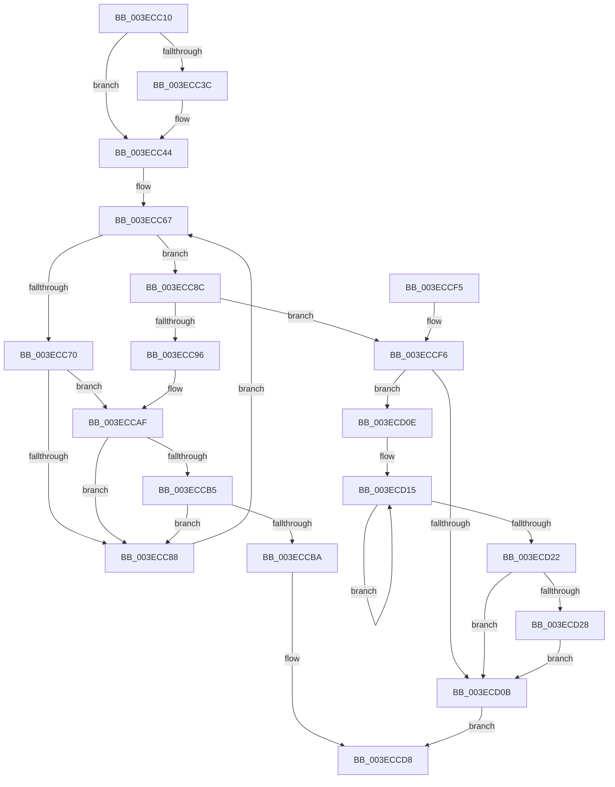

# PspUnlockProcessThreadListShared

- RVA: `0x003ECC10`–`0x003ECD2F` (길이 `287` bytes)
- VA: `0x00000001403ECC10`
- 실행 섹션: `.text`
- PDB 이름 있음: `예`; PDB Function 태그: `아니요`
- unwind 정보 RVA: `0x00064784`
- 디코드: `79`개 명령, `287/287` bytes 표시
- 미해석 바이트: `0` (있으면 어셈블리에 `.byte`로 보존)

> 이 문서는 커널 이미지의 기계어와 PDB 기호를 분석해 생성했습니다. 4번과 5번은 함수 원형과 자료형을 바이너리 사용 방식에서 추정한 C 해석이며 원본 소스 복구 결과는 아닙니다.

## 1. Dependencies

- 직접 호출 지점: **5**; 고유 호출 대상: **5**
- 직접 호출자로 확인된 함수: **5**
- RIP 상대 이미지 참조: **0**

### Outgoing calls
- `0x003ECC3F` → [ExfReleasePushLockShared](../26/ExfReleasePushLockShared_function_00263440.md) (function, `0x00263440`)
- `0x003ECCA9` → [KeBugCheckEx](../4F/KeBugCheckEx_function_004FD660.md) (function, `0x004FD660`)
- `0x003ECCD3` → [KiAbEntryFreeAndEnableInterrupts](../26/KiAbEntryFreeAndEnableInterrupts_function_002622D0.md) (function, `0x002622D0`)
- `0x003ECCDB` → [KeLeaveCriticalRegionThread](../25/KeLeaveCriticalRegionThread_function_0025EFF0.md) (function, `0x0025EFF0`)
- `0x003ECD28` → [KiRemoveSystemWorkPriorityKick](../26/KiRemoveSystemWorkPriorityKick_function_002631D0.md) (function, `0x002631D0`)

### Direct callers
- [PspNotifyProcessEffectiveIoLimitChanged](PspNotifyProcessEffectiveIoLimitChanged_function_003EC9C0.md) at `0x003ECA67`
- [PsUpdateSvmProcessPasidAllThreads](../../page/78/PsUpdateSvmProcessPasidAllThreads_function_00781404.md) at `0x007815BF`
- [PsUpdateSvmProcessPasidAllThreads](../../page/78/PsUpdateSvmProcessPasidAllThreads_function_00781404.md) at `0x0078160C`
- [PspEnableProcessOptionalXStateFeatures](../../page/78/PspEnableProcessOptionalXStateFeatures_function_00781EF0.md) at `0x0078217F`
- [PspEnableProcessOptionalXStateFeatures](../../page/78/PspEnableProcessOptionalXStateFeatures_function_00781EF0.md) at `0x00782299`
- [PsQueryProcessEnergyValues](../../page/91/PsQueryProcessEnergyValues_function_0091A4E0.md) at `0x0091A80D`
- [PsQueryTotalCycleTimeProcess](../../page/A2/PsQueryTotalCycleTimeProcess_function_00A26840.md) at `0x00A268A6`

### Static image references
- 디코드된 RIP-relative 메모리 참조가 없습니다.

## 2. Other-region calls and transfers

- 다른 실행 섹션으로 향하는 call: **0**
- 별도 외부 분기/꼬리 이동을 확인하지 못했습니다.

## 3. Assembly (complete function range)

```asm
003ECC10  48 89 5C 24 10                  mov qword ptr [rsp + 0x10], rbx
003ECC15  48 89 6C 24 18                  mov qword ptr [rsp + 0x18], rbp
003ECC1A  48 89 74 24 20                  mov qword ptr [rsp + 0x20], rsi
003ECC1F  57                              push rdi
003ECC20  48 83 EC 30                     sub rsp, 0x30
003ECC24  48 8B FA                        mov rdi, rdx
003ECC27  48 8D 99 E0 05 00 00            lea rbx, [rcx + 0x5e0]
003ECC2E  33 F6                           xor esi, esi
003ECC30  B8 11 00 00 00                  mov eax, 0x11
003ECC35  F0 48 0F B1 33                  lock cmpxchg qword ptr [rbx], rsi
003ECC3A  74 08                           je 0x1403ecc44
003ECC3C  48 8B CB                        mov rcx, rbx
003ECC3F  E8 FC 67 E7 FF                  call 0x140263440
003ECC44  65 4C 8B 1C 25 88 01 00 00      mov r11, qword ptr gs:[0x188]
003ECC4D  FA                              cli
003ECC4E  4D 8B 83 70 04 00 00            mov r8, qword ptr [r11 + 0x470]
003ECC55  4C 8B CB                        mov r9, rbx
003ECC58  48 BD FC FF FF FF FF FF FF 7F   movabs rbp, 0x7ffffffffffffffc
003ECC62  8B C6                           mov eax, esi
003ECC64  4C 23 CD                        and r9, rbp
003ECC67  41 0F B6 48 0C                  movzx ecx, byte ptr [r8 + 0xc]
003ECC6C  3B C1                           cmp eax, ecx
003ECC6E  73 1C                           jae 0x1403ecc8c
003ECC70  8B C8                           mov ecx, eax
003ECC72  4C 6B D1 58                     imul r10, rcx, 0x58
003ECC76  4D 03 D0                        add r10, r8
003ECC79  49 8B 52 10                     mov rdx, qword ptr [r10 + 0x10]
003ECC7D  48 8B CA                        mov rcx, rdx
003ECC80  48 23 CD                        and rcx, rbp
003ECC83  49 3B C9                        cmp rcx, r9
003ECC86  74 27                           je 0x1403eccaf
003ECC88  FF C0                           inc eax
003ECC8A  EB DB                           jmp 0x1403ecc67
003ECC8C  41 8B 43 78                     mov eax, dword ptr [r11 + 0x78]
003ECC90  0F BA E0 10                     bt eax, 0x10
003ECC94  72 60                           jb 0x1403eccf6
003ECC96  45 33 C9                        xor r9d, r9d
003ECC99  48 89 74 24 20                  mov qword ptr [rsp + 0x20], rsi
003ECC9E  4C 8B C3                        mov r8, rbx
003ECCA1  49 8B D3                        mov rdx, r11
003ECCA4  B9 62 01 00 00                  mov ecx, 0x162
003ECCA9  E8 B2 09 11 00                  call 0x1404fd660
003ECCAE  CC                              int3
003ECCAF  41 38 72 1A                     cmp byte ptr [r10 + 0x1a], sil
003ECCB3  74 D3                           je 0x1403ecc88
003ECCB5  F6 C2 01                        test dl, 1
003ECCB8  75 CE                           jne 0x1403ecc88
003ECCBA  41 B9 01 00 00 00               mov r9d, 1
003ECCC0  41 88 72 1A                     mov byte ptr [r10 + 0x1a], sil
003ECCC4  4C 8B C3                        mov r8, rbx
003ECCC7  48 89 74 24 20                  mov qword ptr [rsp + 0x20], rsi
003ECCCC  49 8B D3                        mov rdx, r11
003ECCCF  49 8D 4A 10                     lea rcx, [r10 + 0x10]
003ECCD3  E8 F8 55 E7 FF                  call 0x1402622d0
003ECCD8  48 8B CF                        mov rcx, rdi
003ECCDB  E8 10 23 E7 FF                  call 0x14025eff0
003ECCE0  48 8B 5C 24 48                  mov rbx, qword ptr [rsp + 0x48]
003ECCE5  48 8B 6C 24 50                  mov rbp, qword ptr [rsp + 0x50]
003ECCEA  48 8B 74 24 58                  mov rsi, qword ptr [rsp + 0x58]
003ECCEF  48 83 C4 30                     add rsp, 0x30
003ECCF3  5F                              pop rdi
003ECCF4  C3                              ret
003ECCF5  CC                              int3
003ECCF6  65 48 8B 0C 25 20 00 00 00      mov rcx, qword ptr gs:[0x20]
003ECCFF  4C 8B 81 B8 8E 00 00            mov r8, qword ptr [rcx + 0x8eb8]
003ECD06  4D 85 C0                        test r8, r8
003ECD09  75 03                           jne 0x1403ecd0e
003ECD0B  FB                              sti
003ECD0C  EB CA                           jmp 0x1403eccd8
003ECD0E  41 0F 0D 08                     prefetchw byte ptr [r8]
003ECD12  41 8B 00                        mov eax, dword ptr [r8]
003ECD15  8B D0                           mov edx, eax
003ECD17  0F BA F2 15                     btr edx, 0x15
003ECD1B  F0 41 0F B1 10                  lock cmpxchg dword ptr [r8], edx
003ECD20  75 F3                           jne 0x1403ecd15
003ECD22  0F BA E0 15                     bt eax, 0x15
003ECD26  73 E3                           jae 0x1403ecd0b
003ECD28  E8 A3 64 E7 FF                  call 0x1402631d0
003ECD2D  EB DC                           jmp 0x1403ecd0b
```

## 4. C-style interpretation (structured pseudocode)

```c
__int64 __fastcall PspUnlockProcessThreadListShared(__int64 a1, __int64 a2)
{
    __int64 result;
    __int64 v_r10;
    __int64 v_rsi;
    __int64 v_rsp;
    unsigned __int64 v_stack_m18;
    unsigned __int64 v_stack_p10;
    unsigned __int64 v_stack_p18;
    unsigned __int64 v_stack_p20;

    v_stack_p10 = v_rbx;
    v_stack_p18 = v_rbp;
    v_stack_p20 = v_rsi;
    v_rsp = (v_rsp) - (48);
    v_rsi = 0;
    result = 17;
    if (!(condition_is_equal)) {
        a1 = a1 + 1504;
        result = ExfReleasePushLockShared(a1, a2, a3, a4);
    }
    a4 = (a1 + 1504) & (v_rbp);
loc_003ECC67:
    if (0 >= ((unsigned int)(*(unsigned __int8 *)(*(unsigned __int64 *)(*(unsigned __int64 *)(gs_base + (0 + 392)) + 1136) + 12)))) goto loc_003ECC8C;
    v_r10 = (v_r10) * (0);
    v_r10 = (v_r10) + (*(unsigned __int64 *)(*(unsigned __int64 *)(gs_base + (0 + 392)) + 1136));
    a1 = (*(unsigned __int64 *)(v_r10 + 16)) & (v_rbp);
    if (a1 == a4) goto loc_003ECCAF;
loc_003ECC88:
    result = (unsigned int)((0) + 1);
    goto loc_003ECC67;
loc_003ECC8C:
    if (a1 < a4) goto loc_003ECCF6;
    a4 = 0;
    v_stack_m18 = 0;
    result = KeBugCheckEx(354, *(unsigned __int64 *)(gs_base + (0 + 392)), a1 + 1504, a4);
loc_003ECCAF:
    if ((*(unsigned __int8 *)(v_r10 + 26)) == 0) goto loc_003ECC88;
    if ((((unsigned __int8)(*(unsigned __int64 *)(gs_base + (0 + 392)))) & (1)) != 0) goto loc_003ECC88;
    *(unsigned __int8 *)(v_r10 + 26) = 0;
    v_stack_m18 = 0;
    result = KiAbEntryFreeAndEnableInterrupts(v_r10 + 16, *(unsigned __int64 *)(gs_base + (0 + 392)), a1 + 1504, 1);
loc_003ECCD8:
    result = KeLeaveCriticalRegionThread(a2, *(unsigned __int64 *)(gs_base + (0 + 392)), a1 + 1504, 1);
    v_rsp = (v_rsp) + (48);
    return result;
loc_003ECCF6:
    if (*(unsigned __int64 *)(*(unsigned __int64 *)(gs_base + (0 + 32)) + 36536) != 0) goto loc_003ECD0E;
loc_003ECD0B:
    goto loc_003ECCD8;
loc_003ECD0E:
loc_003ECD15:
    if (*(unsigned __int64 *)(*(unsigned __int64 *)(gs_base + (0 + 32)) + 36536) != 0) goto loc_003ECD15;
    if (condition_is_above_or_equal) goto loc_003ECD0B;
    result = KiRemoveSystemWorkPriorityKick(*(unsigned __int64 *)(gs_base + (0 + 32)), (unsigned int)((unsigned int)((unsigned int)(*(unsigned int *)(*(unsigned __int64 *)(*(unsigned __int64 *)(gs_base + (0 + 32)) + 36536))))), *(unsigned __int64 *)(*(unsigned __int64 *)(gs_base + (0 + 32)) + 36536), 1);
    goto loc_003ECD0B;
}
```

## 5. (Beta) C Style

```c
int64_t PspUnlockProcessThreadListShared(void *Arg1, int64_t Arg2)
{
    uint8_t *arg1 = (uint8_t *)Arg1;

    int64_t result;
    int64_t local_r10;
    int64_t local_rsi;
    int64_t local_rsp;
    uint64_t v_stack_m18;
    uint64_t v_stack_p10;
    uint64_t v_stack_p18;
    uint64_t v_stack_p20;

    v_stack_p10 = local_rbx;
    v_stack_p18 = local_rbp;
    v_stack_p20 = local_rsi;
    local_rsp = (local_rsp) - (48);
    local_rsi = 0;
    result = 17;
    if (!(condition_is_equal)) {
        Arg1 = Arg1 + 1504;
        result = ExfReleasePushLockShared(Arg1, Arg2, a3, a4);
    }
    a4 = (Arg1 + 1504) & (local_rbp);
loc_003ECC67:
    if (0 >= ((uint32_t)(*(uint8_t *)(*(uint64_t *)(*(uint64_t *)(gs_base + (0 + 0x188)) + 0x470) + 0xC)))) goto loc_003ECC8C;
    local_r10 = (local_r10) * (0);
    local_r10 = (local_r10) + (*(uint64_t *)(*(uint64_t *)(gs_base + (0 + 0x188)) + 0x470));
    Arg1 = (*(uint64_t *)(local_r10 + 0x10)) & (local_rbp);
    if (Arg1 == a4) goto loc_003ECCAF;
loc_003ECC88:
    result = (uint32_t)((0) + 1);
    goto loc_003ECC67;
loc_003ECC8C:
    if (Arg1 < a4) goto loc_003ECCF6;
    a4 = 0;
    v_stack_m18 = 0;
    result = KeBugCheckEx(354, *(uint64_t *)(gs_base + (0 + 0x188)), Arg1 + 1504, a4);
loc_003ECCAF:
    if ((*(uint8_t *)(local_r10 + 0x1A)) == 0) goto loc_003ECC88;
    if ((((uint8_t)(*(uint64_t *)(gs_base + (0 + 0x188)))) & (1)) != 0) goto loc_003ECC88;
    *(uint8_t *)(local_r10 + 0x1A) = 0;
    v_stack_m18 = 0;
    result = KiAbEntryFreeAndEnableInterrupts(local_r10 + 16, *(uint64_t *)(gs_base + (0 + 0x188)), Arg1 + 1504, 1);
loc_003ECCD8:
    result = KeLeaveCriticalRegionThread(Arg2, *(uint64_t *)(gs_base + (0 + 0x188)), Arg1 + 1504, 1);
    local_rsp = (local_rsp) + (48);
    return result;
loc_003ECCF6:
    if (*(uint64_t *)(*(uint64_t *)(gs_base + (0 + 0x20)) + 0x8EB8) != 0) goto loc_003ECD0E;
loc_003ECD0B:
    goto loc_003ECCD8;
loc_003ECD0E:
loc_003ECD15:
    if (*(uint64_t *)(*(uint64_t *)(gs_base + (0 + 0x20)) + 0x8EB8) != 0) goto loc_003ECD15;
    if (condition_is_above_or_equal) goto loc_003ECD0B;
    result = KiRemoveSystemWorkPriorityKick(*(uint64_t *)(gs_base + (0 + 0x20)), (uint32_t)((uint32_t)((uint32_t)(*(uint32_t *)(*(uint64_t *)(*(uint64_t *)(gs_base + (0 + 0x20)) + 0x8EB8))))), *(uint64_t *)(*(uint64_t *)(gs_base + (0 + 0x20)) + 0x8EB8), 1);
    goto loc_003ECD0B;
}
```

### 관측된 메모리 오프셋

구조체 형식이 확인되지 않은 접근은 인자 기준의 오프셋으로만 기록했습니다.

| 기준 인자 | 오프셋 표현 | 폭 (bit) | 접근 |
|---|---:|---:|---|
| `Arg1` | `+ 0x0` | `64` | `R` |
| `Arg1` | `+ 0x5E0` | `64` | `R` |

## 6. Execution-region graph

[열기: 2D/3D 그래프와 함수 탐색 컨트롤 패널](../../../control-panel.html?section=text&rva=0x003ECC10&view=graph)

- 2D 그래프는 위에서 아래로 흐르고, 3D 그래프는 빈 공간을 드래그해 회전합니다. Shift+드래그는 이동, 휠은 확대·축소, 함수 노드 선택은 대상 보고서 이동입니다.

### Static fallback


