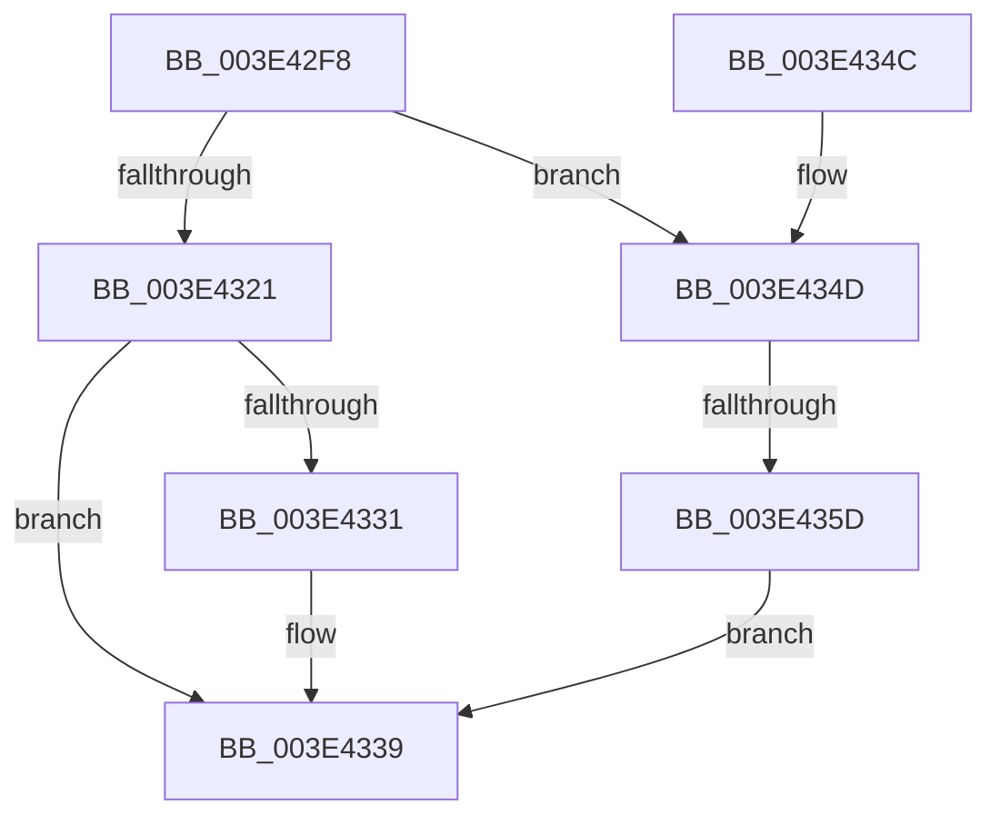

# RaspAllocateMemory

- RVA: `0x003E42F8`–`0x003E436B` (길이 `115` bytes)
- VA: `0x00000001403E42F8`
- 실행 섹션: `.text`
- PDB 이름 있음: `예`; PDB Function 태그: `예`
- unwind 정보 RVA: `0x00088CDC`
- 디코드: `34`개 명령, `115/115` bytes 표시
- 미해석 바이트: `0` (있으면 어셈블리에 `.byte`로 보존)

> 이 문서는 커널 이미지의 기계어와 PDB 기호를 분석해 생성했습니다. 4번과 5번은 함수 원형과 자료형을 바이너리 사용 방식에서 추정한 C 해석이며 원본 소스 복구 결과는 아닙니다.

## 1. Dependencies

- 직접 호출 지점: **1**; 고유 호출 대상: **1**
- 직접 호출자로 확인된 함수: **10**
- RIP 상대 이미지 참조: **0**

### Outgoing calls
- `0x003E4324` → [BgpFwAllocateMemory](BgpFwAllocateMemory_function_003E4374.md) (function, `0x003E4374`)

### Direct callers
- [RaspInterpolatePoint](RaspInterpolatePoint_function_003E36D8.md) at `0x003E36F5`
- [RaspScanConvert](RaspScanConvert_function_003E3760.md) at `0x003E3887`
- [RaspScanConvert](RaspScanConvert_function_003E3760.md) at `0x003E38D9`
- [RaspCreateSegmentList](RaspCreateSegmentList_function_003E3ED8.md) at `0x003E3F88`
- [RaspRectangleCreate](RaspRectangleCreate_function_003E52D0.md) at `0x003E5304`
- [RaspInitializeGlyphData](RaspInitializeGlyphData_function_003E54B8.md) at `0x003E55E0`
- [RaspInitializeGlyphData](RaspInitializeGlyphData_function_003E54B8.md) at `0x003E5695`
- [RaspInitializeGlyphData](RaspInitializeGlyphData_function_003E54B8.md) at `0x003E5763`
- [RaspCreatePointList](../6A/RaspCreatePointList_function_006A1A24.md) at `0x006A1A49`
- [RaspGetCompositeGlyphList](../6A/RaspGetCompositeGlyphList_function_006A1B54.md) at `0x006A1C08`
- [RaspGetXExtent](../6A/RaspGetXExtent_function_006A1F7C.md) at `0x006A2070`
- [RaspInitializeCompositeGlyphData](../6A/RaspInitializeCompositeGlyphData_function_006A2138.md) at `0x006A218D`
- [RaspLoadGlyphData](../6A/RaspLoadGlyphData_function_006A2818.md) at `0x006A285A`

### Static image references
- 디코드된 RIP-relative 메모리 참조가 없습니다.

## 2. Other-region calls and transfers

- 다른 실행 섹션으로 향하는 call: **0**
- call이 아닌 외부 분기/꼬리 이동: **1**
  - `0x003E4357` → [sub_006EA96A](../6E/Unknown_function_006EA96A.md) (`tail-transfer`)

## 3. Assembly (complete function range)

```asm
003E42F8  48 89 5C 24 08                  mov qword ptr [rsp + 8], rbx
003E42FD  48 89 74 24 10                  mov qword ptr [rsp + 0x10], rsi
003E4302  57                              push rdi
003E4303  48 83 EC 20                     sub rsp, 0x20
003E4307  48 8B 5A 10                     mov rbx, qword ptr [rdx + 0x10]
003E430B  48 8B F9                        mov rdi, rcx
003E430E  48 8B 0A                        mov rcx, qword ptr [rdx]
003E4311  48 83 C3 0F                     add rbx, 0xf
003E4315  48 83 E3 F0                     and rbx, 0xfffffffffffffff0
003E4319  48 8B F2                        mov rsi, rdx
003E431C  48 85 C9                        test rcx, rcx
003E431F  75 2C                           jne 0x1403e434d
003E4321  48 8B CF                        mov rcx, rdi
003E4324  E8 4B 00 00 00                  call 0x1403e4374
003E4329  48 8B D0                        mov rdx, rax
003E432C  48 85 C0                        test rax, rax
003E432F  74 08                           je 0x1403e4339
003E4331  48 8D 0C 3B                     lea rcx, [rbx + rdi]
003E4335  48 89 4E 10                     mov qword ptr [rsi + 0x10], rcx
003E4339  48 8B 5C 24 30                  mov rbx, qword ptr [rsp + 0x30]
003E433E  48 8B C2                        mov rax, rdx
003E4341  48 8B 74 24 38                  mov rsi, qword ptr [rsp + 0x38]
003E4346  48 83 C4 20                     add rsp, 0x20
003E434A  5F                              pop rdi
003E434B  C3                              ret
003E434C  CC                              int3
003E434D  48 8B 42 08                     mov rax, qword ptr [rdx + 8]
003E4351  48 2B C3                        sub rax, rbx
003E4354  48 3B F8                        cmp rdi, rax
003E4357  0F 87 0D 66 30 00               ja 0x1406ea96a
003E435D  48 8D 04 3B                     lea rax, [rbx + rdi]
003E4361  48 89 46 10                     mov qword ptr [rsi + 0x10], rax
003E4365  48 8D 14 19                     lea rdx, [rcx + rbx]
003E4369  EB CE                           jmp 0x1403e4339
```

## 4. C-style interpretation (structured pseudocode)

```c
__int64 __fastcall RaspAllocateMemory(__int64 a1, __int64 a2)
{
    __int64 result;
    __int64 v_rbx;
    __int64 v_rsp;
    unsigned __int64 v_stack_p10;
    unsigned __int64 v_stack_p8;

    v_stack_p8 = v_rbx;
    v_stack_p10 = v_rsi;
    v_rsp = (v_rsp) - (32);
    v_rbx = (*(unsigned __int64 *)(a2 + 16)) + (15);
    v_rbx = (v_rbx) & (-16);
    if (*(unsigned __int64 *)(a2) != 0) goto loc_003E434D;
    result = BgpFwAllocateMemory(a1, a2, a3, a4);
    if (result != 0) {
        a1 = v_rbx + a1 * 1;
        *(unsigned __int64 *)(a2 + 16) = a1;
    }
    v_rsp = (v_rsp) + (32);
    return result;
loc_003E434D:
    result = (*(unsigned __int64 *)(result + 8)) - (v_stack_p8);
    *(unsigned __int64 *)(v_stack_p10 + 16) = v_stack_p8 + a1 * 1;
    goto loc_003E4339;
}
```

## 5. (Beta) C Style

```c
int64_t RaspAllocateMemory(int64_t Arg1, void *Arg2)
{
    uint8_t *arg2 = (uint8_t *)Arg2;

    int64_t result;
    int64_t local_rbx;
    int64_t local_rsp;
    uint64_t v_stack_p10;
    uint64_t v_stack_p8;

    v_stack_p8 = local_rbx;
    v_stack_p10 = local_rsi;
    local_rsp = (local_rsp) - (32);
    local_rbx = (*(uint64_t *)(arg2 + 0x10)) + (15);
    local_rbx = (local_rbx) & (-16);
    if (*(uint64_t *)(arg2) != 0) goto loc_003E434D;
    result = BgpFwAllocateMemory(Arg1, Arg2, a3, a4);
    if (result != 0) {
        Arg1 = local_rbx + Arg1 * 1;
        *(uint64_t *)(arg2 + 0x10) = Arg1;
    }
    local_rsp = (local_rsp) + (32);
    return result;
loc_003E434D:
    result = (*(uint64_t *)(result + 0x8)) - (v_stack_p8);
    *(uint64_t *)(v_stack_p10 + 0x10) = v_stack_p8 + Arg1 * 1;
    goto loc_003E4339;
}
```

### 관측된 메모리 오프셋

구조체 형식이 확인되지 않은 접근은 인자 기준의 오프셋으로만 기록했습니다.

| 기준 인자 | 오프셋 표현 | 폭 (bit) | 접근 |
|---|---:|---:|---|
| `Arg2` | `+ 0x0` | `64` | `R` |
| `Arg2` | `+ 0x8` | `64` | `R` |
| `Arg2` | `+ 0x10` | `64` | `R` |
| `Arg2` | `+ 0x10` | `64` | `W` |

## 6. Execution-region graph

[열기: 2D/3D 그래프와 함수 탐색 컨트롤 패널](../../../control-panel.html?section=text&rva=0x003E42F8&view=graph)

- 2D 그래프는 위에서 아래로 흐르고, 3D 그래프는 빈 공간을 드래그해 회전합니다. Shift+드래그는 이동, 휠은 확대·축소, 함수 노드 선택은 대상 보고서 이동입니다.

### Static fallback


