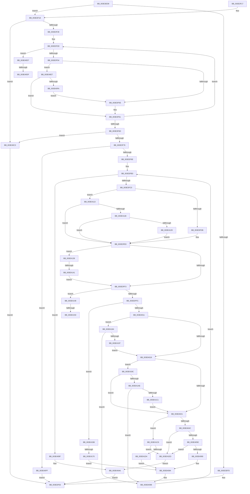

# RaspCreateSegmentList

- RVA: `0x003E3ED8`–`0x003E420F` (길이 `823` bytes)
- VA: `0x00000001403E3ED8`
- 실행 섹션: `.text`
- PDB 이름 있음: `예`; PDB Function 태그: `예`
- unwind 정보 RVA: `0x00094CFC`
- 디코드: `212`개 명령, `823/823` bytes 표시
- 미해석 바이트: `0` (있으면 어셈블리에 `.byte`로 보존)

> 이 문서는 커널 이미지의 기계어와 PDB 기호를 분석해 생성했습니다. 4번과 5번은 함수 원형과 자료형을 바이너리 사용 방식에서 추정한 C 해석이며 원본 소스 복구 결과는 아닙니다.

## 1. Dependencies

- 직접 호출 지점: **6**; 고유 호출 대상: **4**
- 직접 호출자로 확인된 함수: **1**
- RIP 상대 이미지 참조: **0**

### Outgoing calls
- `0x003E3F88` → [RaspAllocateMemory](RaspAllocateMemory_function_003E42F8.md) (function, `0x003E42F8`)
- `0x003E3FA6` → [memset](../6C/memset_function_006C6C40.md) (function, `0x006C6C40`)
- `0x003E404C` → [RaspInterpolatePoint](RaspInterpolatePoint_function_003E36D8.md) (function, `0x003E36D8`)
- `0x003E407F` → [RaspInterpolatePoint](RaspInterpolatePoint_function_003E36D8.md) (function, `0x003E36D8`)
- `0x003E41C6` → [RaspInterpolatePoint](RaspInterpolatePoint_function_003E36D8.md) (function, `0x003E36D8`)
- `0x003E4202` → [RaspDestroySegmentList](RaspDestroySegmentList_function_003E4238.md) (function, `0x003E4238`)

### Direct callers
- [RaspScanConvert](RaspScanConvert_function_003E3760.md) at `0x003E37BE`

### Static image references
- 디코드된 RIP-relative 메모리 참조가 없습니다.

## 2. Other-region calls and transfers

- 다른 실행 섹션으로 향하는 call: **0**
- call이 아닌 외부 분기/꼬리 이동: **6**
  - `0x003E40D9` → [sub_006EA8CA](../6E/Unknown_function_006EA8CA.md) (`tail-transfer`)
  - `0x003E40E2` → [sub_006EA8CA + 0xB](../6E/Unknown_function_006EA8CA.md) (`tail-transfer`)
  - `0x003E413B` → [sub_006EA8CA + 0x12](../6E/Unknown_function_006EA8CA.md) (`tail-transfer`)
  - `0x003E414A` → [sub_006EA8CA + 0x21](../6E/Unknown_function_006EA8CA.md) (`tail-transfer`)
  - `0x003E4156` → [sub_006EA8CA + 0x30](../6E/Unknown_function_006EA8CA.md) (`tail-transfer`)
  - `0x003E416A` → [sub_006EA8CA + 0x37](../6E/Unknown_function_006EA8CA.md) (`tail-transfer`)

## 3. Assembly (complete function range)

```asm
003E3ED8  48 89 5C 24 08                  mov qword ptr [rsp + 8], rbx
003E3EDD  4C 89 4C 24 20                  mov qword ptr [rsp + 0x20], r9
003E3EE2  55                              push rbp
003E3EE3  56                              push rsi
003E3EE4  57                              push rdi
003E3EE5  41 54                           push r12
003E3EE7  41 55                           push r13
003E3EE9  41 56                           push r14
003E3EEB  41 57                           push r15
003E3EED  48 83 EC 30                     sub rsp, 0x30
003E3EF1  49 8B F9                        mov rdi, r9
003E3EF4  4C 8B FA                        mov r15, rdx
003E3EF7  41 83 F8 02                     cmp r8d, 2
003E3EFB  73 1B                           jae 0x1403e3f18
003E3EFD  B8 0D 00 00 C0                  mov eax, 0xc000000d
003E3F02  48 8B 5C 24 70                  mov rbx, qword ptr [rsp + 0x70]
003E3F07  48 83 C4 30                     add rsp, 0x30
003E3F0B  41 5F                           pop r15
003E3F0D  41 5E                           pop r14
003E3F0F  41 5D                           pop r13
003E3F11  41 5C                           pop r12
003E3F13  5F                              pop rdi
003E3F14  5E                              pop rsi
003E3F15  5D                              pop rbp
003E3F16  C3                              ret
003E3F17  CC                              int3
003E3F18  4C 8B 61 1A                     mov r12, qword ptr [rcx + 0x1a]
003E3F1C  41 8D 70 FE                     lea esi, [r8 - 2]
003E3F20  33 DB                           xor ebx, ebx
003E3F22  89 B4 24 80 00 00 00            mov dword ptr [rsp + 0x80], esi
003E3F29  8B D3                           mov edx, ebx
003E3F2B  44 8B EB                        mov r13d, ebx
003E3F2E  44 8B CB                        mov r9d, ebx
003E3F31  85 F6                           test esi, esi
003E3F33  0F 84 8A 01 00 00               je 0x1403e40c3
003E3F39  4D 8D 57 10                     lea r10, [r15 + 0x10]
003E3F3D  8B C2                           mov eax, edx
003E3F3F  45 8D 59 01                     lea r11d, [r9 + 1]
003E3F43  45 8B C3                        mov r8d, r11d
003E3F46  41 0F B7 0C 44                  movzx ecx, word ptr [r12 + rax*2]
003E3F4B  44 3B C9                        cmp r9d, ecx
003E3F4E  0F 84 83 01 00 00               je 0x1403e40d7
003E3F54  41 F6 02 01                     test byte ptr [r10], 1
003E3F58  0F 84 89 01 00 00               je 0x1403e40e7
003E3F5E  41 FF C5                        inc r13d
003E3F61  49 83 C2 11                     add r10, 0x11
003E3F65  45 8B CB                        mov r9d, r11d
003E3F68  44 3B DE                        cmp r11d, esi
003E3F6B  72 D0                           jb 0x1403e3f3d
003E3F6D  45 85 ED                        test r13d, r13d
003E3F70  0F 84 4D 01 00 00               je 0x1403e40c3
003E3F76  48 8B 94 24 98 00 00 00         mov rdx, qword ptr [rsp + 0x98]
003E3F7E  41 8B C5                        mov eax, r13d
003E3F81  48 6B F8 19                     imul rdi, rax, 0x19
003E3F85  48 8B CF                        mov rcx, rdi
003E3F88  E8 6B 03 00 00                  call 0x1403e42f8
003E3F8D  48 89 44 24 28                  mov qword ptr [rsp + 0x28], rax
003E3F92  4C 8B F0                        mov r14, rax
003E3F95  48 85 C0                        test rax, rax
003E3F98  0F 84 61 01 00 00               je 0x1403e40ff
003E3F9E  4C 8B C7                        mov r8, rdi
003E3FA1  33 D2                           xor edx, edx
003E3FA3  48 8B C8                        mov rcx, rax
003E3FA6  E8 95 2C 2E 00                  call 0x1406c6c40
003E3FAB  8B EB                           mov ebp, ebx
003E3FAD  49 8D 76 10                     lea rsi, [r14 + 0x10]
003E3FB1  8B FB                           mov edi, ebx
003E3FB3  3B BC 24 80 00 00 00            cmp edi, dword ptr [rsp + 0x80]
003E3FBA  0F 83 DF 00 00 00               jae 0x1403e409f
003E3FC0  44 8D 5F 01                     lea r11d, [rdi + 1]
003E3FC4  44 89 5C 24 20                  mov dword ptr [rsp + 0x20], r11d
003E3FC9  45 8B F3                        mov r14d, r11d
003E3FCC  44 8D 4F FF                     lea r9d, [rdi - 1]
003E3FD0  8D 57 02                        lea edx, [rdi + 2]
003E3FD3  85 FF                           test edi, edi
003E3FD5  0F 85 38 01 00 00               jne 0x1403e4113
003E3FDB  45 0F B7 0C 24                  movzx r9d, word ptr [r12]
003E3FE0  8B C5                           mov eax, ebp
003E3FE2  45 0F B7 04 44                  movzx r8d, word ptr [r12 + rax*2]
003E3FE7  41 8D 40 FF                     lea eax, [r8 - 1]
003E3FEB  3B F8                           cmp edi, eax
003E3FED  0F 84 46 01 00 00               je 0x1403e4139
003E3FF3  41 3B F8                        cmp edi, r8d
003E3FF6  0F 84 4C 01 00 00               je 0x1403e4148
003E3FFC  8B C7                           mov eax, edi
003E3FFE  4C 6B D0 11                     imul r10, rax, 0x11
003E4002  4F 8D 04 3A                     lea r8, [r10 + r15]
003E4006  41 F6 40 10 01                  test byte ptr [r8 + 0x10], 1
003E400B  0F 85 4A 01 00 00               jne 0x1403e415b
003E4011  85 FF                           test edi, edi
003E4013  0F 84 6B 01 00 00               je 0x1403e4184
003E4019  85 ED                           test ebp, ebp
003E401B  0F 85 7B 01 00 00               jne 0x1403e419c
003E4021  4C 8B 84 24 98 00 00 00         mov r8, qword ptr [rsp + 0x98]
003E4029  4B 8D 14 3A                     lea rdx, [r10 + r15]
003E402D  41 8B C6                        mov eax, r14d
003E4030  4C 6B F0 11                     imul r14, rax, 0x11
003E4034  41 8B C1                        mov eax, r9d
003E4037  48 6B C8 11                     imul rcx, rax, 0x11
003E403B  4D 03 F7                        add r14, r15
003E403E  49 03 CF                        add rcx, r15
003E4041  41 F6 46 10 01                  test byte ptr [r14 + 0x10], 1
003E4046  0F 85 7A 01 00 00               jne 0x1403e41c6
003E404C  E8 87 F6 FF FF                  call 0x1403e36d8
003E4051  48 89 46 F0                     mov qword ptr [rsi - 0x10], rax
003E4055  48 85 C0                        test rax, rax
003E4058  0F 84 8F 01 00 00               je 0x1403e41ed
003E405E  4C 8B 84 24 98 00 00 00         mov r8, qword ptr [rsp + 0x98]
003E4066  49 8B D6                        mov rdx, r14
003E4069  8B C7                           mov eax, edi
003E406B  48 6B C8 11                     imul rcx, rax, 0x11
003E406F  8B C7                           mov eax, edi
003E4071  49 03 CF                        add rcx, r15
003E4074  48 89 4E F8                     mov qword ptr [rsi - 8], rcx
003E4078  48 6B C8 11                     imul rcx, rax, 0x11
003E407C  49 03 CF                        add rcx, r15
003E407F  E8 54 F6 FF FF                  call 0x1403e36d8
003E4084  48 89 06                        mov qword ptr [rsi], rax
003E4087  48 85 C0                        test rax, rax
003E408A  0F 84 5D 01 00 00               je 0x1403e41ed
003E4090  C6 46 08 05                     mov byte ptr [rsi + 8], 5
003E4094  48 83 C6 19                     add rsi, 0x19
003E4098  FF C7                           inc edi
003E409A  E9 14 FF FF FF                  jmp 0x1403e3fb3
003E409F  8B FB                           mov edi, ebx
003E40A1  48 8B 5C 24 28                  mov rbx, qword ptr [rsp + 0x28]
003E40A6  48 8B 84 24 90 00 00 00         mov rax, qword ptr [rsp + 0x90]
003E40AE  48 8B 8C 24 88 00 00 00         mov rcx, qword ptr [rsp + 0x88]
003E40B6  44 89 28                        mov dword ptr [rax], r13d
003E40B9  8B C7                           mov eax, edi
003E40BB  48 89 19                        mov qword ptr [rcx], rbx
003E40BE  E9 3F FE FF FF                  jmp 0x1403e3f02
003E40C3  48 8B 84 24 90 00 00 00         mov rax, qword ptr [rsp + 0x90]
003E40CB  48 89 1F                        mov qword ptr [rdi], rbx
003E40CE  89 18                           mov dword ptr [rax], ebx
003E40D0  33 C0                           xor eax, eax
003E40D2  E9 2B FE FF FF                  jmp 0x1403e3f02
003E40D7  85 D2                           test edx, edx
003E40D9  0F 85 EB 67 30 00               jne 0x1406ea8ca
003E40DF  44 8B C3                        mov r8d, ebx
003E40E2  E9 EE 67 30 00                  jmp 0x1406ea8d5
003E40E7  41 8B C0                        mov eax, r8d
003E40EA  48 6B C8 11                     imul rcx, rax, 0x11
003E40EE  42 F6 44 39 10 01               test byte ptr [rcx + r15 + 0x10], 1
003E40F4  0F 85 67 FE FF FF               jne 0x1403e3f61
003E40FA  E9 5F FE FF FF                  jmp 0x1403e3f5e
003E40FF  48 8B 84 24 90 00 00 00         mov rax, qword ptr [rsp + 0x90]
003E4107  89 18                           mov dword ptr [rax], ebx
003E4109  B8 9A 00 00 C0                  mov eax, 0xc000009a
003E410E  E9 EF FD FF FF                  jmp 0x1403e3f02
003E4113  85 ED                           test ebp, ebp
003E4115  0F 84 C5 FE FF FF               je 0x1403e3fe0
003E411B  8D 45 FF                        lea eax, [rbp - 1]
003E411E  41 0F B7 04 44                  movzx eax, word ptr [r12 + rax*2]
003E4123  FF C0                           inc eax
003E4125  3B F8                           cmp edi, eax
003E4127  0F 85 B3 FE FF FF               jne 0x1403e3fe0
003E412D  8B C5                           mov eax, ebp
003E412F  45 0F B7 0C 44                  movzx r9d, word ptr [r12 + rax*2]
003E4134  E9 A7 FE FF FF                  jmp 0x1403e3fe0
003E4139  85 ED                           test ebp, ebp
003E413B  0F 85 9B 67 30 00               jne 0x1406ea8dc
003E4141  8B D3                           mov edx, ebx
003E4143  E9 AB FE FF FF                  jmp 0x1403e3ff3
003E4148  85 ED                           test ebp, ebp
003E414A  0F 85 9B 67 30 00               jne 0x1406ea8eb
003E4150  44 8B F3                        mov r14d, ebx
003E4153  8D 55 01                        lea edx, [rbp + 1]
003E4156  E9 9F 67 30 00                  jmp 0x1406ea8fa
003E415B  41 8B C6                        mov eax, r14d
003E415E  4C 6B C8 11                     imul r9, rax, 0x11
003E4162  4D 03 CF                        add r9, r15
003E4165  41 F6 41 10 01                  test byte ptr [r9 + 0x10], 1
003E416A  0F 84 91 67 30 00               je 0x1406ea901
003E4170  4C 89 46 F0                     mov qword ptr [rsi - 0x10], r8
003E4174  4C 89 4E F8                     mov qword ptr [rsi - 8], r9
003E4178  4C 89 0E                        mov qword ptr [rsi], r9
003E417B  C6 46 08 01                     mov byte ptr [rsi + 8], 1
003E417F  E9 10 FF FF FF                  jmp 0x1403e4094
003E4184  41 8B C1                        mov eax, r9d
003E4187  48 6B C8 11                     imul rcx, rax, 0x11
003E418B  42 F6 44 39 10 01               test byte ptr [rcx + r15 + 0x10], 1
003E4191  0F 85 01 FF FF FF               jne 0x1403e4098
003E4197  E9 7D FE FF FF                  jmp 0x1403e4019
003E419C  8D 45 FF                        lea eax, [rbp - 1]
003E419F  41 0F B7 04 44                  movzx eax, word ptr [r12 + rax*2]
003E41A4  FF C0                           inc eax
003E41A6  3B F8                           cmp edi, eax
003E41A8  0F 85 73 FE FF FF               jne 0x1403e4021
003E41AE  41 8B C1                        mov eax, r9d
003E41B1  48 6B C8 11                     imul rcx, rax, 0x11
003E41B5  42 F6 44 39 10 01               test byte ptr [rcx + r15 + 0x10], 1
003E41BB  0F 85 D7 FE FF FF               jne 0x1403e4098
003E41C1  E9 5B FE FF FF                  jmp 0x1403e4021
003E41C6  E8 0D F5 FF FF                  call 0x1403e36d8
003E41CB  48 89 46 F0                     mov qword ptr [rsi - 0x10], rax
003E41CF  48 85 C0                        test rax, rax
003E41D2  74 19                           je 0x1403e41ed
003E41D4  8B C7                           mov eax, edi
003E41D6  48 6B C8 11                     imul rcx, rax, 0x11
003E41DA  4C 89 36                        mov qword ptr [rsi], r14
003E41DD  49 03 CF                        add rcx, r15
003E41E0  C6 46 08 03                     mov byte ptr [rsi + 8], 3
003E41E4  48 89 4E F8                     mov qword ptr [rsi - 8], rcx
003E41E8  E9 A7 FE FF FF                  jmp 0x1403e4094
003E41ED  4C 8B 84 24 98 00 00 00         mov r8, qword ptr [rsp + 0x98]
003E41F5  41 8B D5                        mov edx, r13d
003E41F8  48 8B 4C 24 28                  mov rcx, qword ptr [rsp + 0x28]
003E41FD  BF 9A 00 00 C0                  mov edi, 0xc000009a
003E4202  E8 31 00 00 00                  call 0x1403e4238
003E4207  44 8B EB                        mov r13d, ebx
003E420A  E9 97 FE FF FF                  jmp 0x1403e40a6
```

## 4. C-style interpretation (structured pseudocode)

```c
__int64 __fastcall RaspCreateSegmentList(__int64 a1, __int64 a2, __int64 a3, __int64 a4, __int64 a5, __int64 a6)
{
    __int64 result;
    __int64 v_r10;
    __int64 v_r13;
    __int64 v_r14;
    __int64 v_rbx;
    __int64 v_rdi;
    __int64 v_rsi;
    __int64 v_rsp;
    unsigned __int64 v_stack_p20;
    unsigned __int64 v_stack_p28;
    unsigned __int64 v_stack_p8;
    unsigned int v_stack_p80;
    unsigned __int64 v_stack_p88;

    v_stack_p8 = v_rbx;
    v_stack_p20 = a4;
    v_rsp = (v_rsp) - (48);
    if (((unsigned int)(a3)) >= 2) goto loc_003E3F18;
loc_003E3F02:
    v_rsp = (v_rsp) + (48);
    return (unsigned int)(0xC000000DULL);
loc_003E3F18:
    v_rbx = 0;
    v_stack_p80 = (unsigned int)(a3 - 2);
    if ((unsigned int)(a3 - 2) == 0) goto loc_003E40C3;
loc_003E3F3D:
    if (0 == ((unsigned int)(*(unsigned __int16 *)(*(unsigned __int64 *)(a1 + 26) + 0 * 2)))) goto loc_003E40D7;
    if (((*(unsigned __int8 *)(a2 + 16)) & (1)) == 0) goto loc_003E40E7;
loc_003E3F5E:
    v_r13 = (unsigned int)((0) + 1);
loc_003E3F61:
    v_r10 = (a2 + 16) + (17);
    if (((unsigned int)(0 + 1)) < ((unsigned int)(a3 - 2))) goto loc_003E3F3D;
    if ((unsigned int)(v_r13) == 0) goto loc_003E40C3;
    v_rdi = (a4) * ((unsigned int)((unsigned int)(v_r13)));
    result = RaspAllocateMemory(v_rdi, a6, (unsigned int)((unsigned int)(0 + 1)), (unsigned int)((unsigned int)(0 + 1)));
    v_stack_p28 = result;
    if (result == 0) goto loc_003E40FF;
    a2 = 0;
    result = memset(result, a2, v_rdi, (unsigned int)((unsigned int)(0 + 1)));
loc_003E3FB3:
    if (0 >= v_stack_p80) goto loc_003E409F;
    v_stack_p20 = (unsigned int)(0 + 1);
    if (0 != 0) goto loc_003E4113;
loc_003E3FE0:
    if (0 == ((unsigned int)(*(unsigned __int16 *)(*(unsigned __int64 *)(a1 + 26) + 0 * 2) - 1))) goto loc_003E4139;
loc_003E3FF3:
    if (0 == ((unsigned int)(*(unsigned __int16 *)(*(unsigned __int64 *)(a1 + 26) + 0 * 2)))) goto loc_003E4148;
    v_r10 = (v_r10) * (0);
    if (((*(unsigned __int8 *)(v_r10 + a2 * 1 + 16)) & (1)) != 0) goto loc_003E415B;
    if (0 == 0) goto loc_003E4184;
loc_003E4019:
    if (0 != 0) goto loc_003E419C;
loc_003E4021:
    v_r14 = ((unsigned int)((unsigned int)(0 + 1))) * ((unsigned int)((unsigned int)((unsigned int)((unsigned int)(0 + 1)))));
    a1 = (result) * ((unsigned int)((unsigned int)(*(unsigned __int16 *)(*(unsigned __int64 *)(a1 + 26)))));
    v_r14 = (v_r14) + (0);
    a1 = (a1) + (0);
    if (((*(unsigned __int8 *)(v_r14 + 16)) & (1)) != 0) goto loc_003E41C6;
    result = RaspInterpolatePoint(a1, v_r10 + a2 * 1, a6, *(unsigned __int16 *)(*(unsigned __int64 *)(a1 + 26)));
    *(unsigned __int64 *)(result + 16 - 16) = result;
    if (result == 0) goto loc_003E41ED;
    a1 = (a1) * (0);
    a1 = (a1) + (0);
    *(unsigned __int64 *)(result + 16 - 8) = a1;
    a1 = (a1) * (0);
    a1 = (a1) + (0);
    result = RaspInterpolatePoint(a1, v_r14, a6, *(unsigned __int16 *)(*(unsigned __int64 *)(a1 + 26)));
    *(unsigned __int64 *)(result + 16) = result;
    if (result == 0) goto loc_003E41ED;
    *(unsigned __int8 *)(result + 16 + 8) = 5;
loc_003E4094:
    v_rsi = (result + 16) + (25);
loc_003E4098:
    v_rdi = (unsigned int)((0) + 1);
    goto loc_003E3FB3;
loc_003E409F:
loc_003E40A6:
    *(unsigned int *)(a5) = (unsigned int)(v_r13);
    *(unsigned __int64 *)(v_stack_p88) = v_stack_p28;
    goto loc_003E3F02;
loc_003E40C3:
    *(unsigned __int64 *)(0) = v_stack_p28;
    *(unsigned int *)(a5) = (unsigned int)(v_stack_p28);
    result = 0;
    goto loc_003E3F02;
loc_003E40D7:
loc_003E40E7:
    a1 = (v_stack_p88) * ((unsigned int)((unsigned int)((unsigned int)((unsigned int)(v_stack_p28)))));
    if (((*(unsigned __int8 *)(a1 + a2 * 1 + 16)) & (1)) != 0) goto loc_003E3F61;
    goto loc_003E3F5E;
loc_003E40FF:
    *(unsigned int *)(a5) = (unsigned int)(v_stack_p28);
    goto loc_003E3F02;
loc_003E4113:
    if (0 == 0) goto loc_003E3FE0;
    result = (unsigned int)((*(unsigned __int16 *)(*(unsigned __int64 *)(a1 + 26) + 0 - 1 * 2)) + 1);
    if (0 != ((unsigned int)(result))) goto loc_003E3FE0;
    goto loc_003E3FE0;
loc_003E4139:
    goto loc_003E3FF3;
loc_003E4148:
loc_003E415B:
    a4 = (*(unsigned __int16 *)(*(unsigned __int64 *)(a1 + 26) + 0 * 2)) * ((unsigned int)((unsigned int)((unsigned int)((unsigned int)(v_stack_p28)))));
    a4 = (a4) + (0);
    *(unsigned __int64 *)(v_rsi - 16) = (unsigned int)((unsigned int)(v_stack_p28));
    *(unsigned __int64 *)(v_rsi - 8) = a4;
    *(unsigned __int64 *)(v_rsi) = a4;
    *(unsigned __int8 *)(v_rsi + 8) = 1;
    goto loc_003E4094;
loc_003E4184:
    a1 = (a1) * ((unsigned int)((unsigned int)(a4)));
    if (((*(unsigned __int8 *)(a1 + a2 * 1 + 16)) & (1)) != 0) goto loc_003E4098;
    goto loc_003E4019;
loc_003E419C:
    result = (unsigned int)((*(unsigned __int16 *)(*(unsigned __int64 *)(a1 + 26) + 0 - 1 * 2)) + 1);
    if (0 != ((unsigned int)(result))) goto loc_003E4021;
    a1 = (a1) * ((unsigned int)((unsigned int)(a4)));
    if (((*(unsigned __int8 *)(a1 + a2 * 1 + 16)) & (1)) != 0) goto loc_003E4098;
    goto loc_003E4021;
loc_003E41C6:
    result = RaspInterpolatePoint(a1, 0 + 1, (unsigned int)((unsigned int)(v_stack_p28)), a4);
    *(unsigned __int64 *)(v_rsi - 16) = result;
    if (result == 0) goto loc_003E41ED;
    a1 = (a1) * (0);
    *(unsigned __int64 *)(v_rsi) = (unsigned int)((unsigned int)(v_stack_p28));
    a1 = (a1) + (0);
    *(unsigned __int8 *)(v_rsi + 8) = 3;
    *(unsigned __int64 *)(v_rsi - 8) = a1;
    goto loc_003E4094;
loc_003E41ED:
    result = RaspDestroySegmentList(v_stack_p28, (unsigned int)((unsigned int)(v_r13)), a6, a4);
    goto loc_003E40A6;
}
```

## 5. (Beta) C Style

```c
int64_t RaspCreateSegmentList(void *Arg1, void *Arg2, int64_t Arg3, void *Arg4, void *Arg5, int64_t Arg6)
{
    uint8_t *arg1 = (uint8_t *)Arg1;
    uint8_t *arg2 = (uint8_t *)Arg2;
    uint8_t *arg4 = (uint8_t *)Arg4;
    uint8_t *arg5 = (uint8_t *)Arg5;

    int64_t result;
    int64_t local_r10;
    int64_t local_r13;
    int64_t local_r14;
    int64_t local_rbx;
    int64_t local_rdi;
    int64_t local_rsi;
    int64_t local_rsp;
    uint64_t v_stack_p20;
    uint64_t v_stack_p28;
    uint64_t v_stack_p8;
    uint32_t v_stack_p80;
    uint64_t v_stack_p88;

    v_stack_p8 = local_rbx;
    v_stack_p20 = Arg4;
    local_rsp = (local_rsp) - (48);
    if (((uint32_t)(Arg3)) >= 2) goto loc_003E3F18;
loc_003E3F02:
    local_rsp = (local_rsp) + (48);
    return (uint32_t)(0xC000000DULL);
loc_003E3F18:
    local_rbx = 0;
    v_stack_p80 = (uint32_t)(Arg3 - 2);
    if ((uint32_t)(Arg3 - 2) == 0) goto loc_003E40C3;
loc_003E3F3D:
    if (0 == ((uint32_t)(*(uint16_t *)(*(uint64_t *)(arg1 + 0x1A) + 0x0 * 2)))) goto loc_003E40D7;
    if (((*(uint8_t *)(arg2 + 0x10)) & (1)) == 0) goto loc_003E40E7;
loc_003E3F5E:
    local_r13 = (uint32_t)((0) + 1);
loc_003E3F61:
    local_r10 = (Arg2 + 16) + (17);
    if (((uint32_t)(0 + 1)) < ((uint32_t)(Arg3 - 2))) goto loc_003E3F3D;
    if ((uint32_t)(local_r13) == 0) goto loc_003E40C3;
    local_rdi = (Arg4) * ((uint32_t)((uint32_t)(local_r13)));
    result = RaspAllocateMemory(local_rdi, Arg6, (uint32_t)((uint32_t)(0 + 1)), (uint32_t)((uint32_t)(0 + 1)));
    v_stack_p28 = result;
    if (result == 0) goto loc_003E40FF;
    Arg2 = 0;
    result = memset(result, Arg2, local_rdi, (uint32_t)((uint32_t)(0 + 1)));
loc_003E3FB3:
    if (0 >= v_stack_p80) goto loc_003E409F;
    v_stack_p20 = (uint32_t)(0 + 1);
    if (0 != 0) goto loc_003E4113;
loc_003E3FE0:
    if (0 == ((uint32_t)(*(uint16_t *)(*(uint64_t *)(arg1 + 0x1A) + 0x0 * 2) - 1))) goto loc_003E4139;
loc_003E3FF3:
    if (0 == ((uint32_t)(*(uint16_t *)(*(uint64_t *)(arg1 + 0x1A) + 0x0 * 2)))) goto loc_003E4148;
    local_r10 = (local_r10) * (0);
    if (((*(uint8_t *)(local_r10 + arg2 * 1 + 0x10)) & (1)) != 0) goto loc_003E415B;
    if (0 == 0) goto loc_003E4184;
loc_003E4019:
    if (0 != 0) goto loc_003E419C;
loc_003E4021:
    local_r14 = ((uint32_t)((uint32_t)(0 + 1))) * ((uint32_t)((uint32_t)((uint32_t)((uint32_t)(0 + 1)))));
    Arg1 = (result) * ((uint32_t)((uint32_t)(*(uint16_t *)(*(uint64_t *)(arg1 + 0x1A)))));
    local_r14 = (local_r14) + (0);
    Arg1 = (Arg1) + (0);
    if (((*(uint8_t *)(local_r14 + 0x10)) & (1)) != 0) goto loc_003E41C6;
    result = RaspInterpolatePoint(Arg1, local_r10 + Arg2 * 1, Arg6, *(uint16_t *)(*(uint64_t *)(arg1 + 0x1A)));
    *(uint64_t *)(result + 0x10 - 0x10) = result;
    if (result == 0) goto loc_003E41ED;
    Arg1 = (Arg1) * (0);
    Arg1 = (Arg1) + (0);
    *(void **)(result + 0x10 - 0x8) = Arg1;
    Arg1 = (Arg1) * (0);
    Arg1 = (Arg1) + (0);
    result = RaspInterpolatePoint(Arg1, local_r14, Arg6, *(uint16_t *)(*(uint64_t *)(arg1 + 0x1A)));
    *(uint64_t *)(result + 0x10) = result;
    if (result == 0) goto loc_003E41ED;
    *(uint8_t *)(result + 0x10 + 0x8) = 5;
loc_003E4094:
    local_rsi = (result + 16) + (25);
loc_003E4098:
    local_rdi = (uint32_t)((0) + 1);
    goto loc_003E3FB3;
loc_003E409F:
loc_003E40A6:
    *(uint32_t *)(arg5) = (uint32_t)(local_r13);
    *(uint64_t *)(v_stack_p88) = v_stack_p28;
    goto loc_003E3F02;
loc_003E40C3:
    *(uint64_t *)(0) = v_stack_p28;
    *(uint32_t *)(arg5) = (uint32_t)(v_stack_p28);
    result = 0;
    goto loc_003E3F02;
loc_003E40D7:
loc_003E40E7:
    Arg1 = (v_stack_p88) * ((uint32_t)((uint32_t)((uint32_t)((uint32_t)(v_stack_p28)))));
    if (((*(uint8_t *)(arg1 + arg2 * 1 + 0x10)) & (1)) != 0) goto loc_003E3F61;
    goto loc_003E3F5E;
loc_003E40FF:
    *(uint32_t *)(arg5) = (uint32_t)(v_stack_p28);
    goto loc_003E3F02;
loc_003E4113:
    if (0 == 0) goto loc_003E3FE0;
    result = (uint32_t)((*(uint16_t *)(*(uint64_t *)(arg1 + 0x1A) + 0x0 - 0x1 * 2)) + 1);
    if (0 != ((uint32_t)(result))) goto loc_003E3FE0;
    goto loc_003E3FE0;
loc_003E4139:
    goto loc_003E3FF3;
loc_003E4148:
loc_003E415B:
    Arg4 = (*(uint16_t *)(*(uint64_t *)(arg1 + 0x1A) + 0x0 * 2)) * ((uint32_t)((uint32_t)((uint32_t)((uint32_t)(v_stack_p28)))));
    Arg4 = (Arg4) + (0);
    *(uint64_t *)(local_rsi - 0x10) = (uint32_t)((uint32_t)(v_stack_p28));
    *(void **)(local_rsi - 0x8) = Arg4;
    *(void **)(local_rsi) = Arg4;
    *(uint8_t *)(local_rsi + 0x8) = 1;
    goto loc_003E4094;
loc_003E4184:
    Arg1 = (Arg1) * ((uint32_t)((uint32_t)(Arg4)));
    if (((*(uint8_t *)(arg1 + arg2 * 1 + 0x10)) & (1)) != 0) goto loc_003E4098;
    goto loc_003E4019;
loc_003E419C:
    result = (uint32_t)((*(uint16_t *)(*(uint64_t *)(arg1 + 0x1A) + 0x0 - 0x1 * 2)) + 1);
    if (0 != ((uint32_t)(result))) goto loc_003E4021;
    Arg1 = (Arg1) * ((uint32_t)((uint32_t)(Arg4)));
    if (((*(uint8_t *)(arg1 + arg2 * 1 + 0x10)) & (1)) != 0) goto loc_003E4098;
    goto loc_003E4021;
loc_003E41C6:
    result = RaspInterpolatePoint(Arg1, 0 + 1, (uint32_t)((uint32_t)(v_stack_p28)), Arg4);
    *(uint64_t *)(local_rsi - 0x10) = result;
    if (result == 0) goto loc_003E41ED;
    Arg1 = (Arg1) * (0);
    *(uint64_t *)(local_rsi) = (uint32_t)((uint32_t)(v_stack_p28));
    Arg1 = (Arg1) + (0);
    *(uint8_t *)(local_rsi + 0x8) = 3;
    *(void **)(local_rsi - 0x8) = Arg1;
    goto loc_003E4094;
loc_003E41ED:
    result = RaspDestroySegmentList(v_stack_p28, (uint32_t)((uint32_t)(local_r13)), Arg6, Arg4);
    goto loc_003E40A6;
}
```

### 관측된 메모리 오프셋

구조체 형식이 확인되지 않은 접근은 인자 기준의 오프셋으로만 기록했습니다.

| 기준 인자 | 오프셋 표현 | 폭 (bit) | 접근 |
|---|---:|---:|---|
| `Arg1` | `+ 0x1A` | `64` | `R` |
| `Arg2` | `+ 0x0` | `8` | `R` |
| `Arg2` | `+ 0x10` | `64` | `R` |
| `Arg4` | `+ 0x0` | `64` | `W` |
| `Arg5` | `+ 0x0` | `32` | `W` |

## 6. Execution-region graph

[열기: 2D/3D 그래프와 함수 탐색 컨트롤 패널](../../../control-panel.html?section=text&rva=0x003E3ED8&view=graph)

- 2D 그래프는 위에서 아래로 흐르고, 3D 그래프는 빈 공간을 드래그해 회전합니다. Shift+드래그는 이동, 휠은 확대·축소, 함수 노드 선택은 대상 보고서 이동입니다.

### Static fallback


