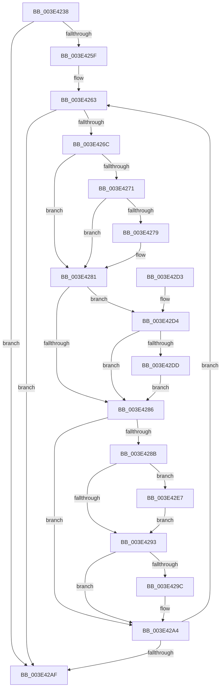

# RaspDestroySegmentList

- RVA: `0x003E4238`–`0x003E42F1` (길이 `185` bytes)
- VA: `0x00000001403E4238`
- 실행 섹션: `.text`
- PDB 이름 있음: `예`; PDB Function 태그: `아니요`
- unwind 정보 RVA: `0x0007CD24`
- 디코드: `61`개 명령, `185/185` bytes 표시
- 미해석 바이트: `0` (있으면 어셈블리에 `.byte`로 보존)

> 이 문서는 커널 이미지의 기계어와 PDB 기호를 분석해 생성했습니다. 4번과 5번은 함수 원형과 자료형을 바이너리 사용 방식에서 추정한 C 해석이며 원본 소스 복구 결과는 아닙니다.

## 1. Dependencies

- 직접 호출 지점: **5**; 고유 호출 대상: **1**
- 직접 호출자로 확인된 함수: **2**
- RIP 상대 이미지 참조: **0**

### Outgoing calls
- `0x003E427C` → [RaspFreeMemory](RaspFreeMemory_function_003E28E4.md) (function, `0x003E28E4`)
- `0x003E429F` → [RaspFreeMemory](RaspFreeMemory_function_003E28E4.md) (function, `0x003E28E4`)
- `0x003E42B5` → [RaspFreeMemory](RaspFreeMemory_function_003E28E4.md) (function, `0x003E28E4`)
- `0x003E42E0` → [RaspFreeMemory](RaspFreeMemory_function_003E28E4.md) (function, `0x003E28E4`)
- `0x003E42EA` → [RaspFreeMemory](RaspFreeMemory_function_003E28E4.md) (function, `0x003E28E4`)

### Direct callers
- [RaspScanConvert](RaspScanConvert_function_003E3760.md) at `0x003E3A1F`
- [RaspCreateSegmentList](RaspCreateSegmentList_function_003E3ED8.md) at `0x003E4202`

### Static image references
- 디코드된 RIP-relative 메모리 참조가 없습니다.

## 2. Other-region calls and transfers

- 다른 실행 섹션으로 향하는 call: **0**
- 별도 외부 분기/꼬리 이동을 확인하지 못했습니다.

## 3. Assembly (complete function range)

```asm
003E4238  48 89 5C 24 08                  mov qword ptr [rsp + 8], rbx
003E423D  48 89 6C 24 10                  mov qword ptr [rsp + 0x10], rbp
003E4242  48 89 74 24 18                  mov qword ptr [rsp + 0x18], rsi
003E4247  57                              push rdi
003E4248  41 56                           push r14
003E424A  41 57                           push r15
003E424C  48 83 EC 20                     sub rsp, 0x20
003E4250  33 F6                           xor esi, esi
003E4252  49 8B F8                        mov rdi, r8
003E4255  44 8B FA                        mov r15d, edx
003E4258  48 8B E9                        mov rbp, rcx
003E425B  85 D2                           test edx, edx
003E425D  74 50                           je 0x1403e42af
003E425F  48 8D 59 18                     lea rbx, [rcx + 0x18]
003E4263  4C 8D 73 E8                     lea r14, [rbx - 0x18]
003E4267  4D 85 F6                        test r14, r14
003E426A  74 43                           je 0x1403e42af
003E426C  80 3B 03                        cmp byte ptr [rbx], 3
003E426F  75 10                           jne 0x1403e4281
003E4271  49 8B 0E                        mov rcx, qword ptr [r14]
003E4274  48 85 C9                        test rcx, rcx
003E4277  74 08                           je 0x1403e4281
003E4279  48 8B D7                        mov rdx, rdi
003E427C  E8 63 E6 FF FF                  call 0x1403e28e4
003E4281  80 3B 04                        cmp byte ptr [rbx], 4
003E4284  74 4E                           je 0x1403e42d4
003E4286  80 3B 05                        cmp byte ptr [rbx], 5
003E4289  75 19                           jne 0x1403e42a4
003E428B  49 8B 0E                        mov rcx, qword ptr [r14]
003E428E  48 85 C9                        test rcx, rcx
003E4291  75 54                           jne 0x1403e42e7
003E4293  48 8B 4B F8                     mov rcx, qword ptr [rbx - 8]
003E4297  48 85 C9                        test rcx, rcx
003E429A  74 08                           je 0x1403e42a4
003E429C  48 8B D7                        mov rdx, rdi
003E429F  E8 40 E6 FF FF                  call 0x1403e28e4
003E42A4  48 83 C3 19                     add rbx, 0x19
003E42A8  FF C6                           inc esi
003E42AA  41 3B F7                        cmp esi, r15d
003E42AD  72 B4                           jb 0x1403e4263
003E42AF  48 8B D7                        mov rdx, rdi
003E42B2  48 8B CD                        mov rcx, rbp
003E42B5  E8 2A E6 FF FF                  call 0x1403e28e4
003E42BA  48 8B 5C 24 40                  mov rbx, qword ptr [rsp + 0x40]
003E42BF  48 8B 6C 24 48                  mov rbp, qword ptr [rsp + 0x48]
003E42C4  48 8B 74 24 50                  mov rsi, qword ptr [rsp + 0x50]
003E42C9  48 83 C4 20                     add rsp, 0x20
003E42CD  41 5F                           pop r15
003E42CF  41 5E                           pop r14
003E42D1  5F                              pop rdi
003E42D2  C3                              ret
003E42D3  CC                              int3
003E42D4  48 8B 4B F8                     mov rcx, qword ptr [rbx - 8]
003E42D8  48 85 C9                        test rcx, rcx
003E42DB  74 A9                           je 0x1403e4286
003E42DD  48 8B D7                        mov rdx, rdi
003E42E0  E8 FF E5 FF FF                  call 0x1403e28e4
003E42E5  EB 9F                           jmp 0x1403e4286
003E42E7  48 8B D7                        mov rdx, rdi
003E42EA  E8 F5 E5 FF FF                  call 0x1403e28e4
003E42EF  EB A2                           jmp 0x1403e4293
```

## 4. C-style interpretation (structured pseudocode)

```c
__int64 __fastcall RaspDestroySegmentList(__int64 a1, int a2, __int64 a3)
{
    __int64 result;
    __int64 v_rbx;
    __int64 v_rsi;
    __int64 v_rsp;
    unsigned __int64 v_stack_p10;
    unsigned __int64 v_stack_p18;
    unsigned __int64 v_stack_p8;

    v_stack_p8 = v_rbx;
    v_stack_p10 = v_rbp;
    v_stack_p18 = v_rsi;
    v_rsp = (v_rsp) - (32);
    v_rsi = 0;
    if (a2 == 0) goto loc_003E42AF;
loc_003E4263:
    if (a1 + 24 - 24 == 0) goto loc_003E42AF;
    if ((*(unsigned __int8 *)(a1 + 24)) != 3) goto loc_003E4281;
    if (*(unsigned __int64 *)(a1 + 24 - 24) != 0) {
        a2 = a3;
        result = RaspFreeMemory(*(unsigned __int64 *)(a1 + 24 - 24), a2, a3, a4);
    }
    if ((*(unsigned __int8 *)(a1 + 24)) == 4) goto loc_003E42D4;
loc_003E4286:
    if ((*(unsigned __int8 *)(a1 + 24)) != 5) goto loc_003E42A4;
    if (*(unsigned __int64 *)(a1 + 24 - 24) != 0) goto loc_003E42E7;
loc_003E4293:
    if (*(unsigned __int64 *)(a1 + 24 - 8) != 0) {
        a2 = a3;
        result = RaspFreeMemory(*(unsigned __int64 *)(a1 + 24 - 8), a2, a3, a4);
    }
    v_rbx = (a1 + 24) + (25);
    v_rsi = (unsigned int)((v_rsi) + 1);
    if (((unsigned int)(v_rsi)) < ((unsigned int)((unsigned int)(a2)))) goto loc_003E4263;
loc_003E42AF:
    result = RaspFreeMemory(a1, a3, a3, a4);
    v_rsp = (v_rsp) + (32);
    return result;
loc_003E42D4:
    if (*(unsigned __int64 *)(v_stack_p8 - 8) == 0) goto loc_003E4286;
    result = RaspFreeMemory(*(unsigned __int64 *)(v_stack_p8 - 8), a3, a3, a4);
    goto loc_003E4286;
loc_003E42E7:
    result = RaspFreeMemory(*(unsigned __int64 *)(v_stack_p8 - 8), a3, a3, a4);
    goto loc_003E4293;
}
```

## 5. (Beta) C Style

```c
int64_t RaspDestroySegmentList(void *Arg1, int32_t Arg2, int64_t Arg3)
{
    uint8_t *arg1 = (uint8_t *)Arg1;

    int64_t result;
    int64_t local_rbx;
    int64_t local_rsi;
    int64_t local_rsp;
    uint64_t v_stack_p10;
    uint64_t v_stack_p18;
    uint64_t v_stack_p8;

    v_stack_p8 = local_rbx;
    v_stack_p10 = local_rbp;
    v_stack_p18 = local_rsi;
    local_rsp = (local_rsp) - (32);
    local_rsi = 0;
    if (Arg2 == 0) goto loc_003E42AF;
loc_003E4263:
    if (Arg1 + 24 - 24 == 0) goto loc_003E42AF;
    if ((*(uint8_t *)(arg1 + 0x18)) != 3) goto loc_003E4281;
    if (*(uint64_t *)(arg1 + 0x18 - 0x18) != 0) {
        Arg2 = Arg3;
        result = RaspFreeMemory(*(uint64_t *)(arg1 + 0x18 - 0x18), Arg2, Arg3, a4);
    }
    if ((*(uint8_t *)(arg1 + 0x18)) == 4) goto loc_003E42D4;
loc_003E4286:
    if ((*(uint8_t *)(arg1 + 0x18)) != 5) goto loc_003E42A4;
    if (*(uint64_t *)(arg1 + 0x18 - 0x18) != 0) goto loc_003E42E7;
loc_003E4293:
    if (*(uint64_t *)(arg1 + 0x18 - 0x8) != 0) {
        Arg2 = Arg3;
        result = RaspFreeMemory(*(uint64_t *)(arg1 + 0x18 - 0x8), Arg2, Arg3, a4);
    }
    local_rbx = (Arg1 + 24) + (25);
    local_rsi = (uint32_t)((local_rsi) + 1);
    if (((uint32_t)(local_rsi)) < ((uint32_t)((uint32_t)(Arg2)))) goto loc_003E4263;
loc_003E42AF:
    result = RaspFreeMemory(Arg1, Arg3, Arg3, a4);
    local_rsp = (local_rsp) + (32);
    return result;
loc_003E42D4:
    if (*(uint64_t *)(v_stack_p8 - 0x8) == 0) goto loc_003E4286;
    result = RaspFreeMemory(*(uint64_t *)(v_stack_p8 - 0x8), Arg3, Arg3, a4);
    goto loc_003E4286;
loc_003E42E7:
    result = RaspFreeMemory(*(uint64_t *)(v_stack_p8 - 0x8), Arg3, Arg3, a4);
    goto loc_003E4293;
}
```

### 관측된 메모리 오프셋

구조체 형식이 확인되지 않은 접근은 인자 기준의 오프셋으로만 기록했습니다.

| 기준 인자 | 오프셋 표현 | 폭 (bit) | 접근 |
|---|---:|---:|---|
| `Arg1` | `- 0x18` | `64` | `R` |
| `Arg1` | `- 0x8` | `64` | `R` |
| `Arg1` | `+ 0x0` | `8` | `R` |
| `Arg1` | `+ 0x18` | `64` | `R` |

## 6. Execution-region graph

[열기: 2D/3D 그래프와 함수 탐색 컨트롤 패널](../../../control-panel.html?section=text&rva=0x003E4238&view=graph)

- 2D 그래프는 위에서 아래로 흐르고, 3D 그래프는 빈 공간을 드래그해 회전합니다. Shift+드래그는 이동, 휠은 확대·축소, 함수 노드 선택은 대상 보고서 이동입니다.

### Static fallback


