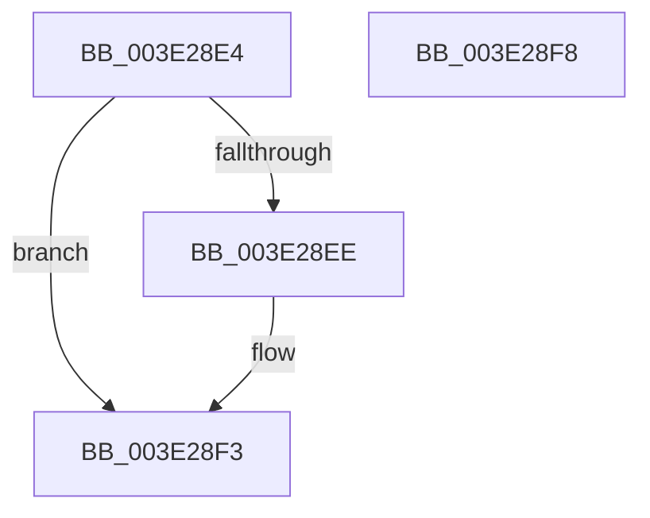

# RaspFreeMemory

- RVA: `0x003E28E4`–`0x003E28F9` (길이 `21` bytes)
- VA: `0x00000001403E28E4`
- 실행 섹션: `.text`
- PDB 이름 있음: `예`; PDB Function 태그: `아니요`
- unwind 정보 RVA: `0x0005C788`
- 디코드: `7`개 명령, `21/21` bytes 표시
- 미해석 바이트: `0` (있으면 어셈블리에 `.byte`로 보존)

> 이 문서는 커널 이미지의 기계어와 PDB 기호를 분석해 생성했습니다. 4번과 5번은 함수 원형과 자료형을 바이너리 사용 방식에서 추정한 C 해석이며 원본 소스 복구 결과는 아닙니다.

## 1. Dependencies

- 직접 호출 지점: **1**; 고유 호출 대상: **1**
- 직접 호출자로 확인된 함수: **12**
- RIP 상대 이미지 참조: **0**

### Outgoing calls
- `0x003E28EE` → [BgpFwFreeMemory](BgpFwFreeMemory_function_003E25E0.md) (function, `0x003E25E0`)

### Direct callers
- [RaspScanConvert](RaspScanConvert_function_003E3760.md) at `0x003E3A08`
- [RaspDestroySegmentList](RaspDestroySegmentList_function_003E4238.md) at `0x003E427C`
- [RaspDestroySegmentList](RaspDestroySegmentList_function_003E4238.md) at `0x003E429F`
- [RaspDestroySegmentList](RaspDestroySegmentList_function_003E4238.md) at `0x003E42B5`
- [RaspDestroySegmentList](RaspDestroySegmentList_function_003E4238.md) at `0x003E42E0`
- [RaspDestroySegmentList](RaspDestroySegmentList_function_003E4238.md) at `0x003E42EA`
- [RaspInitializeGlyphData](RaspInitializeGlyphData_function_003E54B8.md) at `0x003E577E`
- [RaspInitializeGlyphData](RaspInitializeGlyphData_function_003E54B8.md) at `0x003E5920`
- [BgpRasPrintGlyph](../47/BgpRasPrintGlyph_function_0047F3B4.md) at `0x0047F7BC`
- [BgpRasPrintGlyph](../47/BgpRasPrintGlyph_function_0047F3B4.md) at `0x0047F7D5`
- [RaspRectangleDestroy](../4F/RaspRectangleDestroy_function_004FC9E0.md) at `0x004FC9E4`
- [RaspGetCompositeGlyphList](../6A/RaspGetCompositeGlyphList_function_006A1B54.md) at `0x006A1E40`
- [RaspGetCompositeGlyphList](../6A/RaspGetCompositeGlyphList_function_006A1B54.md) at `0x006A1E4B`
- [RaspGetUnscaledGlyphData](../6A/RaspGetUnscaledGlyphData_function_006A1E84.md) at `0x006A1F56`
- [RaspGetXExtent](../6A/RaspGetXExtent_function_006A1F7C.md) at `0x006A210D`
- [RaspInitializeCompositeGlyphData](../6A/RaspInitializeCompositeGlyphData_function_006A2138.md) at `0x006A244B`
- [RaspInitializeCompositeGlyphData](../6A/RaspInitializeCompositeGlyphData_function_006A2138.md) at `0x006A245B`
- [RaspLoadCompositeGlyphData](../6A/RaspLoadCompositeGlyphData_function_006A261C.md) at `0x006A27AC`
- [RaspLoadCompositeGlyphData](../6A/RaspLoadCompositeGlyphData_function_006A261C.md) at `0x006A27B7`
- [RaspLoadCompositeGlyphData](../6A/RaspLoadCompositeGlyphData_function_006A261C.md) at `0x006A27D4`
- [RaspRasterize](../6A/RaspRasterize_function_006A2AA4.md) at `0x006A2B74`
- [RaspRasterize](../6A/RaspRasterize_function_006A2AA4.md) at `0x006A2B84`
- [RaspRasterize](../6A/RaspRasterize_function_006A2AA4.md) at `0x006A2B97`
- [RaspDestroyCachedBitmap](../../pagebgfx/BC/RaspDestroyCachedBitmap_function_00BC5CE8.md) at `0x00BC5D16`

### Static image references
- 디코드된 RIP-relative 메모리 참조가 없습니다.

## 2. Other-region calls and transfers

- 다른 실행 섹션으로 향하는 call: **0**
- 별도 외부 분기/꼬리 이동을 확인하지 못했습니다.

## 3. Assembly (complete function range)

```asm
003E28E4  48 83 EC 28                     sub rsp, 0x28
003E28E8  48 83 3A 00                     cmp qword ptr [rdx], 0
003E28EC  75 05                           jne 0x1403e28f3
003E28EE  E8 ED FC FF FF                  call 0x1403e25e0
003E28F3  48 83 C4 28                     add rsp, 0x28
003E28F7  C3                              ret
003E28F8  CC                              int3
```

## 4. C-style interpretation (structured pseudocode)

```c
__int64 __fastcall RaspFreeMemory(__int64 a1, __int64 a2)
{
    __int64 result;
    __int64 v_rsp;

    v_rsp = (v_rsp) - (40);
    if ((*(unsigned __int64 *)(a2)) == 0) {
        result = BgpFwFreeMemory(a1, a2, a3, a4);
    }
    v_rsp = (v_rsp) + (40);
    return result;
}
```

## 5. (Beta) C Style

```c
int64_t RaspFreeMemory(int64_t Arg1, void *Arg2)
{
    uint8_t *arg2 = (uint8_t *)Arg2;

    int64_t result;
    int64_t local_rsp;

    local_rsp = (local_rsp) - (40);
    if ((*(uint64_t *)(arg2)) == 0) {
        result = BgpFwFreeMemory(Arg1, Arg2, a3, a4);
    }
    local_rsp = (local_rsp) + (40);
    return result;
}
```

### 관측된 메모리 오프셋

구조체 형식이 확인되지 않은 접근은 인자 기준의 오프셋으로만 기록했습니다.

| 기준 인자 | 오프셋 표현 | 폭 (bit) | 접근 |
|---|---:|---:|---|
| `Arg2` | `+ 0x0` | `64` | `R` |

## 6. Execution-region graph

[열기: 2D/3D 그래프와 함수 탐색 컨트롤 패널](../../../control-panel.html?section=text&rva=0x003E28E4&view=graph)

- 2D 그래프는 위에서 아래로 흐르고, 3D 그래프는 빈 공간을 드래그해 회전합니다. Shift+드래그는 이동, 휠은 확대·축소, 함수 노드 선택은 대상 보고서 이동입니다.

### Static fallback


