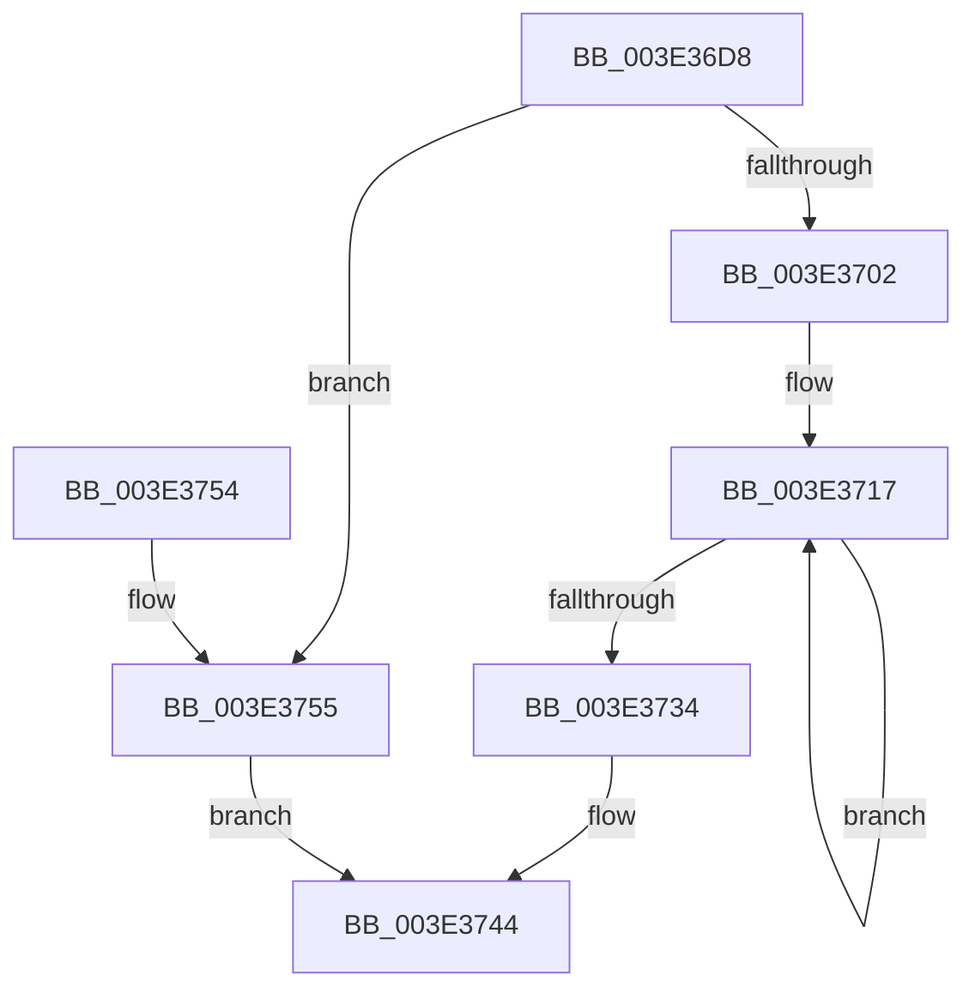

# RaspInterpolatePoint

- RVA: `0x003E36D8`–`0x003E3757` (길이 `127` bytes)
- VA: `0x00000001403E36D8`
- 실행 섹션: `.text`
- PDB 이름 있음: `예`; PDB Function 태그: `아니요`
- unwind 정보 RVA: `0x00094C9C`
- 디코드: `39`개 명령, `127/127` bytes 표시
- 미해석 바이트: `0` (있으면 어셈블리에 `.byte`로 보존)

> 이 문서는 커널 이미지의 기계어와 PDB 기호를 분석해 생성했습니다. 4번과 5번은 함수 원형과 자료형을 바이너리 사용 방식에서 추정한 C 해석이며 원본 소스 복구 결과는 아닙니다.

## 1. Dependencies

- 직접 호출 지점: **1**; 고유 호출 대상: **1**
- 직접 호출자로 확인된 함수: **2**
- RIP 상대 이미지 참조: **0**

### Outgoing calls
- `0x003E36F5` → [RaspAllocateMemory](RaspAllocateMemory_function_003E42F8.md) (function, `0x003E42F8`)

### Direct callers
- [RaspCreateSegmentList](RaspCreateSegmentList_function_003E3ED8.md) at `0x003E404C`
- [RaspCreateSegmentList](RaspCreateSegmentList_function_003E3ED8.md) at `0x003E407F`
- [RaspCreateSegmentList](RaspCreateSegmentList_function_003E3ED8.md) at `0x003E41C6`
- [sub_006EA8CA](../6E/Unknown_function_006EA8CA.md) at `0x006EA92B`

### Static image references
- 디코드된 RIP-relative 메모리 참조가 없습니다.

## 2. Other-region calls and transfers

- 다른 실행 섹션으로 향하는 call: **0**
- 별도 외부 분기/꼬리 이동을 확인하지 못했습니다.

## 3. Assembly (complete function range)

```asm
003E36D8  48 89 5C 24 08                  mov qword ptr [rsp + 8], rbx
003E36DD  48 89 74 24 10                  mov qword ptr [rsp + 0x10], rsi
003E36E2  57                              push rdi
003E36E3  48 83 EC 20                     sub rsp, 0x20
003E36E7  48 8B DA                        mov rbx, rdx
003E36EA  48 8B F9                        mov rdi, rcx
003E36ED  49 8B D0                        mov rdx, r8
003E36F0  B9 11 00 00 00                  mov ecx, 0x11
003E36F5  E8 FE 0B 00 00                  call 0x1403e42f8
003E36FA  4C 8B C0                        mov r8, rax
003E36FD  48 85 C0                        test rax, rax
003E3700  74 53                           je 0x1403e3755
003E3702  48 8B CF                        mov rcx, rdi
003E3705  4C 8B C8                        mov r9, rax
003E3708  48 2B CB                        sub rcx, rbx
003E370B  4C 8B D3                        mov r10, rbx
003E370E  4C 2B CB                        sub r9, rbx
003E3711  41 BB 04 00 00 00               mov r11d, 4
003E3717  42 8B 04 11                     mov eax, dword ptr [rcx + r10]
003E371B  BE 02 00 00 00                  mov esi, 2
003E3720  41 03 02                        add eax, dword ptr [r10]
003E3723  99                              cdq
003E3724  F7 FE                           idiv esi
003E3726  43 89 04 11                     mov dword ptr [r9 + r10], eax
003E372A  4D 8D 52 04                     lea r10, [r10 + 4]
003E372E  49 83 EB 01                     sub r11, 1
003E3732  75 E3                           jne 0x1403e3717
003E3734  8A 4F 10                        mov cl, byte ptr [rdi + 0x10]
003E3737  49 8B C0                        mov rax, r8
003E373A  0A 4B 10                        or cl, byte ptr [rbx + 0x10]
003E373D  80 C9 01                        or cl, 1
003E3740  41 88 48 10                     mov byte ptr [r8 + 0x10], cl
003E3744  48 8B 5C 24 30                  mov rbx, qword ptr [rsp + 0x30]
003E3749  48 8B 74 24 38                  mov rsi, qword ptr [rsp + 0x38]
003E374E  48 83 C4 20                     add rsp, 0x20
003E3752  5F                              pop rdi
003E3753  C3                              ret
003E3754  CC                              int3
003E3755  EB ED                           jmp 0x1403e3744
```

## 4. C-style interpretation (structured pseudocode)

```c
__int64 __fastcall RaspInterpolatePoint(__int64 a1, __int64 a2, __int64 a3)
{
    __int64 result;
    __int64 v_r11;
    __int64 v_rsp;
    unsigned __int64 v_stack_p10;
    unsigned __int64 v_stack_p8;

    v_stack_p8 = v_rbx;
    v_stack_p10 = v_rsi;
    v_rsp = (v_rsp) - (32);
    result = RaspAllocateMemory(17, a3, a3, a4);
    if (result == 0) goto loc_003E3755;
    a1 = (a1) - (a2);
    a4 = (result) - (a2);
loc_003E3717:
    result = (unsigned int)(((unsigned int)(*(unsigned int *)(a1 + a2 * 1))) + (*(unsigned int *)(a2)));
    *(unsigned int *)(a4 + a2 * 1) = (unsigned int)(result);
    v_r11 = (4) - (1);
    if (condition_is_not_equal) goto loc_003E3717;
    a1 = (unsigned __int8)((*(unsigned __int8 *)(a1 + 16)) | (*(unsigned __int8 *)(a2 + 16)));
    a1 = (unsigned __int8)((a1) | (1));
    *(unsigned __int8 *)(result + 16) = (unsigned __int8)(a1);
loc_003E3744:
    v_rsp = (v_rsp) + (32);
    return result;
loc_003E3755:
    goto loc_003E3744;
}
```

## 5. (Beta) C Style

```c
int64_t RaspInterpolatePoint(void *Arg1, void *Arg2, int64_t Arg3)
{
    uint8_t *arg1 = (uint8_t *)Arg1;
    uint8_t *arg2 = (uint8_t *)Arg2;

    int64_t result;
    int64_t local_r11;
    int64_t local_rsp;
    uint64_t v_stack_p10;
    uint64_t v_stack_p8;

    v_stack_p8 = local_rbx;
    v_stack_p10 = local_rsi;
    local_rsp = (local_rsp) - (32);
    result = RaspAllocateMemory(17, Arg3, Arg3, a4);
    if (result == 0) goto loc_003E3755;
    Arg1 = (Arg1) - (Arg2);
    a4 = (result) - (Arg2);
loc_003E3717:
    result = (uint32_t)(((uint32_t)(*(uint32_t *)(arg1 + arg2 * 1))) + (*(uint32_t *)(arg2)));
    *(uint32_t *)(a4 + arg2 * 1) = (uint32_t)(result);
    local_r11 = (4) - (1);
    if (condition_is_not_equal) goto loc_003E3717;
    Arg1 = (uint8_t)((*(uint8_t *)(arg1 + 0x10)) | (*(uint8_t *)(arg2 + 0x10)));
    Arg1 = (uint8_t)((Arg1) | (1));
    *(uint8_t *)(result + 0x10) = (uint8_t)(Arg1);
loc_003E3744:
    local_rsp = (local_rsp) + (32);
    return result;
loc_003E3755:
    goto loc_003E3744;
}
```

### 관측된 메모리 오프셋

구조체 형식이 확인되지 않은 접근은 인자 기준의 오프셋으로만 기록했습니다.

| 기준 인자 | 오프셋 표현 | 폭 (bit) | 접근 |
|---|---:|---:|---|
| `Arg1` | `+ 0x0 + r10*1` | `32` | `R` |
| `Arg1` | `+ 0x10` | `8` | `R` |
| `Arg2` | `+ 0x0` | `32` | `R` |
| `Arg2` | `+ 0x4` | `64` | `R` |
| `Arg2` | `+ 0x10` | `8` | `R` |

## 6. Execution-region graph

[열기: 2D/3D 그래프와 함수 탐색 컨트롤 패널](../../../control-panel.html?section=text&rva=0x003E36D8&view=graph)

- 2D 그래프는 위에서 아래로 흐르고, 3D 그래프는 빈 공간을 드래그해 회전합니다. Shift+드래그는 이동, 휠은 확대·축소, 함수 노드 선택은 대상 보고서 이동입니다.

### Static fallback


