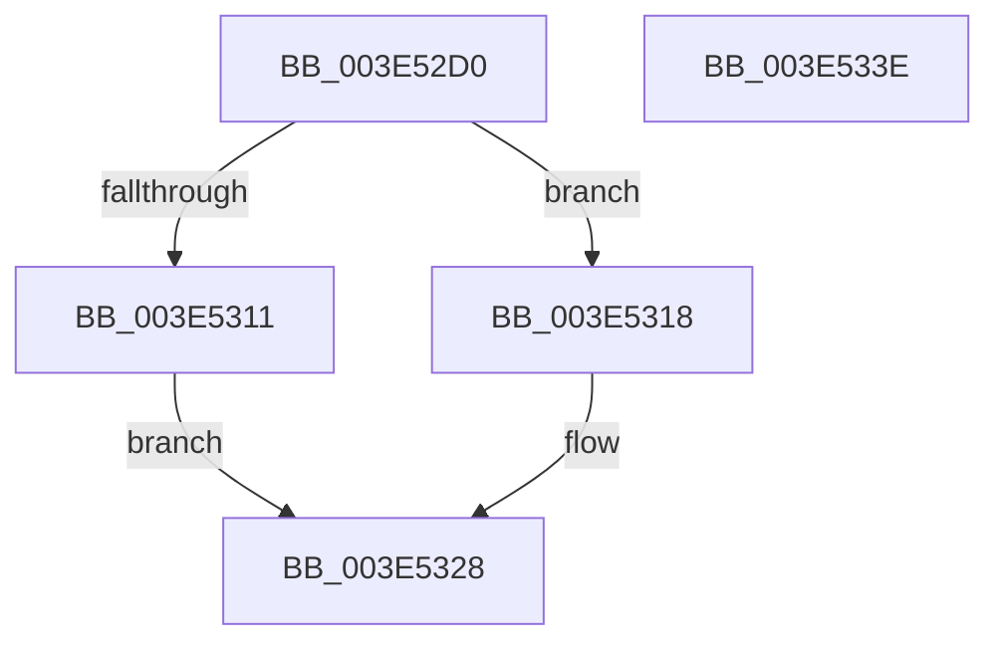

# RaspRectangleCreate

- RVA: `0x003E52D0`–`0x003E533F` (길이 `111` bytes)
- VA: `0x00000001403E52D0`
- 실행 섹션: `.text`
- PDB 이름 있음: `예`; PDB Function 태그: `아니요`
- unwind 정보 RVA: `0x0006F978`
- 디코드: `34`개 명령, `111/111` bytes 표시
- 미해석 바이트: `0` (있으면 어셈블리에 `.byte`로 보존)

> 이 문서는 커널 이미지의 기계어와 PDB 기호를 분석해 생성했습니다. 4번과 5번은 함수 원형과 자료형을 바이너리 사용 방식에서 추정한 C 해석이며 원본 소스 복구 결과는 아닙니다.

## 1. Dependencies

- 직접 호출 지점: **2**; 고유 호출 대상: **2**
- 직접 호출자로 확인된 함수: **1**
- RIP 상대 이미지 참조: **0**

### Outgoing calls
- `0x003E5304` → [RaspAllocateMemory](RaspAllocateMemory_function_003E42F8.md) (function, `0x003E42F8`)
- `0x003E5320` → [BgpGxInitializeRectangle](../69/BgpGxInitializeRectangle_function_0069F1E4.md) (function, `0x0069F1E4`)

### Direct callers
- [BgpRasPrintGlyph](../47/BgpRasPrintGlyph_function_0047F3B4.md) at `0x0047F6F7`

### Static image references
- 디코드된 RIP-relative 메모리 참조가 없습니다.

## 2. Other-region calls and transfers

- 다른 실행 섹션으로 향하는 call: **0**
- 별도 외부 분기/꼬리 이동을 확인하지 못했습니다.

## 3. Assembly (complete function range)

```asm
003E52D0  48 89 5C 24 08                  mov qword ptr [rsp + 8], rbx
003E52D5  48 89 74 24 10                  mov qword ptr [rsp + 0x10], rsi
003E52DA  48 89 7C 24 18                  mov qword ptr [rsp + 0x18], rdi
003E52DF  41 56                           push r14
003E52E1  48 83 EC 20                     sub rsp, 0x20
003E52E5  8B 59 04                        mov ebx, dword ptr [rcx + 4]
003E52E8  8B F2                           mov esi, edx
003E52EA  0F AF 19                        imul ebx, dword ptr [rcx]
003E52ED  48 8B F9                        mov rdi, rcx
003E52F0  4D 8B F0                        mov r14, r8
003E52F3  0F AF DA                        imul ebx, edx
003E52F6  49 8B D1                        mov rdx, r9
003E52F9  83 C3 07                        add ebx, 7
003E52FC  C1 EB 03                        shr ebx, 3
003E52FF  83 C3 48                        add ebx, 0x48
003E5302  8B CB                           mov ecx, ebx
003E5304  E8 EF EF FF FF                  call 0x1403e42f8
003E5309  4C 8B C0                        mov r8, rax
003E530C  48 85 C0                        test rax, rax
003E530F  75 07                           jne 0x1403e5318
003E5311  B8 17 00 00 C0                  mov eax, 0xc0000017
003E5316  EB 10                           jmp 0x1403e5328
003E5318  44 8B CB                        mov r9d, ebx
003E531B  8B D6                           mov edx, esi
003E531D  48 8B CF                        mov rcx, rdi
003E5320  E8 BF 9E 2B 00                  call 0x14069f1e4
003E5325  4D 89 06                        mov qword ptr [r14], r8
003E5328  48 8B 5C 24 30                  mov rbx, qword ptr [rsp + 0x30]
003E532D  48 8B 74 24 38                  mov rsi, qword ptr [rsp + 0x38]
003E5332  48 8B 7C 24 40                  mov rdi, qword ptr [rsp + 0x40]
003E5337  48 83 C4 20                     add rsp, 0x20
003E533B  41 5E                           pop r14
003E533D  C3                              ret
003E533E  CC                              int3
```

## 4. C-style interpretation (structured pseudocode)

```c
__int64 __fastcall RaspRectangleCreate(__int64 a1, int a2, __int64 a3, __int64 a4)
{
    __int64 result;
    __int64 v_rbx;
    __int64 v_rsp;
    unsigned __int64 v_stack_p10;
    unsigned __int64 v_stack_p18;
    unsigned __int64 v_stack_p8;

    v_stack_p8 = v_rbx;
    v_stack_p10 = v_rsi;
    v_stack_p18 = v_rdi;
    v_rsp = (v_rsp) - (32);
    v_rbx = (unsigned int)(((unsigned int)(*(unsigned int *)(a1 + 4))) * (*(unsigned int *)(a1)));
    v_rbx = (unsigned int)((v_rbx) * (a2));
    v_rbx = (unsigned int)((v_rbx) + (7));
    v_rbx = (unsigned int)((v_rbx) >> (3));
    v_rbx = (unsigned int)((v_rbx) + (72));
    result = RaspAllocateMemory((unsigned int)((unsigned int)(v_rbx)), a4, a3, a4);
    if (result != 0) goto loc_003E5318;
    goto loc_003E5328;
loc_003E5318:
    result = BgpGxInitializeRectangle(a1, (unsigned int)((unsigned int)((unsigned int)(a2))), result, (unsigned int)((unsigned int)(v_rbx)));
    *(unsigned __int64 *)(a3) = result;
loc_003E5328:
    v_rsp = (v_rsp) + (32);
    return result;
}
```

## 5. (Beta) C Style

```c
int64_t RaspRectangleCreate(void *Arg1, int32_t Arg2, void *Arg3, int64_t Arg4)
{
    uint8_t *arg1 = (uint8_t *)Arg1;
    uint8_t *arg3 = (uint8_t *)Arg3;

    int64_t result;
    int64_t local_rbx;
    int64_t local_rsp;
    uint64_t v_stack_p10;
    uint64_t v_stack_p18;
    uint64_t v_stack_p8;

    v_stack_p8 = local_rbx;
    v_stack_p10 = local_rsi;
    v_stack_p18 = local_rdi;
    local_rsp = (local_rsp) - (32);
    local_rbx = (uint32_t)(((uint32_t)(*(uint32_t *)(arg1 + 0x4))) * (*(uint32_t *)(arg1)));
    local_rbx = (uint32_t)((local_rbx) * (Arg2));
    local_rbx = (uint32_t)((local_rbx) + (7));
    local_rbx = (uint32_t)((local_rbx) >> (3));
    local_rbx = (uint32_t)((local_rbx) + (72));
    result = RaspAllocateMemory((uint32_t)((uint32_t)(local_rbx)), Arg4, Arg3, Arg4);
    if (result != 0) goto loc_003E5318;
    goto loc_003E5328;
loc_003E5318:
    result = BgpGxInitializeRectangle(Arg1, (uint32_t)((uint32_t)((uint32_t)(Arg2))), result, (uint32_t)((uint32_t)(local_rbx)));
    *(uint64_t *)(arg3) = result;
loc_003E5328:
    local_rsp = (local_rsp) + (32);
    return result;
}
```

### 관측된 메모리 오프셋

구조체 형식이 확인되지 않은 접근은 인자 기준의 오프셋으로만 기록했습니다.

| 기준 인자 | 오프셋 표현 | 폭 (bit) | 접근 |
|---|---:|---:|---|
| `Arg1` | `+ 0x0` | `32` | `R` |
| `Arg1` | `+ 0x4` | `32` | `R` |
| `Arg3` | `+ 0x0` | `64` | `W` |

## 6. Execution-region graph

[열기: 2D/3D 그래프와 함수 탐색 컨트롤 패널](../../../control-panel.html?section=text&rva=0x003E52D0&view=graph)

- 2D 그래프는 위에서 아래로 흐르고, 3D 그래프는 빈 공간을 드래그해 회전합니다. Shift+드래그는 이동, 휠은 확대·축소, 함수 노드 선택은 대상 보고서 이동입니다.

### Static fallback


