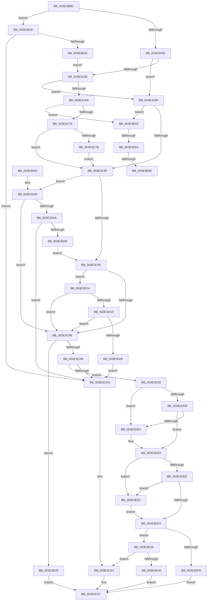

# RaspTestIntersection

- RVA: `0x003E3BBC`–`0x003E3E75` (길이 `697` bytes)
- VA: `0x00000001403E3BBC`
- 실행 섹션: `.text`
- PDB 이름 있음: `예`; PDB Function 태그: `예`
- unwind 정보 RVA: `0x00094CCC`
- 디코드: `203`개 명령, `697/697` bytes 표시
- 미해석 바이트: `0` (있으면 어셈블리에 `.byte`로 보존)

> 이 문서는 커널 이미지의 기계어와 PDB 기호를 분석해 생성했습니다. 4번과 5번은 함수 원형과 자료형을 바이너리 사용 방식에서 추정한 C 해석이며 원본 소스 복구 결과는 아닙니다.

## 1. Dependencies

- 직접 호출 지점: **1**; 고유 호출 대상: **1**
- 직접 호출자로 확인된 함수: **1**
- RIP 상대 이미지 참조: **0**

### Outgoing calls
- `0x003E3D28` → [BgpFmSqrt](BgpFmSqrt_function_003E3E7C.md) (function, `0x003E3E7C`)

### Direct callers
- [RaspScanConvert](RaspScanConvert_function_003E3760.md) at `0x003E395D`

### Static image references
- 디코드된 RIP-relative 메모리 참조가 없습니다.

## 2. Other-region calls and transfers

- 다른 실행 섹션으로 향하는 call: **0**
- call이 아닌 외부 분기/꼬리 이동: **3**
  - `0x003E3E5E` → [sub_006EA898](../6E/Unknown_function_006EA898.md) (`tail-transfer`)
  - `0x003E3E67` → [sub_006EA898 + 0x2A](../6E/Unknown_function_006EA898.md) (`tail-transfer`)
  - `0x003E3E70` → [sub_006EA898](../6E/Unknown_function_006EA898.md) (`tail-transfer`)

## 3. Assembly (complete function range)

```asm
003E3BBC  48 89 5C 24 10                  mov qword ptr [rsp + 0x10], rbx
003E3BC1  48 89 6C 24 18                  mov qword ptr [rsp + 0x18], rbp
003E3BC6  48 89 74 24 20                  mov qword ptr [rsp + 0x20], rsi
003E3BCB  57                              push rdi
003E3BCC  41 54                           push r12
003E3BCE  41 55                           push r13
003E3BD0  41 56                           push r14
003E3BD2  41 57                           push r15
003E3BD4  48 83 EC 30                     sub rsp, 0x30
003E3BD8  4C 8B 11                        mov r10, qword ptr [rcx]
003E3BDB  4D 8B D9                        mov r11, r9
003E3BDE  4C 8B 69 08                     mov r13, qword ptr [rcx + 8]
003E3BE2  49 8B D8                        mov rbx, r8
003E3BE5  4C 8B E1                        mov r12, rcx
003E3BE8  48 8B 49 10                     mov rcx, qword ptr [rcx + 0x10]
003E3BEC  41 8B 42 08                     mov eax, dword ptr [r10 + 8]
003E3BF0  41 03 02                        add eax, dword ptr [r10]
003E3BF3  48 98                           cdqe
003E3BF5  48 8B E8                        mov rbp, rax
003E3BF8  48 89 44 24 20                  mov qword ptr [rsp + 0x20], rax
003E3BFD  41 8B 42 0C                     mov eax, dword ptr [r10 + 0xc]
003E3C01  41 03 42 04                     add eax, dword ptr [r10 + 4]
003E3C05  4C 63 D0                        movsxd r10, eax
003E3C08  41 8B 45 0C                     mov eax, dword ptr [r13 + 0xc]
003E3C0C  4D 8B CA                        mov r9, r10
003E3C0F  41 03 45 04                     add eax, dword ptr [r13 + 4]
003E3C13  48 63 F8                        movsxd rdi, eax
003E3C16  8B 41 08                        mov eax, dword ptr [rcx + 8]
003E3C19  4C 8B F7                        mov r14, rdi
003E3C1C  03 01                           add eax, dword ptr [rcx]
003E3C1E  48 98                           cdqe
003E3C20  48 8B F0                        mov rsi, rax
003E3C23  48 89 44 24 28                  mov qword ptr [rsp + 0x28], rax
003E3C28  8B 41 0C                        mov eax, dword ptr [rcx + 0xc]
003E3C2B  03 41 04                        add eax, dword ptr [rcx + 4]
003E3C2E  4C 63 F8                        movsxd r15, eax
003E3C31  48 63 C2                        movsxd rax, edx
003E3C34  4D 8B C7                        mov r8, r15
003E3C37  48 8B D0                        mov rdx, rax
003E3C3A  48 C1 E5 10                     shl rbp, 0x10
003E3C3E  48 C1 E2 10                     shl rdx, 0x10
003E3C42  49 C1 E1 10                     shl r9, 0x10
003E3C46  49 C1 E6 10                     shl r14, 0x10
003E3C4A  48 C1 E6 10                     shl rsi, 0x10
003E3C4E  49 C1 E0 10                     shl r8, 0x10
003E3C52  48 89 44 24 60                  mov qword ptr [rsp + 0x60], rax
003E3C57  4D 3B C8                        cmp r9, r8
003E3C5A  0F 84 E5 01 00 00               je 0x1403e3e45
003E3C60  4C 3B CA                        cmp r9, rdx
003E3C63  74 1B                           je 0x1403e3c80
003E3C65  4C 3B C2                        cmp r8, rdx
003E3C68  74 16                           je 0x1403e3c80
003E3C6A  41 80 7C 24 18 01               cmp byte ptr [r12 + 0x18], 1
003E3C70  0F 84 DD 01 00 00               je 0x1403e3e53
003E3C76  4C 3B F2                        cmp r14, rdx
003E3C79  75 14                           jne 0x1403e3c8f
003E3C7B  48 FF C2                        inc rdx
003E3C7E  EB 0F                           jmp 0x1403e3c8f
003E3C80  48 FF C2                        inc rdx
003E3C83  41 80 7C 24 18 01               cmp byte ptr [r12 + 0x18], 1
003E3C89  0F 84 C4 01 00 00               je 0x1403e3e53
003E3C8F  4C 3B CA                        cmp r9, rdx
003E3C92  7F 71                           jg 0x1403e3d05
003E3C94  7C 7E                           jl 0x1403e3d14
003E3C96  4B 8D 04 36                     lea rax, [r14 + r14]
003E3C9A  49 8B C8                        mov rcx, r8
003E3C9D  48 2B C8                        sub rcx, rax
003E3CA0  49 03 C9                        add rcx, r9
003E3CA3  0F 84 60 01 00 00               je 0x1403e3e09
003E3CA9  41 8B 45 08                     mov eax, dword ptr [r13 + 8]
003E3CAD  41 03 45 00                     add eax, dword ptr [r13]
003E3CB1  48 63 E8                        movsxd rbp, eax
003E3CB4  48 8D 04 3F                     lea rax, [rdi + rdi]
003E3CB8  49 2B FA                        sub rdi, r10
003E3CBB  4C 2B F8                        sub r15, rax
003E3CBE  4D 03 FA                        add r15, r10
003E3CC1  48 03 FF                        add rdi, rdi
003E3CC4  4C 2B 54 24 60                  sub r10, qword ptr [rsp + 0x60]
003E3CC9  48 8B CF                        mov rcx, rdi
003E3CCC  4D 0F AF D7                     imul r10, r15
003E3CD0  48 0F AF CF                     imul rcx, rdi
003E3CD4  49 C1 E2 02                     shl r10, 2
003E3CD8  49 2B CA                        sub rcx, r10
003E3CDB  79 4B                           jns 0x1403e3d28
003E3CDD  B8 FF FF FF 7F                  mov eax, 0x7fffffff
003E3CE2  89 03                           mov dword ptr [rbx], eax
003E3CE4  41 89 03                        mov dword ptr [r11], eax
003E3CE7  48 8B 5C 24 68                  mov rbx, qword ptr [rsp + 0x68]
003E3CEC  48 8B 6C 24 70                  mov rbp, qword ptr [rsp + 0x70]
003E3CF1  48 8B 74 24 78                  mov rsi, qword ptr [rsp + 0x78]
003E3CF6  48 83 C4 30                     add rsp, 0x30
003E3CFA  41 5F                           pop r15
003E3CFC  41 5E                           pop r14
003E3CFE  41 5D                           pop r13
003E3D00  41 5C                           pop r12
003E3D02  5F                              pop rdi
003E3D03  C3                              ret
003E3D04  CC                              int3
003E3D05  4C 3B F2                        cmp r14, rdx
003E3D08  7E 8C                           jle 0x1403e3c96
003E3D0A  4C 3B C2                        cmp r8, rdx
003E3D0D  7F CE                           jg 0x1403e3cdd
003E3D0F  4C 3B CA                        cmp r9, rdx
003E3D12  EB 80                           jmp 0x1403e3c94
003E3D14  4C 3B C2                        cmp r8, rdx
003E3D17  0F 8D 79 FF FF FF               jge 0x1403e3c96
003E3D1D  4C 3B F2                        cmp r14, rdx
003E3D20  0F 8D 70 FF FF FF               jge 0x1403e3c96
003E3D26  EB B5                           jmp 0x1403e3cdd
003E3D28  E8 4F 01 00 00                  call 0x1403e3e7c
003E3D2D  4C 8B D0                        mov r10, rax
003E3D30  4B 8D 0C 3F                     lea rcx, [r15 + r15]
003E3D34  48 F7 DF                        neg rdi
003E3D37  41 B9 00 00 01 00               mov r9d, 0x10000
003E3D3D  48 C1 E7 10                     shl rdi, 0x10
003E3D41  45 8B C1                        mov r8d, r9d
003E3D44  48 03 C7                        add rax, rdi
003E3D47  49 BC 00 00 00 00 01 00 00 00   movabs r12, 0x100000000
003E3D51  48 99                           cqo
003E3D53  49 2B FA                        sub rdi, r10
003E3D56  48 F7 F9                        idiv rcx
003E3D59  48 8B F0                        mov rsi, rax
003E3D5C  48 8B C7                        mov rax, rdi
003E3D5F  48 99                           cqo
003E3D61  4C 2B C6                        sub r8, rsi
003E3D64  48 F7 F9                        idiv rcx
003E3D67  49 8B D0                        mov rdx, r8
003E3D6A  48 8B CE                        mov rcx, rsi
003E3D6D  48 0F AF 54 24 20               imul rdx, qword ptr [rsp + 0x20]
003E3D73  48 0F AF CD                     imul rcx, rbp
003E3D77  48 8B F8                        mov rdi, rax
003E3D7A  48 8D 04 4A                     lea rax, [rdx + rcx*2]
003E3D7E  48 8B CE                        mov rcx, rsi
003E3D81  49 0F AF C0                     imul rax, r8
003E3D85  48 0F AF CE                     imul rcx, rsi
003E3D89  45 8B C1                        mov r8d, r9d
003E3D8C  4C 2B C7                        sub r8, rdi
003E3D8F  48 0F AF 4C 24 28               imul rcx, qword ptr [rsp + 0x28]
003E3D95  48 03 C1                        add rax, rcx
003E3D98  48 8B CF                        mov rcx, rdi
003E3D9B  48 99                           cqo
003E3D9D  49 F7 FC                        idiv r12
003E3DA0  48 0F AF CD                     imul rcx, rbp
003E3DA4  4C 8B D0                        mov r10, rax
003E3DA7  89 03                           mov dword ptr [rbx], eax
003E3DA9  49 8B D0                        mov rdx, r8
003E3DAC  48 0F AF 54 24 20               imul rdx, qword ptr [rsp + 0x20]
003E3DB2  48 8D 04 4A                     lea rax, [rdx + rcx*2]
003E3DB6  48 8B CF                        mov rcx, rdi
003E3DB9  49 0F AF C0                     imul rax, r8
003E3DBD  48 0F AF CF                     imul rcx, rdi
003E3DC1  48 0F AF 4C 24 28               imul rcx, qword ptr [rsp + 0x28]
003E3DC7  48 03 C1                        add rax, rcx
003E3DCA  48 99                           cqo
003E3DCC  49 F7 FC                        idiv r12
003E3DCF  41 89 03                        mov dword ptr [r11], eax
003E3DD2  48 8B C8                        mov rcx, rax
003E3DD5  B8 FF FF FF 7F                  mov eax, 0x7fffffff
003E3DDA  48 85 F6                        test rsi, rsi
003E3DDD  78 05                           js 0x1403e3de4
003E3DDF  49 3B F1                        cmp rsi, r9
003E3DE2  7E 05                           jle 0x1403e3de9
003E3DE4  89 03                           mov dword ptr [rbx], eax
003E3DE6  44 8B D0                        mov r10d, eax
003E3DE9  48 85 FF                        test rdi, rdi
003E3DEC  78 14                           js 0x1403e3e02
003E3DEE  49 3B F9                        cmp rdi, r9
003E3DF1  7F 0F                           jg 0x1403e3e02
003E3DF3  44 3B D1                        cmp r10d, ecx
003E3DF6  7E 42                           jle 0x1403e3e3a
003E3DF8  89 0B                           mov dword ptr [rbx], ecx
003E3DFA  45 89 13                        mov dword ptr [r11], r10d
003E3DFD  E9 E5 FE FF FF                  jmp 0x1403e3ce7
003E3E02  41 89 03                        mov dword ptr [r11], eax
003E3E05  8B C8                           mov ecx, eax
003E3E07  EB EA                           jmp 0x1403e3df3
003E3E09  49 2B D1                        sub rdx, r9
003E3E0C  41 C7 03 FF FF FF 7F            mov dword ptr [r11], 0x7fffffff
003E3E13  4D 2B C1                        sub r8, r9
003E3E16  48 2B F5                        sub rsi, rbp
003E3E19  48 0F AF D6                     imul rdx, rsi
003E3E1D  41 B9 00 00 01 00               mov r9d, 0x10000
003E3E23  48 8B C2                        mov rax, rdx
003E3E26  48 99                           cqo
003E3E28  49 F7 F8                        idiv r8
003E3E2B  48 03 C5                        add rax, rbp
003E3E2E  48 99                           cqo
003E3E30  49 F7 F9                        idiv r9
003E3E33  89 03                           mov dword ptr [rbx], eax
003E3E35  E9 AD FE FF FF                  jmp 0x1403e3ce7
003E3E3A  0F 84 A4 FE FF FF               je 0x1403e3ce4
003E3E40  E9 A2 FE FF FF                  jmp 0x1403e3ce7
003E3E45  4C 3B CA                        cmp r9, rdx
003E3E48  0F 84 8F FE FF FF               je 0x1403e3cdd
003E3E4E  E9 12 FE FF FF                  jmp 0x1403e3c65
003E3E53  B8 FF FF FF 7F                  mov eax, 0x7fffffff
003E3E58  41 89 03                        mov dword ptr [r11], eax
003E3E5B  4C 3B CA                        cmp r9, rdx
003E3E5E  0F 8E 34 6A 30 00               jle 0x1406ea898
003E3E64  4C 3B C2                        cmp r8, rdx
003E3E67  0F 8F 55 6A 30 00               jg 0x1406ea8c2
003E3E6D  4C 3B CA                        cmp r9, rdx
003E3E70  E9 23 6A 30 00                  jmp 0x1406ea898
```

## 4. C-style interpretation (structured pseudocode)

```c
__int64 __fastcall RaspTestIntersection(__int64 a1, int a2, __int64 a3, __int64 a4)
{
    __int64 result;
    __int64 v_r10;
    __int64 v_r14;
    __int64 v_r15;
    __int64 v_rbp;
    __int64 v_rdi;
    __int64 v_rsi;
    __int64 v_rsp;
    unsigned __int64 v_stack_m30;
    unsigned __int64 v_stack_m38;
    unsigned __int64 v_stack_p10;
    unsigned __int64 v_stack_p18;
    unsigned __int64 v_stack_p20;
    unsigned __int64 v_stack_p28;
    unsigned __int64 v_stack_p8;

    v_stack_p10 = v_rbx;
    v_stack_p18 = v_rbp;
    v_stack_p20 = v_rsi;
    v_rsp = (v_rsp) - (48);
    result = (unsigned int)(((unsigned int)(*(unsigned int *)(*(unsigned __int64 *)(a1) + 8))) + (*(unsigned int *)(*(unsigned __int64 *)(a1))));
    v_stack_m38 = result;
    result = (unsigned int)(((unsigned int)(*(unsigned int *)(*(unsigned __int64 *)(a1) + 12))) + (*(unsigned int *)(*(unsigned __int64 *)(a1) + 4)));
    result = (unsigned int)(((unsigned int)(*(unsigned int *)(*(unsigned __int64 *)(a1 + 8) + 12))) + (*(unsigned int *)(*(unsigned __int64 *)(a1 + 8) + 4)));
    result = (unsigned int)(((unsigned int)(*(unsigned int *)(*(unsigned __int64 *)(a1 + 16) + 8))) + (*(unsigned int *)(*(unsigned __int64 *)(a1 + 16))));
    v_stack_m30 = result;
    result = (unsigned int)(((unsigned int)(*(unsigned int *)(*(unsigned __int64 *)(a1 + 16) + 12))) + (*(unsigned int *)(*(unsigned __int64 *)(a1 + 16) + 4)));
    v_rbp = (result) << (16);
    a2 = ((int)(a2)) << (16);
    a4 = ((int)((unsigned int)(result))) << (16);
    v_r14 = ((int)((unsigned int)(result))) << (16);
    v_rsi = (result) << (16);
    a3 = ((int)((unsigned int)(result))) << (16);
    v_stack_p8 = (int)(a2);
    if (a4 == a3) goto loc_003E3E45;
    if (a4 == a2) goto loc_003E3C80;
loc_003E3C65:
    if (a3 == a2) goto loc_003E3C80;
    if ((*(unsigned __int8 *)(a1 + 24)) == 1) goto loc_003E3E53;
    if (v_r14 != a2) goto loc_003E3C8F;
    a2 = (a2) + 1;
    goto loc_003E3C8F;
loc_003E3C80:
    a2 = (a2) + 1;
    if ((*(unsigned __int8 *)(a1 + 24)) == 1) goto loc_003E3E53;
loc_003E3C8F:
    if (a4 > a2) goto loc_003E3D05;
loc_003E3C94:
    if (a4 < a2) goto loc_003E3D14;
loc_003E3C96:
    a1 = (a3) - (v_r14 + v_r14 * 1);
    a1 = (a1) + (a4);
    if (condition_is_equal) goto loc_003E3E09;
    result = (unsigned int)(((unsigned int)(*(unsigned int *)(*(unsigned __int64 *)(a1 + 8) + 8))) + (*(unsigned int *)(*(unsigned __int64 *)(a1 + 8))));
    v_rdi = ((int)((unsigned int)(result))) - ((int)((unsigned int)(result)));
    v_r15 = ((int)((unsigned int)(result))) - ((int)((unsigned int)(result)) + (int)((unsigned int)(result)) * 1);
    v_r15 = (v_r15) + ((int)((unsigned int)(result)));
    v_rdi = (v_rdi) + (v_rdi);
    v_r10 = ((int)((unsigned int)(result))) - (v_stack_p8);
    v_r10 = (v_r10) * (v_r15);
    a1 = (v_rdi) * (v_rdi);
    v_r10 = (v_r10) << (2);
    a1 = (a1) - (v_r10);
    if (!sign_flag) goto loc_003E3D28;
loc_003E3CDD:
    *(unsigned int *)(a3) = (unsigned int)((unsigned int)(0x7FFFFFFFULL));
loc_003E3CE4:
    *(unsigned int *)(a4) = (unsigned int)((unsigned int)(0x7FFFFFFFULL));
loc_003E3CE7:
    v_rsp = (v_rsp) + (48);
    return (unsigned int)(0x7FFFFFFFULL);
loc_003E3D05:
    if (v_r14 <= a2) goto loc_003E3C96;
    if (a3 > a2) goto loc_003E3CDD;
    goto loc_003E3C94;
loc_003E3D14:
    if (a3 >= a2) goto loc_003E3C96;
    if (v_r14 >= a2) goto loc_003E3C96;
    goto loc_003E3CDD;
loc_003E3D28:
    result = BgpFmSqrt(a1, a2, a3, a4);
    v_rdi = -(v_rdi);
    v_rdi = (v_rdi) << (16);
    result = (result) + (v_rdi);
    v_rdi = (v_rdi) - (result);
    a3 = ((unsigned int)((unsigned int)((unsigned int)(0x10000ULL)))) - (result);
    a2 = (a3) * (v_stack_p20);
    a1 = (result) * (v_stack_p18);
    result = (a2 + a1 * 2) * (a3);
    a1 = (result) * (result);
    a3 = ((unsigned int)((unsigned int)((unsigned int)(0x10000ULL)))) - (v_rdi);
    a1 = (a1) * (v_stack_p28);
    result = (result) + (a1);
    a1 = (v_rdi) * (v_stack_p18);
    *(unsigned int *)(v_stack_p10) = (unsigned int)(result);
    a2 = (a3) * (v_stack_p20);
    result = (a2 + a1 * 2) * (a3);
    a1 = (v_rdi) * (v_rdi);
    a1 = (a1) * (v_stack_p28);
    result = (result) + (a1);
    *(unsigned int *)(a4) = (unsigned int)(result);
    if (sign_flag) goto loc_003E3DE4;
    v_r10 = result;
    if (result >= = ((unsigned int)(0x10000ULL))) {
        *(unsigned int *)(v_stack_p10) = (unsigned int)((unsigned int)(0x7FFFFFFFULL));
        v_r10 = (unsigned int)((unsigned int)(0x7FFFFFFFULL));
    }
    if (sign_flag) goto loc_003E3E02;
    if (v_rdi > ((unsigned int)(0x10000ULL))) goto loc_003E3E02;
loc_003E3DF3:
    if (((unsigned int)(v_r10)) <= ((unsigned int)(result))) goto loc_003E3E3A;
    *(unsigned int *)(v_stack_p10) = (unsigned int)(result);
    *(unsigned int *)(a4) = (unsigned int)(v_r10);
    goto loc_003E3CE7;
loc_003E3E02:
    *(unsigned int *)(a4) = (unsigned int)((unsigned int)(0x7FFFFFFFULL));
    goto loc_003E3DF3;
loc_003E3E09:
    a2 = (a2) - ((unsigned int)(0x10000ULL));
    *(unsigned int *)(a4) = 0x7FFFFFFFULL;
    a3 = (a3) - ((unsigned int)(0x10000ULL));
    v_rsi = (result) - (v_stack_p18);
    a2 = (a2) * (v_rsi);
    result = (a2) + (v_stack_p18);
    *(unsigned int *)(v_stack_p10) = (unsigned int)(result);
    goto loc_003E3CE7;
loc_003E3E3A:
    if (condition_is_equal) goto loc_003E3CE4;
    goto loc_003E3CE7;
loc_003E3E45:
    if (((unsigned int)(0x10000ULL)) == a2) goto loc_003E3CDD;
    goto loc_003E3C65;
loc_003E3E53:
    *(unsigned int *)(a4) = (unsigned int)((unsigned int)(0x7FFFFFFFULL));
}
```

## 5. (Beta) C Style

```c
int64_t RaspTestIntersection(void *Arg1, int32_t Arg2, void *Arg3, void *Arg4)
{
    uint8_t *arg1 = (uint8_t *)Arg1;
    uint8_t *arg3 = (uint8_t *)Arg3;
    uint8_t *arg4 = (uint8_t *)Arg4;

    int64_t result;
    int64_t local_r10;
    int64_t local_r14;
    int64_t local_r15;
    int64_t local_rbp;
    int64_t local_rdi;
    int64_t local_rsi;
    int64_t local_rsp;
    uint64_t v_stack_m30;
    uint64_t v_stack_m38;
    uint64_t v_stack_p10;
    uint64_t v_stack_p18;
    uint64_t v_stack_p20;
    uint64_t v_stack_p28;
    uint64_t v_stack_p8;

    v_stack_p10 = local_rbx;
    v_stack_p18 = local_rbp;
    v_stack_p20 = local_rsi;
    local_rsp = (local_rsp) - (48);
    result = (uint32_t)(((uint32_t)(*(uint32_t *)(*(uint64_t *)(arg1) + 0x8))) + (*(uint32_t *)(*(uint64_t *)(arg1))));
    v_stack_m38 = result;
    result = (uint32_t)(((uint32_t)(*(uint32_t *)(*(uint64_t *)(arg1) + 0xC))) + (*(uint32_t *)(*(uint64_t *)(arg1) + 0x4)));
    result = (uint32_t)(((uint32_t)(*(uint32_t *)(*(uint64_t *)(arg1 + 0x8) + 0xC))) + (*(uint32_t *)(*(uint64_t *)(arg1 + 0x8) + 0x4)));
    result = (uint32_t)(((uint32_t)(*(uint32_t *)(*(uint64_t *)(arg1 + 0x10) + 0x8))) + (*(uint32_t *)(*(uint64_t *)(arg1 + 0x10))));
    v_stack_m30 = result;
    result = (uint32_t)(((uint32_t)(*(uint32_t *)(*(uint64_t *)(arg1 + 0x10) + 0xC))) + (*(uint32_t *)(*(uint64_t *)(arg1 + 0x10) + 0x4)));
    local_rbp = (result) << (16);
    Arg2 = ((int32_t)(Arg2)) << (16);
    Arg4 = ((int32_t)((uint32_t)(result))) << (16);
    local_r14 = ((int32_t)((uint32_t)(result))) << (16);
    local_rsi = (result) << (16);
    Arg3 = ((int32_t)((uint32_t)(result))) << (16);
    v_stack_p8 = (int32_t)(Arg2);
    if (Arg4 == Arg3) goto loc_003E3E45;
    if (Arg4 == Arg2) goto loc_003E3C80;
loc_003E3C65:
    if (Arg3 == Arg2) goto loc_003E3C80;
    if ((*(uint8_t *)(arg1 + 0x18)) == 1) goto loc_003E3E53;
    if (local_r14 != Arg2) goto loc_003E3C8F;
    Arg2 = (Arg2) + 1;
    goto loc_003E3C8F;
loc_003E3C80:
    Arg2 = (Arg2) + 1;
    if ((*(uint8_t *)(arg1 + 0x18)) == 1) goto loc_003E3E53;
loc_003E3C8F:
    if (Arg4 > Arg2) goto loc_003E3D05;
loc_003E3C94:
    if (Arg4 < Arg2) goto loc_003E3D14;
loc_003E3C96:
    Arg1 = (Arg3) - (local_r14 + local_r14 * 1);
    Arg1 = (Arg1) + (Arg4);
    if (condition_is_equal) goto loc_003E3E09;
    result = (uint32_t)(((uint32_t)(*(uint32_t *)(*(uint64_t *)(arg1 + 0x8) + 0x8))) + (*(uint32_t *)(*(uint64_t *)(arg1 + 0x8))));
    local_rdi = ((int32_t)((uint32_t)(result))) - ((int32_t)((uint32_t)(result)));
    local_r15 = ((int32_t)((uint32_t)(result))) - ((int32_t)((uint32_t)(result)) + (int32_t)((uint32_t)(result)) * 1);
    local_r15 = (local_r15) + ((int32_t)((uint32_t)(result)));
    local_rdi = (local_rdi) + (local_rdi);
    local_r10 = ((int32_t)((uint32_t)(result))) - (v_stack_p8);
    local_r10 = (local_r10) * (local_r15);
    Arg1 = (local_rdi) * (local_rdi);
    local_r10 = (local_r10) << (2);
    Arg1 = (Arg1) - (local_r10);
    if (!sign_flag) goto loc_003E3D28;
loc_003E3CDD:
    *(uint32_t *)(arg3) = (uint32_t)((uint32_t)(0x7FFFFFFFULL));
loc_003E3CE4:
    *(uint32_t *)(arg4) = (uint32_t)((uint32_t)(0x7FFFFFFFULL));
loc_003E3CE7:
    local_rsp = (local_rsp) + (48);
    return (uint32_t)(0x7FFFFFFFULL);
loc_003E3D05:
    if (local_r14 <= Arg2) goto loc_003E3C96;
    if (Arg3 > Arg2) goto loc_003E3CDD;
    goto loc_003E3C94;
loc_003E3D14:
    if (Arg3 >= Arg2) goto loc_003E3C96;
    if (local_r14 >= Arg2) goto loc_003E3C96;
    goto loc_003E3CDD;
loc_003E3D28:
    result = BgpFmSqrt(Arg1, Arg2, Arg3, Arg4);
    local_rdi = -(local_rdi);
    local_rdi = (local_rdi) << (16);
    result = (result) + (local_rdi);
    local_rdi = (local_rdi) - (result);
    Arg3 = ((uint32_t)((uint32_t)((uint32_t)(0x10000ULL)))) - (result);
    Arg2 = (Arg3) * (v_stack_p20);
    Arg1 = (result) * (v_stack_p18);
    result = (Arg2 + Arg1 * 2) * (Arg3);
    Arg1 = (result) * (result);
    Arg3 = ((uint32_t)((uint32_t)((uint32_t)(0x10000ULL)))) - (local_rdi);
    Arg1 = (Arg1) * (v_stack_p28);
    result = (result) + (Arg1);
    Arg1 = (local_rdi) * (v_stack_p18);
    *(uint32_t *)(v_stack_p10) = (uint32_t)(result);
    Arg2 = (Arg3) * (v_stack_p20);
    result = (Arg2 + Arg1 * 2) * (Arg3);
    Arg1 = (local_rdi) * (local_rdi);
    Arg1 = (Arg1) * (v_stack_p28);
    result = (result) + (Arg1);
    *(uint32_t *)(arg4) = (uint32_t)(result);
    if (sign_flag) goto loc_003E3DE4;
    local_r10 = result;
    if (result >= = ((uint32_t)(0x10000ULL))) {
        *(uint32_t *)(v_stack_p10) = (uint32_t)((uint32_t)(0x7FFFFFFFULL));
        local_r10 = (uint32_t)((uint32_t)(0x7FFFFFFFULL));
    }
    if (sign_flag) goto loc_003E3E02;
    if (local_rdi > ((uint32_t)(0x10000ULL))) goto loc_003E3E02;
loc_003E3DF3:
    if (((uint32_t)(local_r10)) <= ((uint32_t)(result))) goto loc_003E3E3A;
    *(uint32_t *)(v_stack_p10) = (uint32_t)(result);
    *(uint32_t *)(arg4) = (uint32_t)(local_r10);
    goto loc_003E3CE7;
loc_003E3E02:
    *(uint32_t *)(arg4) = (uint32_t)((uint32_t)(0x7FFFFFFFULL));
    goto loc_003E3DF3;
loc_003E3E09:
    Arg2 = (Arg2) - ((uint32_t)(0x10000ULL));
    *(uint32_t *)(arg4) = 0x7FFFFFFFULL;
    Arg3 = (Arg3) - ((uint32_t)(0x10000ULL));
    local_rsi = (result) - (v_stack_p18);
    Arg2 = (Arg2) * (local_rsi);
    result = (Arg2) + (v_stack_p18);
    *(uint32_t *)(v_stack_p10) = (uint32_t)(result);
    goto loc_003E3CE7;
loc_003E3E3A:
    if (condition_is_equal) goto loc_003E3CE4;
    goto loc_003E3CE7;
loc_003E3E45:
    if (((uint32_t)(0x10000ULL)) == Arg2) goto loc_003E3CDD;
    goto loc_003E3C65;
loc_003E3E53:
    *(uint32_t *)(arg4) = (uint32_t)((uint32_t)(0x7FFFFFFFULL));
}
```

### 관측된 메모리 오프셋

구조체 형식이 확인되지 않은 접근은 인자 기준의 오프셋으로만 기록했습니다.

| 기준 인자 | 오프셋 표현 | 폭 (bit) | 접근 |
|---|---:|---:|---|
| `Arg1` | `+ 0x0` | `64` | `R` |
| `Arg1` | `+ 0x8` | `64` | `R` |
| `Arg1` | `+ 0x10` | `64` | `R` |
| `Arg1` | `+ 0x18` | `8` | `R` |
| `Arg3` | `+ 0x0` | `32` | `W` |
| `Arg4` | `+ 0x0` | `32` | `W` |

## 6. Execution-region graph

[열기: 2D/3D 그래프와 함수 탐색 컨트롤 패널](../../../control-panel.html?section=text&rva=0x003E3BBC&view=graph)

- 2D 그래프는 위에서 아래로 흐르고, 3D 그래프는 빈 공간을 드래그해 회전합니다. Shift+드래그는 이동, 휠은 확대·축소, 함수 노드 선택은 대상 보고서 이동입니다.

### Static fallback


