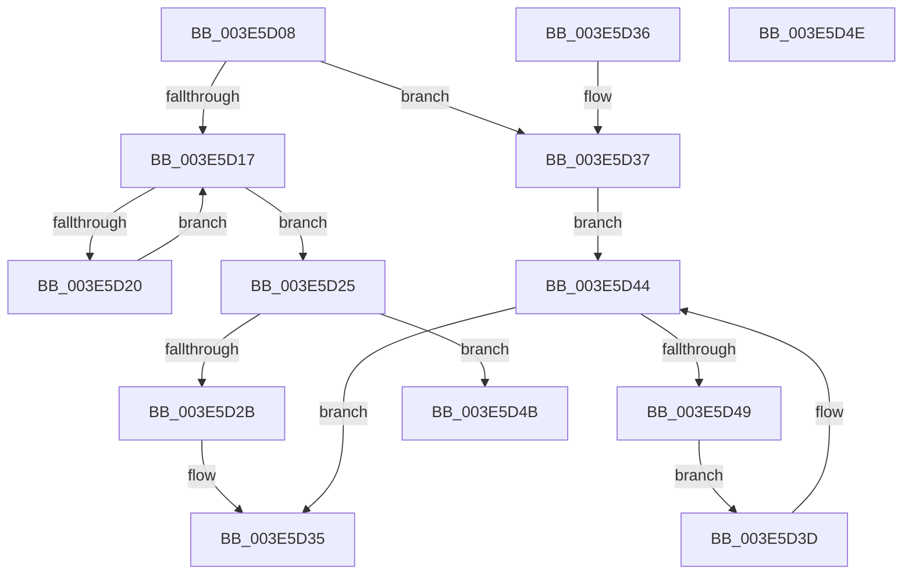

# RealPredecessor

- RVA: `0x003E5D08`–`0x003E5D4F` (길이 `71` bytes)
- VA: `0x00000001403E5D08`
- 실행 섹션: `.text`
- PDB 이름 있음: `예`; PDB Function 태그: `아니요`
- unwind 정보 RVA: `0x000DB714`
- 디코드: `27`개 명령, `71/71` bytes 표시
- 미해석 바이트: `0` (있으면 어셈블리에 `.byte`로 보존)

> 이 문서는 커널 이미지의 기계어와 PDB 기호를 분석해 생성했습니다. 4번과 5번은 함수 원형과 자료형을 바이너리 사용 방식에서 추정한 C 해석이며 원본 소스 복구 결과는 아닙니다.

## 1. Dependencies

- 직접 호출 지점: **0**; 고유 호출 대상: **0**
- 직접 호출자로 확인된 함수: **2**
- RIP 상대 이미지 참조: **0**

### Outgoing calls
- 직접 디코드된 call 명령이 없습니다.

### Direct callers
- [RtlLookupFirstMatchingElementGenericTableAvl](RtlLookupFirstMatchingElementGenericTableAvl_function_003E5B70.md) at `0x003E5BD2`
- [sub_006F76E6](../6F/Unknown_function_006F76E6.md) at `0x006F76E6`
- [sub_006F76E6](../6F/Unknown_function_006F76E6.md) at `0x006F7763`

### Static image references
- 디코드된 RIP-relative 메모리 참조가 없습니다.

## 2. Other-region calls and transfers

- 다른 실행 섹션으로 향하는 call: **0**
- 별도 외부 분기/꼬리 이동을 확인하지 못했습니다.

## 3. Assembly (complete function range)

```asm
003E5D08  48 8B 41 08                     mov rax, qword ptr [rcx + 8]
003E5D0C  45 33 C0                        xor r8d, r8d
003E5D0F  48 8B D1                        mov rdx, rcx
003E5D12  48 85 C0                        test rax, rax
003E5D15  75 20                           jne 0x1403e5d37
003E5D17  48 8B 09                        mov rcx, qword ptr [rcx]
003E5D1A  48 39 51 08                     cmp qword ptr [rcx + 8], rdx
003E5D1E  75 05                           jne 0x1403e5d25
003E5D20  48 8B D1                        mov rdx, rcx
003E5D23  EB F2                           jmp 0x1403e5d17
003E5D25  48 39 51 10                     cmp qword ptr [rcx + 0x10], rdx
003E5D29  75 20                           jne 0x1403e5d4b
003E5D2B  48 39 09                        cmp qword ptr [rcx], rcx
003E5D2E  4C 0F 45 C1                     cmovne r8, rcx
003E5D32  49 8B C0                        mov rax, r8
003E5D35  C3                              ret
003E5D36  CC                              int3
003E5D37  48 8B 48 10                     mov rcx, qword ptr [rax + 0x10]
003E5D3B  EB 07                           jmp 0x1403e5d44
003E5D3D  48 8B C1                        mov rax, rcx
003E5D40  48 8B 49 10                     mov rcx, qword ptr [rcx + 0x10]
003E5D44  48 85 C9                        test rcx, rcx
003E5D47  74 EC                           je 0x1403e5d35
003E5D49  EB F2                           jmp 0x1403e5d3d
003E5D4B  33 C0                           xor eax, eax
003E5D4D  C3                              ret
003E5D4E  CC                              int3
```

## 4. C-style interpretation (structured pseudocode)

```c
__int64 __fastcall RealPredecessor(__int64 a1, __int64 a2, int a3)
{
    __int64 result;

    a3 = 0;
    if (*(unsigned __int64 *)(a1 + 8) != 0) goto loc_003E5D37;
loc_003E5D17:
    if ((*(unsigned __int64 *)(*(unsigned __int64 *)(a1) + 8)) != a1) goto loc_003E5D25;
    goto loc_003E5D17;
loc_003E5D25:
    if ((*(unsigned __int64 *)(*(unsigned __int64 *)(a1) + 16)) != (*(unsigned __int64 *)(a1))) goto loc_003E5D4B;
    if ((*(unsigned __int64 *)(*(unsigned __int64 *)(a1))) != (*(unsigned __int64 *)(a1))) { a3 = *(unsigned __int64 *)(a1); }
loc_003E5D35:
    return a3;
loc_003E5D37:
    goto loc_003E5D44;
loc_003E5D3D:
loc_003E5D44:
    if (*(unsigned __int64 *)(*(unsigned __int64 *)(a3 + 16) + 16) == 0) goto loc_003E5D35;
    goto loc_003E5D3D;
loc_003E5D4B:
    result = 0;
    return result;
}
```

## 5. (Beta) C Style

```c
int64_t RealPredecessor(void *Arg1, int64_t Arg2, int32_t Arg3)
{
    uint8_t *arg1 = (uint8_t *)Arg1;

    int64_t result;

    Arg3 = 0;
    if (*(uint64_t *)(arg1 + 0x8) != 0) goto loc_003E5D37;
loc_003E5D17:
    if ((*(uint64_t *)(*(uint64_t *)(arg1) + 0x8)) != Arg1) goto loc_003E5D25;
    goto loc_003E5D17;
loc_003E5D25:
    if ((*(uint64_t *)(*(uint64_t *)(arg1) + 0x10)) != (*(uint64_t *)(arg1))) goto loc_003E5D4B;
    if ((*(uint64_t *)(*(uint64_t *)(arg1))) != (*(uint64_t *)(arg1))) { Arg3 = *(uint64_t *)(arg1); }
loc_003E5D35:
    return Arg3;
loc_003E5D37:
    goto loc_003E5D44;
loc_003E5D3D:
loc_003E5D44:
    if (*(uint64_t *)(*(uint64_t *)(Arg3 + 0x10) + 0x10) == 0) goto loc_003E5D35;
    goto loc_003E5D3D;
loc_003E5D4B:
    result = 0;
    return result;
}
```

### 관측된 메모리 오프셋

구조체 형식이 확인되지 않은 접근은 인자 기준의 오프셋으로만 기록했습니다.

| 기준 인자 | 오프셋 표현 | 폭 (bit) | 접근 |
|---|---:|---:|---|
| `Arg1` | `+ 0x8` | `64` | `R` |

## 6. Execution-region graph

[열기: 2D/3D 그래프와 함수 탐색 컨트롤 패널](../../../control-panel.html?section=text&rva=0x003E5D08&view=graph)

- 2D 그래프는 위에서 아래로 흐르고, 3D 그래프는 빈 공간을 드래그해 회전합니다. Shift+드래그는 이동, 휠은 확대·축소, 함수 노드 선택은 대상 보고서 이동입니다.

### Static fallback


