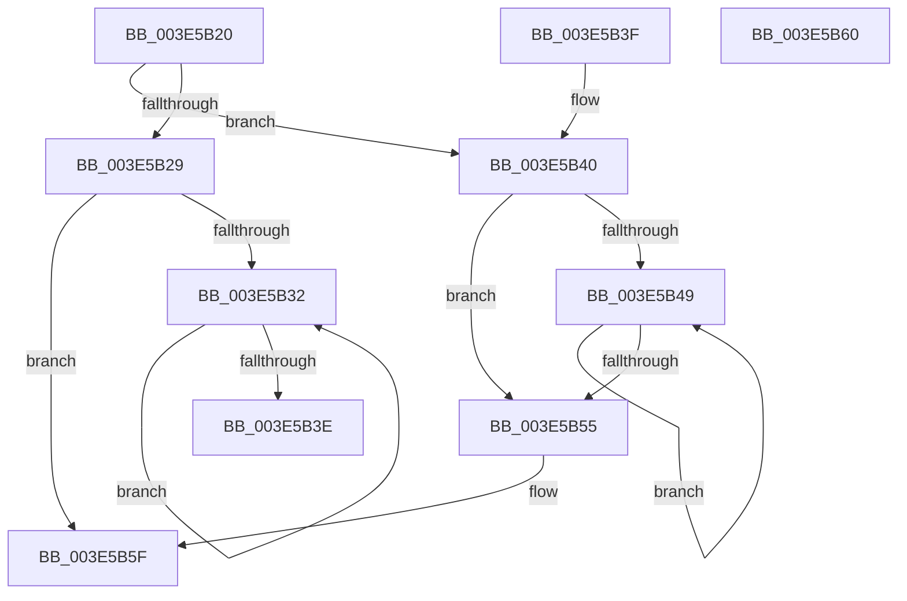

# RealSuccessor

- RVA: `0x003E5B20`–`0x003E5B61` (길이 `65` bytes)
- VA: `0x00000001403E5B20`
- 실행 섹션: `.text`
- PDB 이름 있음: `예`; PDB Function 태그: `아니요`
- unwind 정보 RVA: `0x000DB714`
- 디코드: `24`개 명령, `65/65` bytes 표시
- 미해석 바이트: `0` (있으면 어셈블리에 `.byte`로 보존)

> 이 문서는 커널 이미지의 기계어와 PDB 기호를 분석해 생성했습니다. 4번과 5번은 함수 원형과 자료형을 바이너리 사용 방식에서 추정한 C 해석이며 원본 소스 복구 결과는 아닙니다.

## 1. Dependencies

- 직접 호출 지점: **0**; 고유 호출 대상: **0**
- 직접 호출자로 확인된 함수: **3**
- RIP 상대 이미지 참조: **0**

### Outgoing calls
- 직접 디코드된 call 명령이 없습니다.

### Direct callers
- [sub_003E59B6](Unknown_function_003E59B6.md) at `0x003E59ED`
- [RtlEnumerateGenericTableAvl](RtlEnumerateGenericTableAvl_function_003E5AB0.md) at `0x003E5AD3`
- [sub_006F76E6](../6F/Unknown_function_006F76E6.md) at `0x006F7713`
- [sub_006F76E6](../6F/Unknown_function_006F76E6.md) at `0x006F7739`

### Static image references
- 디코드된 RIP-relative 메모리 참조가 없습니다.

## 2. Other-region calls and transfers

- 다른 실행 섹션으로 향하는 call: **0**
- 별도 외부 분기/꼬리 이동을 확인하지 못했습니다.

## 3. Assembly (complete function range)

```asm
003E5B20  48 8B 41 10                     mov rax, qword ptr [rcx + 0x10]
003E5B24  48 85 C0                        test rax, rax
003E5B27  74 17                           je 0x1403e5b40
003E5B29  48 8B 48 08                     mov rcx, qword ptr [rax + 8]
003E5B2D  48 85 C9                        test rcx, rcx
003E5B30  74 2D                           je 0x1403e5b5f
003E5B32  48 8B C1                        mov rax, rcx
003E5B35  48 8B 49 08                     mov rcx, qword ptr [rcx + 8]
003E5B39  48 85 C9                        test rcx, rcx
003E5B3C  75 F4                           jne 0x1403e5b32
003E5B3E  C3                              ret
003E5B3F  CC                              int3
003E5B40  48 8B 11                        mov rdx, qword ptr [rcx]
003E5B43  48 39 4A 10                     cmp qword ptr [rdx + 0x10], rcx
003E5B47  75 0C                           jne 0x1403e5b55
003E5B49  48 8B CA                        mov rcx, rdx
003E5B4C  48 8B 12                        mov rdx, qword ptr [rdx]
003E5B4F  48 39 4A 10                     cmp qword ptr [rdx + 0x10], rcx
003E5B53  74 F4                           je 0x1403e5b49
003E5B55  33 C0                           xor eax, eax
003E5B57  48 39 4A 08                     cmp qword ptr [rdx + 8], rcx
003E5B5B  48 0F 44 C2                     cmove rax, rdx
003E5B5F  C3                              ret
003E5B60  CC                              int3
```

## 4. C-style interpretation (structured pseudocode)

```c
__int64 __fastcall RealSuccessor(__int64 a1)
{
    __int64 result;

    if (*(unsigned __int64 *)(a1 + 16) == 0) goto loc_003E5B40;
    if (*(unsigned __int64 *)(*(unsigned __int64 *)(a1 + 16) + 8) == 0) goto loc_003E5B5F;
loc_003E5B32:
    if (*(unsigned __int64 *)(*(unsigned __int64 *)(*(unsigned __int64 *)(a1 + 16) + 8) + 8) != 0) goto loc_003E5B32;
    return *(unsigned __int64 *)(*(unsigned __int64 *)(a1 + 16) + 8);
loc_003E5B40:
    if ((*(unsigned __int64 *)(*(unsigned __int64 *)(*(unsigned __int64 *)(*(unsigned __int64 *)(*(unsigned __int64 *)(a1 + 16) + 8) + 8)) + 16)) != (*(unsigned __int64 *)(*(unsigned __int64 *)(*(unsigned __int64 *)(a1 + 16) + 8) + 8))) goto loc_003E5B55;
loc_003E5B49:
    if ((*(unsigned __int64 *)(*(unsigned __int64 *)(*(unsigned __int64 *)(*(unsigned __int64 *)(*(unsigned __int64 *)(*(unsigned __int64 *)(a1 + 16) + 8) + 8))) + 16)) == (*(unsigned __int64 *)(*(unsigned __int64 *)(*(unsigned __int64 *)(*(unsigned __int64 *)(a1 + 16) + 8) + 8)))) goto loc_003E5B49;
loc_003E5B55:
    result = 0;
    if ((*(unsigned __int64 *)(*(unsigned __int64 *)(*(unsigned __int64 *)(*(unsigned __int64 *)(*(unsigned __int64 *)(*(unsigned __int64 *)(a1 + 16) + 8) + 8))) + 8)) == (*(unsigned __int64 *)(*(unsigned __int64 *)(*(unsigned __int64 *)(*(unsigned __int64 *)(a1 + 16) + 8) + 8)))) { result = *(unsigned __int64 *)(*(unsigned __int64 *)(*(unsigned __int64 *)(*(unsigned __int64 *)(*(unsigned __int64 *)(a1 + 16) + 8) + 8))); }
loc_003E5B5F:
    return result;
}
```

## 5. (Beta) C Style

```c
int64_t RealSuccessor(void *Arg1)
{
    uint8_t *arg1 = (uint8_t *)Arg1;

    int64_t result;

    if (*(uint64_t *)(arg1 + 0x10) == 0) goto loc_003E5B40;
    if (*(uint64_t *)(*(uint64_t *)(arg1 + 0x10) + 0x8) == 0) goto loc_003E5B5F;
loc_003E5B32:
    if (*(uint64_t *)(*(uint64_t *)(*(uint64_t *)(arg1 + 0x10) + 0x8) + 0x8) != 0) goto loc_003E5B32;
    return *(uint64_t *)(*(uint64_t *)(arg1 + 0x10) + 0x8);
loc_003E5B40:
    if ((*(uint64_t *)(*(uint64_t *)(*(uint64_t *)(*(uint64_t *)(*(uint64_t *)(arg1 + 0x10) + 0x8) + 0x8)) + 0x10)) != (*(uint64_t *)(*(uint64_t *)(*(uint64_t *)(arg1 + 0x10) + 0x8) + 0x8))) goto loc_003E5B55;
loc_003E5B49:
    if ((*(uint64_t *)(*(uint64_t *)(*(uint64_t *)(*(uint64_t *)(*(uint64_t *)(*(uint64_t *)(arg1 + 0x10) + 0x8) + 0x8))) + 0x10)) == (*(uint64_t *)(*(uint64_t *)(*(uint64_t *)(*(uint64_t *)(arg1 + 0x10) + 0x8) + 0x8)))) goto loc_003E5B49;
loc_003E5B55:
    result = 0;
    if ((*(uint64_t *)(*(uint64_t *)(*(uint64_t *)(*(uint64_t *)(*(uint64_t *)(*(uint64_t *)(arg1 + 0x10) + 0x8) + 0x8))) + 0x8)) == (*(uint64_t *)(*(uint64_t *)(*(uint64_t *)(*(uint64_t *)(arg1 + 0x10) + 0x8) + 0x8)))) { result = *(uint64_t *)(*(uint64_t *)(*(uint64_t *)(*(uint64_t *)(*(uint64_t *)(arg1 + 0x10) + 0x8) + 0x8))); }
loc_003E5B5F:
    return result;
}
```

### 관측된 메모리 오프셋

구조체 형식이 확인되지 않은 접근은 인자 기준의 오프셋으로만 기록했습니다.

| 기준 인자 | 오프셋 표현 | 폭 (bit) | 접근 |
|---|---:|---:|---|
| `Arg1` | `+ 0x0` | `64` | `R` |
| `Arg1` | `+ 0x10` | `64` | `R` |

## 6. Execution-region graph

[열기: 2D/3D 그래프와 함수 탐색 컨트롤 패널](../../../control-panel.html?section=text&rva=0x003E5B20&view=graph)

- 2D 그래프는 위에서 아래로 흐르고, 3D 그래프는 빈 공간을 드래그해 회전합니다. Shift+드래그는 이동, 휠은 확대·축소, 함수 노드 선택은 대상 보고서 이동입니다.

### Static fallback


