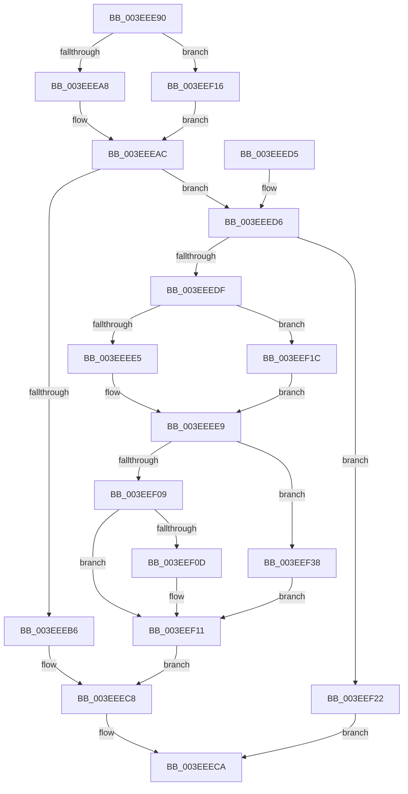

# RebalanceNode

- RVA: `0x003EEE90`–`0x003EEF41` (길이 `177` bytes)
- VA: `0x00000001403EEE90`
- 실행 섹션: `.text`
- PDB 이름 있음: `예`; PDB Function 태그: `아니요`
- unwind 정보 RVA: `0x00096A90`
- 디코드: `56`개 명령, `177/177` bytes 표시
- 미해석 바이트: `0` (있으면 어셈블리에 `.byte`로 보존)

> 이 문서는 커널 이미지의 기계어와 PDB 기호를 분석해 생성했습니다. 4번과 5번은 함수 원형과 자료형을 바이너리 사용 방식에서 추정한 C 해석이며 원본 소스 복구 결과는 아닙니다.

## 1. Dependencies

- 직접 호출 지점: **4**; 고유 호출 대상: **1**
- 직접 호출자로 확인된 함수: **4**
- RIP 상대 이미지 참조: **0**

### Outgoing calls
- `0x003EEEB9` → [PromoteNode](PromoteNode_function_003EEF48.md) (function, `0x003EEF48`)
- `0x003EEEEC` → [PromoteNode](PromoteNode_function_003EEF48.md) (function, `0x003EEF48`)
- `0x003EEEF1` → [PromoteNode](PromoteNode_function_003EEF48.md) (function, `0x003EEF48`)
- `0x003EEF25` → [PromoteNode](PromoteNode_function_003EEF48.md) (function, `0x003EEF48`)

### Direct callers
- [RtlInsertElementGenericTableAvl](RtlInsertElementGenericTableAvl_function_003EE510.md) at `0x003EE6A9`
- [RtlDeleteElementGenericTableAvl](RtlDeleteElementGenericTableAvl_function_003EE750.md) at `0x003EEA11`
- [RtlDeleteElementGenericTableAvlEx](RtlDeleteElementGenericTableAvlEx_function_003EEA70.md) at `0x003EECAD`
- [RtlInsertElementGenericTableFullAvl](RtlInsertElementGenericTableFullAvl_function_003EED00.md) at `0x003EEE1D`

### Static image references
- 디코드된 RIP-relative 메모리 참조가 없습니다.

## 2. Other-region calls and transfers

- 다른 실행 섹션으로 향하는 call: **0**
- 별도 외부 분기/꼬리 이동을 확인하지 못했습니다.

## 3. Assembly (complete function range)

```asm
003EEE90  48 89 5C 24 08                  mov qword ptr [rsp + 8], rbx
003EEE95  57                              push rdi
003EEE96  48 83 EC 20                     sub rsp, 0x20
003EEE9A  44 0F BE 49 18                  movsx r9d, byte ptr [rcx + 0x18]
003EEE9F  4C 8B D9                        mov r11, rcx
003EEEA2  41 80 F9 01                     cmp r9b, 1
003EEEA6  75 6E                           jne 0x1403eef16
003EEEA8  4C 8B 51 10                     mov r10, qword ptr [rcx + 0x10]
003EEEAC  41 0F BE 42 18                  movsx eax, byte ptr [r10 + 0x18]
003EEEB1  41 3A C1                        cmp al, r9b
003EEEB4  75 20                           jne 0x1403eeed6
003EEEB6  49 8B CA                        mov rcx, r10
003EEEB9  E8 8A 00 00 00                  call 0x1403eef48
003EEEBE  33 C9                           xor ecx, ecx
003EEEC0  41 88 4A 18                     mov byte ptr [r10 + 0x18], cl
003EEEC4  41 88 4B 18                     mov byte ptr [r11 + 0x18], cl
003EEEC8  33 C0                           xor eax, eax
003EEECA  48 8B 5C 24 30                  mov rbx, qword ptr [rsp + 0x30]
003EEECF  48 83 C4 20                     add rsp, 0x20
003EEED3  5F                              pop rdi
003EEED4  C3                              ret
003EEED5  CC                              int3
003EEED6  41 8B F9                        mov edi, r9d
003EEED9  F7 DF                           neg edi
003EEEDB  3B C7                           cmp eax, edi
003EEEDD  75 43                           jne 0x1403eef22
003EEEDF  41 80 F9 01                     cmp r9b, 1
003EEEE3  74 37                           je 0x1403eef1c
003EEEE5  49 8B 5A 10                     mov rbx, qword ptr [r10 + 0x10]
003EEEE9  48 8B CB                        mov rcx, rbx
003EEEEC  E8 57 00 00 00                  call 0x1403eef48
003EEEF1  E8 52 00 00 00                  call 0x1403eef48
003EEEF6  32 C9                           xor cl, cl
003EEEF8  41 88 4B 18                     mov byte ptr [r11 + 0x18], cl
003EEEFC  41 88 4A 18                     mov byte ptr [r10 + 0x18], cl
003EEF00  0F BE 43 18                     movsx eax, byte ptr [rbx + 0x18]
003EEF04  41 3A C1                        cmp al, r9b
003EEF07  74 2F                           je 0x1403eef38
003EEF09  3B C7                           cmp eax, edi
003EEF0B  75 04                           jne 0x1403eef11
003EEF0D  45 88 4A 18                     mov byte ptr [r10 + 0x18], r9b
003EEF11  88 4B 18                        mov byte ptr [rbx + 0x18], cl
003EEF14  EB B2                           jmp 0x1403eeec8
003EEF16  4C 8B 51 08                     mov r10, qword ptr [rcx + 8]
003EEF1A  EB 90                           jmp 0x1403eeeac
003EEF1C  49 8B 5A 08                     mov rbx, qword ptr [r10 + 8]
003EEF20  EB C7                           jmp 0x1403eeee9
003EEF22  49 8B CA                        mov rcx, r10
003EEF25  E8 1E 00 00 00                  call 0x1403eef48
003EEF2A  41 F6 D9                        neg r9b
003EEF2D  B8 01 00 00 00                  mov eax, 1
003EEF32  45 88 4A 18                     mov byte ptr [r10 + 0x18], r9b
003EEF36  EB 92                           jmp 0x1403eeeca
003EEF38  41 F6 D9                        neg r9b
003EEF3B  45 88 4B 18                     mov byte ptr [r11 + 0x18], r9b
003EEF3F  EB D0                           jmp 0x1403eef11
```

## 4. C-style interpretation (structured pseudocode)

```c
__int64 __fastcall RebalanceNode(__int64 a1)
{
    __int64 result;
    __int64 v_rdi;
    __int64 v_rsp;
    unsigned __int64 v_stack_p8;

    v_stack_p8 = v_rbx;
    v_rsp = (v_rsp) - (32);
    if (((unsigned __int8)((__int8)(*(unsigned __int8 *)(a1 + 24)))) != 1) goto loc_003EEF16;
loc_003EEEAC:
    if (((unsigned __int8)((__int8)(*(unsigned __int8 *)(*(unsigned __int64 *)(a1 + 16) + 24)))) != ((unsigned __int8)((__int8)(*(unsigned __int8 *)(a1 + 24))))) goto loc_003EEED6;
    result = PromoteNode(*(unsigned __int64 *)(a1 + 16), a2, a3, (__int8)(*(unsigned __int8 *)(a1 + 24)));
    a1 = 0;
    *(unsigned __int8 *)(*(unsigned __int64 *)(a1 + 16) + 24) = 0;
    *(unsigned __int8 *)(a1 + 24) = 0;
loc_003EEEC8:
    result = 0;
loc_003EEECA:
    v_rsp = (v_rsp) + (32);
    return result;
loc_003EEED6:
    v_rdi = (unsigned int)(-((unsigned int)((unsigned int)((__int8)(*(unsigned __int8 *)(a1 + 24))))));
    if (0 != ((unsigned int)(v_rdi))) goto loc_003EEF22;
    if (((unsigned __int8)((__int8)(*(unsigned __int8 *)(a1 + 24)))) == 1) goto loc_003EEF1C;
loc_003EEEE9:
    result = PromoteNode(*(unsigned __int64 *)(*(unsigned __int64 *)(a1 + 16) + 16), a2, a3, (__int8)(*(unsigned __int8 *)(a1 + 24)));
    result = PromoteNode(*(unsigned __int64 *)(*(unsigned __int64 *)(a1 + 16) + 16), a2, a3, (__int8)(*(unsigned __int8 *)(a1 + 24)));
    a1 = 0;
    *(unsigned __int8 *)(a1 + 24) = 0;
    *(unsigned __int8 *)(*(unsigned __int64 *)(a1 + 16) + 24) = 0;
    if (((unsigned __int8)((__int8)(*(unsigned __int8 *)(*(unsigned __int64 *)(*(unsigned __int64 *)(a1 + 16) + 16) + 24)))) == ((unsigned __int8)((__int8)(*(unsigned __int8 *)(a1 + 24))))) goto loc_003EEF38;
    if (((unsigned int)((__int8)(*(unsigned __int8 *)(*(unsigned __int64 *)(*(unsigned __int64 *)(a1 + 16) + 16) + 24)))) == ((unsigned int)(v_rdi))) {
        *(unsigned __int8 *)(*(unsigned __int64 *)(a1 + 16) + 24) = (unsigned __int8)((__int8)(*(unsigned __int8 *)(a1 + 24)));
    }
    *(unsigned __int8 *)(*(unsigned __int64 *)(*(unsigned __int64 *)(a1 + 16) + 16) + 24) = 0;
    goto loc_003EEEC8;
loc_003EEF16:
    goto loc_003EEEAC;
loc_003EEF1C:
    goto loc_003EEEE9;
loc_003EEF22:
    result = PromoteNode(*(unsigned __int64 *)(a1 + 8), a2, a3, (__int8)(*(unsigned __int8 *)(a1 + 24)));
    a4 = (unsigned __int8)(-((__int8)(*(unsigned __int8 *)(a1 + 24))));
    *(unsigned __int8 *)(*(unsigned __int64 *)(a1 + 8) + 24) = (unsigned __int8)(a4);
    goto loc_003EEECA;
loc_003EEF38:
    a4 = (unsigned __int8)(-(a4));
    *(unsigned __int8 *)(a1 + 24) = (unsigned __int8)(a4);
    goto loc_003EEF11;
}
```

## 5. (Beta) C Style

```c
int64_t RebalanceNode(void *Arg1)
{
    uint8_t *arg1 = (uint8_t *)Arg1;

    int64_t result;
    int64_t local_rdi;
    int64_t local_rsp;
    uint64_t v_stack_p8;

    v_stack_p8 = local_rbx;
    local_rsp = (local_rsp) - (32);
    if (((uint8_t)((int8_t)(*(uint8_t *)(arg1 + 0x18)))) != 1) goto loc_003EEF16;
loc_003EEEAC:
    if (((uint8_t)((int8_t)(*(uint8_t *)(*(uint64_t *)(arg1 + 0x10) + 0x18)))) != ((uint8_t)((int8_t)(*(uint8_t *)(arg1 + 0x18))))) goto loc_003EEED6;
    result = PromoteNode(*(uint64_t *)(arg1 + 0x10), a2, a3, (int8_t)(*(uint8_t *)(arg1 + 0x18)));
    Arg1 = 0;
    *(uint8_t *)(*(uint64_t *)(arg1 + 0x10) + 0x18) = 0;
    *(uint8_t *)(arg1 + 0x18) = 0;
loc_003EEEC8:
    result = 0;
loc_003EEECA:
    local_rsp = (local_rsp) + (32);
    return result;
loc_003EEED6:
    local_rdi = (uint32_t)(-((uint32_t)((uint32_t)((int8_t)(*(uint8_t *)(arg1 + 0x18))))));
    if (0 != ((uint32_t)(local_rdi))) goto loc_003EEF22;
    if (((uint8_t)((int8_t)(*(uint8_t *)(arg1 + 0x18)))) == 1) goto loc_003EEF1C;
loc_003EEEE9:
    result = PromoteNode(*(uint64_t *)(*(uint64_t *)(arg1 + 0x10) + 0x10), a2, a3, (int8_t)(*(uint8_t *)(arg1 + 0x18)));
    result = PromoteNode(*(uint64_t *)(*(uint64_t *)(arg1 + 0x10) + 0x10), a2, a3, (int8_t)(*(uint8_t *)(arg1 + 0x18)));
    Arg1 = 0;
    *(uint8_t *)(arg1 + 0x18) = 0;
    *(uint8_t *)(*(uint64_t *)(arg1 + 0x10) + 0x18) = 0;
    if (((uint8_t)((int8_t)(*(uint8_t *)(*(uint64_t *)(*(uint64_t *)(arg1 + 0x10) + 0x10) + 0x18)))) == ((uint8_t)((int8_t)(*(uint8_t *)(arg1 + 0x18))))) goto loc_003EEF38;
    if (((uint32_t)((int8_t)(*(uint8_t *)(*(uint64_t *)(*(uint64_t *)(arg1 + 0x10) + 0x10) + 0x18)))) == ((uint32_t)(local_rdi))) {
        *(uint8_t *)(*(uint64_t *)(arg1 + 0x10) + 0x18) = (uint8_t)((int8_t)(*(uint8_t *)(arg1 + 0x18)));
    }
    *(uint8_t *)(*(uint64_t *)(*(uint64_t *)(arg1 + 0x10) + 0x10) + 0x18) = 0;
    goto loc_003EEEC8;
loc_003EEF16:
    goto loc_003EEEAC;
loc_003EEF1C:
    goto loc_003EEEE9;
loc_003EEF22:
    result = PromoteNode(*(uint64_t *)(arg1 + 0x8), a2, a3, (int8_t)(*(uint8_t *)(arg1 + 0x18)));
    a4 = (uint8_t)(-((int8_t)(*(uint8_t *)(arg1 + 0x18))));
    *(uint8_t *)(*(uint64_t *)(arg1 + 0x8) + 0x18) = (uint8_t)(a4);
    goto loc_003EEECA;
loc_003EEF38:
    a4 = (uint8_t)(-(a4));
    *(uint8_t *)(arg1 + 0x18) = (uint8_t)(a4);
    goto loc_003EEF11;
}
```

### 관측된 메모리 오프셋

구조체 형식이 확인되지 않은 접근은 인자 기준의 오프셋으로만 기록했습니다.

| 기준 인자 | 오프셋 표현 | 폭 (bit) | 접근 |
|---|---:|---:|---|
| `Arg1` | `+ 0x8` | `64` | `R` |
| `Arg1` | `+ 0x10` | `64` | `R` |
| `Arg1` | `+ 0x18` | `8` | `R` |

## 6. Execution-region graph

[열기: 2D/3D 그래프와 함수 탐색 컨트롤 패널](../../../control-panel.html?section=text&rva=0x003EEE90&view=graph)

- 2D 그래프는 위에서 아래로 흐르고, 3D 그래프는 빈 공간을 드래그해 회전합니다. Shift+드래그는 이동, 휠은 확대·축소, 함수 노드 선택은 대상 보고서 이동입니다.

### Static fallback


