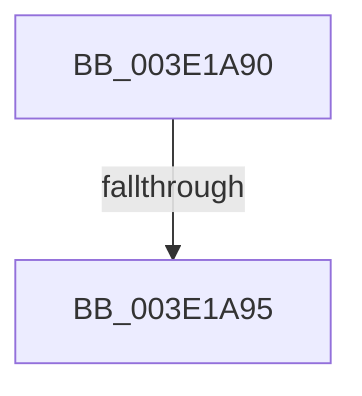

# RtlClearBits

- RVA: `0x003E1A90`–`0x003E1A9A` (길이 `10` bytes)
- VA: `0x00000001403E1A90`
- 실행 섹션: `.text`
- PDB 이름 있음: `예`; PDB Function 태그: `아니요`
- unwind 정보 RVA: `0x00094AA4`
- 디코드: `4`개 명령, `10/10` bytes 표시
- 미해석 바이트: `0` (있으면 어셈블리에 `.byte`로 보존)

> 이 문서는 커널 이미지의 기계어와 PDB 기호를 분석해 생성했습니다. 4번과 5번은 함수 원형과 자료형을 바이너리 사용 방식에서 추정한 C 해석이며 원본 소스 복구 결과는 아닙니다.

## 1. Dependencies

- 직접 호출 지점: **0**; 고유 호출 대상: **0**
- 직접 호출자로 확인된 함수: **43**
- RIP 상대 이미지 참조: **0**

### Outgoing calls
- 직접 디코드된 call 명령이 없습니다.

### Direct callers
- [MiStoreWriteModifiedPages](../2B/MiStoreWriteModifiedPages_function_002B46C4.md) at `0x002B50CA`
- [MiFreeSlabEntries](../2D/MiFreeSlabEntries_function_002DAFC0.md) at `0x002DB1CA`
- [MiTrimWorkingSetBuildup](MiTrimWorkingSetBuildup_function_003E03FC.md) at `0x003E06A9`
- [MiReduceMappedFileReadAhead](MiReduceMappedFileReadAhead_function_003E0A54.md) at `0x003E0AC7`
- [HalpDmaReturnToContiguousPool](HalpDmaReturnToContiguousPool_function_003E1758.md) at `0x003E17EF`
- [MmStoreEvictComplete](MmStoreEvictComplete_function_003E1840.md) at `0x003E188F`
- [HalpMmAllocCtxFree](HalpMmAllocCtxFree_function_003E1904.md) at `0x003E196A`
- [MiReduceMappedFileReadBehind](MiReduceMappedFileReadBehind_function_003E1B64.md) at `0x003E1C6C`
- [HvpGrowDirtyVectors](HvpGrowDirtyVectors_function_003E2028.md) at `0x003E20F0`
- [HvpGrowDirtyVectors](HvpGrowDirtyVectors_function_003E2028.md) at `0x003E2119`
- [HvpGrowDirtyVectors](HvpGrowDirtyVectors_function_003E2028.md) at `0x003E21BC`
- [HvpGrowDirtyVectors](HvpGrowDirtyVectors_function_003E2028.md) at `0x003E21D6`
- [BgpFwFreeMemory](BgpFwFreeMemory_function_003E25E0.md) at `0x003E260D`
- [RtlFindSetBitsAndClear](../4B/RtlFindSetBitsAndClear_function_004B9070.md) at `0x004B942F`
- [MiFinishPageFileExtension](../4D/MiFinishPageFileExtension_function_004D5EB4.md) at `0x004D5EFB`
- [MiFinishPageFileExtension](../4D/MiFinishPageFileExtension_function_004D5EB4.md) at `0x004D5F12`
- [HalpDmaAllocateScatterPagesFromContiguousPoolAtHighLevelV3](../53/HalpDmaAllocateScatterPagesFromContiguousPoolAtHighLevelV3_function_0053DF40.md) at `0x0053DFBA`
- [HalpDmaCommitContiguousMapBuffers](../55/HalpDmaCommitContiguousMapBuffers_function_00550A84.md) at `0x00550C5F`
- [HalpDmaAllocateScatterPagesFromContiguousPoolAtHighLevelV2](../55/HalpDmaAllocateScatterPagesFromContiguousPoolAtHighLevelV2_function_00553E70.md) at `0x00553EE7`
- [ExtEnvClearBits](../56/ExtEnvClearBits_function_005612E8.md) at `0x005612EC`
- [HalpIommuProcessIvhdEntry](../57/HalpIommuProcessIvhdEntry_function_00572F38.md) at `0x005731F5`
- [HsaAllocateRemappingTableEntry](../57/HsaAllocateRemappingTableEntry_function_00573820.md) at `0x00573A26`
- [HsaUpdateRemappingTableEntry](../57/HsaUpdateRemappingTableEntry_function_00575000.md) at `0x00575089`
- [PopWriteSecurePagesCallback](../5D/PopWriteSecurePagesCallback_function_005D5048.md) at `0x005D50A0`
- [RtlShiftLeftBitMap](../5E/RtlShiftLeftBitMap_function_005E6580.md) at `0x005E65D5`
- [sub_006F503A](../6F/Unknown_function_006F503A.md) at `0x006F51F9`
- [sub_006F503A](../6F/Unknown_function_006F503A.md) at `0x006F5207`
- [HalpDmaAllocateLocalContiguousPool](../../page/70/HalpDmaAllocateLocalContiguousPool_function_00708EE4.md) at `0x007091AD`
- [HalpIrtAllocateIndex](../../page/70/HalpIrtAllocateIndex_function_0070A9D4.md) at `0x0070ABF0`
- [HalpIrtFreeIndex](../../page/70/HalpIrtFreeIndex_function_0070AE30.md) at `0x0070AE96`
- [SmcStorePlacementGet](../../page/7A/SmcStorePlacementGet_function_007AC400.md) at `0x007AC49A`
- [SmcStorePlacementGet](../../page/7A/SmcStorePlacementGet_function_007AC400.md) at `0x007AC4D5`
- [MiFreeInitializationCode](../../page/7F/MiFreeInitializationCode_function_007F88A0.md) at `0x007F893F`
- [MiCreatePagefile](../../page/7F/MiCreatePagefile_function_007FEC30.md) at `0x007FEF45`
- [MiCreatePagefile](../../page/7F/MiCreatePagefile_function_007FEC30.md) at `0x007FEF67`
- [MiPrepareToHotPatchImagePatchCallback](../../page/80/MiPrepareToHotPatchImagePatchCallback_function_00806DC0.md) at `0x00806E50`
- [MiProcessHotPatchUndoTable](../../page/80/MiProcessHotPatchUndoTable_function_00806F20.md) at `0x00806F79`
- [HvpAdjustBitmap](../../page/84/HvpAdjustBitmap_function_0084DBFC.md) at `0x0084DCFA`
- [HvIsCellAllocated](../../page/85/HvIsCellAllocated_function_00855D60.md) at `0x00855DF4`
- [sub_0085A2AA](../../page/85/Unknown_function_0085A2AA.md) at `0x0085A368`
- [PspQueryRateControlHistory](../../page/91/PspQueryRateControlHistory_function_00918D1C.md) at `0x00918E84`
- [SepGetLowBoxNumberEntry](../../page/A6/SepGetLowBoxNumberEntry_function_00A65040.md) at `0x00A651F9`
- [MiReleaseDriverPtes](../../page/A7/MiReleaseDriverPtes_function_00A7F1B4.md) at `0x00A7F296`
- [MiReleaseDriverPtes](../../page/A7/MiReleaseDriverPtes_function_00A7F1B4.md) at `0x00A7F3A2`
- [sub_00B3E78C](../../page/B3/Unknown_function_00B3E78C.md) at `0x00B3E8F5`
- [sub_00B3E78C](../../page/B3/Unknown_function_00B3E78C.md) at `0x00B3E907`
- [PnprMarkOrMirrorPages](../../pagelk/B6/PnprMarkOrMirrorPages_function_00B646A8.md) at `0x00B647BB`
- [PopMirrorPhysicalMemory](../../pagelk/B7/PopMirrorPhysicalMemory_function_00B77D10.md) at `0x00B77D49`
- [PopCloneRange](../../pagelk/B7/PopCloneRange_function_00B7BBB8.md) at `0x00B7BBF9`
- [ViFreeToContiguousMemory](../../pagevrfy/B9/ViFreeToContiguousMemory_function_00B98DD8.md) at `0x00B98E3A`
- [HalpPowerInitDiscard](../../init/C1/HalpPowerInitDiscard_function_00C1EB40.md) at `0x00C1EC0D`
- [MiAssignSystemVa](../../init/C6/MiAssignSystemVa_function_00C65470.md) at `0x00C654F9`

### Static image references
- 디코드된 RIP-relative 메모리 참조가 없습니다.

## 2. Other-region calls and transfers

- 다른 실행 섹션으로 향하는 call: **0**
- call이 아닌 외부 분기/꼬리 이동: **1**
  - `0x003E1A93` → [sub_003E1A9A + 0x48](Unknown_function_003E1A9A.md) (`tail-transfer`)

## 3. Assembly (complete function range)

```asm
003E1A90  45 85 C0                        test r8d, r8d
003E1A93  74 4D                           je 0x1403e1ae2
003E1A95  56                              push rsi
003E1A96  48 83 EC 20                     sub rsp, 0x20
```

## 4. C-style interpretation (structured pseudocode)

```c
void __fastcall RtlClearBits(__int64 a1, __int64 a2, int a3)
{
    __int64 v_rsp;

    v_rsp = (v_rsp) - (32);
    return;
}
```

## 5. (Beta) C Style

```c
void RtlClearBits(int64_t Arg1, int64_t Arg2, int32_t Arg3)
{
    int64_t local_rsp;

    local_rsp = (local_rsp) - (32);
    return;
}
```

## 6. Execution-region graph

[열기: 2D/3D 그래프와 함수 탐색 컨트롤 패널](../../../control-panel.html?section=text&rva=0x003E1A90&view=graph)

- 2D 그래프는 위에서 아래로 흐르고, 3D 그래프는 빈 공간을 드래그해 회전합니다. Shift+드래그는 이동, 휠은 확대·축소, 함수 노드 선택은 대상 보고서 이동입니다.

### Static fallback


