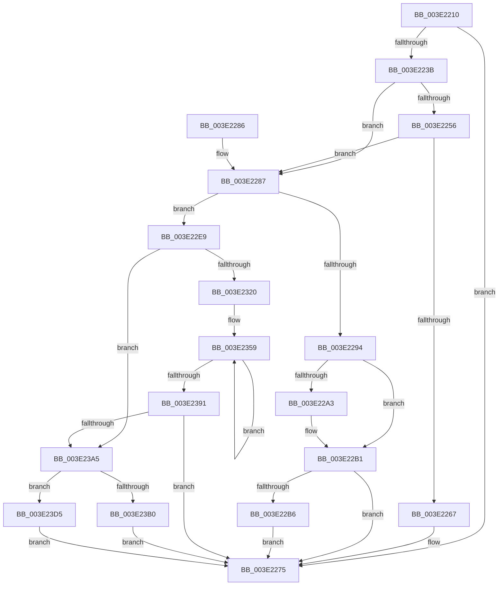

# RtlCopyBitMap

- RVA: `0x003E2210`–`0x003E2419` (길이 `521` bytes)
- VA: `0x00000001403E2210`
- 실행 섹션: `.text`
- PDB 이름 있음: `예`; PDB Function 태그: `아니요`
- unwind 정보 RVA: `0x00094B7C`
- 디코드: `170`개 명령, `521/521` bytes 표시
- 미해석 바이트: `0` (있으면 어셈블리에 `.byte`로 보존)

> 이 문서는 커널 이미지의 기계어와 PDB 기호를 분석해 생성했습니다. 4번과 5번은 함수 원형과 자료형을 바이너리 사용 방식에서 추정한 C 해석이며 원본 소스 복구 결과는 아닙니다.

## 1. Dependencies

- 직접 호출 지점: **2**; 고유 호출 대상: **2**
- 직접 호출자로 확인된 함수: **5**
- RIP 상대 이미지 참조: **0**

### Outgoing calls
- `0x003E2270` → [RtlpCopyBitMapTailToHead](RtlpCopyBitMapTailToHead_function_003E2420.md) (function, `0x003E2420`)
- `0x003E22AC` → [memcpy](../6C/memcpy_function_006C6840.md) (function, `0x006C6840`)

### Direct callers
- [HvpGrowDirtyVectors](HvpGrowDirtyVectors_function_003E2028.md) at `0x003E20E1`
- [HvpGrowDirtyVectors](HvpGrowDirtyVectors_function_003E2028.md) at `0x003E210A`
- [MiChangePagingFileMaximum](../67/MiChangePagingFileMaximum_function_0067FEFC.md) at `0x006800E6`
- [MiChangePagingFileMaximum](../67/MiChangePagingFileMaximum_function_0067FEFC.md) at `0x006800F7`
- [Xp10ExecuteHuffmanEncode](../../page/79/Xp10ExecuteHuffmanEncode_function_00798100.md) at `0x00798238`
- [PspQueryRateControlHistory](../../page/91/PspQueryRateControlHistory_function_00918D1C.md) at `0x00918E77`
- [PopSaveHiberContext](../../pagelk/B6/PopSaveHiberContext_function_00B6F050.md) at `0x00B6F4DF`

### Static image references
- 디코드된 RIP-relative 메모리 참조가 없습니다.

## 2. Other-region calls and transfers

- 다른 실행 섹션으로 향하는 call: **0**
- 별도 외부 분기/꼬리 이동을 확인하지 못했습니다.

## 3. Assembly (complete function range)

```asm
003E2210  40 53                           push rbx
003E2212  55                              push rbp
003E2213  56                              push rsi
003E2214  57                              push rdi
003E2215  41 54                           push r12
003E2217  41 55                           push r13
003E2219  41 56                           push r14
003E221B  41 57                           push r15
003E221D  48 83 EC 28                     sub rsp, 0x28
003E2221  8B 1A                           mov ebx, dword ptr [rdx]
003E2223  4C 8B F2                        mov r14, rdx
003E2226  8B 01                           mov eax, dword ptr [rcx]
003E2228  41 2B D8                        sub ebx, r8d
003E222B  3B C3                           cmp eax, ebx
003E222D  45 8B D0                        mov r10d, r8d
003E2230  48 8B E9                        mov rbp, rcx
003E2233  0F 46 D8                        cmovbe ebx, eax
003E2236  48 85 DB                        test rbx, rbx
003E2239  74 3A                           je 0x1403e2275
003E223B  48 8B 4A 08                     mov rcx, qword ptr [rdx + 8]
003E223F  41 8B C2                        mov eax, r10d
003E2242  4C 8B 5D 08                     mov r11, qword ptr [rbp + 8]
003E2246  45 8B CA                        mov r9d, r10d
003E2249  48 C1 E8 05                     shr rax, 5
003E224D  4C 8D 04 81                     lea r8, [rcx + rax*4]
003E2251  4D 3B D8                        cmp r11, r8
003E2254  77 31                           ja 0x1403e2287
003E2256  48 8D 43 FF                     lea rax, [rbx - 1]
003E225A  48 C1 E8 05                     shr rax, 5
003E225E  49 8D 04 83                     lea rax, [r11 + rax*4]
003E2262  4C 3B C0                        cmp r8, rax
003E2265  77 20                           ja 0x1403e2287
003E2267  44 8B CB                        mov r9d, ebx
003E226A  45 8B C2                        mov r8d, r10d
003E226D  48 8B CD                        mov rcx, rbp
003E2270  E8 AB 01 00 00                  call 0x1403e2420
003E2275  48 83 C4 28                     add rsp, 0x28
003E2279  41 5F                           pop r15
003E227B  41 5E                           pop r14
003E227D  41 5D                           pop r13
003E227F  41 5C                           pop r12
003E2281  5F                              pop rdi
003E2282  5E                              pop rsi
003E2283  5D                              pop rbp
003E2284  5B                              pop rbx
003E2285  C3                              ret
003E2286  CC                              int3
003E2287  49 8B F1                        mov rsi, r9
003E228A  48 C1 EE 03                     shr rsi, 3
003E228E  41 F6 C2 07                     test r10b, 7
003E2292  75 55                           jne 0x1403e22e9
003E2294  48 8B FB                        mov rdi, rbx
003E2297  83 E3 07                        and ebx, 7
003E229A  48 C1 EF 03                     shr rdi, 3
003E229E  48 85 FF                        test rdi, rdi
003E22A1  74 0E                           je 0x1403e22b1
003E22A3  48 03 CE                        add rcx, rsi
003E22A6  4C 8B C7                        mov r8, rdi
003E22A9  49 8B D3                        mov rdx, r11
003E22AC  E8 8F 45 2E 00                  call 0x1406c6840
003E22B1  48 85 DB                        test rbx, rbx
003E22B4  74 BF                           je 0x1403e2275
003E22B6  4D 8B 4E 08                     mov r9, qword ptr [r14 + 8]
003E22BA  41 BA 01 00 00 00               mov r10d, 1
003E22C0  48 8B CB                        mov rcx, rbx
003E22C3  4C 03 CE                        add r9, rsi
003E22C6  4C 03 CF                        add r9, rdi
003E22C9  45 8B C2                        mov r8d, r10d
003E22CC  41 D2 E0                        shl r8b, cl
003E22CF  45 2A C2                        sub r8b, r10b
003E22D2  41 8A C0                        mov al, r8b
003E22D5  F6 D0                           not al
003E22D7  41 20 01                        and byte ptr [r9], al
003E22DA  48 8B 45 08                     mov rax, qword ptr [rbp + 8]
003E22DE  8A 0C 07                        mov cl, byte ptr [rdi + rax]
003E22E1  41 22 C8                        and cl, r8b
003E22E4  41 08 09                        or byte ptr [r9], cl
003E22E7  EB 8C                           jmp 0x1403e2275
003E22E9  41 83 E1 1F                     and r9d, 0x1f
003E22ED  41 BA 01 00 00 00               mov r10d, 1
003E22F3  BD 20 00 00 00                  mov ebp, 0x20
003E22F8  41 8B F2                        mov esi, r10d
003E22FB  49 2B E9                        sub rbp, r9
003E22FE  41 8B FA                        mov edi, r10d
003E2301  48 8B CD                        mov rcx, rbp
003E2304  D3 E6                           shl esi, cl
003E2306  41 8B C9                        mov ecx, r9d
003E2309  D3 E7                           shl edi, cl
003E230B  89 B4 24 88 00 00 00            mov dword ptr [rsp + 0x88], esi
003E2312  89 7C 24 78                     mov dword ptr [rsp + 0x78], edi
003E2316  48 83 FB 20                     cmp rbx, 0x20
003E231A  0F 82 85 00 00 00               jb 0x1403e23a5
003E2320  45 8B 28                        mov r13d, dword ptr [r8]
003E2323  8D 46 FF                        lea eax, [rsi - 1]
003E2326  89 84 24 80 00 00 00            mov dword ptr [rsp + 0x80], eax
003E232D  4C 8B F3                        mov r14, rbx
003E2330  8B B4 24 80 00 00 00            mov esi, dword ptr [rsp + 0x80]
003E2337  8D 47 FF                        lea eax, [rdi - 1]
003E233A  49 C1 EE 05                     shr r14, 5
003E233E  44 8B E0                        mov r12d, eax
003E2341  89 44 24 70                     mov dword ptr [rsp + 0x70], eax
003E2345  44 8B FE                        mov r15d, esi
003E2348  8B 7C 24 70                     mov edi, dword ptr [rsp + 0x70]
003E234C  41 F7 D7                        not r15d
003E234F  49 6B C6 E0                     imul rax, r14, -0x20
003E2353  41 F7 D4                        not r12d
003E2356  48 03 D8                        add rbx, rax
003E2359  49 8B C9                        mov rcx, r9
003E235C  8B D6                           mov edx, esi
003E235E  41 23 13                        and edx, dword ptr [r11]
003E2361  8B C7                           mov eax, edi
003E2363  41 23 C5                        and eax, r13d
003E2366  D3 E2                           shl edx, cl
003E2368  0B C2                           or eax, edx
003E236A  48 8B CD                        mov rcx, rbp
003E236D  41 89 00                        mov dword ptr [r8], eax
003E2370  45 8B EC                        mov r13d, r12d
003E2373  49 83 C0 04                     add r8, 4
003E2377  41 8B C7                        mov eax, r15d
003E237A  41 23 03                        and eax, dword ptr [r11]
003E237D  49 83 C3 04                     add r11, 4
003E2381  D3 E8                           shr eax, cl
003E2383  45 23 28                        and r13d, dword ptr [r8]
003E2386  44 0B E8                        or r13d, eax
003E2389  45 89 28                        mov dword ptr [r8], r13d
003E238C  4D 2B F2                        sub r14, r10
003E238F  75 C8                           jne 0x1403e2359
003E2391  8B 7C 24 78                     mov edi, dword ptr [rsp + 0x78]
003E2395  8B B4 24 88 00 00 00            mov esi, dword ptr [rsp + 0x88]
003E239C  48 85 DB                        test rbx, rbx
003E239F  0F 84 D0 FE FF FF               je 0x1403e2275
003E23A5  45 8B 33                        mov r14d, dword ptr [r11]
003E23A8  45 8B 38                        mov r15d, dword ptr [r8]
003E23AB  48 3B DD                        cmp rbx, rbp
003E23AE  77 25                           ja 0x1403e23d5
003E23B0  48 8B CB                        mov rcx, rbx
003E23B3  41 D3 E2                        shl r10d, cl
003E23B6  49 8B C9                        mov rcx, r9
003E23B9  41 8D 52 FF                     lea edx, [r10 - 1]
003E23BD  8B C2                           mov eax, edx
003E23BF  41 23 D6                        and edx, r14d
003E23C2  D3 E0                           shl eax, cl
003E23C4  F7 D0                           not eax
003E23C6  D3 E2                           shl edx, cl
003E23C8  41 23 C7                        and eax, r15d
003E23CB  0B C2                           or eax, edx
003E23CD  41 89 00                        mov dword ptr [r8], eax
003E23D0  E9 A0 FE FF FF                  jmp 0x1403e2275
003E23D5  49 8B C9                        mov rcx, r9
003E23D8  8D 56 FF                        lea edx, [rsi - 1]
003E23DB  41 23 D6                        and edx, r14d
003E23DE  8D 47 FF                        lea eax, [rdi - 1]
003E23E1  D3 E2                           shl edx, cl
003E23E3  41 23 C7                        and eax, r15d
003E23E6  0B D0                           or edx, eax
003E23E8  44 02 CB                        add r9b, bl
003E23EB  41 89 10                        mov dword ptr [r8], edx
003E23EE  41 8D 89 E0 00 00 00            lea ecx, [r9 + 0xe0]
003E23F5  41 D3 E2                        shl r10d, cl
003E23F8  48 8B CD                        mov rcx, rbp
003E23FB  41 8D 52 FF                     lea edx, [r10 - 1]
003E23FF  8B C2                           mov eax, edx
003E2401  F7 D2                           not edx
003E2403  41 23 50 04                     and edx, dword ptr [r8 + 4]
003E2407  D3 E0                           shl eax, cl
003E2409  41 23 03                        and eax, dword ptr [r11]
003E240C  D3 E8                           shr eax, cl
003E240E  0B D0                           or edx, eax
003E2410  41 89 50 04                     mov dword ptr [r8 + 4], edx
003E2414  E9 5C FE FF FF                  jmp 0x1403e2275
```

## 4. C-style interpretation (structured pseudocode)

```c
__int64 __fastcall RtlCopyBitMap(__int64 a1, __int64 a2, int a3)
{
    __int64 result;
    __int64 v_r10;
    __int64 v_r11;
    __int64 v_r12;
    __int64 v_r13;
    __int64 v_r14;
    __int64 v_r15;
    __int64 v_rbp;
    __int64 v_rbx;
    __int64 v_rdi;
    __int64 v_rsi;
    __int64 v_rsp;
    unsigned int v_stack_p70;
    unsigned int v_stack_p78;
    unsigned int v_stack_p80;
    unsigned int v_stack_p88;

    v_rsp = (v_rsp) - (40);
    v_rbx = (unsigned int)(((unsigned int)(*(unsigned int *)(a2))) - (a3));
    if (((unsigned int)((unsigned int)(*(unsigned int *)(a1)))) <= ((unsigned int)(v_rbx))) { v_rbx = (unsigned int)((unsigned int)(*(unsigned int *)(a1))); }
    if (v_rbx == 0) goto loc_003E2275;
    result = ((unsigned int)((unsigned int)((unsigned int)(a3)))) >> (5);
    if ((*(unsigned __int64 *)(a1 + 8)) > (*(unsigned __int64 *)(a2 + 8) + result * 4)) goto loc_003E2287;
    result = (v_rbx - 1) >> (5);
    if ((*(unsigned __int64 *)(a2 + 8) + result * 4) > (*(unsigned __int64 *)(a1 + 8) + result * 4)) goto loc_003E2287;
    result = RtlpCopyBitMapTailToHead(a1, a2, (unsigned int)((unsigned int)((unsigned int)(a3))), (unsigned int)((unsigned int)(v_rbx)));
loc_003E2275:
    v_rsp = (v_rsp) + (40);
    return result;
loc_003E2287:
    v_rsi = ((unsigned int)((unsigned int)(v_rbx))) >> (3);
    if ((((unsigned __int8)((unsigned int)(a3))) & (7)) != 0) goto loc_003E22E9;
    v_rbx = (unsigned int)((v_rbx) & (7));
    v_rdi = (v_rbx) >> (3);
    if (v_rdi != 0) {
        a1 = (a1) + (v_rsi);
        a3 = v_rdi;
        a2 = *(unsigned __int64 *)(a1 + 8);
        result = memcpy(a1, a2, a3, (unsigned int)((unsigned int)(v_rbx)));
    }
    if (v_rbx == 0) goto loc_003E2275;
    a4 = (*(unsigned __int64 *)(a2 + 8)) + (v_rsi);
    a4 = (a4) + (v_rdi);
    a3 = (unsigned __int8)((1) << ((unsigned __int8)(v_rbx)));
    a3 = (unsigned __int8)((a3) - (1));
    result = (unsigned __int8)(~((unsigned __int8)(a3)));
    a1 = (unsigned __int8)((*(unsigned __int8 *)(v_rdi + *(unsigned __int64 *)(a1 + 8) * 1)) & ((unsigned __int8)(a3)));
    goto loc_003E2275;
loc_003E22E9:
    a4 = (unsigned int)((a4) & (31));
    v_rbp = (32) - (a4);
    v_rsi = (unsigned int)((1) << ((unsigned __int8)(v_rbp)));
    v_rdi = (unsigned int)((1) << ((unsigned __int8)((unsigned int)((unsigned int)(a4)))));
    v_stack_p88 = (unsigned int)(v_rsi);
    v_stack_p78 = (unsigned int)(v_rdi);
    if (v_rbx < 32) goto loc_003E23A5;
    v_stack_p80 = (unsigned int)(v_rsi - 1);
    v_r14 = (v_rbx) >> (5);
    v_stack_p70 = (unsigned int)(v_rdi - 1);
    v_r15 = (unsigned int)(~((unsigned int)((unsigned int)((unsigned int)(v_stack_p80)))));
    result = (v_rdi - 1) * (v_r14);
    v_r12 = (unsigned int)(~((unsigned int)((unsigned int)(v_rdi - 1))));
    v_rbx = (v_rbx) + (result);
loc_003E2359:
    a2 = (unsigned int)(((unsigned int)((unsigned int)((unsigned int)(v_stack_p80)))) & (*(unsigned int *)(*(unsigned __int64 *)(a1 + 8))));
    result = (unsigned int)(((unsigned int)((unsigned int)((unsigned int)(v_stack_p70)))) & ((unsigned int)((unsigned int)(*(unsigned int *)(a3)))));
    a2 = (unsigned int)((a2) << ((unsigned __int8)(a4)));
    result = (unsigned int)((result) | ((unsigned int)(a2)));
    *(unsigned int *)(a3) = (unsigned int)(result);
    a3 = (a3) + (4);
    result = (unsigned int)(((unsigned int)((unsigned int)(v_r15))) & (*(unsigned int *)(*(unsigned __int64 *)(a1 + 8))));
    v_r11 = (*(unsigned __int64 *)(a1 + 8)) + (4);
    result = (unsigned int)((result) >> ((unsigned __int8)(v_rbp)));
    v_r13 = (unsigned int)(((unsigned int)((unsigned int)(v_r12))) & (*(unsigned int *)(a3)));
    v_r13 = (unsigned int)((v_r13) | ((unsigned int)(result)));
    *(unsigned int *)(a3) = (unsigned int)(v_r13);
    v_r14 = (v_r14) - (1);
    if (condition_is_not_equal) goto loc_003E2359;
    if (v_rbx == 0) goto loc_003E2275;
loc_003E23A5:
    if (v_rbx > v_rbp) goto loc_003E23D5;
    v_r10 = (unsigned int)((1) << ((unsigned __int8)(v_rbx)));
    a2 = (unsigned int)((v_r10 - 1) & ((unsigned int)((unsigned int)(*(unsigned int *)(v_r11)))));
    result = (unsigned int)(((unsigned int)((unsigned int)(v_r10 - 1))) << ((unsigned __int8)(a4)));
    result = (unsigned int)(~(result));
    a2 = (unsigned int)((a2) << ((unsigned __int8)(a4)));
    result = (unsigned int)((result) & ((unsigned int)((unsigned int)(*(unsigned int *)(a3)))));
    result = (unsigned int)((result) | ((unsigned int)(a2)));
    *(unsigned int *)(a3) = (unsigned int)(result);
    goto loc_003E2275;
loc_003E23D5:
    a2 = (unsigned int)(((unsigned int)(v_stack_p88) - 1) & ((unsigned int)((unsigned int)(*(unsigned int *)(v_r11)))));
    a2 = (unsigned int)((a2) << ((unsigned __int8)(a4)));
    result = (unsigned int)(((unsigned int)(v_stack_p78) - 1) & ((unsigned int)((unsigned int)(*(unsigned int *)(a3)))));
    a2 = (unsigned int)((a2) | ((unsigned int)(result)));
    a4 = (unsigned __int8)((a4) + ((unsigned __int8)(v_rbx)));
    *(unsigned int *)(a3) = (unsigned int)(a2);
    v_r10 = (unsigned int)((v_r10) << ((unsigned __int8)(a4 + 224)));
    a2 = (unsigned int)(~(v_r10 - 1));
    a2 = (unsigned int)((a2) & (*(unsigned int *)(a3 + 4)));
    result = (unsigned int)(((unsigned int)((unsigned int)(v_r10 - 1))) << ((unsigned __int8)(v_rbp)));
    result = (unsigned int)((result) & (*(unsigned int *)(v_r11)));
    result = (unsigned int)((result) >> ((unsigned __int8)(v_rbp)));
    a2 = (unsigned int)((a2) | ((unsigned int)(result)));
    *(unsigned int *)(a3 + 4) = (unsigned int)(a2);
    goto loc_003E2275;
}
```

## 5. (Beta) C Style

```c
int64_t RtlCopyBitMap(void *Arg1, void *Arg2, void *Arg3)
{
    uint8_t *arg1 = (uint8_t *)Arg1;
    uint8_t *arg2 = (uint8_t *)Arg2;
    uint8_t *arg3 = (uint8_t *)Arg3;

    int64_t result;
    int64_t local_r10;
    int64_t local_r11;
    int64_t local_r12;
    int64_t local_r13;
    int64_t local_r14;
    int64_t local_r15;
    int64_t local_rbp;
    int64_t local_rbx;
    int64_t local_rdi;
    int64_t local_rsi;
    int64_t local_rsp;
    uint32_t v_stack_p70;
    uint32_t v_stack_p78;
    uint32_t v_stack_p80;
    uint32_t v_stack_p88;

    local_rsp = (local_rsp) - (40);
    local_rbx = (uint32_t)(((uint32_t)(*(uint32_t *)(arg2))) - (Arg3));
    if (((uint32_t)((uint32_t)(*(uint32_t *)(arg1)))) <= ((uint32_t)(local_rbx))) { local_rbx = (uint32_t)((uint32_t)(*(uint32_t *)(arg1))); }
    if (local_rbx == 0) goto loc_003E2275;
    result = ((uint32_t)((uint32_t)((uint32_t)(Arg3)))) >> (5);
    if ((*(uint64_t *)(arg1 + 0x8)) > (*(uint64_t *)(arg2 + 0x8) + result * 4)) goto loc_003E2287;
    result = (local_rbx - 1) >> (5);
    if ((*(uint64_t *)(arg2 + 0x8) + result * 4) > (*(uint64_t *)(arg1 + 0x8) + result * 4)) goto loc_003E2287;
    result = RtlpCopyBitMapTailToHead(Arg1, Arg2, (uint32_t)((uint32_t)((uint32_t)(Arg3))), (uint32_t)((uint32_t)(local_rbx)));
loc_003E2275:
    local_rsp = (local_rsp) + (40);
    return result;
loc_003E2287:
    local_rsi = ((uint32_t)((uint32_t)(local_rbx))) >> (3);
    if ((((uint8_t)((uint32_t)(Arg3))) & (7)) != 0) goto loc_003E22E9;
    local_rbx = (uint32_t)((local_rbx) & (7));
    local_rdi = (local_rbx) >> (3);
    if (local_rdi != 0) {
        Arg1 = (Arg1) + (local_rsi);
        Arg3 = local_rdi;
        Arg2 = *(uint64_t *)(arg1 + 0x8);
        result = memcpy(Arg1, Arg2, Arg3, (uint32_t)((uint32_t)(local_rbx)));
    }
    if (local_rbx == 0) goto loc_003E2275;
    a4 = (*(uint64_t *)(arg2 + 0x8)) + (local_rsi);
    a4 = (a4) + (local_rdi);
    Arg3 = (uint8_t)((1) << ((uint8_t)(local_rbx)));
    Arg3 = (uint8_t)((Arg3) - (1));
    result = (uint8_t)(~((uint8_t)(Arg3)));
    Arg1 = (uint8_t)((*(uint8_t *)(local_rdi + *(uint64_t *)(arg1 + 0x8) * 1)) & ((uint8_t)(Arg3)));
    goto loc_003E2275;
loc_003E22E9:
    a4 = (uint32_t)((a4) & (31));
    local_rbp = (32) - (a4);
    local_rsi = (uint32_t)((1) << ((uint8_t)(local_rbp)));
    local_rdi = (uint32_t)((1) << ((uint8_t)((uint32_t)((uint32_t)(a4)))));
    v_stack_p88 = (uint32_t)(local_rsi);
    v_stack_p78 = (uint32_t)(local_rdi);
    if (local_rbx < 32) goto loc_003E23A5;
    v_stack_p80 = (uint32_t)(local_rsi - 1);
    local_r14 = (local_rbx) >> (5);
    v_stack_p70 = (uint32_t)(local_rdi - 1);
    local_r15 = (uint32_t)(~((uint32_t)((uint32_t)((uint32_t)(v_stack_p80)))));
    result = (local_rdi - 1) * (local_r14);
    local_r12 = (uint32_t)(~((uint32_t)((uint32_t)(local_rdi - 1))));
    local_rbx = (local_rbx) + (result);
loc_003E2359:
    Arg2 = (uint32_t)(((uint32_t)((uint32_t)((uint32_t)(v_stack_p80)))) & (*(uint32_t *)(*(uint64_t *)(arg1 + 0x8))));
    result = (uint32_t)(((uint32_t)((uint32_t)((uint32_t)(v_stack_p70)))) & ((uint32_t)((uint32_t)(*(uint32_t *)(arg3)))));
    Arg2 = (uint32_t)((Arg2) << ((uint8_t)(a4)));
    result = (uint32_t)((result) | ((uint32_t)(Arg2)));
    *(uint32_t *)(arg3) = (uint32_t)(result);
    Arg3 = (Arg3) + (4);
    result = (uint32_t)(((uint32_t)((uint32_t)(local_r15))) & (*(uint32_t *)(*(uint64_t *)(arg1 + 0x8))));
    local_r11 = (*(uint64_t *)(arg1 + 0x8)) + (4);
    result = (uint32_t)((result) >> ((uint8_t)(local_rbp)));
    local_r13 = (uint32_t)(((uint32_t)((uint32_t)(local_r12))) & (*(uint32_t *)(arg3)));
    local_r13 = (uint32_t)((local_r13) | ((uint32_t)(result)));
    *(uint32_t *)(arg3) = (uint32_t)(local_r13);
    local_r14 = (local_r14) - (1);
    if (condition_is_not_equal) goto loc_003E2359;
    if (local_rbx == 0) goto loc_003E2275;
loc_003E23A5:
    if (local_rbx > local_rbp) goto loc_003E23D5;
    local_r10 = (uint32_t)((1) << ((uint8_t)(local_rbx)));
    Arg2 = (uint32_t)((local_r10 - 1) & ((uint32_t)((uint32_t)(*(uint32_t *)(local_r11)))));
    result = (uint32_t)(((uint32_t)((uint32_t)(local_r10 - 1))) << ((uint8_t)(a4)));
    result = (uint32_t)(~(result));
    Arg2 = (uint32_t)((Arg2) << ((uint8_t)(a4)));
    result = (uint32_t)((result) & ((uint32_t)((uint32_t)(*(uint32_t *)(arg3)))));
    result = (uint32_t)((result) | ((uint32_t)(Arg2)));
    *(uint32_t *)(arg3) = (uint32_t)(result);
    goto loc_003E2275;
loc_003E23D5:
    Arg2 = (uint32_t)(((uint32_t)(v_stack_p88) - 1) & ((uint32_t)((uint32_t)(*(uint32_t *)(local_r11)))));
    Arg2 = (uint32_t)((Arg2) << ((uint8_t)(a4)));
    result = (uint32_t)(((uint32_t)(v_stack_p78) - 1) & ((uint32_t)((uint32_t)(*(uint32_t *)(arg3)))));
    Arg2 = (uint32_t)((Arg2) | ((uint32_t)(result)));
    a4 = (uint8_t)((a4) + ((uint8_t)(local_rbx)));
    *(uint32_t *)(arg3) = (uint32_t)(Arg2);
    local_r10 = (uint32_t)((local_r10) << ((uint8_t)(a4 + 224)));
    Arg2 = (uint32_t)(~(local_r10 - 1));
    Arg2 = (uint32_t)((Arg2) & (*(uint32_t *)(arg3 + 0x4)));
    result = (uint32_t)(((uint32_t)((uint32_t)(local_r10 - 1))) << ((uint8_t)(local_rbp)));
    result = (uint32_t)((result) & (*(uint32_t *)(local_r11)));
    result = (uint32_t)((result) >> ((uint8_t)(local_rbp)));
    Arg2 = (uint32_t)((Arg2) | ((uint32_t)(result)));
    *(uint32_t *)(arg3 + 0x4) = (uint32_t)(Arg2);
    goto loc_003E2275;
}
```

### 관측된 메모리 오프셋

구조체 형식이 확인되지 않은 접근은 인자 기준의 오프셋으로만 기록했습니다.

| 기준 인자 | 오프셋 표현 | 폭 (bit) | 접근 |
|---|---:|---:|---|
| `Arg1` | `+ 0x0` | `32` | `R` |
| `Arg1` | `+ 0x8` | `64` | `R` |
| `Arg2` | `+ 0x0` | `32` | `R` |
| `Arg2` | `+ 0x8` | `64` | `R` |
| `Arg3` | `+ 0xE0` | `32` | `R` |

## 6. Execution-region graph

[열기: 2D/3D 그래프와 함수 탐색 컨트롤 패널](../../../control-panel.html?section=text&rva=0x003E2210&view=graph)

- 2D 그래프는 위에서 아래로 흐르고, 3D 그래프는 빈 공간을 드래그해 회전합니다. Shift+드래그는 이동, 휠은 확대·축소, 함수 노드 선택은 대상 보고서 이동입니다.

### Static fallback


