# RtlDeleteElementGenericTableAvlEx

- RVA: `0x003EEA70`–`0x003EECF6` (길이 `646` bytes)
- VA: `0x00000001403EEA70`
- 실행 섹션: `.text`
- PDB 이름 있음: `예`; PDB Function 태그: `아니요`
- unwind 정보 RVA: `0x00096A58`
- 디코드: `173`개 명령, `646/646` bytes 표시
- 미해석 바이트: `0` (있으면 어셈블리에 `.byte`로 보존)

> 이 문서는 커널 이미지의 기계어와 PDB 기호를 분석해 생성했습니다. 4번과 5번은 함수 원형과 자료형을 바이너리 사용 방식에서 추정한 C 해석이며 원본 소스 복구 결과는 아닙니다.

## 1. Dependencies

- 직접 호출 지점: **5**; 고유 호출 대상: **5**
- 직접 호출자로 확인된 함수: **1**
- RIP 상대 이미지 참조: **3**

### Outgoing calls
- `0x003EEB78` → [PiPnpRtlOperationFreeGenericTableEntry](../../page/A3/PiPnpRtlOperationFreeGenericTableEntry_function_00A38760.md) (function, `0x00A38760`)
- `0x003EEC71` → [ExFreePoolWithTag](../../poolcode/B8/ExFreePoolWithTag_function_00B82870.md) (function, `0x00B82870`)
- `0x003EECA0` → [SshpCacheDatabaseFree](../../page/A7/SshpCacheDatabaseFree_function_00A78840.md) (function, `0x00A78840`)
- `0x003EECAD` → [RebalanceNode](RebalanceNode_function_003EEE90.md) (function, `0x003EEE90`)
- `0x003EECEC` → [guard_dispatch_icall](../6B/guard_dispatch_icall_function_006BAAD0.md) (function, `0x006BAAD0`)

### Direct callers
- [DifObjTrkQeuryInvokeDeleteRange](../61/DifObjTrkQeuryInvokeDeleteRange_function_00619EA0.md) at `0x0061A0E0`
- [DifObjTrkQeuryInvokeDeleteRange](../61/DifObjTrkQeuryInvokeDeleteRange_function_00619EA0.md) at `0x0061A104`
- [DifObjTrkQeuryInvokeDeleteRange](../61/DifObjTrkQeuryInvokeDeleteRange_function_00619EA0.md) at `0x0061A146`

### Static image references
- `0x003EEB56` → RVA `0x00A38760` (`PiPnpRtlOperationFreeGenericTableEntry`; read)
- `0x003EEC62` → RVA `0x00B82870` (`ExFreePoolWithTag`; read)
- `0x003EEC91` → RVA `0x00A78840` (`SshpCacheDatabaseFree`; read)

## 2. Other-region calls and transfers

- 다른 실행 섹션으로 향하는 call: **3**
  - `0x003EEB78` → [PiPnpRtlOperationFreeGenericTableEntry](../../page/A3/PiPnpRtlOperationFreeGenericTableEntry_function_00A38760.md) (`.text` → `PAGE`)
  - `0x003EEC71` → [ExFreePoolWithTag](../../poolcode/B8/ExFreePoolWithTag_function_00B82870.md) (`.text` → `POOLCODE`)
  - `0x003EECA0` → [SshpCacheDatabaseFree](../../page/A7/SshpCacheDatabaseFree_function_00A78840.md) (`.text` → `PAGE`)
- 별도 외부 분기/꼬리 이동을 확인하지 못했습니다.

## 3. Assembly (complete function range)

```asm
003EEA70  48 89 5C 24 08                  mov qword ptr [rsp + 8], rbx
003EEA75  48 89 6C 24 10                  mov qword ptr [rsp + 0x10], rbp
003EEA7A  48 89 74 24 18                  mov qword ptr [rsp + 0x18], rsi
003EEA7F  57                              push rdi
003EEA80  41 56                           push r14
003EEA82  41 57                           push r15
003EEA84  48 83 EC 20                     sub rsp, 0x20
003EEA88  45 33 FF                        xor r15d, r15d
003EEA8B  48 8B F2                        mov rsi, rdx
003EEA8E  48 8B D9                        mov rbx, rcx
003EEA91  48 3B 51 38                     cmp rdx, qword ptr [rcx + 0x38]
003EEA95  75 3C                           jne 0x1403eead3
003EEA97  48 8B 42 08                     mov rax, qword ptr [rdx + 8]
003EEA9B  48 85 C0                        test rax, rax
003EEA9E  0F 85 0E 01 00 00               jne 0x1403eebb2
003EEAA4  48 8B 02                        mov rax, qword ptr [rdx]
003EEAA7  48 8B CA                        mov rcx, rdx
003EEAAA  48 39 50 08                     cmp qword ptr [rax + 8], rdx
003EEAAE  75 0C                           jne 0x1403eeabc
003EEAB0  48 8B C8                        mov rcx, rax
003EEAB3  48 8B 00                        mov rax, qword ptr [rax]
003EEAB6  48 39 48 08                     cmp qword ptr [rax + 8], rcx
003EEABA  74 F4                           je 0x1403eeab0
003EEABC  48 39 48 10                     cmp qword ptr [rax + 0x10], rcx
003EEAC0  0F 85 1E 02 00 00               jne 0x1403eece4
003EEAC6  48 39 00                        cmp qword ptr [rax], rax
003EEAC9  0F 84 15 02 00 00               je 0x1403eece4
003EEACF  48 89 43 38                     mov qword ptr [rbx + 0x38], rax
003EEAD3  FF 43 40                        inc dword ptr [rbx + 0x40]
003EEAD6  48 8B 42 08                     mov rax, qword ptr [rdx + 8]
003EEADA  48 85 C0                        test rax, rax
003EEADD  0F 85 4E 01 00 00               jne 0x1403eec31
003EEAE3  48 8B FE                        mov rdi, rsi
003EEAE6  48 8B 07                        mov rax, qword ptr [rdi]
003EEAE9  B2 FF                           mov dl, 0xff
003EEAEB  48 8B 4F 08                     mov rcx, qword ptr [rdi + 8]
003EEAEF  4C 8B 40 08                     mov r8, qword ptr [rax + 8]
003EEAF3  48 85 C9                        test rcx, rcx
003EEAF6  0F 85 21 01 00 00               jne 0x1403eec1d
003EEAFC  48 8B 4F 10                     mov rcx, qword ptr [rdi + 0x10]
003EEB00  4C 3B C7                        cmp r8, rdi
003EEB03  0F 84 C8 00 00 00               je 0x1403eebd1
003EEB09  48 89 48 10                     mov qword ptr [rax + 0x10], rcx
003EEB0D  B2 01                           mov dl, 1
003EEB0F  48 8B 4F 10                     mov rcx, qword ptr [rdi + 0x10]
003EEB13  48 85 C9                        test rcx, rcx
003EEB16  74 06                           je 0x1403eeb1e
003EEB18  48 8B 07                        mov rax, qword ptr [rdi]
003EEB1B  48 89 01                        mov qword ptr [rcx], rax
003EEB1E  44 88 7B 18                     mov byte ptr [rbx + 0x18], r15b
003EEB22  BD FF FF FF FF                  mov ebp, 0xffffffff
003EEB27  4C 8B 37                        mov r14, qword ptr [rdi]
003EEB2A  41 0F B6 46 18                  movzx eax, byte ptr [r14 + 0x18]
003EEB2F  3A C2                           cmp al, dl
003EEB31  74 64                           je 0x1403eeb97
003EEB33  84 C0                           test al, al
003EEB35  0F 85 6F 01 00 00               jne 0x1403eecaa
003EEB3B  F6 DA                           neg dl
003EEB3D  41 88 56 18                     mov byte ptr [r14 + 0x18], dl
003EEB41  44 38 7B 18                     cmp byte ptr [rbx + 0x18], r15b
003EEB45  74 03                           je 0x1403eeb4a
003EEB47  01 6B 30                        add dword ptr [rbx + 0x30], ebp
003EEB4A  48 3B F7                        cmp rsi, rdi
003EEB4D  0F 85 87 00 00 00               jne 0x1403eebda
003EEB53  01 6B 2C                        add dword ptr [rbx + 0x2c], ebp
003EEB56  48 8D 0D 03 9C 64 00            lea rcx, [rip + 0x649c03]
003EEB5D  48 8B 43 58                     mov rax, qword ptr [rbx + 0x58]
003EEB61  48 8B D6                        mov rdx, rsi
003EEB64  44 89 7B 28                     mov dword ptr [rbx + 0x28], r15d
003EEB68  4C 89 7B 20                     mov qword ptr [rbx + 0x20], r15
003EEB6C  48 3B C1                        cmp rax, rcx
003EEB6F  0F 85 ED 00 00 00               jne 0x1403eec62
003EEB75  48 8B CB                        mov rcx, rbx
003EEB78  E8 E3 9B 64 00                  call 0x140a38760
003EEB7D  48 8B 5C 24 40                  mov rbx, qword ptr [rsp + 0x40]
003EEB82  48 8B 6C 24 48                  mov rbp, qword ptr [rsp + 0x48]
003EEB87  48 8B 74 24 50                  mov rsi, qword ptr [rsp + 0x50]
003EEB8C  48 83 C4 20                     add rsp, 0x20
003EEB90  41 5F                           pop r15
003EEB92  41 5E                           pop r14
003EEB94  5F                              pop rdi
003EEB95  C3                              ret
003EEB96  CC                              int3
003EEB97  45 88 7E 18                     mov byte ptr [r14 + 0x18], r15b
003EEB9B  49 8B 06                        mov rax, qword ptr [r14]
003EEB9E  BA 01 00 00 00                  mov edx, 1
003EEBA3  4C 39 70 10                     cmp qword ptr [rax + 0x10], r14
003EEBA7  4C 8B F0                        mov r14, rax
003EEBAA  0F 45 D5                        cmovne edx, ebp
003EEBAD  E9 78 FF FF FF                  jmp 0x1403eeb2a
003EEBB2  48 8B 48 10                     mov rcx, qword ptr [rax + 0x10]
003EEBB6  48 85 C9                        test rcx, rcx
003EEBB9  0F 84 10 FF FF FF               je 0x1403eeacf
003EEBBF  48 8B C1                        mov rax, rcx
003EEBC2  48 8B 49 10                     mov rcx, qword ptr [rcx + 0x10]
003EEBC6  48 85 C9                        test rcx, rcx
003EEBC9  0F 84 00 FF FF FF               je 0x1403eeacf
003EEBCF  EB EE                           jmp 0x1403eebbf
003EEBD1  48 89 48 08                     mov qword ptr [rax + 8], rcx
003EEBD5  E9 35 FF FF FF                  jmp 0x1403eeb0f
003EEBDA  0F 10 06                        movups xmm0, xmmword ptr [rsi]
003EEBDD  0F 11 07                        movups xmmword ptr [rdi], xmm0
003EEBE0  0F 10 4E 10                     movups xmm1, xmmword ptr [rsi + 0x10]
003EEBE4  0F 11 4F 10                     movups xmmword ptr [rdi + 0x10], xmm1
003EEBE8  48 8B 06                        mov rax, qword ptr [rsi]
003EEBEB  48 8B 0F                        mov rcx, qword ptr [rdi]
003EEBEE  48 39 70 08                     cmp qword ptr [rax + 8], rsi
003EEBF2  0F 85 83 00 00 00               jne 0x1403eec7b
003EEBF8  48 89 79 08                     mov qword ptr [rcx + 8], rdi
003EEBFC  48 8B 47 08                     mov rax, qword ptr [rdi + 8]
003EEC00  48 85 C0                        test rax, rax
003EEC03  74 03                           je 0x1403eec08
003EEC05  48 89 38                        mov qword ptr [rax], rdi
003EEC08  48 8B 47 10                     mov rax, qword ptr [rdi + 0x10]
003EEC0C  48 85 C0                        test rax, rax
003EEC0F  0F 84 3E FF FF FF               je 0x1403eeb53
003EEC15  48 89 38                        mov qword ptr [rax], rdi
003EEC18  E9 36 FF FF FF                  jmp 0x1403eeb53
003EEC1D  4C 3B C7                        cmp r8, rdi
003EEC20  74 62                           je 0x1403eec84
003EEC22  48 89 48 10                     mov qword ptr [rax + 0x10], rcx
003EEC26  B2 01                           mov dl, 1
003EEC28  48 8B 4F 08                     mov rcx, qword ptr [rdi + 8]
003EEC2C  E9 E7 FE FF FF                  jmp 0x1403eeb18
003EEC31  48 8B 7A 10                     mov rdi, qword ptr [rdx + 0x10]
003EEC35  48 85 FF                        test rdi, rdi
003EEC38  0F 84 A5 FE FF FF               je 0x1403eeae3
003EEC3E  44 38 7A 18                     cmp byte ptr [rdx + 0x18], r15b
003EEC42  7C 7E                           jl 0x1403eecc2
003EEC44  48 8B 47 08                     mov rax, qword ptr [rdi + 8]
003EEC48  48 85 C0                        test rax, rax
003EEC4B  0F 84 95 FE FF FF               je 0x1403eeae6
003EEC51  48 8B F8                        mov rdi, rax
003EEC54  48 8B 40 08                     mov rax, qword ptr [rax + 8]
003EEC58  48 85 C0                        test rax, rax
003EEC5B  75 F4                           jne 0x1403eec51
003EEC5D  E9 84 FE FF FF                  jmp 0x1403eeae6
003EEC62  48 8D 0D 07 3C 79 00            lea rcx, [rip + 0x793c07]
003EEC69  48 3B C1                        cmp rax, rcx
003EEC6C  75 23                           jne 0x1403eec91
003EEC6E  48 8B CB                        mov rcx, rbx
003EEC71  E8 FA 3B 79 00                  call 0x140b82870
003EEC76  E9 02 FF FF FF                  jmp 0x1403eeb7d
003EEC7B  48 89 79 10                     mov qword ptr [rcx + 0x10], rdi
003EEC7F  E9 78 FF FF FF                  jmp 0x1403eebfc
003EEC84  48 89 48 08                     mov qword ptr [rax + 8], rcx
003EEC88  48 8B 4F 08                     mov rcx, qword ptr [rdi + 8]
003EEC8C  E9 87 FE FF FF                  jmp 0x1403eeb18
003EEC91  48 8D 0D A8 9B 68 00            lea rcx, [rip + 0x689ba8]
003EEC98  48 3B C1                        cmp rax, rcx
003EEC9B  48 8B CB                        mov rcx, rbx
003EEC9E  75 4C                           jne 0x1403eecec
003EECA0  E8 9B 9B 68 00                  call 0x140a78840
003EECA5  E9 D3 FE FF FF                  jmp 0x1403eeb7d
003EECAA  49 8B CE                        mov rcx, r14
003EECAD  E8 DE 01 00 00                  call 0x1403eee90
003EECB2  85 C0                           test eax, eax
003EECB4  0F 85 90 FE FF FF               jne 0x1403eeb4a
003EECBA  4D 8B 36                        mov r14, qword ptr [r14]
003EECBD  E9 D9 FE FF FF                  jmp 0x1403eeb9b
003EECC2  48 8B F8                        mov rdi, rax
003EECC5  48 8B 40 10                     mov rax, qword ptr [rax + 0x10]
003EECC9  48 85 C0                        test rax, rax
003EECCC  0F 84 14 FE FF FF               je 0x1403eeae6
003EECD2  48 8B F8                        mov rdi, rax
003EECD5  48 8B 40 10                     mov rax, qword ptr [rax + 0x10]
003EECD9  48 85 C0                        test rax, rax
003EECDC  0F 84 04 FE FF FF               je 0x1403eeae6
003EECE2  EB EE                           jmp 0x1403eecd2
003EECE4  49 8B C7                        mov rax, r15
003EECE7  E9 E3 FD FF FF                  jmp 0x1403eeacf
003EECEC  E8 DF BD 2C 00                  call 0x1406baad0
003EECF1  E9 87 FE FF FF                  jmp 0x1403eeb7d
```

## 4. C-style interpretation (structured pseudocode)

```c
__int64 __fastcall RtlDeleteElementGenericTableAvlEx(__int64 a1, __int64 a2)
{
    __int64 result;
    __int64 v_r15;
    __int64 v_rsp;
    unsigned __int64 v_stack_p10;
    unsigned __int64 v_stack_p18;
    unsigned __int64 v_stack_p8;

    v_stack_p8 = v_rbx;
    v_stack_p10 = v_rbp;
    v_stack_p18 = v_rsi;
    v_rsp = (v_rsp) - (32);
    v_r15 = 0;
    if (a2 != (*(unsigned __int64 *)(a1 + 56))) goto loc_003EEAD3;
    if (*(unsigned __int64 *)(a2 + 8) != 0) goto loc_003EEBB2;
    if ((*(unsigned __int64 *)(*(unsigned __int64 *)(a2) + 8)) != a2) goto loc_003EEABC;
loc_003EEAB0:
    if ((*(unsigned __int64 *)(*(unsigned __int64 *)(*(unsigned __int64 *)(a2)) + 8)) == (*(unsigned __int64 *)(a2))) goto loc_003EEAB0;
loc_003EEABC:
    if ((*(unsigned __int64 *)(*(unsigned __int64 *)(*(unsigned __int64 *)(a2)) + 16)) != (*(unsigned __int64 *)(a2))) goto loc_003EECE4;
    if ((*(unsigned __int64 *)(*(unsigned __int64 *)(*(unsigned __int64 *)(a2)))) == (*(unsigned __int64 *)(*(unsigned __int64 *)(a2)))) goto loc_003EECE4;
loc_003EEACF:
    *(unsigned __int64 *)(a1 + 56) = *(unsigned __int64 *)(*(unsigned __int64 *)(a2));
loc_003EEAD3:
    if (*(unsigned __int64 *)(a2 + 8) != 0) goto loc_003EEC31;
loc_003EEAE3:
loc_003EEAE6:
    if (*(unsigned __int64 *)(a2 + 8) != 0) goto loc_003EEC1D;
    if ((*(unsigned __int64 *)(*(unsigned __int64 *)(a2) + 8)) == a2) goto loc_003EEBD1;
    *(unsigned __int64 *)(*(unsigned __int64 *)(a2) + 16) = *(unsigned __int64 *)(a2 + 16);
loc_003EEB0F:
    result = *(unsigned __int64 *)(a2);
    if (*(unsigned __int64 *)(a2 + 16) != 0) {
        result = *(unsigned __int64 *)(a2);
        *(unsigned __int64 *)(*(unsigned __int64 *)(a2 + 16)) = result;
    }
    *(unsigned __int8 *)(a1 + 24) = 0;
loc_003EEB2A:
    if (((unsigned __int8)(*(unsigned __int8 *)(*(unsigned __int64 *)(a2) + 24))) == 1) goto loc_003EEB97;
    if ((unsigned __int8)(*(unsigned __int8 *)(*(unsigned __int64 *)(a2) + 24)) != 0) goto loc_003EECAA;
    a2 = (unsigned __int8)(-(1));
    *(unsigned __int8 *)(*(unsigned __int64 *)(a2) + 24) = (unsigned __int8)(a2);
    if ((*(unsigned __int8 *)(a1 + 24)) != 0) {
    }
    if (a2 != a2) goto loc_003EEBDA;
loc_003EEB53:
    *(unsigned int *)(a1 + 40) = 0;
    *(unsigned __int64 *)(a1 + 32) = 0;
    if ((*(unsigned __int64 *)(a1 + 88)) != (v_rip + 6593539)) goto loc_003EEC62;
    result = PiPnpRtlOperationFreeGenericTableEntry(a1, a2, *(unsigned __int64 *)(*(unsigned __int64 *)(a2) + 8), a4);
loc_003EEB7D:
    v_rsp = (v_rsp) + (32);
    return result;
loc_003EEB97:
    *(unsigned __int8 *)(*(unsigned __int64 *)(a2) + 24) = 0;
loc_003EEB9B:
    a2 = 1;
    if ((*(unsigned __int64 *)(*(unsigned __int64 *)(*(unsigned __int64 *)(a2)) + 16)) != (*(unsigned __int64 *)(a2))) { a2 = (unsigned int)(v_stack_p10); }
    goto loc_003EEB2A;
loc_003EEBB2:
    if (*(unsigned __int64 *)(*(unsigned __int64 *)(*(unsigned __int64 *)(a2)) + 16) == 0) goto loc_003EEACF;
loc_003EEBBF:
    if (*(unsigned __int64 *)(*(unsigned __int64 *)(*(unsigned __int64 *)(*(unsigned __int64 *)(a2)) + 16) + 16) == 0) goto loc_003EEACF;
    goto loc_003EEBBF;
loc_003EEBD1:
    *(unsigned __int64 *)(*(unsigned __int64 *)(*(unsigned __int64 *)(*(unsigned __int64 *)(a2)) + 16) + 8) = *(unsigned __int64 *)(*(unsigned __int64 *)(*(unsigned __int64 *)(*(unsigned __int64 *)(a2)) + 16) + 16);
    goto loc_003EEB0F;
loc_003EEBDA:
    *(unsigned __int64 *)(a2) = v_xmm0;
    *(unsigned __int64 *)(a2 + 16) = v_xmm1;
    if ((*(unsigned __int64 *)(*(unsigned __int64 *)(v_stack_p18) + 8)) != v_stack_p18) goto loc_003EEC7B;
    *(unsigned __int64 *)(*(unsigned __int64 *)(a2) + 8) = a2;
loc_003EEBFC:
    if (*(unsigned __int64 *)(a2 + 8) != 0) {
        *(unsigned __int64 *)(*(unsigned __int64 *)(a2 + 8)) = a2;
    }
    if (*(unsigned __int64 *)(a2 + 16) == 0) goto loc_003EEB53;
    *(unsigned __int64 *)(*(unsigned __int64 *)(a2 + 16)) = a2;
    goto loc_003EEB53;
loc_003EEC1D:
    if ((*(unsigned __int64 *)(*(unsigned __int64 *)(a2) + 8)) == a2) goto loc_003EEC84;
    *(unsigned __int64 *)(*(unsigned __int64 *)(a2 + 16) + 16) = *(unsigned __int64 *)(a2);
    goto loc_003EEB18;
loc_003EEC31:
    if (*(unsigned __int64 *)(1 + 16) == 0) goto loc_003EEAE3;
    if ((*(unsigned __int8 *)(1 + 24)) < 0) goto loc_003EECC2;
    if (*(unsigned __int64 *)(*(unsigned __int64 *)(1 + 16) + 8) == 0) goto loc_003EEAE6;
loc_003EEC51:
    if (*(unsigned __int64 *)(*(unsigned __int64 *)(*(unsigned __int64 *)(1 + 16) + 8) + 8) != 0) goto loc_003EEC51;
    goto loc_003EEAE6;
loc_003EEC62:
    if ((*(unsigned __int64 *)(*(unsigned __int64 *)(*(unsigned __int64 *)(1 + 16) + 8) + 8)) != (v_rip + 7945223)) goto loc_003EEC91;
    result = ExFreePoolWithTag(v_stack_p8, 1, *(unsigned __int64 *)(*(unsigned __int64 *)(a2) + 8), a4);
    goto loc_003EEB7D;
loc_003EEC7B:
    *(unsigned __int64 *)(v_stack_p8 + 16) = *(unsigned __int64 *)(*(unsigned __int64 *)(1 + 16) + 8);
    goto loc_003EEBFC;
loc_003EEC84:
    *(unsigned __int64 *)(result + 8) = v_stack_p8;
    goto loc_003EEB18;
loc_003EEC91:
    if (result != (v_rip + 6855592)) goto loc_003EECEC;
    result = SshpCacheDatabaseFree(v_stack_p8, 1, *(unsigned __int64 *)(*(unsigned __int64 *)(a2) + 8), a4);
    goto loc_003EEB7D;
loc_003EECAA:
    result = RebalanceNode(*(unsigned __int64 *)(*(unsigned __int64 *)(a2)), 1, *(unsigned __int64 *)(*(unsigned __int64 *)(a2) + 8), a4);
    if ((unsigned int)(result) != 0) goto loc_003EEB4A;
    goto loc_003EEB9B;
loc_003EECC2:
    if (*(unsigned __int64 *)(result + 16) == 0) goto loc_003EEAE6;
loc_003EECD2:
    if (*(unsigned __int64 *)(*(unsigned __int64 *)(result + 16) + 16) == 0) goto loc_003EEAE6;
    goto loc_003EECD2;
loc_003EECE4:
    goto loc_003EEACF;
loc_003EECEC:
    result = guard_dispatch_icall(*(unsigned __int64 *)(*(unsigned __int64 *)(a2)), 1, *(unsigned __int64 *)(*(unsigned __int64 *)(a2) + 8), a4);
    goto loc_003EEB7D;
}
```

## 5. (Beta) C Style

```c
int64_t RtlDeleteElementGenericTableAvlEx(void *Arg1, int64_t Arg2)
{
    uint8_t *arg1 = (uint8_t *)Arg1;

    int64_t result;
    int64_t local_r15;
    int64_t local_rsp;
    uint64_t v_stack_p10;
    uint64_t v_stack_p18;
    uint64_t v_stack_p8;

    v_stack_p8 = local_rbx;
    v_stack_p10 = local_rbp;
    v_stack_p18 = local_rsi;
    local_rsp = (local_rsp) - (32);
    local_r15 = 0;
    if (Arg2 != (*(uint64_t *)(arg1 + 0x38))) goto loc_003EEAD3;
    if (*(uint64_t *)(Arg2 + 0x8) != 0) goto loc_003EEBB2;
    if ((*(uint64_t *)(*(uint64_t *)(Arg2) + 0x8)) != Arg2) goto loc_003EEABC;
loc_003EEAB0:
    if ((*(uint64_t *)(*(uint64_t *)(*(uint64_t *)(Arg2)) + 0x8)) == (*(uint64_t *)(Arg2))) goto loc_003EEAB0;
loc_003EEABC:
    if ((*(uint64_t *)(*(uint64_t *)(*(uint64_t *)(Arg2)) + 0x10)) != (*(uint64_t *)(Arg2))) goto loc_003EECE4;
    if ((*(uint64_t *)(*(uint64_t *)(*(uint64_t *)(Arg2)))) == (*(uint64_t *)(*(uint64_t *)(Arg2)))) goto loc_003EECE4;
loc_003EEACF:
    *(uint64_t *)(arg1 + 0x38) = *(uint64_t *)(*(uint64_t *)(Arg2));
loc_003EEAD3:
    if (*(uint64_t *)(Arg2 + 0x8) != 0) goto loc_003EEC31;
loc_003EEAE3:
loc_003EEAE6:
    if (*(uint64_t *)(Arg2 + 0x8) != 0) goto loc_003EEC1D;
    if ((*(uint64_t *)(*(uint64_t *)(Arg2) + 0x8)) == Arg2) goto loc_003EEBD1;
    *(uint64_t *)(*(uint64_t *)(Arg2) + 0x10) = *(uint64_t *)(Arg2 + 0x10);
loc_003EEB0F:
    result = *(uint64_t *)(Arg2);
    if (*(uint64_t *)(Arg2 + 0x10) != 0) {
        result = *(uint64_t *)(Arg2);
        *(uint64_t *)(*(uint64_t *)(Arg2 + 0x10)) = result;
    }
    *(uint8_t *)(arg1 + 0x18) = 0;
loc_003EEB2A:
    if (((uint8_t)(*(uint8_t *)(*(uint64_t *)(Arg2) + 0x18))) == 1) goto loc_003EEB97;
    if ((uint8_t)(*(uint8_t *)(*(uint64_t *)(Arg2) + 0x18)) != 0) goto loc_003EECAA;
    Arg2 = (uint8_t)(-(1));
    *(uint8_t *)(*(uint64_t *)(Arg2) + 0x18) = (uint8_t)(Arg2);
    if ((*(uint8_t *)(arg1 + 0x18)) != 0) {
    }
    if (Arg2 != Arg2) goto loc_003EEBDA;
loc_003EEB53:
    *(uint32_t *)(arg1 + 0x28) = 0;
    *(uint64_t *)(arg1 + 0x20) = 0;
    if ((*(uint64_t *)(arg1 + 0x58)) != (v_rip + 6593539)) goto loc_003EEC62;
    result = PiPnpRtlOperationFreeGenericTableEntry(Arg1, Arg2, *(uint64_t *)(*(uint64_t *)(Arg2) + 0x8), a4);
loc_003EEB7D:
    local_rsp = (local_rsp) + (32);
    return result;
loc_003EEB97:
    *(uint8_t *)(*(uint64_t *)(Arg2) + 0x18) = 0;
loc_003EEB9B:
    Arg2 = 1;
    if ((*(uint64_t *)(*(uint64_t *)(*(uint64_t *)(Arg2)) + 0x10)) != (*(uint64_t *)(Arg2))) { Arg2 = (uint32_t)(v_stack_p10); }
    goto loc_003EEB2A;
loc_003EEBB2:
    if (*(uint64_t *)(*(uint64_t *)(*(uint64_t *)(Arg2)) + 0x10) == 0) goto loc_003EEACF;
loc_003EEBBF:
    if (*(uint64_t *)(*(uint64_t *)(*(uint64_t *)(*(uint64_t *)(Arg2)) + 0x10) + 0x10) == 0) goto loc_003EEACF;
    goto loc_003EEBBF;
loc_003EEBD1:
    *(uint64_t *)(*(uint64_t *)(*(uint64_t *)(*(uint64_t *)(Arg2)) + 0x10) + 0x8) = *(uint64_t *)(*(uint64_t *)(*(uint64_t *)(*(uint64_t *)(Arg2)) + 0x10) + 0x10);
    goto loc_003EEB0F;
loc_003EEBDA:
    *(uint64_t *)(Arg2) = v_xmm0;
    *(uint64_t *)(Arg2 + 0x10) = v_xmm1;
    if ((*(uint64_t *)(*(uint64_t *)(v_stack_p18) + 0x8)) != v_stack_p18) goto loc_003EEC7B;
    *(uint64_t *)(*(uint64_t *)(Arg2) + 0x8) = Arg2;
loc_003EEBFC:
    if (*(uint64_t *)(Arg2 + 0x8) != 0) {
        *(uint64_t *)(*(uint64_t *)(Arg2 + 0x8)) = Arg2;
    }
    if (*(uint64_t *)(Arg2 + 0x10) == 0) goto loc_003EEB53;
    *(uint64_t *)(*(uint64_t *)(Arg2 + 0x10)) = Arg2;
    goto loc_003EEB53;
loc_003EEC1D:
    if ((*(uint64_t *)(*(uint64_t *)(Arg2) + 0x8)) == Arg2) goto loc_003EEC84;
    *(uint64_t *)(*(uint64_t *)(Arg2 + 0x10) + 0x10) = *(uint64_t *)(Arg2);
    goto loc_003EEB18;
loc_003EEC31:
    if (*(uint64_t *)(1 + 0x10) == 0) goto loc_003EEAE3;
    if ((*(uint8_t *)(1 + 0x18)) < 0) goto loc_003EECC2;
    if (*(uint64_t *)(*(uint64_t *)(1 + 0x10) + 0x8) == 0) goto loc_003EEAE6;
loc_003EEC51:
    if (*(uint64_t *)(*(uint64_t *)(*(uint64_t *)(1 + 0x10) + 0x8) + 0x8) != 0) goto loc_003EEC51;
    goto loc_003EEAE6;
loc_003EEC62:
    if ((*(uint64_t *)(*(uint64_t *)(*(uint64_t *)(1 + 0x10) + 0x8) + 0x8)) != (v_rip + 7945223)) goto loc_003EEC91;
    result = ExFreePoolWithTag(v_stack_p8, 1, *(uint64_t *)(*(uint64_t *)(Arg2) + 0x8), a4);
    goto loc_003EEB7D;
loc_003EEC7B:
    *(uint64_t *)(v_stack_p8 + 0x10) = *(uint64_t *)(*(uint64_t *)(1 + 0x10) + 0x8);
    goto loc_003EEBFC;
loc_003EEC84:
    *(uint64_t *)(result + 0x8) = v_stack_p8;
    goto loc_003EEB18;
loc_003EEC91:
    if (result != (v_rip + 6855592)) goto loc_003EECEC;
    result = SshpCacheDatabaseFree(v_stack_p8, 1, *(uint64_t *)(*(uint64_t *)(Arg2) + 0x8), a4);
    goto loc_003EEB7D;
loc_003EECAA:
    result = RebalanceNode(*(uint64_t *)(*(uint64_t *)(Arg2)), 1, *(uint64_t *)(*(uint64_t *)(Arg2) + 0x8), a4);
    if ((uint32_t)(result) != 0) goto loc_003EEB4A;
    goto loc_003EEB9B;
loc_003EECC2:
    if (*(uint64_t *)(result + 0x10) == 0) goto loc_003EEAE6;
loc_003EECD2:
    if (*(uint64_t *)(*(uint64_t *)(result + 0x10) + 0x10) == 0) goto loc_003EEAE6;
    goto loc_003EECD2;
loc_003EECE4:
    goto loc_003EEACF;
loc_003EECEC:
    result = guard_dispatch_icall(*(uint64_t *)(*(uint64_t *)(Arg2)), 1, *(uint64_t *)(*(uint64_t *)(Arg2) + 0x8), a4);
    goto loc_003EEB7D;
}
```

### 관측된 메모리 오프셋

구조체 형식이 확인되지 않은 접근은 인자 기준의 오프셋으로만 기록했습니다.

| 기준 인자 | 오프셋 표현 | 폭 (bit) | 접근 |
|---|---:|---:|---|
| `Arg1` | `+ 0x18` | `8` | `R` |
| `Arg1` | `+ 0x18` | `8` | `W` |
| `Arg1` | `+ 0x20` | `64` | `W` |
| `Arg1` | `+ 0x28` | `32` | `W` |
| `Arg1` | `+ 0x2C` | `32` | `R/W` |
| `Arg1` | `+ 0x30` | `32` | `R/W` |
| `Arg1` | `+ 0x38` | `64` | `R` |
| `Arg1` | `+ 0x38` | `64` | `W` |
| `Arg1` | `+ 0x40` | `32` | `R/W` |
| `Arg1` | `+ 0x58` | `64` | `R` |

## 6. Execution-region graph

[열기: 2D/3D 그래프와 함수 탐색 컨트롤 패널](../../../control-panel.html?section=text&rva=0x003EEA70&view=graph)

- 2D 그래프는 위에서 아래로 흐르고, 3D 그래프는 빈 공간을 드래그해 회전합니다. Shift+드래그는 이동, 휠은 확대·축소, 함수 노드 선택은 대상 보고서 이동입니다.

### Static fallback

```mermaid
flowchart TD
  bb_003EEA70[BB_003EEA70]
  bb_003EEA97[BB_003EEA97]
  bb_003EEAA4[BB_003EEAA4]
  bb_003EEAB0[BB_003EEAB0]
  bb_003EEABC[BB_003EEABC]
  bb_003EEAC6[BB_003EEAC6]
  bb_003EEACF[BB_003EEACF]
  bb_003EEAD3[BB_003EEAD3]
  bb_003EEAE3[BB_003EEAE3]
  bb_003EEAE6[BB_003EEAE6]
  bb_003EEAFC[BB_003EEAFC]
  bb_003EEB09[BB_003EEB09]
  bb_003EEB0F[BB_003EEB0F]
  bb_003EEB18[BB_003EEB18]
  bb_003EEB1E[BB_003EEB1E]
  bb_003EEB2A[BB_003EEB2A]
  bb_003EEB33[BB_003EEB33]
  bb_003EEB3B[BB_003EEB3B]
  bb_003EEB47[BB_003EEB47]
  bb_003EEB4A[BB_003EEB4A]
  bb_003EEB53[BB_003EEB53]
  bb_003EEB75[BB_003EEB75]
  bb_003EEB7D[BB_003EEB7D]
  bb_003EEB96[BB_003EEB96]
  bb_003EEB97[BB_003EEB97]
  bb_003EEB9B[BB_003EEB9B]
  bb_003EEBB2[BB_003EEBB2]
  bb_003EEBBF[BB_003EEBBF]
  bb_003EEBCF[BB_003EEBCF]
  bb_003EEBD1[BB_003EEBD1]
  bb_003EEBDA[BB_003EEBDA]
  bb_003EEBF8[BB_003EEBF8]
  bb_003EEBFC[BB_003EEBFC]
  bb_003EEC05[BB_003EEC05]
  bb_003EEC08[BB_003EEC08]
  bb_003EEC15[BB_003EEC15]
  bb_003EEC1D[BB_003EEC1D]
  bb_003EEC22[BB_003EEC22]
  bb_003EEC31[BB_003EEC31]
  bb_003EEC3E[BB_003EEC3E]
  bb_003EEC44[BB_003EEC44]
  bb_003EEC51[BB_003EEC51]
  bb_003EEC5D[BB_003EEC5D]
  bb_003EEC62[BB_003EEC62]
  bb_003EEC6E[BB_003EEC6E]
  bb_003EEC7B[BB_003EEC7B]
  bb_003EEC84[BB_003EEC84]
  bb_003EEC91[BB_003EEC91]
  bb_003EECA0[BB_003EECA0]
  bb_003EECAA[BB_003EECAA]
  bb_003EECBA[BB_003EECBA]
  bb_003EECC2[BB_003EECC2]
  bb_003EECD2[BB_003EECD2]
  bb_003EECE2[BB_003EECE2]
  bb_003EECE4[BB_003EECE4]
  bb_003EECEC[BB_003EECEC]
  bb_003EEA70 -->|branch| bb_003EEAD3
  bb_003EEA70 -->|fallthrough| bb_003EEA97
  bb_003EEA97 -->|branch| bb_003EEBB2
  bb_003EEA97 -->|fallthrough| bb_003EEAA4
  bb_003EEAA4 -->|branch| bb_003EEABC
  bb_003EEAA4 -->|fallthrough| bb_003EEAB0
  bb_003EEAB0 -->|branch| bb_003EEAB0
  bb_003EEAB0 -->|fallthrough| bb_003EEABC
  bb_003EEABC -->|branch| bb_003EECE4
  bb_003EEABC -->|fallthrough| bb_003EEAC6
  bb_003EEAC6 -->|branch| bb_003EECE4
  bb_003EEAC6 -->|fallthrough| bb_003EEACF
  bb_003EEACF -->|flow| bb_003EEAD3
  bb_003EEAD3 -->|branch| bb_003EEC31
  bb_003EEAD3 -->|fallthrough| bb_003EEAE3
  bb_003EEAE3 -->|flow| bb_003EEAE6
  bb_003EEAE6 -->|branch| bb_003EEC1D
  bb_003EEAE6 -->|fallthrough| bb_003EEAFC
  bb_003EEAFC -->|branch| bb_003EEBD1
  bb_003EEAFC -->|fallthrough| bb_003EEB09
  bb_003EEB09 -->|flow| bb_003EEB0F
  bb_003EEB0F -->|branch| bb_003EEB1E
  bb_003EEB0F -->|fallthrough| bb_003EEB18
  bb_003EEB18 -->|flow| bb_003EEB1E
  bb_003EEB1E -->|flow| bb_003EEB2A
  bb_003EEB2A -->|branch| bb_003EEB97
  bb_003EEB2A -->|fallthrough| bb_003EEB33
  bb_003EEB33 -->|branch| bb_003EECAA
  bb_003EEB33 -->|fallthrough| bb_003EEB3B
  bb_003EEB3B -->|branch| bb_003EEB4A
  bb_003EEB3B -->|fallthrough| bb_003EEB47
  bb_003EEB47 -->|flow| bb_003EEB4A
  bb_003EEB4A -->|branch| bb_003EEBDA
  bb_003EEB4A -->|fallthrough| bb_003EEB53
  bb_003EEB53 -->|branch| bb_003EEC62
  bb_003EEB53 -->|fallthrough| bb_003EEB75
  bb_003EEB75 -->|flow| bb_003EEB7D
  bb_003EEB96 -->|flow| bb_003EEB97
  bb_003EEB97 -->|flow| bb_003EEB9B
  bb_003EEB9B -->|branch| bb_003EEB2A
  bb_003EEBB2 -->|branch| bb_003EEACF
  bb_003EEBB2 -->|fallthrough| bb_003EEBBF
  bb_003EEBBF -->|branch| bb_003EEACF
  bb_003EEBBF -->|fallthrough| bb_003EEBCF
  bb_003EEBCF -->|branch| bb_003EEBBF
  bb_003EEBD1 -->|branch| bb_003EEB0F
  bb_003EEBDA -->|branch| bb_003EEC7B
  bb_003EEBDA -->|fallthrough| bb_003EEBF8
  bb_003EEBF8 -->|flow| bb_003EEBFC
  bb_003EEBFC -->|branch| bb_003EEC08
  bb_003EEBFC -->|fallthrough| bb_003EEC05
  bb_003EEC05 -->|flow| bb_003EEC08
  bb_003EEC08 -->|branch| bb_003EEB53
  bb_003EEC08 -->|fallthrough| bb_003EEC15
  bb_003EEC15 -->|branch| bb_003EEB53
  bb_003EEC1D -->|branch| bb_003EEC84
  bb_003EEC1D -->|fallthrough| bb_003EEC22
  bb_003EEC22 -->|branch| bb_003EEB18
  bb_003EEC31 -->|branch| bb_003EEAE3
  bb_003EEC31 -->|fallthrough| bb_003EEC3E
  bb_003EEC3E -->|branch| bb_003EECC2
  bb_003EEC3E -->|fallthrough| bb_003EEC44
  bb_003EEC44 -->|branch| bb_003EEAE6
  bb_003EEC44 -->|fallthrough| bb_003EEC51
  bb_003EEC51 -->|branch| bb_003EEC51
  bb_003EEC51 -->|fallthrough| bb_003EEC5D
  bb_003EEC5D -->|branch| bb_003EEAE6
  bb_003EEC62 -->|branch| bb_003EEC91
  bb_003EEC62 -->|fallthrough| bb_003EEC6E
  bb_003EEC6E -->|branch| bb_003EEB7D
  bb_003EEC7B -->|branch| bb_003EEBFC
  bb_003EEC84 -->|branch| bb_003EEB18
  bb_003EEC91 -->|branch| bb_003EECEC
  bb_003EEC91 -->|fallthrough| bb_003EECA0
  bb_003EECA0 -->|branch| bb_003EEB7D
  bb_003EECAA -->|branch| bb_003EEB4A
  bb_003EECAA -->|fallthrough| bb_003EECBA
  bb_003EECBA -->|branch| bb_003EEB9B
  bb_003EECC2 -->|branch| bb_003EEAE6
  bb_003EECC2 -->|fallthrough| bb_003EECD2
  bb_003EECD2 -->|branch| bb_003EEAE6
  bb_003EECD2 -->|fallthrough| bb_003EECE2
  bb_003EECE2 -->|branch| bb_003EECD2
  bb_003EECE4 -->|branch| bb_003EEACF
  bb_003EECEC -->|branch| bb_003EEB7D
```


