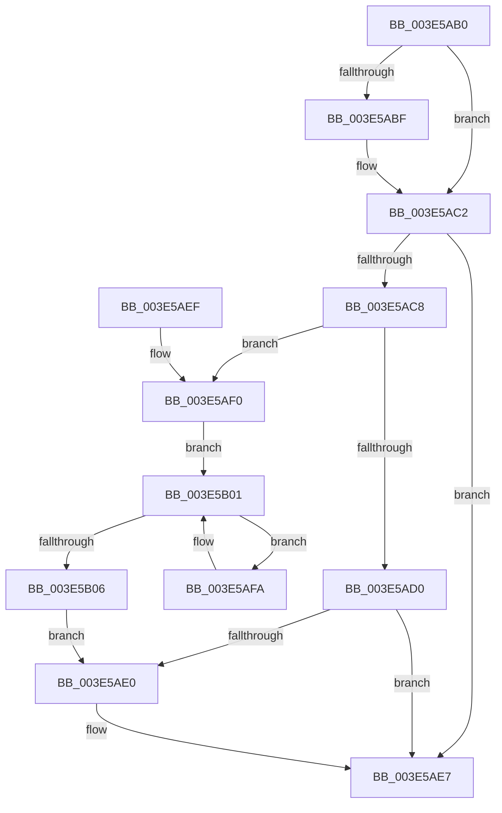

# RtlEnumerateGenericTableAvl

- RVA: `0x003E5AB0`–`0x003E5B0B` (길이 `91` bytes)
- VA: `0x00000001403E5AB0`
- 실행 섹션: `.text`
- PDB 이름 있음: `예`; PDB Function 태그: `아니요`
- unwind 정보 RVA: `0x00094EEC`
- 디코드: `31`개 명령, `91/91` bytes 표시
- 미해석 바이트: `0` (있으면 어셈블리에 `.byte`로 보존)

> 이 문서는 커널 이미지의 기계어와 PDB 기호를 분석해 생성했습니다. 4번과 5번은 함수 원형과 자료형을 바이너리 사용 방식에서 추정한 C 해석이며 원본 소스 복구 결과는 아닙니다.

## 1. Dependencies

- 직접 호출 지점: **1**; 고유 호출 대상: **1**
- 직접 호출자로 확인된 함수: **11**
- RIP 상대 이미지 참조: **0**

### Outgoing calls
- `0x003E5AD3` → [RealSuccessor](RealSuccessor_function_003E5B20.md) (function, `0x003E5B20`)

### Direct callers
- [DifEnumeratePluginData](../61/DifEnumeratePluginData_function_00612590.md) at `0x0061266E`
- [CarDeleteDriverRuleViolations](../61/CarDeleteDriverRuleViolations_function_0061B38C.md) at `0x0061B401`
- [CarDeletePluginRuleViolations](../61/CarDeletePluginRuleViolations_function_0061B440.md) at `0x0061B49F`
- [CarDeleteRuleViolationDB](../61/CarDeleteRuleViolationDB_function_0061B4D0.md) at `0x0061B52A`
- [CarWriteEarlyRuleViolationEvents](../61/CarWriteEarlyRuleViolationEvents_function_0061B628.md) at `0x0061B6CE`
- [PiDmObjectManagerPopulate](../../page/73/PiDmObjectManagerPopulate_function_00730598.md) at `0x007306F1`
- [EtwpFreeKeyNameList](../../page/7B/EtwpFreeKeyNameList_function_007BE660.md) at `0x007BE67B`
- [VfAvlDeleteAllTreeNodes](../../pagevrfy/B9/VfAvlDeleteAllTreeNodes_function_00B93B9C.md) at `0x00B93BE6`
- [VfAvlEnumerateNodes](../../pagevrfy/B9/VfAvlEnumerateNodes_function_00B93C14.md) at `0x00B93C6F`
- [VfPtGenerateTraceInformation](../../pagevrfy/B9/VfPtGenerateTraceInformation_function_00B9BF5C.md) at `0x00B9BFF1`
- [VfPtGenerateTraceInformation](../../pagevrfy/B9/VfPtGenerateTraceInformation_function_00B9BF5C.md) at `0x00B9C014`
- [VfPtGenerateTraceInformation](../../pagevrfy/B9/VfPtGenerateTraceInformation_function_00B9BF5C.md) at `0x00B9C05C`
- [VfPtGenerateTraceInformation](../../pagevrfy/B9/VfPtGenerateTraceInformation_function_00B9BF5C.md) at `0x00B9C0DF`
- [ViPtDeleteAvlTrees](../../pagevrfy/B9/ViPtDeleteAvlTrees_function_00B9C730.md) at `0x00B9C799`
- [ViPtDeleteAvlTrees](../../pagevrfy/B9/ViPtDeleteAvlTrees_function_00B9C730.md) at `0x00B9C81D`

### Static image references
- 디코드된 RIP-relative 메모리 참조가 없습니다.

## 2. Other-region calls and transfers

- 다른 실행 섹션으로 향하는 call: **0**
- 별도 외부 분기/꼬리 이동을 확인하지 못했습니다.

## 3. Assembly (complete function range)

```asm
003E5AB0  48 83 EC 28                     sub rsp, 0x28
003E5AB4  45 33 C0                        xor r8d, r8d
003E5AB7  4C 8D 49 38                     lea r9, [rcx + 0x38]
003E5ABB  84 D2                           test dl, dl
003E5ABD  74 03                           je 0x1403e5ac2
003E5ABF  4D 89 01                        mov qword ptr [r9], r8
003E5AC2  44 39 41 2C                     cmp dword ptr [rcx + 0x2c], r8d
003E5AC6  74 1F                           je 0x1403e5ae7
003E5AC8  49 8B 01                        mov rax, qword ptr [r9]
003E5ACB  48 85 C0                        test rax, rax
003E5ACE  74 20                           je 0x1403e5af0
003E5AD0  48 8B C8                        mov rcx, rax
003E5AD3  E8 48 00 00 00                  call 0x1403e5b20
003E5AD8  48 8B C8                        mov rcx, rax
003E5ADB  48 85 C0                        test rax, rax
003E5ADE  74 07                           je 0x1403e5ae7
003E5AE0  49 89 09                        mov qword ptr [r9], rcx
003E5AE3  4C 8D 40 20                     lea r8, [rax + 0x20]
003E5AE7  49 8B C0                        mov rax, r8
003E5AEA  48 83 C4 28                     add rsp, 0x28
003E5AEE  C3                              ret
003E5AEF  CC                              int3
003E5AF0  48 8B 41 10                     mov rax, qword ptr [rcx + 0x10]
003E5AF4  48 8B 48 08                     mov rcx, qword ptr [rax + 8]
003E5AF8  EB 07                           jmp 0x1403e5b01
003E5AFA  48 8B C1                        mov rax, rcx
003E5AFD  48 8B 49 08                     mov rcx, qword ptr [rcx + 8]
003E5B01  48 85 C9                        test rcx, rcx
003E5B04  75 F4                           jne 0x1403e5afa
003E5B06  48 8B C8                        mov rcx, rax
003E5B09  EB D5                           jmp 0x1403e5ae0
```

## 4. C-style interpretation (structured pseudocode)

```c
__int64 __fastcall RtlEnumerateGenericTableAvl(__int64 a1, unsigned __int8 a2, int a3)
{
    __int64 result;
    __int64 v_rsp;

    v_rsp = (v_rsp) - (40);
    a3 = 0;
    if (a2 != 0) {
        *(unsigned __int64 *)(a1 + 56) = 0;
    }
    if ((*(unsigned int *)(a1 + 44)) == 0) goto loc_003E5AE7;
    if (*(unsigned __int64 *)(a1 + 56) == 0) goto loc_003E5AF0;
    result = RealSuccessor(*(unsigned __int64 *)(a1 + 56), a2, a3, a1 + 56);
    if (result != 0) {
        *(unsigned __int64 *)(a1 + 56) = result;
        a3 = result + 32;
    }
    v_rsp = (v_rsp) + (40);
    return a3;
loc_003E5AF0:
    goto loc_003E5B01;
loc_003E5AFA:
loc_003E5B01:
    if (*(unsigned __int64 *)(*(unsigned __int64 *)(*(unsigned __int64 *)(result + 16) + 8) + 8) != 0) goto loc_003E5AFA;
    goto loc_003E5AE0;
}
```

## 5. (Beta) C Style

```c
int64_t RtlEnumerateGenericTableAvl(void *Arg1, uint8_t Arg2, int32_t Arg3)
{
    uint8_t *arg1 = (uint8_t *)Arg1;

    int64_t result;
    int64_t local_rsp;

    local_rsp = (local_rsp) - (40);
    Arg3 = 0;
    if (Arg2 != 0) {
        *(uint64_t *)(arg1 + 0x38) = 0;
    }
    if ((*(uint32_t *)(arg1 + 0x2C)) == 0) goto loc_003E5AE7;
    if (*(uint64_t *)(arg1 + 0x38) == 0) goto loc_003E5AF0;
    result = RealSuccessor(*(uint64_t *)(arg1 + 0x38), Arg2, Arg3, Arg1 + 56);
    if (result != 0) {
        *(uint64_t *)(arg1 + 0x38) = result;
        Arg3 = result + 32;
    }
    local_rsp = (local_rsp) + (40);
    return Arg3;
loc_003E5AF0:
    goto loc_003E5B01;
loc_003E5AFA:
loc_003E5B01:
    if (*(uint64_t *)(*(uint64_t *)(*(uint64_t *)(result + 0x10) + 0x8) + 0x8) != 0) goto loc_003E5AFA;
    goto loc_003E5AE0;
}
```

### 관측된 메모리 오프셋

구조체 형식이 확인되지 않은 접근은 인자 기준의 오프셋으로만 기록했습니다.

| 기준 인자 | 오프셋 표현 | 폭 (bit) | 접근 |
|---|---:|---:|---|
| `Arg1` | `+ 0x0` | `64` | `R` |
| `Arg1` | `+ 0x0` | `64` | `W` |
| `Arg1` | `+ 0x10` | `64` | `R` |
| `Arg1` | `+ 0x2C` | `32` | `R` |
| `Arg1` | `+ 0x38` | `64` | `R` |

## 6. Execution-region graph

[열기: 2D/3D 그래프와 함수 탐색 컨트롤 패널](../../../control-panel.html?section=text&rva=0x003E5AB0&view=graph)

- 2D 그래프는 위에서 아래로 흐르고, 3D 그래프는 빈 공간을 드래그해 회전합니다. Shift+드래그는 이동, 휠은 확대·축소, 함수 노드 선택은 대상 보고서 이동입니다.

### Static fallback


