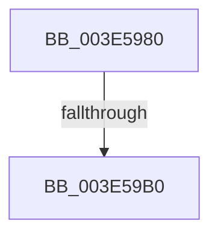

# RtlEnumerateGenericTableLikeADirectory

- RVA: `0x003E5980`–`0x003E59B6` (길이 `54` bytes)
- VA: `0x00000001403E5980`
- 실행 섹션: `.text`
- PDB 이름 있음: `예`; PDB Function 태그: `아니요`
- unwind 정보 RVA: `0x00094E90`
- 디코드: `17`개 명령, `54/54` bytes 표시
- 미해석 바이트: `0` (있으면 어셈블리에 `.byte`로 보존)

> 이 문서는 커널 이미지의 기계어와 PDB 기호를 분석해 생성했습니다. 4번과 5번은 함수 원형과 자료형을 바이너리 사용 방식에서 추정한 C 해석이며 원본 소스 복구 결과는 아닙니다.

## 1. Dependencies

- 직접 호출 지점: **0**; 고유 호출 대상: **0**
- 직접 호출자로 확인된 함수: **1**
- RIP 상대 이미지 참조: **0**

### Outgoing calls
- 직접 디코드된 call 명령이 없습니다.

### Direct callers
- [PiDmEnumObjectsWithCallback](../../page/8E/PiDmEnumObjectsWithCallback_function_008E3920.md) at `0x008E39E5`
- [PiDmEnumObjectsWithCallback](../../page/8E/PiDmEnumObjectsWithCallback_function_008E3920.md) at `0x008E3AAF`

### Static image references
- 디코드된 RIP-relative 메모리 참조가 없습니다.

## 2. Other-region calls and transfers

- 다른 실행 섹션으로 향하는 call: **0**
- call이 아닌 외부 분기/꼬리 이동: **1**
  - `0x003E59AA` → [sub_003E5A48 + 0x1](Unknown_function_003E5A48.md) (`tail-transfer`)

## 3. Assembly (complete function range)

```asm
003E5980  48 89 5C 24 18                  mov qword ptr [rsp + 0x18], rbx
003E5985  55                              push rbp
003E5986  56                              push rsi
003E5987  57                              push rdi
003E5988  41 56                           push r14
003E598A  41 57                           push r15
003E598C  48 83 EC 20                     sub rsp, 0x20
003E5990  83 79 2C 00                     cmp dword ptr [rcx + 0x2c], 0
003E5994  41 8B E9                        mov ebp, r9d
003E5997  48 8B 74 24 70                  mov rsi, qword ptr [rsp + 0x70]
003E599C  4D 8B F0                        mov r14, r8
003E599F  48 8B D9                        mov rbx, rcx
003E59A2  48 8B 3E                        mov rdi, qword ptr [rsi]
003E59A5  48 89 7C 24 70                  mov qword ptr [rsp + 0x70], rdi
003E59AA  0F 84 99 00 00 00               je 0x1403e5a49
003E59B0  8B 41 40                        mov eax, dword ptr [rcx + 0x40]
003E59B3  48 85 D2                        test rdx, rdx
```

## 4. C-style interpretation (structured pseudocode)

```c
__int64 __fastcall RtlEnumerateGenericTableLikeADirectory(__int64 a1, __int64 a2, __int64 a3, int a4, __int64 a5)
{
    __int64 v_rsp;
    unsigned __int64 v_stack_p18;
    unsigned __int64 v_stack_p28;

    v_stack_p18 = v_rbx;
    v_rsp = (v_rsp) - (32);
    v_stack_p28 = *(unsigned __int64 *)(a5);
    return (unsigned int)(*(unsigned int *)(a1 + 64));
}
```

## 5. (Beta) C Style

```c
int64_t RtlEnumerateGenericTableLikeADirectory(void *Arg1, int64_t Arg2, int64_t Arg3, int32_t Arg4, void *Arg5)
{
    uint8_t *arg1 = (uint8_t *)Arg1;
    uint8_t *arg5 = (uint8_t *)Arg5;

    int64_t local_rsp;
    uint64_t v_stack_p18;
    uint64_t v_stack_p28;

    v_stack_p18 = local_rbx;
    local_rsp = (local_rsp) - (32);
    v_stack_p28 = *(uint64_t *)(arg5);
    return (uint32_t)(*(uint32_t *)(arg1 + 0x40));
}
```

### 관측된 메모리 오프셋

구조체 형식이 확인되지 않은 접근은 인자 기준의 오프셋으로만 기록했습니다.

| 기준 인자 | 오프셋 표현 | 폭 (bit) | 접근 |
|---|---:|---:|---|
| `Arg1` | `+ 0x2C` | `32` | `R` |
| `Arg1` | `+ 0x40` | `32` | `R` |
| `Arg5` | `+ 0x0` | `64` | `R` |

## 6. Execution-region graph

[열기: 2D/3D 그래프와 함수 탐색 컨트롤 패널](../../../control-panel.html?section=text&rva=0x003E5980&view=graph)

- 2D 그래프는 위에서 아래로 흐르고, 3D 그래프는 빈 공간을 드래그해 회전합니다. Shift+드래그는 이동, 휠은 확대·축소, 함수 노드 선택은 대상 보고서 이동입니다.

### Static fallback


