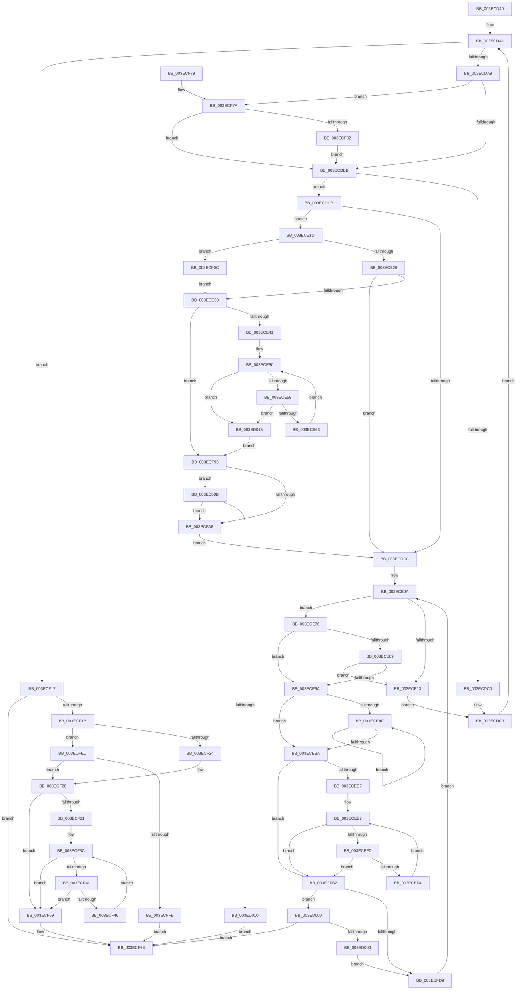

# RtlFindClearRuns

- RVA: `0x003ECD40`–`0x003ED028` (길이 `744` bytes)
- VA: `0x00000001403ECD40`
- 실행 섹션: `.text`
- PDB 이름 있음: `예`; PDB Function 태그: `아니요`
- unwind 정보 RVA: `0x00096640`
- 디코드: `207`개 명령, `744/744` bytes 표시
- 미해석 바이트: `0` (있으면 어셈블리에 `.byte`로 보존)

> 이 문서는 커널 이미지의 기계어와 PDB 기호를 분석해 생성했습니다. 4번과 5번은 함수 원형과 자료형을 바이너리 사용 방식에서 추정한 C 해석이며 원본 소스 복구 결과는 아닙니다.

## 1. Dependencies

- 직접 호출 지점: **0**; 고유 호출 대상: **0**
- 직접 호출자로 확인된 함수: **1**
- RIP 상대 이미지 참조: **3**

### Outgoing calls
- 직접 디코드된 call 명령이 없습니다.

### Direct callers
- [RtlFindLongestRunClear](../5E/RtlFindLongestRunClear_function_005E6240.md) at `0x005E6257`

### Static image references
- `0x003ECD62` → RVA `0x00000000` (`image boundary/outside`; read)
- `0x003ECDE5` → RVA `0x00012D28` (`.rdata`; read)
- `0x003ECE7A` → RVA `0x00012D30` (`.rdata`; read)

## 2. Other-region calls and transfers

- 다른 실행 섹션으로 향하는 call: **0**
- 별도 외부 분기/꼬리 이동을 확인하지 못했습니다.

## 3. Assembly (complete function range)

```asm
003ECD40  44 88 4C 24 20                  mov byte ptr [rsp + 0x20], r9b
003ECD45  44 89 44 24 18                  mov dword ptr [rsp + 0x18], r8d
003ECD4A  48 89 54 24 10                  mov qword ptr [rsp + 0x10], rdx
003ECD4F  53                              push rbx
003ECD50  55                              push rbp
003ECD51  56                              push rsi
003ECD52  57                              push rdi
003ECD53  41 54                           push r12
003ECD55  41 55                           push r13
003ECD57  41 56                           push r14
003ECD59  41 57                           push r15
003ECD5B  48 83 EC 18                     sub rsp, 0x18
003ECD5F  4C 8B E2                        mov r12, rdx
003ECD62  4C 8D 3D 97 32 C1 FF            lea r15, [rip - 0x3ecd69]
003ECD69  BB 00 00 00 00                  mov ebx, 0
003ECD6E  45 8B F0                        mov r14d, r8d
003ECD71  44 8B 01                        mov r8d, dword ptr [rcx]
003ECD74  41 8B D0                        mov edx, r8d
003ECD77  4C 8B 51 08                     mov r10, qword ptr [rcx + 8]
003ECD7B  83 E2 07                        and edx, 7
003ECD7E  41 8B C0                        mov eax, r8d
003ECD81  44 89 44 24 04                  mov dword ptr [rsp + 4], r8d
003ECD86  0F 95 C3                        setne bl
003ECD89  89 14 24                        mov dword ptr [rsp], edx
003ECD8C  C1 E8 03                        shr eax, 3
003ECD8F  33 ED                           xor ebp, ebp
003ECD91  03 D8                           add ebx, eax
003ECD93  89 6C 24 60                     mov dword ptr [rsp + 0x60], ebp
003ECD97  33 C0                           xor eax, eax
003ECD99  33 FF                           xor edi, edi
003ECD9B  45 33 ED                        xor r13d, r13d
003ECD9E  45 33 DB                        xor r11d, r11d
003ECDA1  3B C3                           cmp eax, ebx
003ECDA3  0F 83 6E 01 00 00               jae 0x1403ecf17
003ECDA9  45 0F B6 0A                     movzx r9d, byte ptr [r10]
003ECDAD  8D 4B FF                        lea ecx, [rbx - 1]
003ECDB0  49 FF C2                        inc r10
003ECDB3  3B C1                           cmp eax, ecx
003ECDB5  0F 84 BF 01 00 00               je 0x1403ecf7a
003ECDBB  45 84 C9                        test r9b, r9b
003ECDBE  75 0B                           jne 0x1403ecdcb
003ECDC0  83 C7 08                        add edi, 8
003ECDC3  FF C0                           inc eax
003ECDC5  41 83 C3 08                     add r11d, 8
003ECDC9  EB D6                           jmp 0x1403ecda1
003ECDCB  45 0F B6 C1                     movzx r8d, r9b
003ECDCF  43 0F B6 B4 38 90 C7 02 00      movzx esi, byte ptr [r8 + r15 + 0x2c790]
003ECDD8  03 FE                           add edi, esi
003ECDDA  75 41                           jne 0x1403ece1d
003ECDDC  43 0F B6 BC 38 A0 C8 02 00      movzx edi, byte ptr [r8 + r15 + 0x2c8a0]
003ECDE5  48 8D 15 3C 5F C2 FF            lea rdx, [rip - 0x3da0c4]
003ECDEC  48 2B D7                        sub rdx, rdi
003ECDEF  45 8B EB                        mov r13d, r11d
003ECDF2  44 2B EF                        sub r13d, edi
003ECDF5  41 83 C5 08                     add r13d, 8
003ECDF9  0F B6 0A                        movzx ecx, byte ptr [rdx]
003ECDFC  42 0F B6 94 3E 90 C8 02 00      movzx edx, byte ptr [rsi + r15 + 0x2c890]
003ECE05  0A D1                           or dl, cl
003ECE07  44 0A CA                        or r9b, dl
003ECE0A  44 8B C5                        mov r8d, ebp
003ECE0D  41 80 F9 FF                     cmp r9b, 0xff
003ECE11  75 63                           jne 0x1403ece76
003ECE13  44 8B 44 24 04                  mov r8d, dword ptr [rsp + 4]
003ECE18  8B 14 24                        mov edx, dword ptr [rsp]
003ECE1B  EB A6                           jmp 0x1403ecdc3
003ECE1D  41 3B EE                        cmp ebp, r14d
003ECE20  0F 82 E6 00 00 00               jb 0x1403ecf0c
003ECE26  8D 4D FF                        lea ecx, [rbp - 1]
003ECE29  41 39 7C CC 04                  cmp dword ptr [r12 + rcx*8 + 4], edi
003ECE2E  73 AC                           jae 0x1403ecddc
003ECE30  0F B6 54 24 78                  movzx edx, byte ptr [rsp + 0x78]
003ECE35  44 8D 7D FE                     lea r15d, [rbp - 2]
003ECE39  84 D2                           test dl, dl
003ECE3B  0F 84 54 01 00 00               je 0x1403ecf95
003ECE41  49 63 EF                        movsxd rbp, r15d
003ECE44  4C 8D 75 01                     lea r14, [rbp + 1]
003ECE48  4F 8D 34 F4                     lea r14, [r12 + r14*8]
003ECE4C  0F 1F 40 00                     nop dword ptr [rax]
003ECE50  48 85 ED                        test rbp, rbp
003ECE53  0F 88 BC 01 00 00               js 0x1403ed015
003ECE59  41 39 7E FC                     cmp dword ptr [r14 - 4], edi
003ECE5D  0F 83 B2 01 00 00               jae 0x1403ed015
003ECE63  49 8B 4E F8                     mov rcx, qword ptr [r14 - 8]
003ECE67  41 FF CF                        dec r15d
003ECE6A  48 FF CD                        dec rbp
003ECE6D  49 89 0E                        mov qword ptr [r14], rcx
003ECE70  49 83 C6 F8                     add r14, -8
003ECE74  EB DA                           jmp 0x1403ece50
003ECE76  41 0F B6 F1                     movzx esi, r9b
003ECE7A  48 8D 0D AF 5E C2 FF            lea rcx, [rip - 0x3da151]
003ECE81  48 03 F1                        add rsi, rcx
003ECE84  41 3B EE                        cmp ebp, r14d
003ECE87  72 11                           jb 0x1403ece9a
003ECE89  0F B6 0E                        movzx ecx, byte ptr [rsi]
003ECE8C  8D 55 FF                        lea edx, [rbp - 1]
003ECE8F  41 39 4C D4 04                  cmp dword ptr [r12 + rdx*8 + 4], ecx
003ECE94  0F 83 79 FF FF FF               jae 0x1403ece13
003ECE9A  44 0F B6 36                     movzx r14d, byte ptr [rsi]
003ECE9E  45 33 E4                        xor r12d, r12d
003ECEA1  47 0F B6 BC 3E 90 C8 02 00      movzx r15d, byte ptr [r14 + r15 + 0x2c890]
003ECEAA  45 84 F9                        test r9b, r15b
003ECEAD  74 0B                           je 0x1403eceba
003ECEAF  45 02 FF                        add r15b, r15b
003ECEB2  41 FF C4                        inc r12d
003ECEB5  45 84 F9                        test r9b, r15b
003ECEB8  75 F5                           jne 0x1403eceaf
003ECEBA  FF C5                           inc ebp
003ECEBC  44 3B 44 24 70                  cmp r8d, dword ptr [rsp + 0x70]
003ECEC1  41 0F 43 E8                     cmovae ebp, r8d
003ECEC5  89 6C 24 60                     mov dword ptr [rsp + 0x60], ebp
003ECEC9  83 C5 FE                        add ebp, -2
003ECECC  80 7C 24 78 00                  cmp byte ptr [rsp + 0x78], 0
003ECED1  0F 84 DB 00 00 00               je 0x1403ecfb2
003ECED7  4C 8B 44 24 68                  mov r8, qword ptr [rsp + 0x68]
003ECEDC  49 83 C0 08                     add r8, 8
003ECEE0  48 63 F5                        movsxd rsi, ebp
003ECEE3  4D 8D 04 F0                     lea r8, [r8 + rsi*8]
003ECEE7  48 85 F6                        test rsi, rsi
003ECEEA  0F 88 C2 00 00 00               js 0x1403ecfb2
003ECEF0  45 39 70 FC                     cmp dword ptr [r8 - 4], r14d
003ECEF4  0F 83 B8 00 00 00               jae 0x1403ecfb2
003ECEFA  49 8B 48 F8                     mov rcx, qword ptr [r8 - 8]
003ECEFE  FF CD                           dec ebp
003ECF00  48 FF CE                        dec rsi
003ECF03  49 89 08                        mov qword ptr [r8], rcx
003ECF06  49 83 C0 F8                     add r8, -8
003ECF0A  EB DB                           jmp 0x1403ecee7
003ECF0C  FF C5                           inc ebp
003ECF0E  89 6C 24 60                     mov dword ptr [rsp + 0x60], ebp
003ECF12  E9 19 FF FF FF                  jmp 0x1403ece30
003ECF17  85 FF                           test edi, edi
003ECF19  74 4B                           je 0x1403ecf66
003ECF1B  41 3B EE                        cmp ebp, r14d
003ECF1E  0F 83 C9 00 00 00               jae 0x1403ecfed
003ECF24  FF C5                           inc ebp
003ECF26  80 7C 24 78 00                  cmp byte ptr [rsp + 0x78], 0
003ECF2B  44 8D 45 FE                     lea r8d, [rbp - 2]
003ECF2F  74 28                           je 0x1403ecf59
003ECF31  4D 63 C8                        movsxd r9, r8d
003ECF34  49 8D 51 01                     lea rdx, [r9 + 1]
003ECF38  49 8D 14 D4                     lea rdx, [r12 + rdx*8]
003ECF3C  4D 85 C9                        test r9, r9
003ECF3F  78 18                           js 0x1403ecf59
003ECF41  39 7A FC                        cmp dword ptr [rdx - 4], edi
003ECF44  73 13                           jae 0x1403ecf59
003ECF46  48 8B 42 F8                     mov rax, qword ptr [rdx - 8]
003ECF4A  41 FF C8                        dec r8d
003ECF4D  49 FF C9                        dec r9
003ECF50  48 89 02                        mov qword ptr [rdx], rax
003ECF53  48 83 C2 F8                     add rdx, -8
003ECF57  EB E3                           jmp 0x1403ecf3c
003ECF59  49 63 C0                        movsxd rax, r8d
003ECF5C  41 89 7C C4 0C                  mov dword ptr [r12 + rax*8 + 0xc], edi
003ECF61  45 89 6C C4 08                  mov dword ptr [r12 + rax*8 + 8], r13d
003ECF66  8B C5                           mov eax, ebp
003ECF68  48 83 C4 18                     add rsp, 0x18
003ECF6C  41 5F                           pop r15
003ECF6E  41 5E                           pop r14
003ECF70  41 5D                           pop r13
003ECF72  41 5C                           pop r12
003ECF74  5F                              pop rdi
003ECF75  5E                              pop rsi
003ECF76  5D                              pop rbp
003ECF77  5B                              pop rbx
003ECF78  C3                              ret
003ECF79  CC                              int3
003ECF7A  85 D2                           test edx, edx
003ECF7C  0F 84 39 FE FF FF               je 0x1403ecdbb
003ECF82  41 8B C8                        mov ecx, r8d
003ECF85  83 E1 07                        and ecx, 7
003ECF88  46 0A 8C 39 20 2D 01 00         or r9b, byte ptr [rcx + r15 + 0x12d20]
003ECF90  E9 26 FE FF FF                  jmp 0x1403ecdbb
003ECF95  49 63 CF                        movsxd rcx, r15d
003ECF98  41 89 7C CC 0C                  mov dword ptr [r12 + rcx*8 + 0xc], edi
003ECF9D  45 89 6C CC 08                  mov dword ptr [r12 + rcx*8 + 8], r13d
003ECFA2  84 D2                           test dl, dl
003ECFA4  74 65                           je 0x1403ed00b
003ECFA6  4C 8D 3D 53 30 C1 FF            lea r15, [rip - 0x3ecfad]
003ECFAD  E9 2A FE FF FF                  jmp 0x1403ecddc
003ECFB2  80 7C 24 78 00                  cmp byte ptr [rsp + 0x78], 0
003ECFB7  48 8B 54 24 68                  mov rdx, qword ptr [rsp + 0x68]
003ECFBC  48 63 CD                        movsxd rcx, ebp
003ECFBF  8B 6C 24 60                     mov ebp, dword ptr [rsp + 0x60]
003ECFC3  48 8D 14 CA                     lea rdx, [rdx + rcx*8]
003ECFC7  43 8D 0C 23                     lea ecx, [r11 + r12]
003ECFCB  44 89 72 0C                     mov dword ptr [rdx + 0xc], r14d
003ECFCF  44 8B 74 24 70                  mov r14d, dword ptr [rsp + 0x70]
003ECFD4  89 4A 08                        mov dword ptr [rdx + 8], ecx
003ECFD7  74 27                           je 0x1403ed000
003ECFD9  4C 8B 64 24 68                  mov r12, qword ptr [rsp + 0x68]
003ECFDE  45 0A CF                        or r9b, r15b
003ECFE1  4C 8D 3D 18 30 C1 FF            lea r15, [rip - 0x3ecfe8]
003ECFE8  E9 1D FE FF FF                  jmp 0x1403ece0a
003ECFED  8D 45 FF                        lea eax, [rbp - 1]
003ECFF0  41 39 7C C4 04                  cmp dword ptr [r12 + rax*8 + 4], edi
003ECFF5  0F 82 2B FF FF FF               jb 0x1403ecf26
003ECFFB  E9 66 FF FF FF                  jmp 0x1403ecf66
003ED000  41 3B EE                        cmp ebp, r14d
003ED003  0F 83 5D FF FF FF               jae 0x1403ecf66
003ED009  EB CE                           jmp 0x1403ecfd9
003ED00B  41 3B EE                        cmp ebp, r14d
003ED00E  72 96                           jb 0x1403ecfa6
003ED010  E9 51 FF FF FF                  jmp 0x1403ecf66
003ED015  8B 6C 24 60                     mov ebp, dword ptr [rsp + 0x60]
003ED019  44 8B 74 24 70                  mov r14d, dword ptr [rsp + 0x70]
003ED01E  0F B6 54 24 78                  movzx edx, byte ptr [rsp + 0x78]
003ED023  E9 6D FF FF FF                  jmp 0x1403ecf95
```

## 4. C-style interpretation (structured pseudocode)

```c
__int64 __fastcall RtlFindClearRuns(__int64 a1, __int64 a2, int a3, unsigned __int8 a4)
{
    __int64 result;
    __int64 v_r10;
    __int64 v_r11;
    __int64 v_r12;
    __int64 v_r13;
    __int64 v_r14;
    __int64 v_r15;
    __int64 v_rbp;
    __int64 v_rbx;
    __int64 v_rdi;
    __int64 v_rsi;
    __int64 v_rsp;
    unsigned int v_stack_m54;
    unsigned int v_stack_m58;
    unsigned __int64 v_stack_p10;
    unsigned int v_stack_p18;
    unsigned __int8 v_stack_p20;
    unsigned int v_stack_p60;
    unsigned __int64 v_stack_p68;
    unsigned int v_stack_p70;
    unsigned __int8 v_stack_p78;
    unsigned int v_stack_p8;

    v_stack_p20 = a4;
    v_stack_p18 = a3;
    v_stack_p10 = a2;
    v_rsp = (v_rsp) - (24);
    a2 = (unsigned int)(((unsigned int)((unsigned int)((unsigned int)(*(unsigned int *)(a1))))) & (7));
    v_stack_m54 = (unsigned int)((unsigned int)(*(unsigned int *)(a1)));
    v_rbx = (condition_is_not_equal) ? 1 : 0;
    v_stack_m58 = (unsigned int)(a2);
    result = (unsigned int)(((unsigned int)((unsigned int)((unsigned int)(*(unsigned int *)(a1))))) >> (3));
    v_rbp = 0;
    v_rbx = (unsigned int)((v_rbx) + ((unsigned int)(result)));
    v_stack_p8 = 0;
    result = 0;
    v_rdi = 0;
    v_r13 = 0;
    v_r11 = 0;
loc_003ECDA1:
    if (0 >= ((unsigned int)(v_rbx))) goto loc_003ECF17;
    v_r10 = (*(unsigned __int64 *)(a1 + 8)) + 1;
    if (0 == ((unsigned int)(v_rbx - 1))) goto loc_003ECF7A;
loc_003ECDBB:
    if ((unsigned __int8)(*(unsigned __int8 *)(*(unsigned __int64 *)(a1 + 8))) != 0) goto loc_003ECDCB;
    v_rdi = (unsigned int)((v_rdi) + (8));
loc_003ECDC3:
    result = (unsigned int)((result) + 1);
    v_r11 = (unsigned int)((v_r11) + (8));
    goto loc_003ECDA1;
loc_003ECDCB:
    v_rdi = (unsigned int)((v_rdi) + ((unsigned int)(*(unsigned __int8 *)((unsigned __int8)(*(unsigned __int8 *)(*(unsigned __int64 *)(a1 + 8))) + v_rip - 4115817 * 1 + 182160))));
    if (condition_is_not_equal) goto loc_003ECE1D;
loc_003ECDDC:
    a2 = (v_rip - 4038852) - (*(unsigned __int8 *)((unsigned __int8)(*(unsigned __int8 *)(*(unsigned __int64 *)(a1 + 8))) + v_rip - 4115817 * 1 + 182432));
    v_r13 = (unsigned int)(((unsigned int)((unsigned int)(v_r11))) - ((unsigned int)(*(unsigned __int8 *)((unsigned __int8)(*(unsigned __int8 *)(*(unsigned __int64 *)(a1 + 8))) + v_rip - 4115817 * 1 + 182432))));
    v_r13 = (unsigned int)((v_r13) + (8));
    a2 = (unsigned __int8)((*(unsigned __int8 *)(*(unsigned __int8 *)((unsigned __int8)(*(unsigned __int8 *)(*(unsigned __int64 *)(a1 + 8))) + v_rip - 4115817 * 1 + 182160) + v_rip - 4115817 * 1 + 182416)) | ((unsigned __int8)(*(unsigned __int8 *)(a2))));
    a4 = (unsigned __int8)((*(unsigned __int8 *)(*(unsigned __int64 *)(a1 + 8))) | ((unsigned __int8)(a2)));
loc_003ECE0A:
    if (a4 != 255) goto loc_003ECE76;
loc_003ECE13:
    goto loc_003ECDC3;
loc_003ECE1D:
    if (0 < ((unsigned int)((unsigned int)(a3)))) goto loc_003ECF0C;
    if ((*(unsigned int *)(a2 + v_rbp - 1 * 8 + 4)) >= ((unsigned int)(*(unsigned __int8 *)((unsigned __int8)(*(unsigned __int8 *)(*(unsigned __int64 *)(a1 + 8))) + v_rip - 4115817 * 1 + 182432)))) goto loc_003ECDDC;
loc_003ECE30:
    if ((unsigned __int8)(v_stack_p20) == 0) goto loc_003ECF95;
loc_003ECE50:
    if (sign_flag) goto loc_003ED015;
    if ((*(unsigned int *)(a2 + (int)((unsigned int)(v_rbp - 2)) + 1 * 8 - 4)) >= ((unsigned int)(*(unsigned __int8 *)((unsigned __int8)(*(unsigned __int8 *)(*(unsigned __int64 *)(a1 + 8))) + v_rip - 4115817 * 1 + 182432)))) goto loc_003ED015;
    v_r15 = (unsigned int)((v_rbp - 2) - 1);
    v_rbp = ((int)((unsigned int)(v_rbp - 2))) - 1;
    *(unsigned __int64 *)(a2 + (int)((unsigned int)(v_rbp - 2)) + 1 * 8) = *(unsigned __int64 *)(a2 + (int)((unsigned int)(v_rbp - 2)) + 1 * 8 - 8);
    v_r14 = (a2 + (int)((unsigned int)(v_rbp - 2)) + 1 * 8) + (-8);
    goto loc_003ECE50;
loc_003ECE76:
    v_rsi = (a4) + (v_rip - 4038993);
    if (((unsigned int)(v_rbp)) < ((unsigned int)(v_r14))) goto loc_003ECE9A;
    if ((*(unsigned int *)(a2 + v_rbp - 1 * 8 + 4)) >= ((unsigned int)(*(unsigned __int8 *)(v_rsi)))) goto loc_003ECE13;
loc_003ECE9A:
    v_r12 = 0;
    if (((a4) & ((unsigned __int8)(*(unsigned __int8 *)(*(unsigned __int8 *)(v_rsi) + v_r15 * 1 + 182416)))) == 0) goto loc_003ECEBA;
loc_003ECEAF:
    v_r15 = (unsigned __int8)((*(unsigned __int8 *)(*(unsigned __int8 *)(v_rsi) + v_r15 * 1 + 182416)) + ((unsigned __int8)(*(unsigned __int8 *)(*(unsigned __int8 *)(v_rsi) + v_r15 * 1 + 182416))));
    v_r12 = (unsigned int)((v_r12) + 1);
    if (((a4) & ((unsigned __int8)(v_r15))) != 0) goto loc_003ECEAF;
loc_003ECEBA:
    v_rbp = (unsigned int)((v_rbp) + 1);
    if (((unsigned int)((unsigned int)(v_stack_m54))) >= v_stack_p18) { v_rbp = (unsigned int)((unsigned int)(v_stack_m54)); }
    v_stack_p8 = (unsigned int)(v_rbp);
    v_rbp = (unsigned int)((v_rbp) + (-2));
    if (v_stack_p20 == 0) goto loc_003ECFB2;
    a3 = (v_stack_p10) + (8);
loc_003ECEE7:
    if (sign_flag) goto loc_003ECFB2;
    if ((*(unsigned int *)(a3 + (int)((unsigned int)(v_rbp)) * 8 - 4)) >= ((unsigned int)(*(unsigned __int8 *)(v_rsi)))) goto loc_003ECFB2;
    v_rbp = (unsigned int)((v_rbp) - 1);
    v_rsi = ((int)((unsigned int)(v_rbp))) - 1;
    *(unsigned __int64 *)(a3 + (int)((unsigned int)(v_rbp)) * 8) = *(unsigned __int64 *)(a3 + (int)((unsigned int)(v_rbp)) * 8 - 8);
    a3 = (a3 + (int)((unsigned int)(v_rbp)) * 8) + (-8);
    goto loc_003ECEE7;
loc_003ECF0C:
    v_rbp = (unsigned int)((v_rbp) + 1);
    v_stack_p8 = (unsigned int)(v_rbp);
    goto loc_003ECE30;
loc_003ECF17:
    if ((unsigned int)(*(unsigned __int8 *)((unsigned __int8)(*(unsigned __int8 *)(*(unsigned __int64 *)(a1 + 8))) + v_rip - 4115817 * 1 + 182432)) == 0) goto loc_003ECF66;
    if (((unsigned int)(v_rbp)) >= ((unsigned int)(*(unsigned __int8 *)(v_rsi)))) goto loc_003ECFED;
    v_rbp = (unsigned int)((v_rbp) + 1);
loc_003ECF26:
    if (v_stack_p20 == 0) goto loc_003ECF59;
loc_003ECF3C:
    if (sign_flag) goto loc_003ECF59;
    if ((*(unsigned int *)(v_r12 + (int)((unsigned int)(v_rbp - 2)) + 1 * 8 - 4)) >= ((unsigned int)(*(unsigned __int8 *)((unsigned __int8)(*(unsigned __int8 *)(*(unsigned __int64 *)(a1 + 8))) + v_rip - 4115817 * 1 + 182432)))) goto loc_003ECF59;
    a3 = (unsigned int)((v_rbp - 2) - 1);
    a4 = ((int)((unsigned int)(v_rbp - 2))) - 1;
    *(unsigned __int64 *)(v_r12 + (int)((unsigned int)(v_rbp - 2)) + 1 * 8) = *(unsigned __int64 *)(v_r12 + (int)((unsigned int)(v_rbp - 2)) + 1 * 8 - 8);
    a2 = (v_r12 + (int)((unsigned int)(v_rbp - 2)) + 1 * 8) + (-8);
    goto loc_003ECF3C;
loc_003ECF59:
    *(unsigned int *)(v_r12 + (int)(a3) * 8 + 12) = (unsigned int)(*(unsigned __int8 *)((unsigned __int8)(*(unsigned __int8 *)(*(unsigned __int64 *)(a1 + 8))) + v_rip - 4115817 * 1 + 182432));
    *(unsigned int *)(v_r12 + (int)(a3) * 8 + 8) = (unsigned int)(v_r13);
loc_003ECF66:
    v_rsp = (v_rsp) + (24);
    return (unsigned int)((unsigned int)(v_rbp));
loc_003ECF7A:
    if ((unsigned int)(a2) == 0) goto loc_003ECDBB;
    a1 = (unsigned int)(((unsigned int)(a3)) & (7));
    a4 = (unsigned __int8)((a4) | (*(unsigned __int8 *)(a1 + v_r15 * 1 + 77088)));
    goto loc_003ECDBB;
loc_003ECF95:
    *(unsigned int *)(v_r12 + (int)((unsigned int)(v_r15)) * 8 + 12) = (unsigned int)(*(unsigned __int8 *)((unsigned __int8)(*(unsigned __int8 *)(*(unsigned __int64 *)(a1 + 8))) + v_rip - 4115817 * 1 + 182432));
    *(unsigned int *)(v_r12 + (int)((unsigned int)(v_r15)) * 8 + 8) = (unsigned int)(v_r13);
    if ((unsigned __int8)(a2) == 0) goto loc_003ED00B;
loc_003ECFA6:
    goto loc_003ECDDC;
loc_003ECFB2:
    *(unsigned int *)(v_stack_p68 + (int)((unsigned int)(v_rbp)) * 8 + 12) = (unsigned int)(*(unsigned __int8 *)(v_rsi));
    *(unsigned int *)(v_stack_p68 + (int)((unsigned int)(v_rbp)) * 8 + 8) = (unsigned int)(v_r11 + v_r12 * 1);
    if (v_stack_p78 == 0) goto loc_003ED000;
loc_003ECFD9:
    a4 = (unsigned __int8)((a4) | ((unsigned __int8)(v_rip - 4116397)));
    goto loc_003ECE0A;
loc_003ECFED:
    if ((*(unsigned int *)(v_stack_p68 + (unsigned int)(v_stack_p60) - 1 * 8 + 4)) < ((unsigned int)(*(unsigned __int8 *)((unsigned __int8)(*(unsigned __int8 *)(*(unsigned __int64 *)(a1 + 8))) + v_rip - 4115817 * 1 + 182432)))) goto loc_003ECF26;
    goto loc_003ECF66;
loc_003ED000:
    if (((unsigned int)((unsigned int)(v_stack_p60))) >= ((unsigned int)((unsigned int)(v_stack_p70)))) goto loc_003ECF66;
    goto loc_003ECFD9;
loc_003ED00B:
    if (((unsigned int)((unsigned int)(v_stack_p60))) < ((unsigned int)((unsigned int)(v_stack_p70)))) goto loc_003ECFA6;
    goto loc_003ECF66;
loc_003ED015:
    goto loc_003ECF95;
}
```

## 5. (Beta) C Style

```c
int64_t RtlFindClearRuns(void *Arg1, int64_t Arg2, int32_t Arg3, uint8_t Arg4)
{
    uint8_t *arg1 = (uint8_t *)Arg1;

    int64_t result;
    int64_t local_r10;
    int64_t local_r11;
    int64_t local_r12;
    int64_t local_r13;
    int64_t local_r14;
    int64_t local_r15;
    int64_t local_rbp;
    int64_t local_rbx;
    int64_t local_rdi;
    int64_t local_rsi;
    int64_t local_rsp;
    uint32_t v_stack_m54;
    uint32_t v_stack_m58;
    uint64_t v_stack_p10;
    uint32_t v_stack_p18;
    uint8_t v_stack_p20;
    uint32_t v_stack_p60;
    uint64_t v_stack_p68;
    uint32_t v_stack_p70;
    uint8_t v_stack_p78;
    uint32_t v_stack_p8;

    v_stack_p20 = Arg4;
    v_stack_p18 = Arg3;
    v_stack_p10 = Arg2;
    local_rsp = (local_rsp) - (24);
    Arg2 = (uint32_t)(((uint32_t)((uint32_t)((uint32_t)(*(uint32_t *)(arg1))))) & (7));
    v_stack_m54 = (uint32_t)((uint32_t)(*(uint32_t *)(arg1)));
    local_rbx = (condition_is_not_equal) ? 1 : 0;
    v_stack_m58 = (uint32_t)(Arg2);
    result = (uint32_t)(((uint32_t)((uint32_t)((uint32_t)(*(uint32_t *)(arg1))))) >> (3));
    local_rbp = 0;
    local_rbx = (uint32_t)((local_rbx) + ((uint32_t)(result)));
    v_stack_p8 = 0;
    result = 0;
    local_rdi = 0;
    local_r13 = 0;
    local_r11 = 0;
loc_003ECDA1:
    if (0 >= ((uint32_t)(local_rbx))) goto loc_003ECF17;
    local_r10 = (*(uint64_t *)(arg1 + 0x8)) + 1;
    if (0 == ((uint32_t)(local_rbx - 1))) goto loc_003ECF7A;
loc_003ECDBB:
    if ((uint8_t)(*(uint8_t *)(*(uint64_t *)(arg1 + 0x8))) != 0) goto loc_003ECDCB;
    local_rdi = (uint32_t)((local_rdi) + (8));
loc_003ECDC3:
    result = (uint32_t)((result) + 1);
    local_r11 = (uint32_t)((local_r11) + (8));
    goto loc_003ECDA1;
loc_003ECDCB:
    local_rdi = (uint32_t)((local_rdi) + ((uint32_t)(*(uint8_t *)((uint8_t)(*(uint8_t *)(*(uint64_t *)(arg1 + 0x8))) + v_rip - 0x3ECD69 * 1 + 0x2C790))));
    if (condition_is_not_equal) goto loc_003ECE1D;
loc_003ECDDC:
    Arg2 = (v_rip - 4038852) - (*(uint8_t *)((uint8_t)(*(uint8_t *)(*(uint64_t *)(arg1 + 0x8))) + v_rip - 0x3ECD69 * 1 + 0x2C8A0));
    local_r13 = (uint32_t)(((uint32_t)((uint32_t)(local_r11))) - ((uint32_t)(*(uint8_t *)((uint8_t)(*(uint8_t *)(*(uint64_t *)(arg1 + 0x8))) + v_rip - 0x3ECD69 * 1 + 0x2C8A0))));
    local_r13 = (uint32_t)((local_r13) + (8));
    Arg2 = (uint8_t)((*(uint8_t *)(*(uint8_t *)((uint8_t)(*(uint8_t *)(*(uint64_t *)(arg1 + 0x8))) + v_rip - 0x3ECD69 * 1 + 0x2C790) + v_rip - 0x3ECD69 * 1 + 0x2C890)) | ((uint8_t)(*(uint8_t *)(Arg2))));
    Arg4 = (uint8_t)((*(uint8_t *)(*(uint64_t *)(arg1 + 0x8))) | ((uint8_t)(Arg2)));
loc_003ECE0A:
    if (Arg4 != 255) goto loc_003ECE76;
loc_003ECE13:
    goto loc_003ECDC3;
loc_003ECE1D:
    if (0 < ((uint32_t)((uint32_t)(Arg3)))) goto loc_003ECF0C;
    if ((*(uint32_t *)(Arg2 + local_rbp - 0x1 * 8 + 0x4)) >= ((uint32_t)(*(uint8_t *)((uint8_t)(*(uint8_t *)(*(uint64_t *)(arg1 + 0x8))) + v_rip - 0x3ECD69 * 1 + 0x2C8A0)))) goto loc_003ECDDC;
loc_003ECE30:
    if ((uint8_t)(v_stack_p20) == 0) goto loc_003ECF95;
loc_003ECE50:
    if (sign_flag) goto loc_003ED015;
    if ((*(uint32_t *)(Arg2 + (int32_t)((uint32_t)(local_rbp - 0x2)) + 0x1 * 8 - 0x4)) >= ((uint32_t)(*(uint8_t *)((uint8_t)(*(uint8_t *)(*(uint64_t *)(arg1 + 0x8))) + v_rip - 0x3ECD69 * 1 + 0x2C8A0)))) goto loc_003ED015;
    local_r15 = (uint32_t)((local_rbp - 2) - 1);
    local_rbp = ((int32_t)((uint32_t)(local_rbp - 2))) - 1;
    *(uint64_t *)(Arg2 + (int32_t)((uint32_t)(local_rbp - 0x2)) + 0x1 * 8) = *(uint64_t *)(Arg2 + (int32_t)((uint32_t)(local_rbp - 0x2)) + 0x1 * 8 - 0x8);
    local_r14 = (Arg2 + (int32_t)((uint32_t)(local_rbp - 2)) + 1 * 8) + (-8);
    goto loc_003ECE50;
loc_003ECE76:
    local_rsi = (Arg4) + (v_rip - 4038993);
    if (((uint32_t)(local_rbp)) < ((uint32_t)(local_r14))) goto loc_003ECE9A;
    if ((*(uint32_t *)(Arg2 + local_rbp - 0x1 * 8 + 0x4)) >= ((uint32_t)(*(uint8_t *)(local_rsi)))) goto loc_003ECE13;
loc_003ECE9A:
    local_r12 = 0;
    if (((Arg4) & ((uint8_t)(*(uint8_t *)(*(uint8_t *)(local_rsi) + local_r15 * 1 + 0x2C890)))) == 0) goto loc_003ECEBA;
loc_003ECEAF:
    local_r15 = (uint8_t)((*(uint8_t *)(*(uint8_t *)(local_rsi) + local_r15 * 1 + 0x2C890)) + ((uint8_t)(*(uint8_t *)(*(uint8_t *)(local_rsi) + local_r15 * 1 + 0x2C890))));
    local_r12 = (uint32_t)((local_r12) + 1);
    if (((Arg4) & ((uint8_t)(local_r15))) != 0) goto loc_003ECEAF;
loc_003ECEBA:
    local_rbp = (uint32_t)((local_rbp) + 1);
    if (((uint32_t)((uint32_t)(v_stack_m54))) >= v_stack_p18) { local_rbp = (uint32_t)((uint32_t)(v_stack_m54)); }
    v_stack_p8 = (uint32_t)(local_rbp);
    local_rbp = (uint32_t)((local_rbp) + (-2));
    if (v_stack_p20 == 0) goto loc_003ECFB2;
    Arg3 = (v_stack_p10) + (8);
loc_003ECEE7:
    if (sign_flag) goto loc_003ECFB2;
    if ((*(uint32_t *)(Arg3 + (int32_t)((uint32_t)(local_rbp)) * 8 - 0x4)) >= ((uint32_t)(*(uint8_t *)(local_rsi)))) goto loc_003ECFB2;
    local_rbp = (uint32_t)((local_rbp) - 1);
    local_rsi = ((int32_t)((uint32_t)(local_rbp))) - 1;
    *(uint64_t *)(Arg3 + (int32_t)((uint32_t)(local_rbp)) * 8) = *(uint64_t *)(Arg3 + (int32_t)((uint32_t)(local_rbp)) * 8 - 0x8);
    Arg3 = (Arg3 + (int32_t)((uint32_t)(local_rbp)) * 8) + (-8);
    goto loc_003ECEE7;
loc_003ECF0C:
    local_rbp = (uint32_t)((local_rbp) + 1);
    v_stack_p8 = (uint32_t)(local_rbp);
    goto loc_003ECE30;
loc_003ECF17:
    if ((uint32_t)(*(uint8_t *)((uint8_t)(*(uint8_t *)(*(uint64_t *)(arg1 + 0x8))) + v_rip - 0x3ECD69 * 1 + 0x2C8A0)) == 0) goto loc_003ECF66;
    if (((uint32_t)(local_rbp)) >= ((uint32_t)(*(uint8_t *)(local_rsi)))) goto loc_003ECFED;
    local_rbp = (uint32_t)((local_rbp) + 1);
loc_003ECF26:
    if (v_stack_p20 == 0) goto loc_003ECF59;
loc_003ECF3C:
    if (sign_flag) goto loc_003ECF59;
    if ((*(uint32_t *)(local_r12 + (int32_t)((uint32_t)(local_rbp - 0x2)) + 0x1 * 8 - 0x4)) >= ((uint32_t)(*(uint8_t *)((uint8_t)(*(uint8_t *)(*(uint64_t *)(arg1 + 0x8))) + v_rip - 0x3ECD69 * 1 + 0x2C8A0)))) goto loc_003ECF59;
    Arg3 = (uint32_t)((local_rbp - 2) - 1);
    Arg4 = ((int32_t)((uint32_t)(local_rbp - 2))) - 1;
    *(uint64_t *)(local_r12 + (int32_t)((uint32_t)(local_rbp - 0x2)) + 0x1 * 8) = *(uint64_t *)(local_r12 + (int32_t)((uint32_t)(local_rbp - 0x2)) + 0x1 * 8 - 0x8);
    Arg2 = (local_r12 + (int32_t)((uint32_t)(local_rbp - 2)) + 1 * 8) + (-8);
    goto loc_003ECF3C;
loc_003ECF59:
    *(uint32_t *)(local_r12 + (int32_t)(Arg3) * 8 + 0xC) = (uint32_t)(*(uint8_t *)((uint8_t)(*(uint8_t *)(*(uint64_t *)(arg1 + 0x8))) + v_rip - 0x3ECD69 * 1 + 0x2C8A0));
    *(uint32_t *)(local_r12 + (int32_t)(Arg3) * 8 + 0x8) = (uint32_t)(local_r13);
loc_003ECF66:
    local_rsp = (local_rsp) + (24);
    return (uint32_t)((uint32_t)(local_rbp));
loc_003ECF7A:
    if ((uint32_t)(Arg2) == 0) goto loc_003ECDBB;
    Arg1 = (uint32_t)(((uint32_t)(Arg3)) & (7));
    Arg4 = (uint8_t)((Arg4) | (*(uint8_t *)(arg1 + local_r15 * 1 + 0x12D20)));
    goto loc_003ECDBB;
loc_003ECF95:
    *(uint32_t *)(local_r12 + (int32_t)((uint32_t)(local_r15)) * 8 + 0xC) = (uint32_t)(*(uint8_t *)((uint8_t)(*(uint8_t *)(*(uint64_t *)(arg1 + 0x8))) + v_rip - 0x3ECD69 * 1 + 0x2C8A0));
    *(uint32_t *)(local_r12 + (int32_t)((uint32_t)(local_r15)) * 8 + 0x8) = (uint32_t)(local_r13);
    if ((uint8_t)(Arg2) == 0) goto loc_003ED00B;
loc_003ECFA6:
    goto loc_003ECDDC;
loc_003ECFB2:
    *(uint32_t *)(v_stack_p68 + (int32_t)((uint32_t)(local_rbp)) * 8 + 0xC) = (uint32_t)(*(uint8_t *)(local_rsi));
    *(uint32_t *)(v_stack_p68 + (int32_t)((uint32_t)(local_rbp)) * 8 + 0x8) = (uint32_t)(local_r11 + local_r12 * 1);
    if (v_stack_p78 == 0) goto loc_003ED000;
loc_003ECFD9:
    Arg4 = (uint8_t)((Arg4) | ((uint8_t)(v_rip - 4116397)));
    goto loc_003ECE0A;
loc_003ECFED:
    if ((*(uint32_t *)(v_stack_p68 + (uint32_t)(v_stack_p60) - 0x1 * 8 + 0x4)) < ((uint32_t)(*(uint8_t *)((uint8_t)(*(uint8_t *)(*(uint64_t *)(arg1 + 0x8))) + v_rip - 0x3ECD69 * 1 + 0x2C8A0)))) goto loc_003ECF26;
    goto loc_003ECF66;
loc_003ED000:
    if (((uint32_t)((uint32_t)(v_stack_p60))) >= ((uint32_t)((uint32_t)(v_stack_p70)))) goto loc_003ECF66;
    goto loc_003ECFD9;
loc_003ED00B:
    if (((uint32_t)((uint32_t)(v_stack_p60))) < ((uint32_t)((uint32_t)(v_stack_p70)))) goto loc_003ECFA6;
    goto loc_003ECF66;
loc_003ED015:
    goto loc_003ECF95;
}
```

### 관측된 메모리 오프셋

구조체 형식이 확인되지 않은 접근은 인자 기준의 오프셋으로만 기록했습니다.

| 기준 인자 | 오프셋 표현 | 폭 (bit) | 접근 |
|---|---:|---:|---|
| `Arg1` | `+ 0x0` | `32` | `R` |
| `Arg1` | `+ 0x8` | `64` | `R` |

## 6. Execution-region graph

[열기: 2D/3D 그래프와 함수 탐색 컨트롤 패널](../../../control-panel.html?section=text&rva=0x003ECD40&view=graph)

- 2D 그래프는 위에서 아래로 흐르고, 3D 그래프는 빈 공간을 드래그해 회전합니다. Shift+드래그는 이동, 휠은 확대·축소, 함수 노드 선택은 대상 보고서 이동입니다.

### Static fallback


