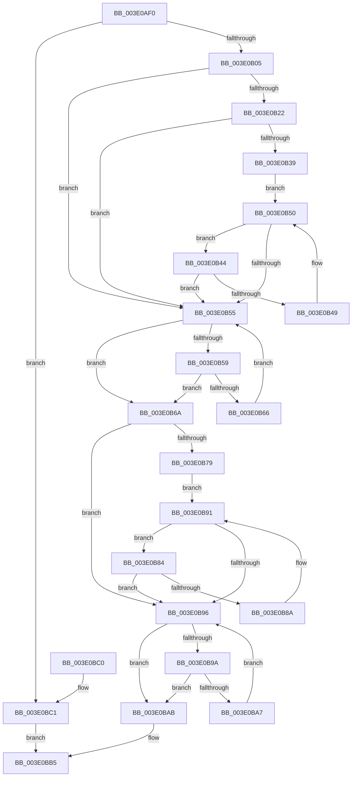

# RtlFindLastBackwardRunClear

- RVA: `0x003E0AF0`–`0x003E0BC8` (길이 `216` bytes)
- VA: `0x00000001403E0AF0`
- 실행 섹션: `.text`
- PDB 이름 있음: `예`; PDB Function 태그: `아니요`
- unwind 정보 RVA: `0x000949A4`
- 디코드: `76`개 명령, `216/216` bytes 표시
- 미해석 바이트: `0` (있으면 어셈블리에 `.byte`로 보존)

> 이 문서는 커널 이미지의 기계어와 PDB 기호를 분석해 생성했습니다. 4번과 5번은 함수 원형과 자료형을 바이너리 사용 방식에서 추정한 C 해석이며 원본 소스 복구 결과는 아닙니다.

## 1. Dependencies

- 직접 호출 지점: **0**; 고유 호출 대상: **0**
- 직접 호출자로 확인된 함수: **2**
- RIP 상대 이미지 참조: **1**

### Outgoing calls
- 직접 디코드된 call 명령이 없습니다.

### Direct callers
- [MiReduceMappedFileReadAhead](MiReduceMappedFileReadAhead_function_003E0A54.md) at `0x003E0A8D`
- [sub_006F503A](../6F/Unknown_function_006F503A.md) at `0x006F5092`
- [sub_006F503A](../6F/Unknown_function_006F503A.md) at `0x006F50AA`

### Static image references
- `0x003E0B09` → RVA `0x00012C50` (`.rdata`; read)

## 2. Other-region calls and transfers

- 다른 실행 섹션으로 향하는 call: **0**
- 별도 외부 분기/꼬리 이동을 확인하지 못했습니다.

## 3. Assembly (complete function range)

```asm
003E0AF0  48 89 5C 24 08                  mov qword ptr [rsp + 8], rbx
003E0AF5  48 89 74 24 10                  mov qword ptr [rsp + 0x10], rsi
003E0AFA  4D 8B D8                        mov r11, r8
003E0AFD  39 11                           cmp dword ptr [rcx], edx
003E0AFF  0F 86 BC 00 00 00               jbe 0x1403e0bc1
003E0B05  4C 8B 49 08                     mov r9, qword ptr [rcx + 8]
003E0B09  48 8D 35 40 21 C3 FF            lea rsi, [rip - 0x3cdec0]
003E0B10  8B C2                           mov eax, edx
003E0B12  83 CB FF                        or ebx, 0xffffffff
003E0B15  48 C1 E8 05                     shr rax, 5
003E0B19  4D 8D 04 81                     lea r8, [r9 + rax*4]
003E0B1D  4D 3B C1                        cmp r8, r9
003E0B20  74 33                           je 0x1403e0b55
003E0B22  44 8B D2                        mov r10d, edx
003E0B25  41 83 E2 1F                     and r10d, 0x1f
003E0B29  41 8D 42 01                     lea eax, [r10 + 1]
003E0B2D  8B 04 86                        mov eax, dword ptr [rsi + rax*4]
003E0B30  F7 D0                           not eax
003E0B32  41 0B 00                        or eax, dword ptr [r8]
003E0B35  3B C3                           cmp eax, ebx
003E0B37  75 1C                           jne 0x1403e0b55
003E0B39  41 2B D2                        sub edx, r10d
003E0B3C  FF CA                           dec edx
003E0B3E  49 83 E8 04                     sub r8, 4
003E0B42  EB 0C                           jmp 0x1403e0b50
003E0B44  41 39 18                        cmp dword ptr [r8], ebx
003E0B47  75 0C                           jne 0x1403e0b55
003E0B49  49 83 E8 04                     sub r8, 4
003E0B4D  83 C2 E0                        add edx, -0x20
003E0B50  4D 3B C1                        cmp r8, r9
003E0B53  77 EF                           ja 0x1403e0b44
003E0B55  3B D3                           cmp edx, ebx
003E0B57  74 11                           je 0x1403e0b6a
003E0B59  8B C2                           mov eax, edx
003E0B5B  49 0F A3 01                     bt qword ptr [r9], rax
003E0B5F  0F 92 C0                        setb al
003E0B62  3C 01                           cmp al, 1
003E0B64  75 04                           jne 0x1403e0b6a
003E0B66  03 D3                           add edx, ebx
003E0B68  EB EB                           jmp 0x1403e0b55
003E0B6A  8B C2                           mov eax, edx
003E0B6C  8B CA                           mov ecx, edx
003E0B6E  83 E0 1F                        and eax, 0x1f
003E0B71  8B 04 86                        mov eax, dword ptr [rsi + rax*4]
003E0B74  41 85 00                        test dword ptr [r8], eax
003E0B77  75 1D                           jne 0x1403e0b96
003E0B79  83 E1 E0                        and ecx, 0xffffffe0
003E0B7C  FF C9                           dec ecx
003E0B7E  49 83 E8 04                     sub r8, 4
003E0B82  EB 0D                           jmp 0x1403e0b91
003E0B84  41 83 38 00                     cmp dword ptr [r8], 0
003E0B88  75 0C                           jne 0x1403e0b96
003E0B8A  49 83 E8 04                     sub r8, 4
003E0B8E  83 C1 E0                        add ecx, -0x20
003E0B91  4D 3B C1                        cmp r8, r9
003E0B94  77 EE                           ja 0x1403e0b84
003E0B96  3B CB                           cmp ecx, ebx
003E0B98  74 11                           je 0x1403e0bab
003E0B9A  8B C1                           mov eax, ecx
003E0B9C  49 0F A3 01                     bt qword ptr [r9], rax
003E0BA0  0F 92 C0                        setb al
003E0BA3  84 C0                           test al, al
003E0BA5  75 04                           jne 0x1403e0bab
003E0BA7  03 CB                           add ecx, ebx
003E0BA9  EB EB                           jmp 0x1403e0b96
003E0BAB  8D 41 01                        lea eax, [rcx + 1]
003E0BAE  2B D1                           sub edx, ecx
003E0BB0  41 89 03                        mov dword ptr [r11], eax
003E0BB3  8B C2                           mov eax, edx
003E0BB5  48 8B 5C 24 08                  mov rbx, qword ptr [rsp + 8]
003E0BBA  48 8B 74 24 10                  mov rsi, qword ptr [rsp + 0x10]
003E0BBF  C3                              ret
003E0BC0  CC                              int3
003E0BC1  41 89 10                        mov dword ptr [r8], edx
003E0BC4  33 C0                           xor eax, eax
003E0BC6  EB ED                           jmp 0x1403e0bb5
```

## 4. C-style interpretation (structured pseudocode)

```c
__int64 __fastcall RtlFindLastBackwardRunClear(__int64 a1, int a2, __int64 a3)
{
    __int64 result;
    __int64 v_r10;
    __int64 v_rbx;
    unsigned __int64 v_stack_p10;
    unsigned __int64 v_stack_p8;

    v_stack_p8 = v_rbx;
    v_stack_p10 = v_rsi;
    if ((*(unsigned int *)(a1)) <= a2) goto loc_003E0BC1;
    v_rbx = (unsigned int)((v_rbx) | (0xFFFFFFFFULL));
    result = ((unsigned int)(a2)) >> (5);
    if ((*(unsigned __int64 *)(a1 + 8) + result * 4) == (*(unsigned __int64 *)(a1 + 8))) goto loc_003E0B55;
    v_r10 = (unsigned int)(((unsigned int)(a2)) & (31));
    result = (unsigned int)(~((unsigned int)(*(unsigned int *)(v_rip - 3989184 + v_r10 + 1 * 4))));
    result = (unsigned int)((result) | (*(unsigned int *)(*(unsigned __int64 *)(a1 + 8) + result * 4)));
    if (((unsigned int)(result)) != ((unsigned int)(v_rbx))) goto loc_003E0B55;
    a2 = (unsigned int)((a2) - ((unsigned int)(v_r10)));
    a2 = (unsigned int)((a2) - 1);
    a3 = (*(unsigned __int64 *)(a1 + 8) + result * 4) - (4);
    goto loc_003E0B50;
loc_003E0B44:
    if ((*(unsigned int *)(a3)) != ((unsigned int)(v_rbx))) goto loc_003E0B55;
    a3 = (a3) - (4);
    a2 = (unsigned int)((a2) + (-32));
loc_003E0B50:
    if (a3 > (*(unsigned __int64 *)(a1 + 8))) goto loc_003E0B44;
loc_003E0B55:
    if (a2 == ((unsigned int)(v_rbx))) goto loc_003E0B6A;
    result = (a2 < ((unsigned int)(v_rbx))) ? 1 : 0;
    if (((unsigned __int8)(result)) != 1) goto loc_003E0B6A;
    a2 = (unsigned int)((a2) + ((unsigned int)(v_rbx)));
    goto loc_003E0B55;
loc_003E0B6A:
    result = (unsigned int)(((unsigned int)(a2)) & (31));
    if (((*(unsigned int *)(a3)) & ((unsigned int)((unsigned int)(*(unsigned int *)(v_rip - 3989184 + result * 4))))) != 0) goto loc_003E0B96;
    a1 = (unsigned int)(((unsigned int)(a2)) & (0xFFFFFFE0ULL));
    a1 = (unsigned int)((a1) - 1);
    a3 = (a3) - (4);
    goto loc_003E0B91;
loc_003E0B84:
    if ((*(unsigned int *)(a3)) != 0) goto loc_003E0B96;
    a3 = (a3) - (4);
    a1 = (unsigned int)((a1) + (-32));
loc_003E0B91:
    if (a3 > (*(unsigned __int64 *)(a1 + 8))) goto loc_003E0B84;
loc_003E0B96:
    if (((unsigned int)(a1)) == ((unsigned int)(v_rbx))) goto loc_003E0BAB;
    result = (((unsigned int)(a1)) < ((unsigned int)(v_rbx))) ? 1 : 0;
    if ((unsigned __int8)(result) != 0) goto loc_003E0BAB;
    a1 = (unsigned int)((a1) + ((unsigned int)(v_rbx)));
    goto loc_003E0B96;
loc_003E0BAB:
    a2 = (unsigned int)((a2) - ((unsigned int)(a1)));
    *(unsigned int *)(a3) = (unsigned int)(a1 + 1);
loc_003E0BB5:
    return (unsigned int)(a2);
loc_003E0BC1:
    *(unsigned int *)(a3) = a2;
    result = 0;
    goto loc_003E0BB5;
}
```

## 5. (Beta) C Style

```c
int64_t RtlFindLastBackwardRunClear(void *Arg1, void *Arg2, void *Arg3)
{
    uint8_t *arg1 = (uint8_t *)Arg1;
    uint8_t *arg2 = (uint8_t *)Arg2;
    uint8_t *arg3 = (uint8_t *)Arg3;

    int64_t result;
    int64_t local_r10;
    int64_t local_rbx;
    uint64_t v_stack_p10;
    uint64_t v_stack_p8;

    v_stack_p8 = local_rbx;
    v_stack_p10 = local_rsi;
    if ((*(uint32_t *)(arg1)) <= Arg2) goto loc_003E0BC1;
    local_rbx = (uint32_t)((local_rbx) | (0xFFFFFFFFULL));
    result = ((uint32_t)(Arg2)) >> (5);
    if ((*(uint64_t *)(arg1 + 0x8) + result * 4) == (*(uint64_t *)(arg1 + 0x8))) goto loc_003E0B55;
    local_r10 = (uint32_t)(((uint32_t)(Arg2)) & (31));
    result = (uint32_t)(~((uint32_t)(*(uint32_t *)(v_rip - 0x3CDEC0 + local_r10 + 0x1 * 4))));
    result = (uint32_t)((result) | (*(uint32_t *)(*(uint64_t *)(arg1 + 0x8) + result * 4)));
    if (((uint32_t)(result)) != ((uint32_t)(local_rbx))) goto loc_003E0B55;
    Arg2 = (uint32_t)((Arg2) - ((uint32_t)(local_r10)));
    Arg2 = (uint32_t)((Arg2) - 1);
    Arg3 = (*(uint64_t *)(arg1 + 0x8) + result * 4) - (4);
    goto loc_003E0B50;
loc_003E0B44:
    if ((*(uint32_t *)(arg3)) != ((uint32_t)(local_rbx))) goto loc_003E0B55;
    Arg3 = (Arg3) - (4);
    Arg2 = (uint32_t)((Arg2) + (-32));
loc_003E0B50:
    if (Arg3 > (*(uint64_t *)(arg1 + 0x8))) goto loc_003E0B44;
loc_003E0B55:
    if (Arg2 == ((uint32_t)(local_rbx))) goto loc_003E0B6A;
    result = (Arg2 < ((uint32_t)(local_rbx))) ? 1 : 0;
    if (((uint8_t)(result)) != 1) goto loc_003E0B6A;
    Arg2 = (uint32_t)((Arg2) + ((uint32_t)(local_rbx)));
    goto loc_003E0B55;
loc_003E0B6A:
    result = (uint32_t)(((uint32_t)(Arg2)) & (31));
    if (((*(uint32_t *)(arg3)) & ((uint32_t)((uint32_t)(*(uint32_t *)(v_rip - 0x3CDEC0 + result * 4))))) != 0) goto loc_003E0B96;
    Arg1 = (uint32_t)(((uint32_t)(Arg2)) & (0xFFFFFFE0ULL));
    Arg1 = (uint32_t)((Arg1) - 1);
    Arg3 = (Arg3) - (4);
    goto loc_003E0B91;
loc_003E0B84:
    if ((*(uint32_t *)(arg3)) != 0) goto loc_003E0B96;
    Arg3 = (Arg3) - (4);
    Arg1 = (uint32_t)((Arg1) + (-32));
loc_003E0B91:
    if (Arg3 > (*(uint64_t *)(arg1 + 0x8))) goto loc_003E0B84;
loc_003E0B96:
    if (((uint32_t)(Arg1)) == ((uint32_t)(local_rbx))) goto loc_003E0BAB;
    result = (((uint32_t)(Arg1)) < ((uint32_t)(local_rbx))) ? 1 : 0;
    if ((uint8_t)(result) != 0) goto loc_003E0BAB;
    Arg1 = (uint32_t)((Arg1) + ((uint32_t)(local_rbx)));
    goto loc_003E0B96;
loc_003E0BAB:
    Arg2 = (uint32_t)((Arg2) - ((uint32_t)(Arg1)));
    *(uint32_t *)(arg3) = (uint32_t)(Arg1 + 1);
loc_003E0BB5:
    return (uint32_t)(Arg2);
loc_003E0BC1:
    *(uint32_t *)(arg3) = Arg2;
    result = 0;
    goto loc_003E0BB5;
}
```

### 관측된 메모리 오프셋

구조체 형식이 확인되지 않은 접근은 인자 기준의 오프셋으로만 기록했습니다.

| 기준 인자 | 오프셋 표현 | 폭 (bit) | 접근 |
|---|---:|---:|---|
| `Arg1` | `+ 0x0` | `32` | `R` |
| `Arg1` | `+ 0x8` | `64` | `R` |
| `Arg2` | `+ 0x1` | `32` | `R` |
| `Arg3` | `+ 0x0` | `32` | `W` |

## 6. Execution-region graph

[열기: 2D/3D 그래프와 함수 탐색 컨트롤 패널](../../../control-panel.html?section=text&rva=0x003E0AF0&view=graph)

- 2D 그래프는 위에서 아래로 흐르고, 3D 그래프는 빈 공간을 드래그해 회전합니다. Shift+드래그는 이동, 휠은 확대·축소, 함수 노드 선택은 대상 보고서 이동입니다.

### Static fallback


