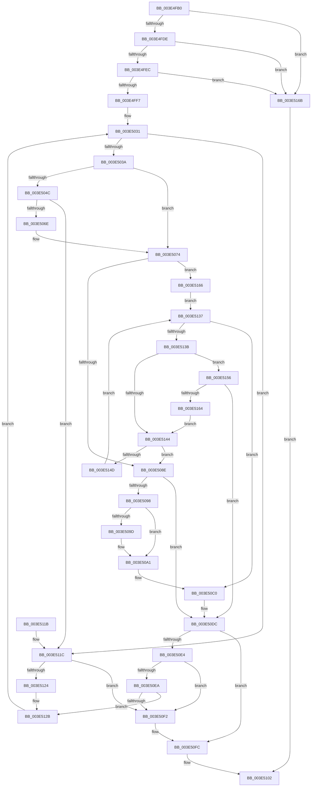

# RtlFindNextClearRunUlong

- RVA: `0x003E4FB0`–`0x003E516F` (길이 `447` bytes)
- VA: `0x00000001403E4FB0`
- 실행 섹션: `.text`
- PDB 이름 있음: `예`; PDB Function 태그: `아니요`
- unwind 정보 RVA: `0x00094E30`
- 디코드: `137`개 명령, `447/447` bytes 표시
- 미해석 바이트: `0` (있으면 어셈블리에 `.byte`로 보존)

> 이 문서는 커널 이미지의 기계어와 PDB 기호를 분석해 생성했습니다. 4번과 5번은 함수 원형과 자료형을 바이너리 사용 방식에서 추정한 C 해석이며 원본 소스 복구 결과는 아닙니다.

## 1. Dependencies

- 직접 호출 지점: **0**; 고유 호출 대상: **0**
- 직접 호출자로 확인된 함수: **3**
- RIP 상대 이미지 참조: **1**

### Outgoing calls
- 직접 디코드된 call 명령이 없습니다.

### Direct callers
- [MiFindFreePageFileSpaceForward](MiFindFreePageFileSpaceForward_function_003E43CC.md) at `0x003E4434`
- [MiFindFreePageFileSpaceForward](MiFindFreePageFileSpaceForward_function_003E43CC.md) at `0x003E4464`
- [MiFindFreePageFileSpaceForward](MiFindFreePageFileSpaceForward_function_003E43CC.md) at `0x003E44EF`
- [MiRescanPageFileBitmapPortion](MiRescanPageFileBitmapPortion_function_003E4D08.md) at `0x003E4D78`
- [MiRescanPageFileBitmapPortion](MiRescanPageFileBitmapPortion_function_003E4D08.md) at `0x003E4DBF`
- [MiRescanPagefileBitmaps](MiRescanPagefileBitmaps_function_003E5178.md) at `0x003E51FF`

### Static image references
- `0x003E4FFB` → RVA `0x00012C50` (`.rdata`; read)

## 2. Other-region calls and transfers

- 다른 실행 섹션으로 향하는 call: **0**
- 별도 외부 분기/꼬리 이동을 확인하지 못했습니다.

## 3. Assembly (complete function range)

```asm
003E4FB0  48 8B C4                        mov rax, rsp
003E4FB3  48 89 58 08                     mov qword ptr [rax + 8], rbx
003E4FB7  48 89 68 10                     mov qword ptr [rax + 0x10], rbp
003E4FBB  48 89 70 20                     mov qword ptr [rax + 0x20], rsi
003E4FBF  44 89 40 18                     mov dword ptr [rax + 0x18], r8d
003E4FC3  57                              push rdi
003E4FC4  41 54                           push r12
003E4FC6  41 55                           push r13
003E4FC8  41 56                           push r14
003E4FCA  41 57                           push r15
003E4FCC  4C 8B 74 24 50                  mov r14, qword ptr [rsp + 0x50]
003E4FD1  45 8B D9                        mov r11d, r9d
003E4FD4  41 83 F9 20                     cmp r9d, 0x20
003E4FD8  0F 82 8D 01 00 00               jb 0x1403e516b
003E4FDE  8B 39                           mov edi, dword ptr [rcx]
003E4FE0  44 8B EF                        mov r13d, edi
003E4FE3  83 FF 20                        cmp edi, 0x20
003E4FE6  0F 82 7F 01 00 00               jb 0x1403e516b
003E4FEC  8D 47 E0                        lea eax, [rdi - 0x20]
003E4FEF  3B D0                           cmp edx, eax
003E4FF1  0F 87 74 01 00 00               ja 0x1403e516b
003E4FF7  4C 8B 61 08                     mov r12, qword ptr [rcx + 8]
003E4FFB  4C 8D 05 4E DC C2 FF            lea r8, [rip - 0x3d23b2]
003E5002  8B D2                           mov edx, edx
003E5004  8D 4F FF                        lea ecx, [rdi - 1]
003E5007  48 C1 E9 05                     shr rcx, 5
003E500B  8B C2                           mov eax, edx
003E500D  48 C1 E8 05                     shr rax, 5
003E5011  83 E7 1F                        and edi, 0x1f
003E5014  4D 8D 0C 84                     lea r9, [r12 + rax*4]
003E5018  49 8D 04 8C                     lea rax, [r12 + rcx*4]
003E501C  4C 8D 78 FC                     lea r15, [rax - 4]
003E5020  4C 0F 44 F8                     cmove r15, rax
003E5024  83 E2 1F                        and edx, 0x1f
003E5027  41 8B 1C 90                     mov ebx, dword ptr [r8 + rdx*4]
003E502B  41 0B 19                        or ebx, dword ptr [r9]
003E502E  45 33 D2                        xor r10d, r10d
003E5031  83 FB FF                        cmp ebx, -1
003E5034  0F 84 E2 00 00 00               je 0x1403e511c
003E503A  4D 8B D1                        mov r10, r9
003E503D  4D 2B D4                        sub r10, r12
003E5040  49 C1 FA 02                     sar r10, 2
003E5044  41 C1 E2 05                     shl r10d, 5
003E5048  85 DB                           test ebx, ebx
003E504A  74 28                           je 0x1403e5074
003E504C  83 64 24 40 00                  and dword ptr [rsp + 0x40], 0
003E5051  BA FF FF FF FF                  mov edx, 0xffffffff
003E5056  8B C3                           mov eax, ebx
003E5058  48 0F BD C8                     bsr rcx, rax
003E505C  0F B6 C1                        movzx eax, cl
003E505F  0F 45 D0                        cmovne edx, eax
003E5062  0F BE C2                        movsx eax, dl
003E5065  83 F8 1F                        cmp eax, 0x1f
003E5068  0F 84 AE 00 00 00               je 0x1403e511c
003E506E  41 FF C2                        inc r10d
003E5071  44 03 D0                        add r10d, eax
003E5074  41 8B F2                        mov esi, r10d
003E5077  83 E6 1F                        and esi, 0x1f
003E507A  41 8B 0C B0                     mov ecx, dword ptr [r8 + rsi*4]
003E507E  45 33 C0                        xor r8d, r8d
003E5081  F7 D1                           not ecx
003E5083  23 D9                           and ebx, ecx
003E5085  4D 3B CF                        cmp r9, r15
003E5088  0F 86 D8 00 00 00               jbe 0x1403e5166
003E508E  40 B5 01                        mov bpl, 1
003E5091  49 8B C9                        mov rcx, r9
003E5094  85 FF                           test edi, edi
003E5096  74 44                           je 0x1403e50dc
003E5098  45 85 C0                        test r8d, r8d
003E509B  74 04                           je 0x1403e50a1
003E509D  41 8B 59 04                     mov ebx, dword ptr [r9 + 4]
003E50A1  49 83 C1 04                     add r9, 4
003E50A5  49 8B C5                        mov rax, r13
003E50A8  45 85 C0                        test r8d, r8d
003E50AB  4C 0F 44 C9                     cmove r9, rcx
003E50AF  83 E0 1F                        and eax, 0x1f
003E50B2  48 8D 0D 97 DB C2 FF            lea rcx, [rip - 0x3d2469]
003E50B9  8B 04 81                        mov eax, dword ptr [rcx + rax*4]
003E50BC  F7 D0                           not eax
003E50BE  0B D8                           or ebx, eax
003E50C0  83 64 24 40 00                  and dword ptr [rsp + 0x40], 0
003E50C5  BA FF FF FF FF                  mov edx, 0xffffffff
003E50CA  8B C3                           mov eax, ebx
003E50CC  48 0F BC C8                     bsf rcx, rax
003E50D0  0F B6 C1                        movzx eax, cl
003E50D3  0F 45 D0                        cmovne edx, eax
003E50D6  0F BE C2                        movsx eax, dl
003E50D9  44 03 C0                        add r8d, eax
003E50DC  44 2B C6                        sub r8d, esi
003E50DF  45 3B C3                        cmp r8d, r11d
003E50E2  77 18                           ja 0x1403e50fc
003E50E4  41 83 F8 20                     cmp r8d, 0x20
003E50E8  73 08                           jae 0x1403e50f2
003E50EA  45 33 C0                        xor r8d, r8d
003E50ED  40 84 ED                        test bpl, bpl
003E50F0  74 39                           je 0x1403e512b
003E50F2  45 3B C3                        cmp r8d, r11d
003E50F5  45 0F 47 C3                     cmova r8d, r11d
003E50F9  45 8B D8                        mov r11d, r8d
003E50FC  45 89 16                        mov dword ptr [r14], r10d
003E50FF  41 8B C3                        mov eax, r11d
003E5102  48 8B 5C 24 30                  mov rbx, qword ptr [rsp + 0x30]
003E5107  48 8B 6C 24 38                  mov rbp, qword ptr [rsp + 0x38]
003E510C  48 8B 74 24 48                  mov rsi, qword ptr [rsp + 0x48]
003E5111  41 5F                           pop r15
003E5113  41 5E                           pop r14
003E5115  41 5D                           pop r13
003E5117  41 5C                           pop r12
003E5119  5F                              pop rdi
003E511A  C3                              ret
003E511B  CC                              int3
003E511C  45 33 C0                        xor r8d, r8d
003E511F  4D 3B CF                        cmp r9, r15
003E5122  73 CE                           jae 0x1403e50f2
003E5124  49 83 C1 04                     add r9, 4
003E5128  41 8B 19                        mov ebx, dword ptr [r9]
003E512B  4C 8D 05 1E DB C2 FF            lea r8, [rip - 0x3d24e2]
003E5132  E9 FA FE FF FF                  jmp 0x1403e5031
003E5137  85 DB                           test ebx, ebx
003E5139  75 85                           jne 0x1403e50c0
003E513B  41 83 C0 20                     add r8d, 0x20
003E513F  45 3B C3                        cmp r8d, r11d
003E5142  73 12                           jae 0x1403e5156
003E5144  4D 3B CF                        cmp r9, r15
003E5147  0F 84 41 FF FF FF               je 0x1403e508e
003E514D  49 83 C1 04                     add r9, 4
003E5151  41 8B 19                        mov ebx, dword ptr [r9]
003E5154  EB E1                           jmp 0x1403e5137
003E5156  41 8B C0                        mov eax, r8d
003E5159  2B C6                           sub eax, esi
003E515B  41 3B C3                        cmp eax, r11d
003E515E  0F 83 78 FF FF FF               jae 0x1403e50dc
003E5164  EB DE                           jmp 0x1403e5144
003E5166  40 32 ED                        xor bpl, bpl
003E5169  EB CC                           jmp 0x1403e5137
003E516B  33 C0                           xor eax, eax
003E516D  EB 93                           jmp 0x1403e5102
```

## 4. C-style interpretation (structured pseudocode)

```c
__int64 __fastcall RtlFindNextClearRunUlong(__int64 a1, int a2, int a3, int a4, __int64 a5)
{
    __int64 result;
    __int64 v_r10;
    __int64 v_r15;
    __int64 v_rbp;
    __int64 v_rbx;
    __int64 v_rdi;
    __int64 v_rsi;
    unsigned __int64 v_stack_p10;
    unsigned int v_stack_p18;
    unsigned __int64 v_stack_p20;
    unsigned __int64 v_stack_p8;

    *(unsigned __int64 *)(v_rsp + 8) = v_rbx;
    *(unsigned __int64 *)(v_rsp + 16) = v_rbp;
    *(unsigned __int64 *)(v_rsp + 32) = v_rsi;
    *(unsigned int *)(v_rsp + 24) = a3;
    if (a4 < 32) goto loc_003E516B;
    if (((unsigned int)((unsigned int)(*(unsigned int *)(a1)))) < 32) goto loc_003E516B;
    if (a2 > ((unsigned int)((unsigned int)(*(unsigned int *)(a1)) - 32))) goto loc_003E516B;
    a1 = ((unsigned int)(*(unsigned int *)(a1)) - 1) >> (5);
    result = ((unsigned int)((unsigned int)((unsigned int)(a2)))) >> (5);
    v_rdi = (unsigned int)(((unsigned int)(*(unsigned int *)(a1))) & (31));
    v_r15 = *(unsigned __int64 *)(a1 + 8) + a1 * 4 - 4;
    if (condition_is_equal) { v_r15 = *(unsigned __int64 *)(a1 + 8) + a1 * 4; }
    a2 = (unsigned int)(((unsigned int)(a2)) & (31));
    v_rbx = (unsigned int)(((unsigned int)(*(unsigned int *)(v_rip - 4006834 + a2 * 4))) | (*(unsigned int *)(*(unsigned __int64 *)(a1 + 8) + result * 4)));
    v_r10 = 0;
loc_003E5031:
    if (((unsigned int)(v_rbx)) == -1) goto loc_003E511C;
    v_r10 = (*(unsigned __int64 *)(a1 + 8) + result * 4) - (*(unsigned __int64 *)(a1 + 8));
    v_r10 = (v_r10) >> (2);
    v_r10 = (unsigned int)((v_r10) << (5));
    if ((unsigned int)(v_rbx) == 0) goto loc_003E5074;
    a2 = (unsigned int)(0xFFFFFFFFULL);
    if ((unsigned int)(v_rbx) != 0) { a2 = (unsigned int)((unsigned __int8)(a1)); }
    if (((unsigned int)((__int8)((unsigned __int8)(a2)))) == 31) goto loc_003E511C;
    v_r10 = (unsigned int)((v_r10) + 1);
    v_r10 = (unsigned int)((v_r10) + ((unsigned int)((__int8)((unsigned __int8)(a2)))));
loc_003E5074:
    v_rsi = (unsigned int)(((unsigned int)((unsigned int)(v_r10))) & (31));
    a3 = 0;
    a1 = (unsigned int)(~((unsigned int)(*(unsigned int *)(v_rip - 4006834 + v_rsi * 4))));
    v_rbx = (unsigned int)((v_rbx) & ((unsigned int)(a1)));
    if ((*(unsigned __int64 *)(a1 + 8) + result * 4) <= v_r15) goto loc_003E5166;
loc_003E508E:
    if ((unsigned int)(v_rdi) == 0) goto loc_003E50DC;
    if (0 != 0) {
        v_rbx = *(unsigned int *)(*(unsigned __int64 *)(a1 + 8) + result * 4 + 4);
    }
    a4 = (*(unsigned __int64 *)(a1 + 8) + result * 4) + (4);
    if (0 == 0) { a4 = *(unsigned __int64 *)(a1 + 8) + result * 4; }
    result = (unsigned int)(((unsigned int)((unsigned int)((unsigned int)(*(unsigned int *)(a1))))) & (31));
    result = (unsigned int)(~((unsigned int)(*(unsigned int *)(v_rip - 4007017 + result * 4))));
    v_rbx = (unsigned int)((v_rbx) | ((unsigned int)(result)));
loc_003E50C0:
    a2 = (unsigned int)(0xFFFFFFFFULL);
    if (condition_is_not_equal) { a2 = (unsigned int)((unsigned __int8)(v_rip - 4007017)); }
    a3 = (unsigned int)((a3) + ((unsigned int)((__int8)((unsigned __int8)(a2)))));
loc_003E50DC:
    a3 = (unsigned int)((a3) - ((unsigned int)(v_rsi)));
    if (a3 > ((unsigned int)((unsigned int)(a4)))) goto loc_003E50FC;
    if (a3 >= 32) goto loc_003E50F2;
    a3 = 0;
    if (1 == 0) goto loc_003E512B;
loc_003E50F2:
    if (0 > ((unsigned int)((unsigned int)(a4)))) { a3 = (unsigned int)((unsigned int)(a4)); }
loc_003E50FC:
    *(unsigned int *)(a5) = (unsigned int)(v_r10);
loc_003E5102:
    return (unsigned int)((unsigned int)((unsigned int)(a3)));
loc_003E511C:
    a3 = 0;
    if (a4 >= v_r15) goto loc_003E50F2;
    a4 = (a4) + (4);
loc_003E512B:
    goto loc_003E5031;
loc_003E5137:
    if ((unsigned int)((unsigned int)(*(unsigned int *)(a4))) != 0) goto loc_003E50C0;
    a3 = (unsigned int)((v_rip - 4007138) + (32));
    if (a3 >= ((unsigned int)((unsigned int)(a3)))) goto loc_003E5156;
loc_003E5144:
    if (a4 == v_r15) goto loc_003E508E;
    a4 = (a4) + (4);
    goto loc_003E5137;
loc_003E5156:
    result = (unsigned int)(((unsigned int)(a3)) - ((unsigned int)(v_stack_p20)));
    if (((unsigned int)(result)) >= ((unsigned int)((unsigned int)(a3)))) goto loc_003E50DC;
    goto loc_003E5144;
loc_003E5166:
    v_rbp = 0;
    goto loc_003E5137;
loc_003E516B:
    result = 0;
    goto loc_003E5102;
}
```

## 5. (Beta) C Style

```c
int64_t RtlFindNextClearRunUlong(void *Arg1, int32_t Arg2, int32_t Arg3, int32_t Arg4, void *Arg5)
{
    uint8_t *arg1 = (uint8_t *)Arg1;
    uint8_t *arg5 = (uint8_t *)Arg5;

    int64_t result;
    int64_t local_r10;
    int64_t local_r15;
    int64_t local_rbp;
    int64_t local_rbx;
    int64_t local_rdi;
    int64_t local_rsi;
    uint64_t v_stack_p10;
    uint32_t v_stack_p18;
    uint64_t v_stack_p20;
    uint64_t v_stack_p8;

    *(uint64_t *)(local_rsp + 0x8) = local_rbx;
    *(uint64_t *)(local_rsp + 0x10) = local_rbp;
    *(uint64_t *)(local_rsp + 0x20) = local_rsi;
    *(uint32_t *)(local_rsp + 0x18) = Arg3;
    if (Arg4 < 32) goto loc_003E516B;
    if (((uint32_t)((uint32_t)(*(uint32_t *)(arg1)))) < 32) goto loc_003E516B;
    if (Arg2 > ((uint32_t)((uint32_t)(*(uint32_t *)(arg1)) - 32))) goto loc_003E516B;
    Arg1 = ((uint32_t)(*(uint32_t *)(arg1)) - 1) >> (5);
    result = ((uint32_t)((uint32_t)((uint32_t)(Arg2)))) >> (5);
    local_rdi = (uint32_t)(((uint32_t)(*(uint32_t *)(arg1))) & (31));
    local_r15 = *(uint64_t *)(arg1 + 0x8) + Arg1 * 4 - 4;
    if (condition_is_equal) { local_r15 = *(uint64_t *)(arg1 + 0x8) + Arg1 * 4; }
    Arg2 = (uint32_t)(((uint32_t)(Arg2)) & (31));
    local_rbx = (uint32_t)(((uint32_t)(*(uint32_t *)(v_rip - 0x3D23B2 + Arg2 * 4))) | (*(uint32_t *)(*(uint64_t *)(arg1 + 0x8) + result * 4)));
    local_r10 = 0;
loc_003E5031:
    if (((uint32_t)(local_rbx)) == -1) goto loc_003E511C;
    local_r10 = (*(uint64_t *)(arg1 + 0x8) + result * 4) - (*(uint64_t *)(arg1 + 0x8));
    local_r10 = (local_r10) >> (2);
    local_r10 = (uint32_t)((local_r10) << (5));
    if ((uint32_t)(local_rbx) == 0) goto loc_003E5074;
    Arg2 = (uint32_t)(0xFFFFFFFFULL);
    if ((uint32_t)(local_rbx) != 0) { Arg2 = (uint32_t)((uint8_t)(Arg1)); }
    if (((uint32_t)((int8_t)((uint8_t)(Arg2)))) == 31) goto loc_003E511C;
    local_r10 = (uint32_t)((local_r10) + 1);
    local_r10 = (uint32_t)((local_r10) + ((uint32_t)((int8_t)((uint8_t)(Arg2)))));
loc_003E5074:
    local_rsi = (uint32_t)(((uint32_t)((uint32_t)(local_r10))) & (31));
    Arg3 = 0;
    Arg1 = (uint32_t)(~((uint32_t)(*(uint32_t *)(v_rip - 0x3D23B2 + local_rsi * 4))));
    local_rbx = (uint32_t)((local_rbx) & ((uint32_t)(Arg1)));
    if ((*(uint64_t *)(arg1 + 0x8) + result * 4) <= local_r15) goto loc_003E5166;
loc_003E508E:
    if ((uint32_t)(local_rdi) == 0) goto loc_003E50DC;
    if (0 != 0) {
        local_rbx = *(uint32_t *)(*(uint64_t *)(arg1 + 0x8) + result * 4 + 0x4);
    }
    Arg4 = (*(uint64_t *)(arg1 + 0x8) + result * 4) + (4);
    if (0 == 0) { Arg4 = *(uint64_t *)(arg1 + 0x8) + result * 4; }
    result = (uint32_t)(((uint32_t)((uint32_t)((uint32_t)(*(uint32_t *)(arg1))))) & (31));
    result = (uint32_t)(~((uint32_t)(*(uint32_t *)(v_rip - 0x3D2469 + result * 4))));
    local_rbx = (uint32_t)((local_rbx) | ((uint32_t)(result)));
loc_003E50C0:
    Arg2 = (uint32_t)(0xFFFFFFFFULL);
    if (condition_is_not_equal) { Arg2 = (uint32_t)((uint8_t)(v_rip - 4007017)); }
    Arg3 = (uint32_t)((Arg3) + ((uint32_t)((int8_t)((uint8_t)(Arg2)))));
loc_003E50DC:
    Arg3 = (uint32_t)((Arg3) - ((uint32_t)(local_rsi)));
    if (Arg3 > ((uint32_t)((uint32_t)(Arg4)))) goto loc_003E50FC;
    if (Arg3 >= 32) goto loc_003E50F2;
    Arg3 = 0;
    if (1 == 0) goto loc_003E512B;
loc_003E50F2:
    if (0 > ((uint32_t)((uint32_t)(Arg4)))) { Arg3 = (uint32_t)((uint32_t)(Arg4)); }
loc_003E50FC:
    *(uint32_t *)(arg5) = (uint32_t)(local_r10);
loc_003E5102:
    return (uint32_t)((uint32_t)((uint32_t)(Arg3)));
loc_003E511C:
    Arg3 = 0;
    if (Arg4 >= local_r15) goto loc_003E50F2;
    Arg4 = (Arg4) + (4);
loc_003E512B:
    goto loc_003E5031;
loc_003E5137:
    if ((uint32_t)((uint32_t)(*(uint32_t *)(Arg4))) != 0) goto loc_003E50C0;
    Arg3 = (uint32_t)((v_rip - 4007138) + (32));
    if (Arg3 >= ((uint32_t)((uint32_t)(Arg3)))) goto loc_003E5156;
loc_003E5144:
    if (Arg4 == local_r15) goto loc_003E508E;
    Arg4 = (Arg4) + (4);
    goto loc_003E5137;
loc_003E5156:
    result = (uint32_t)(((uint32_t)(Arg3)) - ((uint32_t)(v_stack_p20)));
    if (((uint32_t)(result)) >= ((uint32_t)((uint32_t)(Arg3)))) goto loc_003E50DC;
    goto loc_003E5144;
loc_003E5166:
    local_rbp = 0;
    goto loc_003E5137;
loc_003E516B:
    result = 0;
    goto loc_003E5102;
}
```

### 관측된 메모리 오프셋

구조체 형식이 확인되지 않은 접근은 인자 기준의 오프셋으로만 기록했습니다.

| 기준 인자 | 오프셋 표현 | 폭 (bit) | 접근 |
|---|---:|---:|---|
| `Arg1` | `+ 0x0` | `32` | `R` |
| `Arg1` | `+ 0x8` | `64` | `R` |
| `Arg5` | `+ 0x0` | `32` | `W` |

## 6. Execution-region graph

[열기: 2D/3D 그래프와 함수 탐색 컨트롤 패널](../../../control-panel.html?section=text&rva=0x003E4FB0&view=graph)

- 2D 그래프는 위에서 아래로 흐르고, 3D 그래프는 빈 공간을 드래그해 회전합니다. Shift+드래그는 이동, 휠은 확대·축소, 함수 노드 선택은 대상 보고서 이동입니다.

### Static fallback


