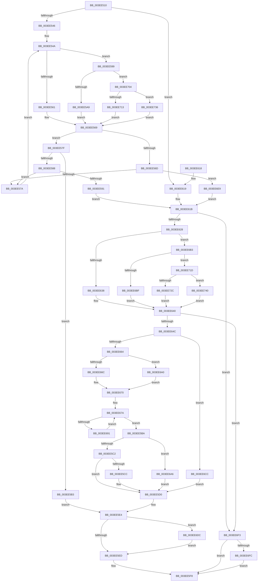

# RtlInsertElementGenericTableAvl

- RVA: `0x003EE510`–`0x003EE74A` (길이 `570` bytes)
- VA: `0x00000001403EE510`
- 실행 섹션: `.text`
- PDB 이름 있음: `예`; PDB Function 태그: `아니요`
- unwind 정보 RVA: `0x00096A1C`
- 디코드: `157`개 명령, `570/570` bytes 표시
- 미해석 바이트: `0` (있으면 어셈블리에 `.byte`로 보존)

> 이 문서는 커널 이미지의 기계어와 PDB 기호를 분석해 생성했습니다. 4번과 5번은 함수 원형과 자료형을 바이너리 사용 방식에서 추정한 C 해석이며 원본 소스 복구 결과는 아닙니다.

## 1. Dependencies

- 직접 호출 지점: **10**; 고유 호출 대상: **9**
- 직접 호출자로 확인된 함수: **20**
- RIP 상대 이미지 참조: **6**

### Outgoing calls
- `0x003EE564` → [PiDmCompareObjects](../../page/9A/PiDmCompareObjects_function_009A2AD0.md) (function, `0x009A2AD0`)
- `0x003EE5AC` → [PnpCompareInstancePath](../../page/9A/PnpCompareInstancePath_function_009A9B60.md) (function, `0x009A9B60`)
- `0x003EE5DA` → [memcpy](../6C/memcpy_function_006C6840.md) (function, `0x006C6840`)
- `0x003EE63B` → [PiPnpRtlOperationAllocateGenericTableEntry](../../page/A3/PiPnpRtlOperationAllocateGenericTableEntry_function_00A30830.md) (function, `0x00A30830`)
- `0x003EE6A9` → [RebalanceNode](RebalanceNode_function_003EEE90.md) (function, `0x003EEE90`)
- `0x003EE6C2` → [SshpCacheDatabaseAllocate](../../page/A7/SshpCacheDatabaseAllocate_function_00A7AF60.md) (function, `0x00A7AF60`)
- `0x003EE713` → [PiPnpRtlObjectEventCompareObjects](../../page/A1/PiPnpRtlObjectEventCompareObjects_function_00A11280.md) (function, `0x00A11280`)
- `0x003EE72C` → [ExAllocatePoolWithTag](../../poolcode/B8/ExAllocatePoolWithTag_function_00B82010.md) (function, `0x00B82010`)
- `0x003EE736` → [guard_dispatch_icall](../6B/guard_dispatch_icall_function_006BAAD0.md) (function, `0x006BAAD0`)
- `0x003EE740` → [guard_dispatch_icall](../6B/guard_dispatch_icall_function_006BAAD0.md) (function, `0x006BAAD0`)

### Direct callers
- [PnpMapActivatingDeviceNodeToThread](PnpMapActivatingDeviceNodeToThread_function_003EE1D4.md) at `0x003EE20A`
- [VfAvlInsertReservedTreeNode](VfAvlInsertReservedTreeNode_function_003EE424.md) at `0x003EE489`
- [DifObjTrkInsertItem](../61/DifObjTrkInsertItem_function_00619D00.md) at `0x00619DDD`
- [CarAddUniqueViolation](../61/CarAddUniqueViolation_function_0061B08C.md) at `0x0061B177`
- [IopSetFileObjectIosbRange](../../page/71/IopSetFileObjectIosbRange_function_0071C1C8.md) at `0x0071C286`
- [PiDmObjectManagerPopulate](../../page/73/PiDmObjectManagerPopulate_function_00730598.md) at `0x00730687`
- [PiDcInitUpdateProperties](../../page/73/PiDcInitUpdateProperties_function_00730B3C.md) at `0x00730D42`
- [PopDirectedDripsUmDirectedFxAddTestDevice](../../page/77/PopDirectedDripsUmDirectedFxAddTestDevice_function_007715D4.md) at `0x00771664`
- [EtwpEnumerateAutologgerPath](../../page/7B/EtwpEnumerateAutologgerPath_function_007BE398.md) at `0x007BE542`
- [EtwpInitializeAutoLoggers](../../page/7B/EtwpInitializeAutoLoggers_function_007BE694.md) at `0x007BE819`
- [PiSwBusRelationAdd](../../page/8D/PiSwBusRelationAdd_function_008DA994.md) at `0x008DAA89`
- [PiSwIrpStartCreateWorker](../../page/8D/PiSwIrpStartCreateWorker_function_008DB398.md) at `0x008DB534`
- [SleepstudyHelperBuildBlocker](../../page/A2/SleepstudyHelperBuildBlocker_function_00A2DAD0.md) at `0x00A2DCC3`
- [PiDqQueryAddObjectToResultSet](../../page/A5/PiDqQueryAddObjectToResultSet_function_00A55624.md) at `0x00A55645`
- [PopPowerRequestTableInsertEntry](../../page/A7/PopPowerRequestTableInsertEntry_function_00A7BFD8.md) at `0x00A7BFFE`
- [PiUpdateDriverDBCache](../../page/A8/PiUpdateDriverDBCache_function_00A895CC.md) at `0x00A8974A`
- [PnpMapDeviceObjectToDeviceInstance](../../page/A9/PnpMapDeviceObjectToDeviceInstance_function_00A9D884.md) at `0x00A9D8B3`
- [EtwpEnumerateKeyProviders](../../page/AB/EtwpEnumerateKeyProviders_function_00AB029C.md) at `0x00AB038F`
- [VfPtAddStackInfoIfNotExist](../../pagevrfy/B9/VfPtAddStackInfoIfNotExist_function_00B9BD74.md) at `0x00B9BE82`
- [VfPtProcessAllocPoolInfo](../../pagevrfy/B9/VfPtProcessAllocPoolInfo_function_00B9C54C.md) at `0x00B9C5B8`

### Static image references
- `0x003EE54E` → RVA `0x009A2AD0` (`PiDmCompareObjects`; read)
- `0x003EE599` → RVA `0x009A9B60` (`PnpCompareInstancePath`; read)
- `0x003EE62C` → RVA `0x00A30830` (`PiPnpRtlOperationAllocateGenericTableEntry`; read)
- `0x003EE6B3` → RVA `0x00A7AF60` (`SshpCacheDatabaseAllocate`; read)
- `0x003EE704` → RVA `0x00A11280` (`PiPnpRtlObjectEventCompareObjects`; read)
- `0x003EE71D` → RVA `0x00B82010` (`ExAllocatePoolWithTag`; read)

## 2. Other-region calls and transfers

- 다른 실행 섹션으로 향하는 call: **6**
  - `0x003EE564` → [PiDmCompareObjects](../../page/9A/PiDmCompareObjects_function_009A2AD0.md) (`.text` → `PAGE`)
  - `0x003EE5AC` → [PnpCompareInstancePath](../../page/9A/PnpCompareInstancePath_function_009A9B60.md) (`.text` → `PAGE`)
  - `0x003EE63B` → [PiPnpRtlOperationAllocateGenericTableEntry](../../page/A3/PiPnpRtlOperationAllocateGenericTableEntry_function_00A30830.md) (`.text` → `PAGE`)
  - `0x003EE6C2` → [SshpCacheDatabaseAllocate](../../page/A7/SshpCacheDatabaseAllocate_function_00A7AF60.md) (`.text` → `PAGE`)
  - `0x003EE713` → [PiPnpRtlObjectEventCompareObjects](../../page/A1/PiPnpRtlObjectEventCompareObjects_function_00A11280.md) (`.text` → `PAGE`)
  - `0x003EE72C` → [ExAllocatePoolWithTag](../../poolcode/B8/ExAllocatePoolWithTag_function_00B82010.md) (`.text` → `POOLCODE`)
- 별도 외부 분기/꼬리 이동을 확인하지 못했습니다.

## 3. Assembly (complete function range)

```asm
003EE510  48 89 5C 24 08                  mov qword ptr [rsp + 8], rbx
003EE515  48 89 6C 24 10                  mov qword ptr [rsp + 0x10], rbp
003EE51A  48 89 74 24 18                  mov qword ptr [rsp + 0x18], rsi
003EE51F  57                              push rdi
003EE520  41 54                           push r12
003EE522  41 55                           push r13
003EE524  41 56                           push r14
003EE526  41 57                           push r15
003EE528  48 83 EC 20                     sub rsp, 0x20
003EE52C  33 FF                           xor edi, edi
003EE52E  45 8B E8                        mov r13d, r8d
003EE531  4D 8B F9                        mov r15, r9
003EE534  4C 8B E2                        mov r12, rdx
003EE537  48 8B D9                        mov rbx, rcx
003EE53A  44 8B F7                        mov r14d, edi
003EE53D  39 79 2C                        cmp dword ptr [rcx + 0x2c], edi
003EE540  0F 84 D3 00 00 00               je 0x1403ee619
003EE546  4C 8B 71 10                     mov r14, qword ptr [rcx + 0x10]
003EE54A  48 8B 43 48                     mov rax, qword ptr [rbx + 0x48]
003EE54E  48 8D 0D 7B 45 5B 00            lea rcx, [rip + 0x5b457b]
003EE555  4D 8D 46 20                     lea r8, [r14 + 0x20]
003EE559  49 8B D4                        mov rdx, r12
003EE55C  48 3B C1                        cmp rax, rcx
003EE55F  75 38                           jne 0x1403ee599
003EE561  48 8B CB                        mov rcx, rbx
003EE564  E8 67 45 5B 00                  call 0x1409a2ad0
003EE569  85 C0                           test eax, eax
003EE56B  75 12                           jne 0x1403ee57f
003EE56D  49 8B 46 08                     mov rax, qword ptr [r14 + 8]
003EE571  48 85 C0                        test rax, rax
003EE574  0F 84 6F 01 00 00               je 0x1403ee6e9
003EE57A  4C 8B F0                        mov r14, rax
003EE57D  EB CB                           jmp 0x1403ee54a
003EE57F  B9 01 00 00 00                  mov ecx, 1
003EE584  3B C1                           cmp eax, ecx
003EE586  75 2B                           jne 0x1403ee5b3
003EE588  49 8B 46 10                     mov rax, qword ptr [r14 + 0x10]
003EE58C  48 85 C0                        test rax, rax
003EE58F  75 E9                           jne 0x1403ee57a
003EE591  8D 69 02                        lea ebp, [rcx + 2]
003EE594  E9 82 00 00 00                  jmp 0x1403ee61b
003EE599  48 8D 0D C0 B5 5B 00            lea rcx, [rip + 0x5bb5c0]
003EE5A0  48 3B C1                        cmp rax, rcx
003EE5A3  0F 85 5B 01 00 00               jne 0x1403ee704
003EE5A9  48 8B CB                        mov rcx, rbx
003EE5AC  E8 AF B5 5B 00                  call 0x1409a9b60
003EE5B1  EB B6                           jmp 0x1403ee569
003EE5B3  49 8B F6                        mov rsi, r14
003EE5B6  8B E9                           mov ebp, ecx
003EE5B8  EB 2A                           jmp 0x1403ee5e4
003EE5BA  3A C8                           cmp cl, al
003EE5BC  0F 84 E4 00 00 00               je 0x1403ee6a6
003EE5C2  41 88 7E 18                     mov byte ptr [r14 + 0x18], dil
003EE5C6  40 38 7B 18                     cmp byte ptr [rbx + 0x18], dil
003EE5CA  75 04                           jne 0x1403ee5d0
003EE5CC  44 01 43 30                     add dword ptr [rbx + 0x30], r8d
003EE5D0  4D 8B C5                        mov r8, r13
003EE5D3  48 8D 4E 20                     lea rcx, [rsi + 0x20]
003EE5D7  49 8B D4                        mov rdx, r12
003EE5DA  E8 61 82 2D 00                  call 0x1406c6840
003EE5DF  B9 01 00 00 00                  mov ecx, 1
003EE5E4  4D 85 FF                        test r15, r15
003EE5E7  0F 85 EF 00 00 00               jne 0x1403ee6dc
003EE5ED  89 7B 28                        mov dword ptr [rbx + 0x28], edi
003EE5F0  48 89 7B 20                     mov qword ptr [rbx + 0x20], rdi
003EE5F4  48 8D 7E 20                     lea rdi, [rsi + 0x20]
003EE5F8  48 8B 5C 24 50                  mov rbx, qword ptr [rsp + 0x50]
003EE5FD  48 8B C7                        mov rax, rdi
003EE600  48 8B 6C 24 58                  mov rbp, qword ptr [rsp + 0x58]
003EE605  48 8B 74 24 60                  mov rsi, qword ptr [rsp + 0x60]
003EE60A  48 83 C4 20                     add rsp, 0x20
003EE60E  41 5F                           pop r15
003EE610  41 5E                           pop r14
003EE612  41 5D                           pop r13
003EE614  41 5C                           pop r12
003EE616  5F                              pop rdi
003EE617  C3                              ret
003EE618  CC                              int3
003EE619  8B EF                           mov ebp, edi
003EE61B  41 8D 55 20                     lea edx, [r13 + 0x20]
003EE61F  41 3B D5                        cmp edx, r13d
003EE622  0F 82 CB 00 00 00               jb 0x1403ee6f3
003EE628  48 8B 43 50                     mov rax, qword ptr [rbx + 0x50]
003EE62C  48 8D 0D FD 21 64 00            lea rcx, [rip + 0x6421fd]
003EE633  48 3B C1                        cmp rax, rcx
003EE636  75 7B                           jne 0x1403ee6b3
003EE638  48 8B CB                        mov rcx, rbx
003EE63B  E8 F0 21 64 00                  call 0x140a30830
003EE640  48 8B F0                        mov rsi, rax
003EE643  48 85 C0                        test rax, rax
003EE646  0F 84 A7 00 00 00               je 0x1403ee6f3
003EE64C  0F 57 C0                        xorps xmm0, xmm0
003EE64F  41 B8 01 00 00 00               mov r8d, 1
003EE655  0F 11 00                        movups xmmword ptr [rax], xmm0
003EE658  0F 11 40 10                     movups xmmword ptr [rax + 0x10], xmm0
003EE65C  44 01 43 2C                     add dword ptr [rbx + 0x2c], r8d
003EE660  85 ED                           test ebp, ebp
003EE662  74 68                           je 0x1403ee6cc
003EE664  48 8B D0                        mov rdx, rax
003EE667  83 FD 02                        cmp ebp, 2
003EE66A  74 34                           je 0x1403ee6a0
003EE66C  49 89 46 10                     mov qword ptr [r14 + 0x10], rax
003EE670  4C 89 36                        mov qword ptr [rsi], r14
003EE673  C6 43 18 FF                     mov byte ptr [rbx + 0x18], 0xff
003EE677  48 8B 0E                        mov rcx, qword ptr [rsi]
003EE67A  83 C8 FF                        or eax, 0xffffffff
003EE67D  48 39 51 08                     cmp qword ptr [rcx + 8], rdx
003EE681  41 8A 4E 18                     mov cl, byte ptr [r14 + 0x18]
003EE685  41 0F 45 C0                     cmovne eax, r8d
003EE689  84 C9                           test cl, cl
003EE68B  0F 85 29 FF FF FF               jne 0x1403ee5ba
003EE691  49 8B 0E                        mov rcx, qword ptr [r14]
003EE694  49 8B D6                        mov rdx, r14
003EE697  41 88 46 18                     mov byte ptr [r14 + 0x18], al
003EE69B  4C 8B F1                        mov r14, rcx
003EE69E  EB DA                           jmp 0x1403ee67a
003EE6A0  49 89 76 08                     mov qword ptr [r14 + 8], rsi
003EE6A4  EB CA                           jmp 0x1403ee670
003EE6A6  49 8B CE                        mov rcx, r14
003EE6A9  E8 E2 07 00 00                  call 0x1403eee90
003EE6AE  E9 1D FF FF FF                  jmp 0x1403ee5d0
003EE6B3  48 8D 0D A6 C8 68 00            lea rcx, [rip + 0x68c8a6]
003EE6BA  48 3B C1                        cmp rax, rcx
003EE6BD  75 5E                           jne 0x1403ee71d
003EE6BF  48 8B CB                        mov rcx, rbx
003EE6C2  E8 99 C8 68 00                  call 0x140a7af60
003EE6C7  E9 74 FF FF FF                  jmp 0x1403ee640
003EE6CC  48 89 73 10                     mov qword ptr [rbx + 0x10], rsi
003EE6D0  48 89 1E                        mov qword ptr [rsi], rbx
003EE6D3  44 89 43 30                     mov dword ptr [rbx + 0x30], r8d
003EE6D7  E9 F4 FE FF FF                  jmp 0x1403ee5d0
003EE6DC  3B E9                           cmp ebp, ecx
003EE6DE  0F 95 C1                        setne cl
003EE6E1  41 88 0F                        mov byte ptr [r15], cl
003EE6E4  E9 04 FF FF FF                  jmp 0x1403ee5ed
003EE6E9  BD 02 00 00 00                  mov ebp, 2
003EE6EE  E9 28 FF FF FF                  jmp 0x1403ee61b
003EE6F3  4D 85 FF                        test r15, r15
003EE6F6  0F 84 FC FE FF FF               je 0x1403ee5f8
003EE6FC  41 88 3F                        mov byte ptr [r15], dil
003EE6FF  E9 F4 FE FF FF                  jmp 0x1403ee5f8
003EE704  48 8D 0D 75 2B 62 00            lea rcx, [rip + 0x622b75]
003EE70B  48 3B C1                        cmp rax, rcx
003EE70E  48 8B CB                        mov rcx, rbx
003EE711  75 23                           jne 0x1403ee736
003EE713  E8 68 2B 62 00                  call 0x140a11280
003EE718  E9 4C FE FF FF                  jmp 0x1403ee569
003EE71D  48 8D 0D EC 38 79 00            lea rcx, [rip + 0x7938ec]
003EE724  48 3B C1                        cmp rax, rcx
003EE727  48 8B CB                        mov rcx, rbx
003EE72A  75 14                           jne 0x1403ee740
003EE72C  E8 DF 38 79 00                  call 0x140b82010
003EE731  E9 0A FF FF FF                  jmp 0x1403ee640
003EE736  E8 95 C3 2C 00                  call 0x1406baad0
003EE73B  E9 29 FE FF FF                  jmp 0x1403ee569
003EE740  E8 8B C3 2C 00                  call 0x1406baad0
003EE745  E9 F6 FE FF FF                  jmp 0x1403ee640
```

## 4. C-style interpretation (structured pseudocode)

```c
__int64 __fastcall RtlInsertElementGenericTableAvl(__int64 a1, __int64 a2, int a3, __int64 a4)
{
    __int64 result;
    __int64 v_rdi;
    __int64 v_rsp;
    unsigned __int64 v_stack_p10;
    unsigned __int64 v_stack_p18;
    unsigned __int64 v_stack_p8;

    v_stack_p8 = v_rbx;
    v_stack_p10 = v_rbp;
    v_stack_p18 = v_rsi;
    v_rsp = (v_rsp) - (32);
    v_rdi = 0;
    if ((*(unsigned int *)(a1 + 44)) == 0) goto loc_003EE619;
loc_003EE54A:
    if ((*(unsigned __int64 *)(a1 + 72)) != (v_rip + 5981563)) goto loc_003EE599;
    result = PiDmCompareObjects(a1, a2, *(unsigned __int64 *)(a1 + 16) + 32, a4);
loc_003EE569:
    if ((unsigned int)(result) != 0) goto loc_003EE57F;
    if (*(unsigned __int64 *)(*(unsigned __int64 *)(a1 + 16) + 8) == 0) goto loc_003EE6E9;
loc_003EE57A:
    goto loc_003EE54A;
loc_003EE57F:
    if (((unsigned int)(*(unsigned __int64 *)(*(unsigned __int64 *)(a1 + 16) + 8))) != 1) goto loc_003EE5B3;
    if (*(unsigned __int64 *)(*(unsigned __int64 *)(*(unsigned __int64 *)(a1 + 16) + 8) + 16) != 0) goto loc_003EE57A;
    goto loc_003EE61B;
loc_003EE599:
    if ((*(unsigned __int64 *)(*(unsigned __int64 *)(*(unsigned __int64 *)(a1 + 16) + 8) + 16)) != (v_rip + 6010304)) goto loc_003EE704;
    result = PnpCompareInstancePath(a1, a2, *(unsigned __int64 *)(a1 + 16) + 32, a4);
    goto loc_003EE569;
loc_003EE5B3:
    goto loc_003EE5E4;
loc_003EE5BA:
    if (((unsigned __int8)(a1)) == ((unsigned __int8)(result))) goto loc_003EE6A6;
    *(unsigned __int8 *)(*(unsigned __int64 *)(*(unsigned __int64 *)(a1 + 16) + 8) + 24) = 0;
    if ((*(unsigned __int8 *)(a1 + 24)) == 0) {
    }
    result = memcpy(*(unsigned __int64 *)(*(unsigned __int64 *)(a1 + 16) + 8) + 32, a2, (unsigned int)(a3), a4);
loc_003EE5E4:
    if (a4 != 0) goto loc_003EE6DC;
loc_003EE5ED:
    *(unsigned int *)(a1 + 40) = 0;
    *(unsigned __int64 *)(a1 + 32) = 0;
loc_003EE5F8:
    v_rsp = (v_rsp) + (32);
    return *(unsigned __int64 *)(*(unsigned __int64 *)(a1 + 16) + 8) + 32;
loc_003EE619:
loc_003EE61B:
    if (((unsigned int)((unsigned int)(a3) + 32)) < ((unsigned int)((unsigned int)(a3)))) goto loc_003EE6F3;
    if ((*(unsigned __int64 *)(v_stack_p8 + 80)) != (v_rip + 6562301)) goto loc_003EE6B3;
    result = PiPnpRtlOperationAllocateGenericTableEntry(v_stack_p8, (unsigned int)(a3) + 32, (unsigned int)(a3), a4);
loc_003EE640:
    if (result == 0) goto loc_003EE6F3;
    *(unsigned __int64 *)(result) = v_xmm0;
    *(unsigned __int64 *)(result + 16) = v_xmm0;
    if ((unsigned int)((unsigned int)((unsigned int)(*(unsigned __int64 *)(*(unsigned __int64 *)(a1 + 16) + 8) + 32))) == 0) goto loc_003EE6CC;
    if (((unsigned int)((unsigned int)((unsigned int)(*(unsigned __int64 *)(*(unsigned __int64 *)(a1 + 16) + 8) + 32)))) == 2) goto loc_003EE6A0;
    *(unsigned __int64 *)(*(unsigned __int64 *)(*(unsigned __int64 *)(a1 + 16) + 8) + 16) = result;
loc_003EE670:
    *(unsigned __int64 *)(result) = *(unsigned __int64 *)(*(unsigned __int64 *)(a1 + 16) + 8);
    *(unsigned __int8 *)(v_stack_p8 + 24) = 255;
loc_003EE67A:
    result = (unsigned int)((result) | (0xFFFFFFFFULL));
    if ((*(unsigned __int64 *)(*(unsigned __int64 *)(result) + 8)) != result) { result = 1; }
    if ((unsigned __int8)(*(unsigned __int8 *)(*(unsigned __int64 *)(*(unsigned __int64 *)(a1 + 16) + 8) + 24)) != 0) goto loc_003EE5BA;
    *(unsigned __int8 *)(*(unsigned __int64 *)(*(unsigned __int64 *)(a1 + 16) + 8) + 24) = (unsigned __int8)(result);
    goto loc_003EE67A;
loc_003EE6A0:
    *(unsigned __int64 *)(*(unsigned __int64 *)(*(unsigned __int64 *)(*(unsigned __int64 *)(a1 + 16) + 8)) + 8) = result;
    goto loc_003EE670;
loc_003EE6A6:
    result = RebalanceNode(*(unsigned __int64 *)(*(unsigned __int64 *)(*(unsigned __int64 *)(a1 + 16) + 8)), *(unsigned __int64 *)(*(unsigned __int64 *)(a1 + 16) + 8), 1, a4);
    goto loc_003EE5D0;
loc_003EE6B3:
    if (result != (v_rip + 6867110)) goto loc_003EE71D;
    result = SshpCacheDatabaseAllocate(v_stack_p8, *(unsigned __int64 *)(*(unsigned __int64 *)(a1 + 16) + 8), 1, a4);
    goto loc_003EE640;
loc_003EE6CC:
    *(unsigned __int64 *)(v_stack_p8 + 16) = result;
    *(unsigned __int64 *)(result) = v_stack_p8;
    *(unsigned int *)(v_stack_p8 + 48) = 1;
    goto loc_003EE5D0;
loc_003EE6DC:
    a1 = (((unsigned int)((unsigned int)((unsigned int)(*(unsigned __int64 *)(*(unsigned __int64 *)(a1 + 16) + 8) + 32)))) != ((unsigned int)(v_stack_p8))) ? 1 : 0;
    *(unsigned __int8 *)(a4) = (unsigned __int8)(a1);
    goto loc_003EE5ED;
loc_003EE6E9:
    goto loc_003EE61B;
loc_003EE6F3:
    if (a4 == 0) goto loc_003EE5F8;
    *(unsigned __int8 *)(a4) = (unsigned __int8)(*(unsigned __int64 *)(*(unsigned __int64 *)(a1 + 16) + 8) + 32);
    goto loc_003EE5F8;
loc_003EE704:
    if (result != (v_rip + 6433653)) goto loc_003EE736;
    result = PiPnpRtlObjectEventCompareObjects(v_stack_p8, *(unsigned __int64 *)(*(unsigned __int64 *)(a1 + 16) + 8), 1, a4);
    goto loc_003EE569;
loc_003EE71D:
    if (result != (v_rip + 7944428)) goto loc_003EE740;
    result = ExAllocatePoolWithTag(v_stack_p8, *(unsigned __int64 *)(*(unsigned __int64 *)(a1 + 16) + 8), 1, a4);
    goto loc_003EE640;
loc_003EE736:
    result = guard_dispatch_icall(v_stack_p8, *(unsigned __int64 *)(*(unsigned __int64 *)(a1 + 16) + 8), 1, a4);
    goto loc_003EE569;
loc_003EE740:
    result = guard_dispatch_icall(v_stack_p8, *(unsigned __int64 *)(*(unsigned __int64 *)(a1 + 16) + 8), 1, a4);
    goto loc_003EE640;
}
```

## 5. (Beta) C Style

```c
int64_t RtlInsertElementGenericTableAvl(void *Arg1, int64_t Arg2, void *Arg3, int64_t Arg4)
{
    uint8_t *arg1 = (uint8_t *)Arg1;
    uint8_t *arg3 = (uint8_t *)Arg3;

    int64_t result;
    int64_t local_rdi;
    int64_t local_rsp;
    uint64_t v_stack_p10;
    uint64_t v_stack_p18;
    uint64_t v_stack_p8;

    v_stack_p8 = local_rbx;
    v_stack_p10 = local_rbp;
    v_stack_p18 = local_rsi;
    local_rsp = (local_rsp) - (32);
    local_rdi = 0;
    if ((*(uint32_t *)(arg1 + 0x2C)) == 0) goto loc_003EE619;
loc_003EE54A:
    if ((*(uint64_t *)(arg1 + 0x48)) != (v_rip + 5981563)) goto loc_003EE599;
    result = PiDmCompareObjects(Arg1, Arg2, *(uint64_t *)(arg1 + 0x10) + 32, Arg4);
loc_003EE569:
    if ((uint32_t)(result) != 0) goto loc_003EE57F;
    if (*(uint64_t *)(*(uint64_t *)(arg1 + 0x10) + 0x8) == 0) goto loc_003EE6E9;
loc_003EE57A:
    goto loc_003EE54A;
loc_003EE57F:
    if (((uint32_t)(*(uint64_t *)(*(uint64_t *)(arg1 + 0x10) + 0x8))) != 1) goto loc_003EE5B3;
    if (*(uint64_t *)(*(uint64_t *)(*(uint64_t *)(arg1 + 0x10) + 0x8) + 0x10) != 0) goto loc_003EE57A;
    goto loc_003EE61B;
loc_003EE599:
    if ((*(uint64_t *)(*(uint64_t *)(*(uint64_t *)(arg1 + 0x10) + 0x8) + 0x10)) != (v_rip + 6010304)) goto loc_003EE704;
    result = PnpCompareInstancePath(Arg1, Arg2, *(uint64_t *)(arg1 + 0x10) + 32, Arg4);
    goto loc_003EE569;
loc_003EE5B3:
    goto loc_003EE5E4;
loc_003EE5BA:
    if (((uint8_t)(Arg1)) == ((uint8_t)(result))) goto loc_003EE6A6;
    *(uint8_t *)(*(uint64_t *)(*(uint64_t *)(arg1 + 0x10) + 0x8) + 0x18) = 0;
    if ((*(uint8_t *)(arg1 + 0x18)) == 0) {
    }
    result = memcpy(*(uint64_t *)(*(uint64_t *)(arg1 + 0x10) + 0x8) + 32, Arg2, (uint32_t)(Arg3), Arg4);
loc_003EE5E4:
    if (Arg4 != 0) goto loc_003EE6DC;
loc_003EE5ED:
    *(uint32_t *)(arg1 + 0x28) = 0;
    *(uint64_t *)(arg1 + 0x20) = 0;
loc_003EE5F8:
    local_rsp = (local_rsp) + (32);
    return *(uint64_t *)(*(uint64_t *)(arg1 + 0x10) + 0x8) + 32;
loc_003EE619:
loc_003EE61B:
    if (((uint32_t)((uint32_t)(Arg3) + 32)) < ((uint32_t)((uint32_t)(Arg3)))) goto loc_003EE6F3;
    if ((*(uint64_t *)(v_stack_p8 + 0x50)) != (v_rip + 6562301)) goto loc_003EE6B3;
    result = PiPnpRtlOperationAllocateGenericTableEntry(v_stack_p8, (uint32_t)(Arg3) + 32, (uint32_t)(Arg3), Arg4);
loc_003EE640:
    if (result == 0) goto loc_003EE6F3;
    *(uint64_t *)(result) = v_xmm0;
    *(uint64_t *)(result + 0x10) = v_xmm0;
    if ((uint32_t)((uint32_t)((uint32_t)(*(uint64_t *)(*(uint64_t *)(arg1 + 0x10) + 0x8) + 32))) == 0) goto loc_003EE6CC;
    if (((uint32_t)((uint32_t)((uint32_t)(*(uint64_t *)(*(uint64_t *)(arg1 + 0x10) + 0x8) + 32)))) == 2) goto loc_003EE6A0;
    *(uint64_t *)(*(uint64_t *)(*(uint64_t *)(arg1 + 0x10) + 0x8) + 0x10) = result;
loc_003EE670:
    *(uint64_t *)(result) = *(uint64_t *)(*(uint64_t *)(arg1 + 0x10) + 0x8);
    *(uint8_t *)(v_stack_p8 + 0x18) = 255;
loc_003EE67A:
    result = (uint32_t)((result) | (0xFFFFFFFFULL));
    if ((*(uint64_t *)(*(uint64_t *)(result) + 0x8)) != result) { result = 1; }
    if ((uint8_t)(*(uint8_t *)(*(uint64_t *)(*(uint64_t *)(arg1 + 0x10) + 0x8) + 0x18)) != 0) goto loc_003EE5BA;
    *(uint8_t *)(*(uint64_t *)(*(uint64_t *)(arg1 + 0x10) + 0x8) + 0x18) = (uint8_t)(result);
    goto loc_003EE67A;
loc_003EE6A0:
    *(uint64_t *)(*(uint64_t *)(*(uint64_t *)(*(uint64_t *)(arg1 + 0x10) + 0x8)) + 0x8) = result;
    goto loc_003EE670;
loc_003EE6A6:
    result = RebalanceNode(*(uint64_t *)(*(uint64_t *)(*(uint64_t *)(arg1 + 0x10) + 0x8)), *(uint64_t *)(*(uint64_t *)(arg1 + 0x10) + 0x8), 1, Arg4);
    goto loc_003EE5D0;
loc_003EE6B3:
    if (result != (v_rip + 6867110)) goto loc_003EE71D;
    result = SshpCacheDatabaseAllocate(v_stack_p8, *(uint64_t *)(*(uint64_t *)(arg1 + 0x10) + 0x8), 1, Arg4);
    goto loc_003EE640;
loc_003EE6CC:
    *(uint64_t *)(v_stack_p8 + 0x10) = result;
    *(uint64_t *)(result) = v_stack_p8;
    *(uint32_t *)(v_stack_p8 + 0x30) = 1;
    goto loc_003EE5D0;
loc_003EE6DC:
    Arg1 = (((uint32_t)((uint32_t)((uint32_t)(*(uint64_t *)(*(uint64_t *)(arg1 + 0x10) + 0x8) + 32)))) != ((uint32_t)(v_stack_p8))) ? 1 : 0;
    *(uint8_t *)(Arg4) = (uint8_t)(Arg1);
    goto loc_003EE5ED;
loc_003EE6E9:
    goto loc_003EE61B;
loc_003EE6F3:
    if (Arg4 == 0) goto loc_003EE5F8;
    *(uint8_t *)(Arg4) = (uint8_t)(*(uint64_t *)(*(uint64_t *)(arg1 + 0x10) + 0x8) + 32);
    goto loc_003EE5F8;
loc_003EE704:
    if (result != (v_rip + 6433653)) goto loc_003EE736;
    result = PiPnpRtlObjectEventCompareObjects(v_stack_p8, *(uint64_t *)(*(uint64_t *)(arg1 + 0x10) + 0x8), 1, Arg4);
    goto loc_003EE569;
loc_003EE71D:
    if (result != (v_rip + 7944428)) goto loc_003EE740;
    result = ExAllocatePoolWithTag(v_stack_p8, *(uint64_t *)(*(uint64_t *)(arg1 + 0x10) + 0x8), 1, Arg4);
    goto loc_003EE640;
loc_003EE736:
    result = guard_dispatch_icall(v_stack_p8, *(uint64_t *)(*(uint64_t *)(arg1 + 0x10) + 0x8), 1, Arg4);
    goto loc_003EE569;
loc_003EE740:
    result = guard_dispatch_icall(v_stack_p8, *(uint64_t *)(*(uint64_t *)(arg1 + 0x10) + 0x8), 1, Arg4);
    goto loc_003EE640;
}
```

### 관측된 메모리 오프셋

구조체 형식이 확인되지 않은 접근은 인자 기준의 오프셋으로만 기록했습니다.

| 기준 인자 | 오프셋 표현 | 폭 (bit) | 접근 |
|---|---:|---:|---|
| `Arg1` | `+ 0x10` | `64` | `R` |
| `Arg1` | `+ 0x10` | `64` | `W` |
| `Arg1` | `+ 0x18` | `8` | `R` |
| `Arg1` | `+ 0x18` | `8` | `W` |
| `Arg1` | `+ 0x20` | `64` | `W` |
| `Arg1` | `+ 0x28` | `32` | `W` |
| `Arg1` | `+ 0x2C` | `32` | `R` |
| `Arg1` | `+ 0x2C` | `32` | `R/W` |
| `Arg1` | `+ 0x30` | `32` | `R/W` |
| `Arg1` | `+ 0x30` | `32` | `W` |
| `Arg1` | `+ 0x48` | `64` | `R` |
| `Arg1` | `+ 0x50` | `64` | `R` |
| `Arg3` | `+ 0x20` | `32` | `R` |

## 6. Execution-region graph

[열기: 2D/3D 그래프와 함수 탐색 컨트롤 패널](../../../control-panel.html?section=text&rva=0x003EE510&view=graph)

- 2D 그래프는 위에서 아래로 흐르고, 3D 그래프는 빈 공간을 드래그해 회전합니다. Shift+드래그는 이동, 휠은 확대·축소, 함수 노드 선택은 대상 보고서 이동입니다.

### Static fallback


