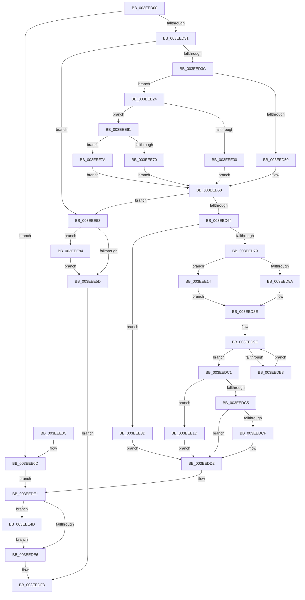

# RtlInsertElementGenericTableFullAvl

- RVA: `0x003EED00`–`0x003EEE8A` (길이 `394` bytes)
- VA: `0x00000001403EED00`
- 실행 섹션: `.text`
- PDB 이름 있음: `예`; PDB Function 태그: `아니요`
- unwind 정보 RVA: `0x00096A74`
- 디코드: `111`개 명령, `394/394` bytes 표시
- 미해석 바이트: `0` (있으면 어셈블리에 `.byte`로 보존)

> 이 문서는 커널 이미지의 기계어와 PDB 기호를 분석해 생성했습니다. 4번과 5번은 함수 원형과 자료형을 바이너리 사용 방식에서 추정한 C 해석이며 원본 소스 복구 결과는 아닙니다.

## 1. Dependencies

- 직접 호출 지점: **6**; 고유 호출 대상: **6**
- 직접 호출자로 확인된 함수: **3**
- RIP 상대 이미지 참조: **3**

### Outgoing calls
- `0x003EED53` → [PiPnpRtlOperationAllocateGenericTableEntry](../../page/A3/PiPnpRtlOperationAllocateGenericTableEntry_function_00A30830.md) (function, `0x00A30830`)
- `0x003EEDDC` → [memcpy](../6C/memcpy_function_006C6840.md) (function, `0x006C6840`)
- `0x003EEE1D` → [RebalanceNode](RebalanceNode_function_003EEE90.md) (function, `0x003EEE90`)
- `0x003EEE33` → [SshpCacheDatabaseAllocate](../../page/A7/SshpCacheDatabaseAllocate_function_00A7AF60.md) (function, `0x00A7AF60`)
- `0x003EEE70` → [ExAllocatePoolWithTag](../../poolcode/B8/ExAllocatePoolWithTag_function_00B82010.md) (function, `0x00B82010`)
- `0x003EEE7A` → [guard_dispatch_icall](../6B/guard_dispatch_icall_function_006BAAD0.md) (function, `0x006BAAD0`)

### Direct callers
- [PiPnpRtlObjectEventCreate](../../page/8D/PiPnpRtlObjectEventCreate_function_008DF7E0.md) at `0x008DFA48`
- [sub_008E078C](../../page/8E/Unknown_function_008E078C.md) at `0x008E0969`
- [PiDmAddCacheReferenceForObject](../../page/95/PiDmAddCacheReferenceForObject_function_00950FB4.md) at `0x009510D7`

### Static image references
- `0x003EED40` → RVA `0x00A30830` (`PiPnpRtlOperationAllocateGenericTableEntry`; read)
- `0x003EEE24` → RVA `0x00A7AF60` (`SshpCacheDatabaseAllocate`; read)
- `0x003EEE61` → RVA `0x00B82010` (`ExAllocatePoolWithTag`; read)

## 2. Other-region calls and transfers

- 다른 실행 섹션으로 향하는 call: **3**
  - `0x003EED53` → [PiPnpRtlOperationAllocateGenericTableEntry](../../page/A3/PiPnpRtlOperationAllocateGenericTableEntry_function_00A30830.md) (`.text` → `PAGE`)
  - `0x003EEE33` → [SshpCacheDatabaseAllocate](../../page/A7/SshpCacheDatabaseAllocate_function_00A7AF60.md) (`.text` → `PAGE`)
  - `0x003EEE70` → [ExAllocatePoolWithTag](../../poolcode/B8/ExAllocatePoolWithTag_function_00B82010.md) (`.text` → `POOLCODE`)
- 별도 외부 분기/꼬리 이동을 확인하지 못했습니다.

## 3. Assembly (complete function range)

```asm
003EED00  48 89 5C 24 08                  mov qword ptr [rsp + 8], rbx
003EED05  48 89 6C 24 10                  mov qword ptr [rsp + 0x10], rbp
003EED0A  48 89 74 24 18                  mov qword ptr [rsp + 0x18], rsi
003EED0F  57                              push rdi
003EED10  41 56                           push r14
003EED12  41 57                           push r15
003EED14  48 83 EC 20                     sub rsp, 0x20
003EED18  8B 6C 24 68                     mov ebp, dword ptr [rsp + 0x68]
003EED1C  4D 8B F1                        mov r14, r9
003EED1F  41 8B F0                        mov esi, r8d
003EED22  4C 8B FA                        mov r15, rdx
003EED25  48 8B D9                        mov rbx, rcx
003EED28  83 FD 01                        cmp ebp, 1
003EED2B  0F 84 DC 00 00 00               je 0x1403eee0d
003EED31  8D 56 20                        lea edx, [rsi + 0x20]
003EED34  3B D6                           cmp edx, esi
003EED36  0F 82 1C 01 00 00               jb 0x1403eee58
003EED3C  48 8B 41 50                     mov rax, qword ptr [rcx + 0x50]
003EED40  48 8D 0D E9 1A 64 00            lea rcx, [rip + 0x641ae9]
003EED47  48 3B C1                        cmp rax, rcx
003EED4A  0F 85 D4 00 00 00               jne 0x1403eee24
003EED50  48 8B CB                        mov rcx, rbx
003EED53  E8 D8 1A 64 00                  call 0x140a30830
003EED58  48 8B F8                        mov rdi, rax
003EED5B  48 85 C0                        test rax, rax
003EED5E  0F 84 F4 00 00 00               je 0x1403eee58
003EED64  0F 57 C0                        xorps xmm0, xmm0
003EED67  0F 11 00                        movups xmmword ptr [rax], xmm0
003EED6A  0F 11 40 10                     movups xmmword ptr [rax + 0x10], xmm0
003EED6E  FF 43 2C                        inc dword ptr [rbx + 0x2c]
003EED71  85 ED                           test ebp, ebp
003EED73  0F 84 C4 00 00 00               je 0x1403eee3d
003EED79  48 8B 4C 24 60                  mov rcx, qword ptr [rsp + 0x60]
003EED7E  4C 8B C0                        mov r8, rax
003EED81  83 FD 02                        cmp ebp, 2
003EED84  0F 84 8A 00 00 00               je 0x1403eee14
003EED8A  48 89 41 10                     mov qword ptr [rcx + 0x10], rax
003EED8E  48 89 0F                        mov qword ptr [rdi], rcx
003EED91  41 B9 01 00 00 00               mov r9d, 1
003EED97  C6 43 18 FF                     mov byte ptr [rbx + 0x18], 0xff
003EED9B  48 8B 17                        mov rdx, qword ptr [rdi]
003EED9E  4C 39 42 08                     cmp qword ptr [rdx + 8], r8
003EEDA2  B8 FF FF FF FF                  mov eax, 0xffffffff
003EEDA7  0F B6 51 18                     movzx edx, byte ptr [rcx + 0x18]
003EEDAB  41 0F 45 C1                     cmovne eax, r9d
003EEDAF  84 D2                           test dl, dl
003EEDB1  75 0E                           jne 0x1403eedc1
003EEDB3  48 8B 11                        mov rdx, qword ptr [rcx]
003EEDB6  4C 8B C1                        mov r8, rcx
003EEDB9  88 41 18                        mov byte ptr [rcx + 0x18], al
003EEDBC  48 8B CA                        mov rcx, rdx
003EEDBF  EB DD                           jmp 0x1403eed9e
003EEDC1  3A D0                           cmp dl, al
003EEDC3  74 58                           je 0x1403eee1d
003EEDC5  C6 41 18 00                     mov byte ptr [rcx + 0x18], 0
003EEDC9  80 7B 18 00                     cmp byte ptr [rbx + 0x18], 0
003EEDCD  75 03                           jne 0x1403eedd2
003EEDCF  FF 43 30                        inc dword ptr [rbx + 0x30]
003EEDD2  4C 8B C6                        mov r8, rsi
003EEDD5  48 8D 4F 20                     lea rcx, [rdi + 0x20]
003EEDD9  49 8B D7                        mov rdx, r15
003EEDDC  E8 5F 7A 2D 00                  call 0x1406c6840
003EEDE1  4D 85 F6                        test r14, r14
003EEDE4  75 67                           jne 0x1403eee4d
003EEDE6  33 C0                           xor eax, eax
003EEDE8  89 43 28                        mov dword ptr [rbx + 0x28], eax
003EEDEB  48 89 43 20                     mov qword ptr [rbx + 0x20], rax
003EEDEF  48 8D 47 20                     lea rax, [rdi + 0x20]
003EEDF3  48 8B 5C 24 40                  mov rbx, qword ptr [rsp + 0x40]
003EEDF8  48 8B 6C 24 48                  mov rbp, qword ptr [rsp + 0x48]
003EEDFD  48 8B 74 24 50                  mov rsi, qword ptr [rsp + 0x50]
003EEE02  48 83 C4 20                     add rsp, 0x20
003EEE06  41 5F                           pop r15
003EEE08  41 5E                           pop r14
003EEE0A  5F                              pop rdi
003EEE0B  C3                              ret
003EEE0C  CC                              int3
003EEE0D  48 8B 7C 24 60                  mov rdi, qword ptr [rsp + 0x60]
003EEE12  EB CD                           jmp 0x1403eede1
003EEE14  48 89 79 08                     mov qword ptr [rcx + 8], rdi
003EEE18  E9 71 FF FF FF                  jmp 0x1403eed8e
003EEE1D  E8 6E 00 00 00                  call 0x1403eee90
003EEE22  EB AE                           jmp 0x1403eedd2
003EEE24  48 8D 0D 35 C1 68 00            lea rcx, [rip + 0x68c135]
003EEE2B  48 3B C1                        cmp rax, rcx
003EEE2E  75 31                           jne 0x1403eee61
003EEE30  48 8B CB                        mov rcx, rbx
003EEE33  E8 28 C1 68 00                  call 0x140a7af60
003EEE38  E9 1B FF FF FF                  jmp 0x1403eed58
003EEE3D  48 89 7B 10                     mov qword ptr [rbx + 0x10], rdi
003EEE41  48 89 1F                        mov qword ptr [rdi], rbx
003EEE44  C7 43 30 01 00 00 00            mov dword ptr [rbx + 0x30], 1
003EEE4B  EB 85                           jmp 0x1403eedd2
003EEE4D  83 FD 01                        cmp ebp, 1
003EEE50  0F 95 C0                        setne al
003EEE53  41 88 06                        mov byte ptr [r14], al
003EEE56  EB 8E                           jmp 0x1403eede6
003EEE58  4D 85 F6                        test r14, r14
003EEE5B  75 27                           jne 0x1403eee84
003EEE5D  33 C0                           xor eax, eax
003EEE5F  EB 92                           jmp 0x1403eedf3
003EEE61  48 8D 0D A8 31 79 00            lea rcx, [rip + 0x7931a8]
003EEE68  48 3B C1                        cmp rax, rcx
003EEE6B  48 8B CB                        mov rcx, rbx
003EEE6E  75 0A                           jne 0x1403eee7a
003EEE70  E8 9B 31 79 00                  call 0x140b82010
003EEE75  E9 DE FE FF FF                  jmp 0x1403eed58
003EEE7A  E8 51 BC 2C 00                  call 0x1406baad0
003EEE7F  E9 D4 FE FF FF                  jmp 0x1403eed58
003EEE84  41 C6 06 00                     mov byte ptr [r14], 0
003EEE88  EB D3                           jmp 0x1403eee5d
```

## 4. C-style interpretation (structured pseudocode)

```c
__int64 __fastcall RtlInsertElementGenericTableFullAvl(__int64 a1, __int64 a2, int a3, __int64 a4, __int64 a5, unsigned int a6)
{
    __int64 result;
    __int64 v_rsp;
    unsigned __int64 v_stack_p10;
    unsigned __int64 v_stack_p18;
    unsigned __int64 v_stack_p8;

    v_stack_p8 = v_rbx;
    v_stack_p10 = v_rbp;
    v_stack_p18 = v_rsi;
    v_rsp = (v_rsp) - (32);
    if (((unsigned int)((unsigned int)(a6))) == 1) goto loc_003EEE0D;
    if (((unsigned int)((unsigned int)(a3) + 32)) < ((unsigned int)((unsigned int)(a3)))) goto loc_003EEE58;
    if ((*(unsigned __int64 *)(a1 + 80)) != (v_rip + 6560489)) goto loc_003EEE24;
    result = PiPnpRtlOperationAllocateGenericTableEntry(a1, (unsigned int)(a3) + 32, a3, a4);
loc_003EED58:
    if (result == 0) goto loc_003EEE58;
    *(unsigned __int64 *)(result) = v_xmm0;
    *(unsigned __int64 *)(result + 16) = v_xmm0;
    if ((unsigned int)((unsigned int)(a6)) == 0) goto loc_003EEE3D;
    if (((unsigned int)((unsigned int)(a6))) == 2) goto loc_003EEE14;
    *(unsigned __int64 *)(a5 + 16) = result;
loc_003EED8E:
    *(unsigned __int64 *)(result) = a5;
    *(unsigned __int8 *)(a1 + 24) = 255;
loc_003EED9E:
    result = (unsigned int)(0xFFFFFFFFULL);
    if ((*(unsigned __int64 *)(*(unsigned __int64 *)(result) + 8)) != result) { result = 1; }
    if ((unsigned __int8)(*(unsigned __int8 *)(a5 + 24)) != 0) goto loc_003EEDC1;
    *(unsigned __int8 *)(a5 + 24) = (unsigned __int8)(result);
    goto loc_003EED9E;
loc_003EEDC1:
    if (((unsigned __int8)(*(unsigned __int64 *)(a5))) == ((unsigned __int8)(result))) goto loc_003EEE1D;
    *(unsigned __int8 *)(*(unsigned __int64 *)(a5) + 24) = 0;
    if ((*(unsigned __int8 *)(a1 + 24)) == 0) {
    }
    result = memcpy(result + 32, a2, (unsigned int)(a3), 1);
loc_003EEDE1:
    if (a4 != 0) goto loc_003EEE4D;
loc_003EEDE6:
    result = 0;
    *(unsigned int *)(a1 + 40) = 0;
    *(unsigned __int64 *)(a1 + 32) = 0;
loc_003EEDF3:
    v_rsp = (v_rsp) + (32);
    return result + 32;
loc_003EEE0D:
    goto loc_003EEDE1;
loc_003EEE14:
    *(unsigned __int64 *)(result + 32 + 8) = a5;
    goto loc_003EED8E;
loc_003EEE1D:
    result = RebalanceNode(result + 32, a2, (unsigned int)(a3), 1);
    goto loc_003EEDD2;
loc_003EEE24:
    if (result != (v_rip + 6865205)) goto loc_003EEE61;
    result = SshpCacheDatabaseAllocate(v_stack_p8, a2, (unsigned int)(a3), 1);
    goto loc_003EED58;
loc_003EEE3D:
    *(unsigned __int64 *)(v_stack_p8 + 16) = a5;
    *(unsigned __int64 *)(a5) = v_stack_p8;
    *(unsigned int *)(v_stack_p8 + 48) = 1;
    goto loc_003EEDD2;
loc_003EEE4D:
    result = (((unsigned int)(v_stack_p10)) != 1) ? 1 : 0;
    *(unsigned __int8 *)(a4) = (unsigned __int8)(result);
    goto loc_003EEDE6;
loc_003EEE58:
    if (a4 != 0) goto loc_003EEE84;
loc_003EEE5D:
    result = 0;
    goto loc_003EEDF3;
loc_003EEE61:
    if (0 != (v_rip + 7942568)) goto loc_003EEE7A;
    result = ExAllocatePoolWithTag(v_stack_p8, a2, (unsigned int)(a3), 1);
    goto loc_003EED58;
loc_003EEE7A:
    result = guard_dispatch_icall(v_stack_p8, a2, (unsigned int)(a3), 1);
    goto loc_003EED58;
loc_003EEE84:
    *(unsigned __int8 *)(a4) = 0;
    goto loc_003EEE5D;
}
```

## 5. (Beta) C Style

```c
int64_t RtlInsertElementGenericTableFullAvl(void *Arg1, int64_t Arg2, void *Arg3, int64_t Arg4, void *Arg5, uint32_t Arg6)
{
    uint8_t *arg1 = (uint8_t *)Arg1;
    uint8_t *arg3 = (uint8_t *)Arg3;
    uint8_t *arg5 = (uint8_t *)Arg5;

    int64_t result;
    int64_t local_rsp;
    uint64_t v_stack_p10;
    uint64_t v_stack_p18;
    uint64_t v_stack_p8;

    v_stack_p8 = local_rbx;
    v_stack_p10 = local_rbp;
    v_stack_p18 = local_rsi;
    local_rsp = (local_rsp) - (32);
    if (((uint32_t)((uint32_t)(Arg6))) == 1) goto loc_003EEE0D;
    if (((uint32_t)((uint32_t)(Arg3) + 32)) < ((uint32_t)((uint32_t)(Arg3)))) goto loc_003EEE58;
    if ((*(uint64_t *)(arg1 + 0x50)) != (v_rip + 6560489)) goto loc_003EEE24;
    result = PiPnpRtlOperationAllocateGenericTableEntry(Arg1, (uint32_t)(Arg3) + 32, Arg3, Arg4);
loc_003EED58:
    if (result == 0) goto loc_003EEE58;
    *(uint64_t *)(result) = v_xmm0;
    *(uint64_t *)(result + 0x10) = v_xmm0;
    if ((uint32_t)((uint32_t)(Arg6)) == 0) goto loc_003EEE3D;
    if (((uint32_t)((uint32_t)(Arg6))) == 2) goto loc_003EEE14;
    *(uint64_t *)(arg5 + 0x10) = result;
loc_003EED8E:
    *(void **)(result) = Arg5;
    *(uint8_t *)(arg1 + 0x18) = 255;
loc_003EED9E:
    result = (uint32_t)(0xFFFFFFFFULL);
    if ((*(uint64_t *)(*(uint64_t *)(result) + 0x8)) != result) { result = 1; }
    if ((uint8_t)(*(uint8_t *)(arg5 + 0x18)) != 0) goto loc_003EEDC1;
    *(uint8_t *)(arg5 + 0x18) = (uint8_t)(result);
    goto loc_003EED9E;
loc_003EEDC1:
    if (((uint8_t)(*(uint64_t *)(arg5))) == ((uint8_t)(result))) goto loc_003EEE1D;
    *(uint8_t *)(*(uint64_t *)(arg5) + 0x18) = 0;
    if ((*(uint8_t *)(arg1 + 0x18)) == 0) {
    }
    result = memcpy(result + 32, Arg2, (uint32_t)(Arg3), 1);
loc_003EEDE1:
    if (Arg4 != 0) goto loc_003EEE4D;
loc_003EEDE6:
    result = 0;
    *(uint32_t *)(arg1 + 0x28) = 0;
    *(uint64_t *)(arg1 + 0x20) = 0;
loc_003EEDF3:
    local_rsp = (local_rsp) + (32);
    return result + 32;
loc_003EEE0D:
    goto loc_003EEDE1;
loc_003EEE14:
    *(void **)(result + 0x20 + 0x8) = Arg5;
    goto loc_003EED8E;
loc_003EEE1D:
    result = RebalanceNode(result + 32, Arg2, (uint32_t)(Arg3), 1);
    goto loc_003EEDD2;
loc_003EEE24:
    if (result != (v_rip + 6865205)) goto loc_003EEE61;
    result = SshpCacheDatabaseAllocate(v_stack_p8, Arg2, (uint32_t)(Arg3), 1);
    goto loc_003EED58;
loc_003EEE3D:
    *(void **)(v_stack_p8 + 0x10) = Arg5;
    *(uint64_t *)(arg5) = v_stack_p8;
    *(uint32_t *)(v_stack_p8 + 0x30) = 1;
    goto loc_003EEDD2;
loc_003EEE4D:
    result = (((uint32_t)(v_stack_p10)) != 1) ? 1 : 0;
    *(uint8_t *)(Arg4) = (uint8_t)(result);
    goto loc_003EEDE6;
loc_003EEE58:
    if (Arg4 != 0) goto loc_003EEE84;
loc_003EEE5D:
    result = 0;
    goto loc_003EEDF3;
loc_003EEE61:
    if (0 != (v_rip + 7942568)) goto loc_003EEE7A;
    result = ExAllocatePoolWithTag(v_stack_p8, Arg2, (uint32_t)(Arg3), 1);
    goto loc_003EED58;
loc_003EEE7A:
    result = guard_dispatch_icall(v_stack_p8, Arg2, (uint32_t)(Arg3), 1);
    goto loc_003EED58;
loc_003EEE84:
    *(uint8_t *)(Arg4) = 0;
    goto loc_003EEE5D;
}
```

### 관측된 메모리 오프셋

구조체 형식이 확인되지 않은 접근은 인자 기준의 오프셋으로만 기록했습니다.

| 기준 인자 | 오프셋 표현 | 폭 (bit) | 접근 |
|---|---:|---:|---|
| `Arg1` | `+ 0x10` | `64` | `W` |
| `Arg1` | `+ 0x18` | `8` | `R` |
| `Arg1` | `+ 0x18` | `8` | `W` |
| `Arg1` | `+ 0x20` | `64` | `W` |
| `Arg1` | `+ 0x28` | `32` | `W` |
| `Arg1` | `+ 0x2C` | `32` | `R/W` |
| `Arg1` | `+ 0x30` | `32` | `R/W` |
| `Arg1` | `+ 0x30` | `32` | `W` |
| `Arg1` | `+ 0x50` | `64` | `R` |
| `Arg3` | `+ 0x20` | `32` | `R` |
| `Arg5` | `+ 0x8` | `64` | `W` |
| `Arg5` | `+ 0x10` | `64` | `W` |

## 6. Execution-region graph

[열기: 2D/3D 그래프와 함수 탐색 컨트롤 패널](../../../control-panel.html?section=text&rva=0x003EED00&view=graph)

- 2D 그래프는 위에서 아래로 흐르고, 3D 그래프는 빈 공간을 드래그해 회전합니다. Shift+드래그는 이동, 휠은 확대·축소, 함수 노드 선택은 대상 보고서 이동입니다.

### Static fallback


