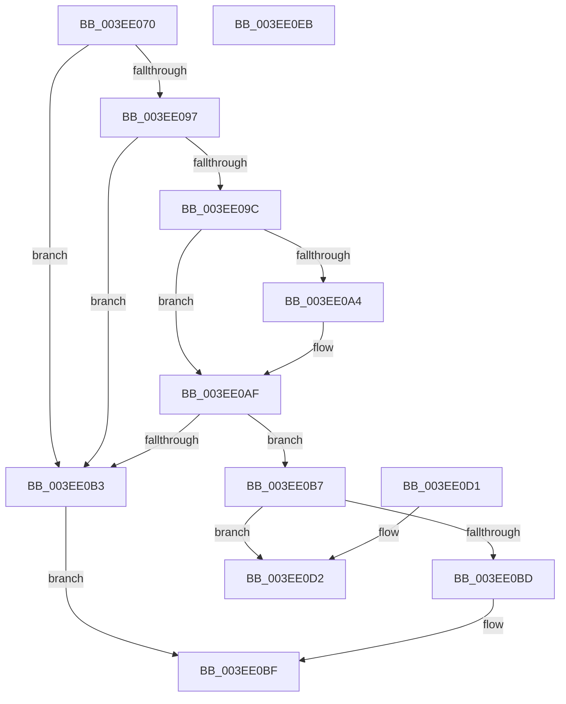

# RtlIsValidProcessTrustLabelSid

- RVA: `0x003EE070`–`0x003EE0EC` (길이 `124` bytes)
- VA: `0x00000001403EE070`
- 실행 섹션: `.text`
- PDB 이름 있음: `예`; PDB Function 태그: `아니요`
- unwind 정보 RVA: `0x000969B4`
- 디코드: `37`개 명령, `124/124` bytes 표시
- 미해석 바이트: `0` (있으면 어셈블리에 `.byte`로 보존)

> 이 문서는 커널 이미지의 기계어와 PDB 기호를 분석해 생성했습니다. 4번과 5번은 함수 원형과 자료형을 바이너리 사용 방식에서 추정한 C 해석이며 원본 소스 복구 결과는 아닙니다.

## 1. Dependencies

- 직접 호출 지점: **2**; 고유 호출 대상: **1**
- 직접 호출자로 확인된 함수: **8**
- RIP 상대 이미지 참조: **1**

### Outgoing calls
- `0x003EE0C7` → [_security_check_cookie](../6A/_security_check_cookie_function_006AC640.md) (function, `0x006AC640`)
- `0x003EE0E1` → [_security_check_cookie](../6A/_security_check_cookie_function_006AC640.md) (function, `0x006AC640`)

### Direct callers
- [RtlpValidTrustSubjectContext](RtlpValidTrustSubjectContext_function_003ED770.md) at `0x003ED782`
- [RtlpValidTrustSubjectContext](RtlpValidTrustSubjectContext_function_003ED770.md) at `0x003ED7B1`
- [SepTrustLevelCheck](SepTrustLevelCheck_function_003ED7E0.md) at `0x003ED8E0`
- [SepTrustLevelCheck](SepTrustLevelCheck_function_003ED7E0.md) at `0x003ED95B`
- [SepTrustLevelCheck](SepTrustLevelCheck_function_003ED7E0.md) at `0x003ED972`
- [SepTrustLevelCheck](SepTrustLevelCheck_function_003ED7E0.md) at `0x003ED99E`
- [SepLocateTokenTrustLevel](SepLocateTokenTrustLevel_function_003EDA40.md) at `0x003EDA81`
- [SepLocateTokenTrustLevel](SepLocateTokenTrustLevel_function_003EDA40.md) at `0x003EDA96`
- [SepReferenceTokenByHandle](SepReferenceTokenByHandle_function_003EDAD0.md) at `0x003EDC6E`
- [SepReferenceTokenByHandle](SepReferenceTokenByHandle_function_003EDAD0.md) at `0x003EDCED`
- [SepReconcileTrustSidWithProcessProtection](SepReconcileTrustSidWithProcessProtection_function_003EDE50.md) at `0x003EDE83`
- [SepReconcileTrustSidWithProcessProtection](SepReconcileTrustSidWithProcessProtection_function_003EDE50.md) at `0x003EDECA`
- [RtlSidDominatesForTrust](RtlSidDominatesForTrust_function_003EDFE0.md) at `0x003EE005`
- [RtlSidDominatesForTrust](RtlSidDominatesForTrust_function_003EDFE0.md) at `0x003EE01C`
- [RtlAddAccessFilterAce](../../page/78/RtlAddAccessFilterAce_function_0078D210.md) at `0x0078D2B7`
- [RtlAddProcessTrustLabelAce](../../page/92/RtlAddProcessTrustLabelAce_function_00929740.md) at `0x0092979A`

### Static image references
- `0x003EE074` → RVA `0x00E0A740` (`.data`; read)

## 2. Other-region calls and transfers

- 다른 실행 섹션으로 향하는 call: **0**
- 별도 외부 분기/꼬리 이동을 확인하지 못했습니다.

## 3. Assembly (complete function range)

```asm
003EE070  48 83 EC 18                     sub rsp, 0x18
003EE074  48 8B 05 C5 C6 A1 00            mov rax, qword ptr [rip + 0xa1c6c5]
003EE07B  48 33 C4                        xor rax, rsp
003EE07E  48 89 44 24 08                  mov qword ptr [rsp + 8], rax
003EE083  80 79 01 02                     cmp byte ptr [rcx + 1], 2
003EE087  C7 04 24 00 00 00 00            mov dword ptr [rsp], 0
003EE08E  66 C7 44 24 04 00 13            mov word ptr [rsp + 4], 0x1300
003EE095  75 1C                           jne 0x1403ee0b3
003EE097  80 39 01                        cmp byte ptr [rcx], 1
003EE09A  75 17                           jne 0x1403ee0b3
003EE09C  8B 51 02                        mov edx, dword ptr [rcx + 2]
003EE09F  2B 14 24                        sub edx, dword ptr [rsp]
003EE0A2  75 0B                           jne 0x1403ee0af
003EE0A4  0F B7 51 06                     movzx edx, word ptr [rcx + 6]
003EE0A8  0F B7 44 24 04                  movzx eax, word ptr [rsp + 4]
003EE0AD  2B D0                           sub edx, eax
003EE0AF  85 D2                           test edx, edx
003EE0B1  74 04                           je 0x1403ee0b7
003EE0B3  32 C0                           xor al, al
003EE0B5  EB 08                           jmp 0x1403ee0bf
003EE0B7  83 79 08 00                     cmp dword ptr [rcx + 8], 0
003EE0BB  74 15                           je 0x1403ee0d2
003EE0BD  B0 01                           mov al, 1
003EE0BF  48 8B 4C 24 08                  mov rcx, qword ptr [rsp + 8]
003EE0C4  48 33 CC                        xor rcx, rsp
003EE0C7  E8 74 E5 2B 00                  call 0x1406ac640
003EE0CC  48 83 C4 18                     add rsp, 0x18
003EE0D0  C3                              ret
003EE0D1  CC                              int3
003EE0D2  83 79 0C 00                     cmp dword ptr [rcx + 0xc], 0
003EE0D6  0F 94 C0                        sete al
003EE0D9  48 8B 4C 24 08                  mov rcx, qword ptr [rsp + 8]
003EE0DE  48 33 CC                        xor rcx, rsp
003EE0E1  E8 5A E5 2B 00                  call 0x1406ac640
003EE0E6  48 83 C4 18                     add rsp, 0x18
003EE0EA  C3                              ret
003EE0EB  CC                              int3
```

## 4. C-style interpretation (structured pseudocode)

```c
__int64 __fastcall RtlIsValidProcessTrustLabelSid(__int64 a1)
{
    __int64 result;
    __int64 v_rsp;
    unsigned __int64 v_stack_m10;
    unsigned __int16 v_stack_m14;
    unsigned int v_stack_m18;
    unsigned __int64 v_stack_p8;

    v_rsp = (v_rsp) - (24);
    result = (*(unsigned __int64 *)(v_rip + 10602181)) ^ (v_rsp);
    v_stack_m10 = result;
    v_stack_m18 = 0;
    v_stack_m14 = 0x1300ULL;
    if ((*(unsigned __int8 *)(a1 + 1)) != 2) goto loc_003EE0B3;
    if ((*(unsigned __int8 *)(a1)) != 1) goto loc_003EE0B3;
    a2 = (unsigned int)(((unsigned int)(*(unsigned int *)(a1 + 2))) - (v_stack_m18));
    if (!(condition_is_not_equal)) {
        a2 = *(unsigned __int16 *)(a1 + 6);
        result = v_stack_m14;
        a2 = (unsigned int)((a2) - ((unsigned int)(result)));
    }
    if ((unsigned int)(a2) == 0) goto loc_003EE0B7;
loc_003EE0B3:
    result = 0;
    goto loc_003EE0BF;
loc_003EE0B7:
    if ((*(unsigned int *)(a1 + 8)) == 0) goto loc_003EE0D2;
loc_003EE0BF:
    a1 = (v_stack_m10) ^ (v_rsp);
    result = _security_check_cookie(a1, a2, a3, a4);
    v_rsp = (v_rsp) + (24);
    return result;
loc_003EE0D2:
    result = ((*(unsigned int *)(a1 + 12)) == 0) ? 1 : 0;
    a1 = (v_stack_p8) ^ (v_rsp);
    result = _security_check_cookie(a1, a2, a3, a4);
    v_rsp = (v_rsp) + (24);
    return result;
}
```

## 5. (Beta) C Style

```c
int64_t RtlIsValidProcessTrustLabelSid(void *Arg1)
{
    uint8_t *arg1 = (uint8_t *)Arg1;

    int64_t result;
    int64_t local_rsp;
    uint64_t v_stack_m10;
    uint16_t v_stack_m14;
    uint32_t v_stack_m18;
    uint64_t v_stack_p8;

    local_rsp = (local_rsp) - (24);
    result = (*(uint64_t *)(v_rip + 0xA1C6C5)) ^ (local_rsp);
    v_stack_m10 = result;
    v_stack_m18 = 0;
    v_stack_m14 = 0x1300ULL;
    if ((*(uint8_t *)(arg1 + 0x1)) != 2) goto loc_003EE0B3;
    if ((*(uint8_t *)(arg1)) != 1) goto loc_003EE0B3;
    a2 = (uint32_t)(((uint32_t)(*(uint32_t *)(arg1 + 0x2))) - (v_stack_m18));
    if (!(condition_is_not_equal)) {
        a2 = *(uint16_t *)(arg1 + 0x6);
        result = v_stack_m14;
        a2 = (uint32_t)((a2) - ((uint32_t)(result)));
    }
    if ((uint32_t)(a2) == 0) goto loc_003EE0B7;
loc_003EE0B3:
    result = 0;
    goto loc_003EE0BF;
loc_003EE0B7:
    if ((*(uint32_t *)(arg1 + 0x8)) == 0) goto loc_003EE0D2;
loc_003EE0BF:
    Arg1 = (v_stack_m10) ^ (local_rsp);
    result = _security_check_cookie(Arg1, a2, a3, a4);
    local_rsp = (local_rsp) + (24);
    return result;
loc_003EE0D2:
    result = ((*(uint32_t *)(arg1 + 0xC)) == 0) ? 1 : 0;
    Arg1 = (v_stack_p8) ^ (local_rsp);
    result = _security_check_cookie(Arg1, a2, a3, a4);
    local_rsp = (local_rsp) + (24);
    return result;
}
```

### 관측된 메모리 오프셋

구조체 형식이 확인되지 않은 접근은 인자 기준의 오프셋으로만 기록했습니다.

| 기준 인자 | 오프셋 표현 | 폭 (bit) | 접근 |
|---|---:|---:|---|
| `Arg1` | `+ 0x0` | `8` | `R` |
| `Arg1` | `+ 0x1` | `8` | `R` |
| `Arg1` | `+ 0x2` | `32` | `R` |
| `Arg1` | `+ 0x6` | `16` | `R` |
| `Arg1` | `+ 0x8` | `32` | `R` |
| `Arg1` | `+ 0xC` | `32` | `R` |

## 6. Execution-region graph

[열기: 2D/3D 그래프와 함수 탐색 컨트롤 패널](../../../control-panel.html?section=text&rva=0x003EE070&view=graph)

- 2D 그래프는 위에서 아래로 흐르고, 3D 그래프는 빈 공간을 드래그해 회전합니다. Shift+드래그는 이동, 휠은 확대·축소, 함수 노드 선택은 대상 보고서 이동입니다.

### Static fallback


