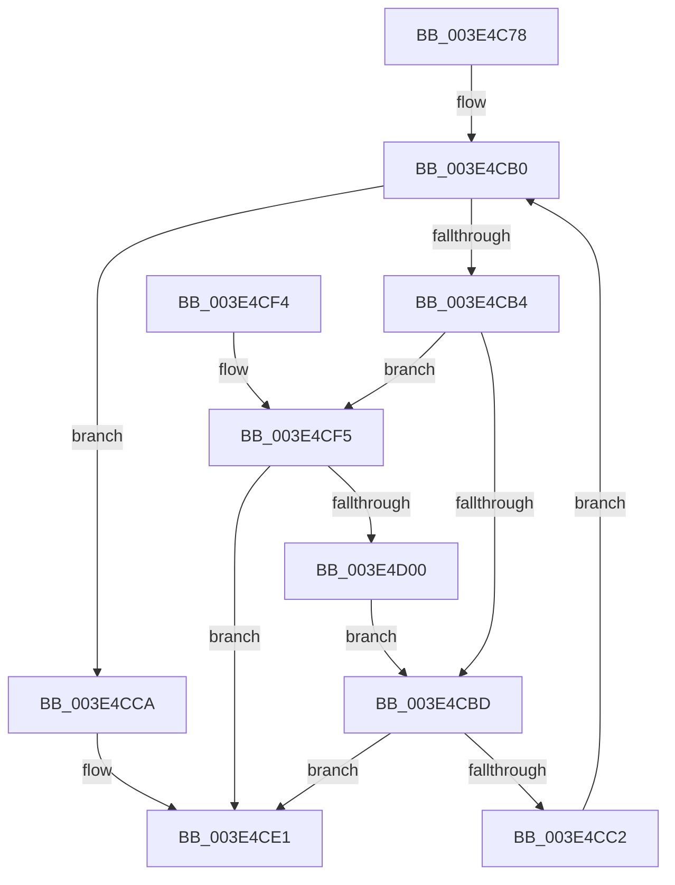

# RtlLengthCurrentClearRunBackward

- RVA: `0x003E4C78`–`0x003E4D02` (길이 `138` bytes)
- VA: `0x00000001403E4C78`
- 실행 섹션: `.text`
- PDB 이름 있음: `예`; PDB Function 태그: `아니요`
- unwind 정보 RVA: `0x00094E04`
- 디코드: `45`개 명령, `138/138` bytes 표시
- 미해석 바이트: `0` (있으면 어셈블리에 `.byte`로 보존)

> 이 문서는 커널 이미지의 기계어와 PDB 기호를 분석해 생성했습니다. 4번과 5번은 함수 원형과 자료형을 바이너리 사용 방식에서 추정한 C 해석이며 원본 소스 복구 결과는 아닙니다.

## 1. Dependencies

- 직접 호출 지점: **0**; 고유 호출 대상: **0**
- 직접 호출자로 확인된 함수: **1**
- RIP 상대 이미지 참조: **1**

### Outgoing calls
- 직접 디코드된 call 명령이 없습니다.

### Direct callers
- [sub_003E47AF](Unknown_function_003E47AF.md) at `0x003E4978`
- [sub_003E47AF](Unknown_function_003E47AF.md) at `0x003E4A86`
- [sub_003E47AF](Unknown_function_003E47AF.md) at `0x003E4AA1`

### Static image references
- `0x003E4CA2` → RVA `0x00012C50` (`.rdata`; read)

## 2. Other-region calls and transfers

- 다른 실행 섹션으로 향하는 call: **0**
- 별도 외부 분기/꼬리 이동을 확인하지 못했습니다.

## 3. Assembly (complete function range)

```asm
003E4C78  48 89 5C 24 08                  mov qword ptr [rsp + 8], rbx
003E4C7D  48 8B 59 08                     mov rbx, qword ptr [rcx + 8]
003E4C81  41 BA 1F 00 00 00               mov r10d, 0x1f
003E4C87  8B C2                           mov eax, edx
003E4C89  45 8B DA                        mov r11d, r10d
003E4C8C  41 23 D2                        and edx, r10d
003E4C8F  48 C1 E8 05                     shr rax, 5
003E4C93  44 2B DA                        sub r11d, edx
003E4C96  45 8B C8                        mov r9d, r8d
003E4C99  45 33 C0                        xor r8d, r8d
003E4C9C  48 8D 0C 83                     lea rcx, [rbx + rax*4]
003E4CA0  8B C2                           mov eax, edx
003E4CA2  48 8D 15 A7 DF C2 FF            lea rdx, [rip - 0x3d2059]
003E4CA9  8B 04 82                        mov eax, dword ptr [rdx + rax*4]
003E4CAC  8B 11                           mov edx, dword ptr [rcx]
003E4CAE  23 D0                           and edx, eax
003E4CB0  85 D2                           test edx, edx
003E4CB2  75 16                           jne 0x1403e4cca
003E4CB4  41 83 C0 20                     add r8d, 0x20
003E4CB8  45 3B C1                        cmp r8d, r9d
003E4CBB  73 38                           jae 0x1403e4cf5
003E4CBD  48 3B CB                        cmp rcx, rbx
003E4CC0  74 1F                           je 0x1403e4ce1
003E4CC2  48 83 C1 FC                     add rcx, -4
003E4CC6  8B 11                           mov edx, dword ptr [rcx]
003E4CC8  EB E6                           jmp 0x1403e4cb0
003E4CCA  8B C2                           mov eax, edx
003E4CCC  BA FF FF FF FF                  mov edx, 0xffffffff
003E4CD1  48 0F BD C8                     bsr rcx, rax
003E4CD5  0F 45 D1                        cmovne edx, ecx
003E4CD8  0F BE CA                        movsx ecx, dl
003E4CDB  44 2B D1                        sub r10d, ecx
003E4CDE  45 03 C2                        add r8d, r10d
003E4CE1  48 8B 5C 24 08                  mov rbx, qword ptr [rsp + 8]
003E4CE6  45 2B C3                        sub r8d, r11d
003E4CE9  45 3B C1                        cmp r8d, r9d
003E4CEC  45 0F 47 C1                     cmova r8d, r9d
003E4CF0  41 8B C0                        mov eax, r8d
003E4CF3  C3                              ret
003E4CF4  CC                              int3
003E4CF5  41 8B C0                        mov eax, r8d
003E4CF8  41 2B C3                        sub eax, r11d
003E4CFB  41 3B C1                        cmp eax, r9d
003E4CFE  73 E1                           jae 0x1403e4ce1
003E4D00  EB BB                           jmp 0x1403e4cbd
```

## 4. C-style interpretation (structured pseudocode)

```c
__int64 __fastcall RtlLengthCurrentClearRunBackward(__int64 a1, int a2, int a3)
{
    __int64 result;
    __int64 v_r10;
    __int64 v_r11;
    unsigned __int64 v_stack_p8;

    v_stack_p8 = v_rbx;
    a2 = (unsigned int)((a2) & (31));
    result = ((unsigned int)(a2)) >> (5);
    v_r11 = (unsigned int)((31) - (a2));
    a3 = 0;
    a2 = (unsigned int)(((unsigned int)(*(unsigned int *)(*(unsigned __int64 *)(a1 + 8) + result * 4))) & ((unsigned int)((unsigned int)(*(unsigned int *)(v_rip - 4005977 + (unsigned int)(a2) * 4)))));
loc_003E4CB0:
    if (a2 != 0) goto loc_003E4CCA;
    a3 = (unsigned int)((a3) + (32));
    if (a3 >= ((unsigned int)((unsigned int)(a3)))) goto loc_003E4CF5;
loc_003E4CBD:
    if ((*(unsigned __int64 *)(a1 + 8) + result * 4) == (*(unsigned __int64 *)(a1 + 8))) goto loc_003E4CE1;
    a1 = (*(unsigned __int64 *)(a1 + 8) + result * 4) + (-4);
    goto loc_003E4CB0;
loc_003E4CCA:
    a2 = (unsigned int)(0xFFFFFFFFULL);
    if (condition_is_not_equal) { a2 = (unsigned int)(a1); }
    v_r10 = (unsigned int)((31) - ((unsigned int)((__int8)((unsigned __int8)(a2)))));
    a3 = (unsigned int)((a3) + ((unsigned int)(v_r10)));
loc_003E4CE1:
    a3 = (unsigned int)((a3) - ((unsigned int)(v_r11)));
    if (a3 > ((unsigned int)((unsigned int)(a3)))) { a3 = (unsigned int)((unsigned int)(a3)); }
    return (unsigned int)(a3);
loc_003E4CF5:
    result = (unsigned int)(((unsigned int)(a3)) - ((unsigned int)(v_r11)));
    if (((unsigned int)(result)) >= ((unsigned int)((unsigned int)(a3)))) goto loc_003E4CE1;
    goto loc_003E4CBD;
}
```

## 5. (Beta) C Style

```c
int64_t RtlLengthCurrentClearRunBackward(void *Arg1, int32_t Arg2, int32_t Arg3)
{
    uint8_t *arg1 = (uint8_t *)Arg1;

    int64_t result;
    int64_t local_r10;
    int64_t local_r11;
    uint64_t v_stack_p8;

    v_stack_p8 = local_rbx;
    Arg2 = (uint32_t)((Arg2) & (31));
    result = ((uint32_t)(Arg2)) >> (5);
    local_r11 = (uint32_t)((31) - (Arg2));
    Arg3 = 0;
    Arg2 = (uint32_t)(((uint32_t)(*(uint32_t *)(*(uint64_t *)(arg1 + 0x8) + result * 4))) & ((uint32_t)((uint32_t)(*(uint32_t *)(v_rip - 0x3D2059 + (uint32_t)(Arg2) * 4)))));
loc_003E4CB0:
    if (Arg2 != 0) goto loc_003E4CCA;
    Arg3 = (uint32_t)((Arg3) + (32));
    if (Arg3 >= ((uint32_t)((uint32_t)(Arg3)))) goto loc_003E4CF5;
loc_003E4CBD:
    if ((*(uint64_t *)(arg1 + 0x8) + result * 4) == (*(uint64_t *)(arg1 + 0x8))) goto loc_003E4CE1;
    Arg1 = (*(uint64_t *)(arg1 + 0x8) + result * 4) + (-4);
    goto loc_003E4CB0;
loc_003E4CCA:
    Arg2 = (uint32_t)(0xFFFFFFFFULL);
    if (condition_is_not_equal) { Arg2 = (uint32_t)(Arg1); }
    local_r10 = (uint32_t)((31) - ((uint32_t)((int8_t)((uint8_t)(Arg2)))));
    Arg3 = (uint32_t)((Arg3) + ((uint32_t)(local_r10)));
loc_003E4CE1:
    Arg3 = (uint32_t)((Arg3) - ((uint32_t)(local_r11)));
    if (Arg3 > ((uint32_t)((uint32_t)(Arg3)))) { Arg3 = (uint32_t)((uint32_t)(Arg3)); }
    return (uint32_t)(Arg3);
loc_003E4CF5:
    result = (uint32_t)(((uint32_t)(Arg3)) - ((uint32_t)(local_r11)));
    if (((uint32_t)(result)) >= ((uint32_t)((uint32_t)(Arg3)))) goto loc_003E4CE1;
    goto loc_003E4CBD;
}
```

### 관측된 메모리 오프셋

구조체 형식이 확인되지 않은 접근은 인자 기준의 오프셋으로만 기록했습니다.

| 기준 인자 | 오프셋 표현 | 폭 (bit) | 접근 |
|---|---:|---:|---|
| `Arg1` | `+ 0x8` | `64` | `R` |

## 6. Execution-region graph

[열기: 2D/3D 그래프와 함수 탐색 컨트롤 패널](../../../control-panel.html?section=text&rva=0x003E4C78&view=graph)

- 2D 그래프는 위에서 아래로 흐르고, 3D 그래프는 빈 공간을 드래그해 회전합니다. Shift+드래그는 이동, 휠은 확대·축소, 함수 노드 선택은 대상 보고서 이동입니다.

### Static fallback


