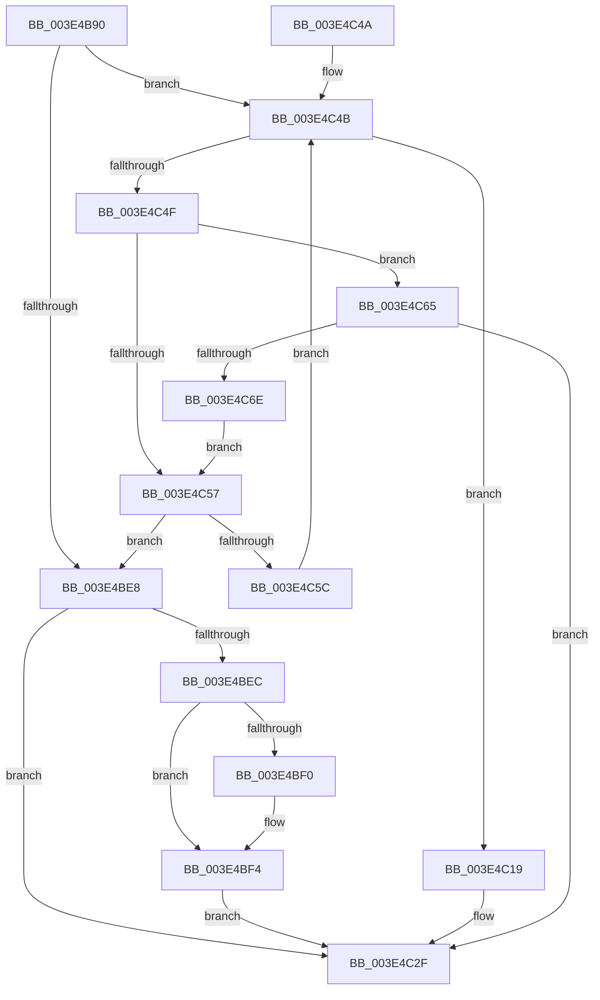

# RtlLengthCurrentClearRunForward

- RVA: `0x003E4B90`–`0x003E4C70` (길이 `224` bytes)
- VA: `0x00000001403E4B90`
- 실행 섹션: `.text`
- PDB 이름 있음: `예`; PDB Function 태그: `아니요`
- unwind 정보 RVA: `0x00094DF0`
- 디코드: `71`개 명령, `224/224` bytes 표시
- 미해석 바이트: `0` (있으면 어셈블리에 `.byte`로 보존)

> 이 문서는 커널 이미지의 기계어와 PDB 기호를 분석해 생성했습니다. 4번과 5번은 함수 원형과 자료형을 바이너리 사용 방식에서 추정한 C 해석이며 원본 소스 복구 결과는 아닙니다.

## 1. Dependencies

- 직접 호출 지점: **0**; 고유 호출 대상: **0**
- 직접 호출자로 확인된 함수: **2**
- RIP 상대 이미지 참조: **1**

### Outgoing calls
- 직접 디코드된 call 명령이 없습니다.

### Direct callers
- [MiFindFreePageFileSpace](MiFindFreePageFileSpace_function_003E2CAC.md) at `0x003E2E40`
- [MiFindFreePageFileSpace](MiFindFreePageFileSpace_function_003E2CAC.md) at `0x003E2E57`
- [sub_003E47AF](Unknown_function_003E47AF.md) at `0x003E4948`

### Static image references
- `0x003E4BA3` → RVA `0x00012C50` (`.rdata`; read)

## 2. Other-region calls and transfers

- 다른 실행 섹션으로 향하는 call: **0**
- 별도 외부 분기/꼬리 이동을 확인하지 못했습니다.

## 3. Assembly (complete function range)

```asm
003E4B90  48 89 5C 24 08                  mov qword ptr [rsp + 8], rbx
003E4B95  48 89 74 24 18                  mov qword ptr [rsp + 0x18], rsi
003E4B9A  48 89 7C 24 20                  mov qword ptr [rsp + 0x20], rdi
003E4B9F  4C 8B 49 08                     mov r9, qword ptr [rcx + 8]
003E4BA3  48 8D 35 A6 E0 C2 FF            lea rsi, [rip - 0x3d1f5a]
003E4BAA  8B DA                           mov ebx, edx
003E4BAC  45 8B D8                        mov r11d, r8d
003E4BAF  44 8B 01                        mov r8d, dword ptr [rcx]
003E4BB2  41 8B F8                        mov edi, r8d
003E4BB5  8B C2                           mov eax, edx
003E4BB7  48 C1 E8 05                     shr rax, 5
003E4BBB  41 8D 48 FF                     lea ecx, [r8 - 1]
003E4BBF  48 C1 E9 05                     shr rcx, 5
003E4BC3  4D 8D 14 81                     lea r10, [r9 + rax*4]
003E4BC7  83 E7 1F                        and edi, 0x1f
003E4BCA  49 8D 04 89                     lea rax, [r9 + rcx*4]
003E4BCE  4C 8D 48 FC                     lea r9, [rax - 4]
003E4BD2  4C 0F 44 C8                     cmove r9, rax
003E4BD6  83 E3 1F                        and ebx, 0x1f
003E4BD9  33 D2                           xor edx, edx
003E4BDB  8B 0C 9E                        mov ecx, dword ptr [rsi + rbx*4]
003E4BDE  F7 D1                           not ecx
003E4BE0  41 23 0A                        and ecx, dword ptr [r10]
003E4BE3  4D 3B D1                        cmp r10, r9
003E4BE6  76 63                           jbe 0x1403e4c4b
003E4BE8  85 FF                           test edi, edi
003E4BEA  74 43                           je 0x1403e4c2f
003E4BEC  85 D2                           test edx, edx
003E4BEE  74 04                           je 0x1403e4bf4
003E4BF0  41 8B 4A 04                     mov ecx, dword ptr [r10 + 4]
003E4BF4  41 83 E0 1F                     and r8d, 0x1f
003E4BF8  42 8B 04 86                     mov eax, dword ptr [rsi + r8*4]
003E4BFC  41 B8 FF FF FF FF               mov r8d, 0xffffffff
003E4C02  F7 D0                           not eax
003E4C04  0B C1                           or eax, ecx
003E4C06  48 0F BC C8                     bsf rcx, rax
003E4C0A  0F B6 C1                        movzx eax, cl
003E4C0D  44 0F 45 C0                     cmovne r8d, eax
003E4C11  41 0F BE C0                     movsx eax, r8b
003E4C15  03 D0                           add edx, eax
003E4C17  EB 16                           jmp 0x1403e4c2f
003E4C19  8B C1                           mov eax, ecx
003E4C1B  41 B8 FF FF FF FF               mov r8d, 0xffffffff
003E4C21  48 0F BC C8                     bsf rcx, rax
003E4C25  44 0F 45 C1                     cmovne r8d, ecx
003E4C29  41 0F BE C8                     movsx ecx, r8b
003E4C2D  03 D1                           add edx, ecx
003E4C2F  48 8B 74 24 18                  mov rsi, qword ptr [rsp + 0x18]
003E4C34  2B D3                           sub edx, ebx
003E4C36  48 8B 5C 24 08                  mov rbx, qword ptr [rsp + 8]
003E4C3B  41 3B D3                        cmp edx, r11d
003E4C3E  48 8B 7C 24 20                  mov rdi, qword ptr [rsp + 0x20]
003E4C43  41 0F 47 D3                     cmova edx, r11d
003E4C47  8B C2                           mov eax, edx
003E4C49  C3                              ret
003E4C4A  CC                              int3
003E4C4B  85 C9                           test ecx, ecx
003E4C4D  75 CA                           jne 0x1403e4c19
003E4C4F  83 C2 20                        add edx, 0x20
003E4C52  41 3B D3                        cmp edx, r11d
003E4C55  73 0E                           jae 0x1403e4c65
003E4C57  4D 3B D1                        cmp r10, r9
003E4C5A  74 8C                           je 0x1403e4be8
003E4C5C  49 83 C2 04                     add r10, 4
003E4C60  41 8B 0A                        mov ecx, dword ptr [r10]
003E4C63  EB E6                           jmp 0x1403e4c4b
003E4C65  8B C2                           mov eax, edx
003E4C67  2B C3                           sub eax, ebx
003E4C69  41 3B C3                        cmp eax, r11d
003E4C6C  73 C1                           jae 0x1403e4c2f
003E4C6E  EB E7                           jmp 0x1403e4c57
```

## 4. C-style interpretation (structured pseudocode)

```c
__int64 __fastcall RtlLengthCurrentClearRunForward(__int64 a1, int a2, int a3)
{
    __int64 result;
    __int64 v_r10;
    __int64 v_rbx;
    __int64 v_rdi;
    unsigned __int64 v_stack_p18;
    unsigned __int64 v_stack_p20;
    unsigned __int64 v_stack_p8;

    v_stack_p8 = v_rbx;
    v_stack_p18 = v_rsi;
    v_stack_p20 = v_rdi;
    result = ((unsigned int)(a2)) >> (5);
    a1 = ((unsigned int)(*(unsigned int *)(a1)) - 1) >> (5);
    v_rdi = (unsigned int)(((unsigned int)((unsigned int)((unsigned int)(*(unsigned int *)(a1))))) & (31));
    a4 = *(unsigned __int64 *)(a1 + 8) + a1 * 4 - 4;
    if (condition_is_equal) { a4 = *(unsigned __int64 *)(a1 + 8) + a1 * 4; }
    v_rbx = (unsigned int)(((unsigned int)(a2)) & (31));
    a2 = 0;
    a1 = (unsigned int)(~((unsigned int)(*(unsigned int *)(v_rip - 4005722 + v_rbx * 4))));
    a1 = (unsigned int)((a1) & (*(unsigned int *)(*(unsigned __int64 *)(a1 + 8) + result * 4)));
    if ((*(unsigned __int64 *)(a1 + 8) + result * 4) <= a4) goto loc_003E4C4B;
loc_003E4BE8:
    if ((unsigned int)(v_rdi) == 0) goto loc_003E4C2F;
    if (0 != 0) {
        a1 = *(unsigned int *)(*(unsigned __int64 *)(a1 + 8) + result * 4 + 4);
    }
    a3 = (unsigned int)(((unsigned int)(*(unsigned int *)(a1))) & (31));
    result = (unsigned int)(~((unsigned int)(*(unsigned int *)(v_rip - 4005722 + a3 * 4))));
    result = (unsigned int)((result) | ((unsigned int)(a1)));
    a3 = (unsigned int)(0xFFFFFFFFULL);
    if (condition_is_not_equal) { a3 = (unsigned int)((unsigned __int8)(a1)); }
    a2 = (unsigned int)((a2) + ((unsigned int)((__int8)((unsigned __int8)(a3)))));
    goto loc_003E4C2F;
loc_003E4C19:
    a3 = (unsigned int)(0xFFFFFFFFULL);
    if (condition_is_not_equal) { a3 = (unsigned int)(a1); }
    a2 = (unsigned int)((a2) + ((unsigned int)((__int8)((unsigned __int8)(a3)))));
loc_003E4C2F:
    a2 = (unsigned int)((a2) - ((unsigned int)(v_rbx)));
    if (a2 > ((unsigned int)((unsigned int)(a3)))) { a2 = (unsigned int)((unsigned int)(a3)); }
    return (unsigned int)(a2);
loc_003E4C4B:
    if ((unsigned int)((__int8)((unsigned __int8)(a3))) != 0) goto loc_003E4C19;
    a2 = (unsigned int)((a2) + (32));
    if (a2 >= ((unsigned int)((unsigned int)(a3)))) goto loc_003E4C65;
loc_003E4C57:
    if ((*(unsigned __int64 *)(a1 + 8) + result * 4) == a4) goto loc_003E4BE8;
    v_r10 = (*(unsigned __int64 *)(a1 + 8) + result * 4) + (4);
    goto loc_003E4C4B;
loc_003E4C65:
    result = (unsigned int)(((unsigned int)(a2)) - ((unsigned int)(v_stack_p8)));
    if (((unsigned int)(result)) >= ((unsigned int)((unsigned int)(a3)))) goto loc_003E4C2F;
    goto loc_003E4C57;
}
```

## 5. (Beta) C Style

```c
int64_t RtlLengthCurrentClearRunForward(void *Arg1, int32_t Arg2, int32_t Arg3)
{
    uint8_t *arg1 = (uint8_t *)Arg1;

    int64_t result;
    int64_t local_r10;
    int64_t local_rbx;
    int64_t local_rdi;
    uint64_t v_stack_p18;
    uint64_t v_stack_p20;
    uint64_t v_stack_p8;

    v_stack_p8 = local_rbx;
    v_stack_p18 = local_rsi;
    v_stack_p20 = local_rdi;
    result = ((uint32_t)(Arg2)) >> (5);
    Arg1 = ((uint32_t)(*(uint32_t *)(arg1)) - 1) >> (5);
    local_rdi = (uint32_t)(((uint32_t)((uint32_t)((uint32_t)(*(uint32_t *)(arg1))))) & (31));
    a4 = *(uint64_t *)(arg1 + 0x8) + Arg1 * 4 - 4;
    if (condition_is_equal) { a4 = *(uint64_t *)(arg1 + 0x8) + Arg1 * 4; }
    local_rbx = (uint32_t)(((uint32_t)(Arg2)) & (31));
    Arg2 = 0;
    Arg1 = (uint32_t)(~((uint32_t)(*(uint32_t *)(v_rip - 0x3D1F5A + local_rbx * 4))));
    Arg1 = (uint32_t)((Arg1) & (*(uint32_t *)(*(uint64_t *)(arg1 + 0x8) + result * 4)));
    if ((*(uint64_t *)(arg1 + 0x8) + result * 4) <= a4) goto loc_003E4C4B;
loc_003E4BE8:
    if ((uint32_t)(local_rdi) == 0) goto loc_003E4C2F;
    if (0 != 0) {
        Arg1 = *(uint32_t *)(*(uint64_t *)(arg1 + 0x8) + result * 4 + 0x4);
    }
    Arg3 = (uint32_t)(((uint32_t)(*(uint32_t *)(arg1))) & (31));
    result = (uint32_t)(~((uint32_t)(*(uint32_t *)(v_rip - 0x3D1F5A + Arg3 * 4))));
    result = (uint32_t)((result) | ((uint32_t)(Arg1)));
    Arg3 = (uint32_t)(0xFFFFFFFFULL);
    if (condition_is_not_equal) { Arg3 = (uint32_t)((uint8_t)(Arg1)); }
    Arg2 = (uint32_t)((Arg2) + ((uint32_t)((int8_t)((uint8_t)(Arg3)))));
    goto loc_003E4C2F;
loc_003E4C19:
    Arg3 = (uint32_t)(0xFFFFFFFFULL);
    if (condition_is_not_equal) { Arg3 = (uint32_t)(Arg1); }
    Arg2 = (uint32_t)((Arg2) + ((uint32_t)((int8_t)((uint8_t)(Arg3)))));
loc_003E4C2F:
    Arg2 = (uint32_t)((Arg2) - ((uint32_t)(local_rbx)));
    if (Arg2 > ((uint32_t)((uint32_t)(Arg3)))) { Arg2 = (uint32_t)((uint32_t)(Arg3)); }
    return (uint32_t)(Arg2);
loc_003E4C4B:
    if ((uint32_t)((int8_t)((uint8_t)(Arg3))) != 0) goto loc_003E4C19;
    Arg2 = (uint32_t)((Arg2) + (32));
    if (Arg2 >= ((uint32_t)((uint32_t)(Arg3)))) goto loc_003E4C65;
loc_003E4C57:
    if ((*(uint64_t *)(arg1 + 0x8) + result * 4) == a4) goto loc_003E4BE8;
    local_r10 = (*(uint64_t *)(arg1 + 0x8) + result * 4) + (4);
    goto loc_003E4C4B;
loc_003E4C65:
    result = (uint32_t)(((uint32_t)(Arg2)) - ((uint32_t)(v_stack_p8)));
    if (((uint32_t)(result)) >= ((uint32_t)((uint32_t)(Arg3)))) goto loc_003E4C2F;
    goto loc_003E4C57;
}
```

### 관측된 메모리 오프셋

구조체 형식이 확인되지 않은 접근은 인자 기준의 오프셋으로만 기록했습니다.

| 기준 인자 | 오프셋 표현 | 폭 (bit) | 접근 |
|---|---:|---:|---|
| `Arg1` | `+ 0x0` | `32` | `R` |
| `Arg1` | `+ 0x8` | `64` | `R` |

## 6. Execution-region graph

[열기: 2D/3D 그래프와 함수 탐색 컨트롤 패널](../../../control-panel.html?section=text&rva=0x003E4B90&view=graph)

- 2D 그래프는 위에서 아래로 흐르고, 3D 그래프는 빈 공간을 드래그해 회전합니다. Shift+드래그는 이동, 휠은 확대·축소, 함수 노드 선택은 대상 보고서 이동입니다.

### Static fallback


