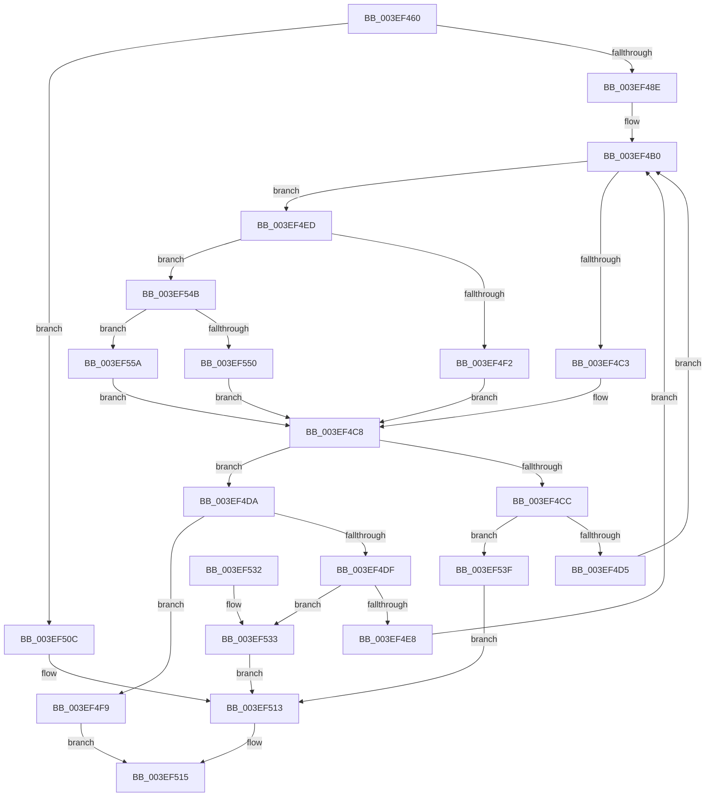

# RtlLookupElementGenericTableFullAvl

- RVA: `0x003EF460`–`0x003EF564` (길이 `260` bytes)
- VA: `0x00000001403EF460`
- 실행 섹션: `.text`
- PDB 이름 있음: `예`; PDB Function 태그: `아니요`
- unwind 정보 RVA: `0x00096AEC`
- 디코드: `75`개 명령, `260/260` bytes 표시
- 미해석 바이트: `0` (있으면 어셈블리에 `.byte`로 보존)

> 이 문서는 커널 이미지의 기계어와 PDB 기호를 분석해 생성했습니다. 4번과 5번은 함수 원형과 자료형을 바이너리 사용 방식에서 추정한 C 해석이며 원본 소스 복구 결과는 아닙니다.

## 1. Dependencies

- 직접 호출 지점: **4**; 고유 호출 대상: **4**
- 직접 호출자로 확인된 함수: **6**
- RIP 상대 이미지 참조: **3**

### Outgoing calls
- `0x003EF4C3` → [PiDmCompareObjects](../../page/9A/PiDmCompareObjects_function_009A2AD0.md) (function, `0x009A2AD0`)
- `0x003EF4F2` → [PnpCompareInstancePath](../../page/9A/PnpCompareInstancePath_function_009A9B60.md) (function, `0x009A9B60`)
- `0x003EF550` → [PiPnpRtlObjectEventCompareObjects](../../page/A1/PiPnpRtlObjectEventCompareObjects_function_00A11280.md) (function, `0x00A11280`)
- `0x003EF55A` → [guard_dispatch_icall](../6B/guard_dispatch_icall_function_006BAAD0.md) (function, `0x006BAAD0`)

### Direct callers
- [VfAvlLookupTreeNode](VfAvlLookupTreeNode_function_003EF1B4.md) at `0x003EF296`
- [VfAvlLookupTreeNode](VfAvlLookupTreeNode_function_003EF1B4.md) at `0x003EF327`
- [PnpGetCurrentlyActiveWorkerThread](../5A/PnpGetCurrentlyActiveWorkerThread_function_005A6AA0.md) at `0x005A6B45`
- [DifObjTrkQeuryInvokeDeleteRange](../61/DifObjTrkQeuryInvokeDeleteRange_function_00619EA0.md) at `0x00619F84`
- [PiPnpRtlObjectEventCreate](../../page/8D/PiPnpRtlObjectEventCreate_function_008DF7E0.md) at `0x008DF92E`
- [sub_008E078C](../../page/8E/Unknown_function_008E078C.md) at `0x008E08B2`
- [PiDmAddCacheReferenceForObject](../../page/95/PiDmAddCacheReferenceForObject_function_00950FB4.md) at `0x00951047`

### Static image references
- `0x003EF492` → RVA `0x009A2AD0` (`PiDmCompareObjects`; read)
- `0x003EF499` → RVA `0x009A9B60` (`PnpCompareInstancePath`; read)
- `0x003EF4A0` → RVA `0x00A11280` (`PiPnpRtlObjectEventCompareObjects`; read)

## 2. Other-region calls and transfers

- 다른 실행 섹션으로 향하는 call: **3**
  - `0x003EF4C3` → [PiDmCompareObjects](../../page/9A/PiDmCompareObjects_function_009A2AD0.md) (`.text` → `PAGE`)
  - `0x003EF4F2` → [PnpCompareInstancePath](../../page/9A/PnpCompareInstancePath_function_009A9B60.md) (`.text` → `PAGE`)
  - `0x003EF550` → [PiPnpRtlObjectEventCompareObjects](../../page/A1/PiPnpRtlObjectEventCompareObjects_function_00A11280.md) (`.text` → `PAGE`)
- 별도 외부 분기/꼬리 이동을 확인하지 못했습니다.

## 3. Assembly (complete function range)

```asm
003EF460  48 89 5C 24 08                  mov qword ptr [rsp + 8], rbx
003EF465  48 89 6C 24 10                  mov qword ptr [rsp + 0x10], rbp
003EF46A  48 89 74 24 18                  mov qword ptr [rsp + 0x18], rsi
003EF46F  57                              push rdi
003EF470  41 54                           push r12
003EF472  41 55                           push r13
003EF474  41 56                           push r14
003EF476  41 57                           push r15
003EF478  48 83 EC 20                     sub rsp, 0x20
003EF47C  83 79 2C 00                     cmp dword ptr [rcx + 0x2c], 0
003EF480  4D 8B F1                        mov r14, r9
003EF483  4D 8B F8                        mov r15, r8
003EF486  48 8B F2                        mov rsi, rdx
003EF489  48 8B F9                        mov rdi, rcx
003EF48C  74 7E                           je 0x1403ef50c
003EF48E  48 8B 59 10                     mov rbx, qword ptr [rcx + 0x10]
003EF492  48 8D 2D 37 36 5B 00            lea rbp, [rip + 0x5b3637]
003EF499  4C 8D 25 C0 A6 5B 00            lea r12, [rip + 0x5ba6c0]
003EF4A0  4C 8D 2D D9 1D 62 00            lea r13, [rip + 0x621dd9]
003EF4A7  66 0F 1F 84 00 00 00 00 00      nop word ptr [rax + rax]
003EF4B0  48 8B 47 48                     mov rax, qword ptr [rdi + 0x48]
003EF4B4  4C 8D 43 20                     lea r8, [rbx + 0x20]
003EF4B8  48 8B D6                        mov rdx, rsi
003EF4BB  48 8B CF                        mov rcx, rdi
003EF4BE  48 3B C5                        cmp rax, rbp
003EF4C1  75 2A                           jne 0x1403ef4ed
003EF4C3  E8 08 36 5B 00                  call 0x1409a2ad0
003EF4C8  85 C0                           test eax, eax
003EF4CA  75 0E                           jne 0x1403ef4da
003EF4CC  48 8B 43 08                     mov rax, qword ptr [rbx + 8]
003EF4D0  48 85 C0                        test rax, rax
003EF4D3  74 6A                           je 0x1403ef53f
003EF4D5  48 8B D8                        mov rbx, rax
003EF4D8  EB D6                           jmp 0x1403ef4b0
003EF4DA  83 F8 01                        cmp eax, 1
003EF4DD  75 1A                           jne 0x1403ef4f9
003EF4DF  48 8B 43 10                     mov rax, qword ptr [rbx + 0x10]
003EF4E3  48 85 C0                        test rax, rax
003EF4E6  74 4B                           je 0x1403ef533
003EF4E8  48 8B D8                        mov rbx, rax
003EF4EB  EB C3                           jmp 0x1403ef4b0
003EF4ED  49 3B C4                        cmp rax, r12
003EF4F0  75 59                           jne 0x1403ef54b
003EF4F2  E8 69 A6 5B 00                  call 0x1409a9b60
003EF4F7  EB CF                           jmp 0x1403ef4c8
003EF4F9  49 89 1F                        mov qword ptr [r15], rbx
003EF4FC  41 C7 06 01 00 00 00            mov dword ptr [r14], 1
003EF503  49 8B 07                        mov rax, qword ptr [r15]
003EF506  48 83 C0 20                     add rax, 0x20
003EF50A  EB 09                           jmp 0x1403ef515
003EF50C  41 C7 01 00 00 00 00            mov dword ptr [r9], 0
003EF513  33 C0                           xor eax, eax
003EF515  48 8B 5C 24 50                  mov rbx, qword ptr [rsp + 0x50]
003EF51A  48 8B 6C 24 58                  mov rbp, qword ptr [rsp + 0x58]
003EF51F  48 8B 74 24 60                  mov rsi, qword ptr [rsp + 0x60]
003EF524  48 83 C4 20                     add rsp, 0x20
003EF528  41 5F                           pop r15
003EF52A  41 5E                           pop r14
003EF52C  41 5D                           pop r13
003EF52E  41 5C                           pop r12
003EF530  5F                              pop rdi
003EF531  C3                              ret
003EF532  CC                              int3
003EF533  49 89 1F                        mov qword ptr [r15], rbx
003EF536  41 C7 06 03 00 00 00            mov dword ptr [r14], 3
003EF53D  EB D4                           jmp 0x1403ef513
003EF53F  49 89 1F                        mov qword ptr [r15], rbx
003EF542  41 C7 06 02 00 00 00            mov dword ptr [r14], 2
003EF549  EB C8                           jmp 0x1403ef513
003EF54B  49 3B C5                        cmp rax, r13
003EF54E  75 0A                           jne 0x1403ef55a
003EF550  E8 2B 1D 62 00                  call 0x140a11280
003EF555  E9 6E FF FF FF                  jmp 0x1403ef4c8
003EF55A  E8 71 B5 2C 00                  call 0x1406baad0
003EF55F  E9 64 FF FF FF                  jmp 0x1403ef4c8
```

## 4. C-style interpretation (structured pseudocode)

```c
__int64 __fastcall RtlLookupElementGenericTableFullAvl(__int64 a1, __int64 a2, __int64 a3, __int64 a4)
{
    __int64 result;
    __int64 v_rsp;
    unsigned __int64 v_stack_p10;
    unsigned __int64 v_stack_p18;
    unsigned __int64 v_stack_p8;

    v_stack_p8 = v_rbx;
    v_stack_p10 = v_rbp;
    v_stack_p18 = v_rsi;
    v_rsp = (v_rsp) - (32);
    if ((*(unsigned int *)(a1 + 44)) == 0) goto loc_003EF50C;
loc_003EF4B0:
    if ((*(unsigned __int64 *)(a1 + 72)) != (v_rip + 5977655)) goto loc_003EF4ED;
    result = PiDmCompareObjects(a1, a2, *(unsigned __int64 *)(a1 + 16) + 32, a4);
loc_003EF4C8:
    if ((unsigned int)(result) != 0) goto loc_003EF4DA;
    if (*(unsigned __int64 *)(*(unsigned __int64 *)(a1 + 16) + 8) == 0) goto loc_003EF53F;
    goto loc_003EF4B0;
loc_003EF4DA:
    if (((unsigned int)(*(unsigned __int64 *)(*(unsigned __int64 *)(a1 + 16) + 8))) != 1) goto loc_003EF4F9;
    if (*(unsigned __int64 *)(*(unsigned __int64 *)(*(unsigned __int64 *)(a1 + 16) + 8) + 16) == 0) goto loc_003EF533;
    goto loc_003EF4B0;
loc_003EF4ED:
    if ((*(unsigned __int64 *)(*(unsigned __int64 *)(*(unsigned __int64 *)(a1 + 16) + 8) + 16)) != (v_rip + 6006464)) goto loc_003EF54B;
    result = PnpCompareInstancePath(a1, a2, *(unsigned __int64 *)(a1 + 16) + 32, a4);
    goto loc_003EF4C8;
loc_003EF4F9:
    *(unsigned __int64 *)(a3) = *(unsigned __int64 *)(*(unsigned __int64 *)(*(unsigned __int64 *)(a1 + 16) + 8) + 16);
    *(unsigned int *)(a4) = 1;
    result = (*(unsigned __int64 *)(a3)) + (32);
    goto loc_003EF515;
loc_003EF50C:
    *(unsigned int *)(a4) = 0;
loc_003EF513:
    result = 0;
loc_003EF515:
    v_rsp = (v_rsp) + (32);
    return result;
loc_003EF533:
    *(unsigned __int64 *)(a3) = v_stack_p8;
    *(unsigned int *)(a4) = 3;
    goto loc_003EF513;
loc_003EF53F:
    *(unsigned __int64 *)(a3) = v_stack_p8;
    *(unsigned int *)(a4) = 2;
    goto loc_003EF513;
loc_003EF54B:
    if (0 != (v_rip + 6430169)) goto loc_003EF55A;
    result = PiPnpRtlObjectEventCompareObjects(a1, a2, *(unsigned __int64 *)(a1 + 16) + 32, a4);
    goto loc_003EF4C8;
loc_003EF55A:
    result = guard_dispatch_icall(a1, a2, *(unsigned __int64 *)(a1 + 16) + 32, a4);
    goto loc_003EF4C8;
}
```

## 5. (Beta) C Style

```c
int64_t RtlLookupElementGenericTableFullAvl(void *Arg1, int64_t Arg2, void *Arg3, void *Arg4)
{
    uint8_t *arg1 = (uint8_t *)Arg1;
    uint8_t *arg3 = (uint8_t *)Arg3;
    uint8_t *arg4 = (uint8_t *)Arg4;

    int64_t result;
    int64_t local_rsp;
    uint64_t v_stack_p10;
    uint64_t v_stack_p18;
    uint64_t v_stack_p8;

    v_stack_p8 = local_rbx;
    v_stack_p10 = local_rbp;
    v_stack_p18 = local_rsi;
    local_rsp = (local_rsp) - (32);
    if ((*(uint32_t *)(arg1 + 0x2C)) == 0) goto loc_003EF50C;
loc_003EF4B0:
    if ((*(uint64_t *)(arg1 + 0x48)) != (v_rip + 5977655)) goto loc_003EF4ED;
    result = PiDmCompareObjects(Arg1, Arg2, *(uint64_t *)(arg1 + 0x10) + 32, Arg4);
loc_003EF4C8:
    if ((uint32_t)(result) != 0) goto loc_003EF4DA;
    if (*(uint64_t *)(*(uint64_t *)(arg1 + 0x10) + 0x8) == 0) goto loc_003EF53F;
    goto loc_003EF4B0;
loc_003EF4DA:
    if (((uint32_t)(*(uint64_t *)(*(uint64_t *)(arg1 + 0x10) + 0x8))) != 1) goto loc_003EF4F9;
    if (*(uint64_t *)(*(uint64_t *)(*(uint64_t *)(arg1 + 0x10) + 0x8) + 0x10) == 0) goto loc_003EF533;
    goto loc_003EF4B0;
loc_003EF4ED:
    if ((*(uint64_t *)(*(uint64_t *)(*(uint64_t *)(arg1 + 0x10) + 0x8) + 0x10)) != (v_rip + 6006464)) goto loc_003EF54B;
    result = PnpCompareInstancePath(Arg1, Arg2, *(uint64_t *)(arg1 + 0x10) + 32, Arg4);
    goto loc_003EF4C8;
loc_003EF4F9:
    *(uint64_t *)(arg3) = *(uint64_t *)(*(uint64_t *)(*(uint64_t *)(arg1 + 0x10) + 0x8) + 0x10);
    *(uint32_t *)(arg4) = 1;
    result = (*(uint64_t *)(arg3)) + (32);
    goto loc_003EF515;
loc_003EF50C:
    *(uint32_t *)(arg4) = 0;
loc_003EF513:
    result = 0;
loc_003EF515:
    local_rsp = (local_rsp) + (32);
    return result;
loc_003EF533:
    *(uint64_t *)(arg3) = v_stack_p8;
    *(uint32_t *)(arg4) = 3;
    goto loc_003EF513;
loc_003EF53F:
    *(uint64_t *)(arg3) = v_stack_p8;
    *(uint32_t *)(arg4) = 2;
    goto loc_003EF513;
loc_003EF54B:
    if (0 != (v_rip + 6430169)) goto loc_003EF55A;
    result = PiPnpRtlObjectEventCompareObjects(Arg1, Arg2, *(uint64_t *)(arg1 + 0x10) + 32, Arg4);
    goto loc_003EF4C8;
loc_003EF55A:
    result = guard_dispatch_icall(Arg1, Arg2, *(uint64_t *)(arg1 + 0x10) + 32, Arg4);
    goto loc_003EF4C8;
}
```

### 관측된 메모리 오프셋

구조체 형식이 확인되지 않은 접근은 인자 기준의 오프셋으로만 기록했습니다.

| 기준 인자 | 오프셋 표현 | 폭 (bit) | 접근 |
|---|---:|---:|---|
| `Arg1` | `+ 0x10` | `64` | `R` |
| `Arg1` | `+ 0x2C` | `32` | `R` |
| `Arg1` | `+ 0x48` | `64` | `R` |
| `Arg3` | `+ 0x0` | `64` | `R` |
| `Arg3` | `+ 0x0` | `64` | `W` |
| `Arg4` | `+ 0x0` | `32` | `W` |

## 6. Execution-region graph

[열기: 2D/3D 그래프와 함수 탐색 컨트롤 패널](../../../control-panel.html?section=text&rva=0x003EF460&view=graph)

- 2D 그래프는 위에서 아래로 흐르고, 3D 그래프는 빈 공간을 드래그해 회전합니다. Shift+드래그는 이동, 휠은 확대·축소, 함수 노드 선택은 대상 보고서 이동입니다.

### Static fallback


