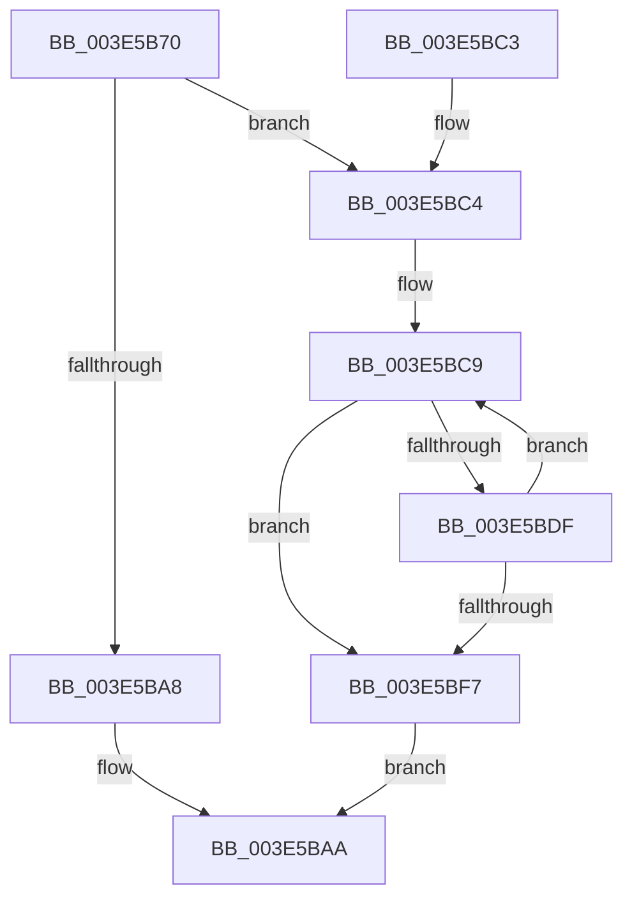

# RtlLookupFirstMatchingElementGenericTableAvl

- RVA: `0x003E5B70`–`0x003E5C00` (길이 `144` bytes)
- VA: `0x00000001403E5B70`
- 실행 섹션: `.text`
- PDB 이름 있음: `예`; PDB Function 태그: `아니요`
- unwind 정보 RVA: `0x00094EF8`
- 디코드: `45`개 명령, `144/144` bytes 표시
- 미해석 바이트: `0` (있으면 어셈블리에 `.byte`로 보존)

> 이 문서는 커널 이미지의 기계어와 PDB 기호를 분석해 생성했습니다. 4번과 5번은 함수 원형과 자료형을 바이너리 사용 방식에서 추정한 C 해석이며 원본 소스 복구 결과는 아닙니다.

## 1. Dependencies

- 직접 호출 지점: **3**; 고유 호출 대상: **3**
- 직접 호출자로 확인된 함수: **0**
- RIP 상대 이미지 참조: **0**

### Outgoing calls
- `0x003E5B9E` → [FindNodeOrParent](FindNodeOrParent_function_003E5C10.md) (function, `0x003E5C10`)
- `0x003E5BD2` → [RealPredecessor](RealPredecessor_function_003E5D08.md) (function, `0x003E5D08`)
- `0x003E5BED` → [guard_dispatch_icall](../6B/guard_dispatch_icall_function_006BAAD0.md) (function, `0x006BAAD0`)

### Direct callers
- 이 함수 시작 RVA로 연결되는 직접 call은 확인되지 않았습니다. 간접 호출은 완전히 역산할 수 없습니다.

### Static image references
- 디코드된 RIP-relative 메모리 참조가 없습니다.

## 2. Other-region calls and transfers

- 다른 실행 섹션으로 향하는 call: **0**
- 별도 외부 분기/꼬리 이동을 확인하지 못했습니다.

## 3. Assembly (complete function range)

```asm
003E5B70  48 8B C4                        mov rax, rsp
003E5B73  48 89 58 08                     mov qword ptr [rax + 8], rbx
003E5B77  48 89 68 10                     mov qword ptr [rax + 0x10], rbp
003E5B7B  48 89 70 20                     mov qword ptr [rax + 0x20], rsi
003E5B7F  57                              push rdi
003E5B80  41 56                           push r14
003E5B82  41 57                           push r15
003E5B84  48 83 EC 20                     sub rsp, 0x20
003E5B88  49 83 20 00                     and qword ptr [r8], 0
003E5B8C  49 8B F8                        mov rdi, r8
003E5B8F  48 83 60 18 00                  and qword ptr [rax + 0x18], 0
003E5B94  4C 8D 40 18                     lea r8, [rax + 0x18]
003E5B98  4C 8B FA                        mov r15, rdx
003E5B9B  4C 8B F1                        mov r14, rcx
003E5B9E  E8 6D 00 00 00                  call 0x1403e5c10
003E5BA3  83 F8 01                        cmp eax, 1
003E5BA6  74 1C                           je 0x1403e5bc4
003E5BA8  33 C0                           xor eax, eax
003E5BAA  48 8B 5C 24 40                  mov rbx, qword ptr [rsp + 0x40]
003E5BAF  48 8B 6C 24 48                  mov rbp, qword ptr [rsp + 0x48]
003E5BB4  48 8B 74 24 58                  mov rsi, qword ptr [rsp + 0x58]
003E5BB9  48 83 C4 20                     add rsp, 0x20
003E5BBD  41 5F                           pop r15
003E5BBF  41 5E                           pop r14
003E5BC1  5F                              pop rdi
003E5BC2  C3                              ret
003E5BC3  CC                              int3
003E5BC4  48 8B 5C 24 50                  mov rbx, qword ptr [rsp + 0x50]
003E5BC9  48 8B CB                        mov rcx, rbx
003E5BCC  48 8B F3                        mov rsi, rbx
003E5BCF  48 8B EB                        mov rbp, rbx
003E5BD2  E8 31 01 00 00                  call 0x1403e5d08
003E5BD7  48 8B D8                        mov rbx, rax
003E5BDA  48 85 C0                        test rax, rax
003E5BDD  74 18                           je 0x1403e5bf7
003E5BDF  4C 8D 40 20                     lea r8, [rax + 0x20]
003E5BE3  49 8B D7                        mov rdx, r15
003E5BE6  49 8B 46 48                     mov rax, qword ptr [r14 + 0x48]
003E5BEA  49 8B CE                        mov rcx, r14
003E5BED  E8 DE 4E 2D 00                  call 0x1406baad0
003E5BF2  83 F8 02                        cmp eax, 2
003E5BF5  74 D2                           je 0x1403e5bc9
003E5BF7  48 89 2F                        mov qword ptr [rdi], rbp
003E5BFA  48 8D 46 20                     lea rax, [rsi + 0x20]
003E5BFE  EB AA                           jmp 0x1403e5baa
```

## 4. C-style interpretation (structured pseudocode)

```c
__int64 __fastcall RtlLookupFirstMatchingElementGenericTableAvl(__int64 a1, __int64 a2, __int64 a3)
{
    __int64 result;
    __int64 v_rsp;
    unsigned __int64 v_stack_p10;
    unsigned __int64 v_stack_p20;
    unsigned __int64 v_stack_p50;
    unsigned __int64 v_stack_p8;

    *(unsigned __int64 *)(v_rsp + 8) = v_rbx;
    *(unsigned __int64 *)(v_rsp + 16) = v_rbp;
    *(unsigned __int64 *)(v_rsp + 32) = v_rsi;
    v_rsp = (v_rsp) - (32);
    result = FindNodeOrParent(a1, a2, v_rsp + 24, a4);
    if (((unsigned int)(result)) == 1) goto loc_003E5BC4;
    result = 0;
loc_003E5BAA:
    v_rsp = (v_rsp) + (32);
    return result;
loc_003E5BC4:
loc_003E5BC9:
    result = RealPredecessor(v_stack_p50, a2, v_rsp + 24, a4);
    if (result == 0) goto loc_003E5BF7;
    result = guard_dispatch_icall(a1, a2, result + 32, a4);
    if (((unsigned int)(result)) == 2) goto loc_003E5BC9;
loc_003E5BF7:
    *(unsigned __int64 *)(a3) = v_stack_p50;
    goto loc_003E5BAA;
}
```

## 5. (Beta) C Style

```c
int64_t RtlLookupFirstMatchingElementGenericTableAvl(void *Arg1, int64_t Arg2, void *Arg3)
{
    uint8_t *arg1 = (uint8_t *)Arg1;
    uint8_t *arg3 = (uint8_t *)Arg3;

    int64_t result;
    int64_t local_rsp;
    uint64_t v_stack_p10;
    uint64_t v_stack_p20;
    uint64_t v_stack_p50;
    uint64_t v_stack_p8;

    *(uint64_t *)(local_rsp + 0x8) = local_rbx;
    *(uint64_t *)(local_rsp + 0x10) = local_rbp;
    *(uint64_t *)(local_rsp + 0x20) = local_rsi;
    local_rsp = (local_rsp) - (32);
    result = FindNodeOrParent(Arg1, Arg2, local_rsp + 24, a4);
    if (((uint32_t)(result)) == 1) goto loc_003E5BC4;
    result = 0;
loc_003E5BAA:
    local_rsp = (local_rsp) + (32);
    return result;
loc_003E5BC4:
loc_003E5BC9:
    result = RealPredecessor(v_stack_p50, Arg2, local_rsp + 24, a4);
    if (result == 0) goto loc_003E5BF7;
    result = guard_dispatch_icall(Arg1, Arg2, result + 32, a4);
    if (((uint32_t)(result)) == 2) goto loc_003E5BC9;
loc_003E5BF7:
    *(uint64_t *)(arg3) = v_stack_p50;
    goto loc_003E5BAA;
}
```

### 관측된 메모리 오프셋

구조체 형식이 확인되지 않은 접근은 인자 기준의 오프셋으로만 기록했습니다.

| 기준 인자 | 오프셋 표현 | 폭 (bit) | 접근 |
|---|---:|---:|---|
| `Arg1` | `+ 0x48` | `64` | `R` |
| `Arg3` | `+ 0x0` | `64` | `R/W` |
| `Arg3` | `+ 0x0` | `64` | `W` |

## 6. Execution-region graph

[열기: 2D/3D 그래프와 함수 탐색 컨트롤 패널](../../../control-panel.html?section=text&rva=0x003E5B70&view=graph)

- 2D 그래프는 위에서 아래로 흐르고, 3D 그래프는 빈 공간을 드래그해 회전합니다. Shift+드래그는 이동, 휠은 확대·축소, 함수 노드 선택은 대상 보고서 이동입니다.

### Static fallback


