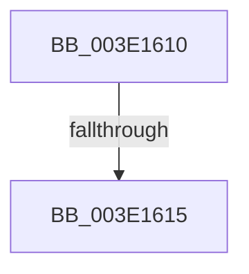

# RtlSetBits

- RVA: `0x003E1610`–`0x003E161A` (길이 `10` bytes)
- VA: `0x00000001403E1610`
- 실행 섹션: `.text`
- PDB 이름 있음: `예`; PDB Function 태그: `아니요`
- unwind 정보 RVA: `0x00094A00`
- 디코드: `4`개 명령, `10/10` bytes 표시
- 미해석 바이트: `0` (있으면 어셈블리에 `.byte`로 보존)

> 이 문서는 커널 이미지의 기계어와 PDB 기호를 분석해 생성했습니다. 4번과 5번은 함수 원형과 자료형을 바이너리 사용 방식에서 추정한 C 해석이며 원본 소스 복구 결과는 아닙니다.

## 1. Dependencies

- 직접 호출 지점: **0**; 고유 호출 대상: **0**
- 직접 호출자로 확인된 함수: **42**
- RIP 상대 이미지 참조: **0**

### Outgoing calls
- 직접 디코드된 call 명령이 없습니다.

### Direct callers
- [MiBuildMdlForMappedFileFault](../36/MiBuildMdlForMappedFileFault_function_0036380C.md) at `0x00363B32`
- [MiGetPrototypePteRanges](MiGetPrototypePteRanges_function_003E0720.md) at `0x003E0801`
- [MiGetPrototypePteRanges](MiGetPrototypePteRanges_function_003E0720.md) at `0x003E08BD`
- [MiReduceMappedFileReadAhead](MiReduceMappedFileReadAhead_function_003E0A54.md) at `0x003E0A79`
- [MiReduceMappedFileReadAhead](MiReduceMappedFileReadAhead_function_003E0A54.md) at `0x003E0AAE`
- [RtlFindClearBitsAndSet](RtlFindClearBitsAndSet_function_003E0CD0.md) at `0x003E0DF9`
- [HalpMmAllocCtxAlloc](HalpMmAllocCtxAlloc_function_003E10B8.md) at `0x003E1272`
- [MiReduceMappedFileReadBehind](MiReduceMappedFileReadBehind_function_003E1B64.md) at `0x003E1B8A`
- [MiReduceMappedFileReadBehind](MiReduceMappedFileReadBehind_function_003E1B64.md) at `0x003E1C9F`
- [MiSetPageFileAllocationBits](MiSetPageFileAllocationBits_function_003E1D8C.md) at `0x003E1DA4`
- [HalpDmaAllocateScatterPagesFromContiguousPoolV2](HalpDmaAllocateScatterPagesFromContiguousPoolV2_function_003E1DC4.md) at `0x003E1F09`
- [MiJoinHugeContext](MiJoinHugeContext_function_003E2748.md) at `0x003E282B`
- [MiFindFreePageFileSpace](MiFindFreePageFileSpace_function_003E2CAC.md) at `0x003E2FA8`
- [HalpIommuProcessDeviceEntries](../57/HalpIommuProcessDeviceEntries_function_00572C58.md) at `0x00572D63`
- [HalpIommuProcessDeviceEntries](../57/HalpIommuProcessDeviceEntries_function_00572C58.md) at `0x00572E3B`
- [HalpIommuProcessDeviceEntries](../57/HalpIommuProcessDeviceEntries_function_00572C58.md) at `0x00572EEE`
- [HsaUpdateRemappingTableEntry](../57/HsaUpdateRemappingTableEntry_function_00575000.md) at `0x0057506C`
- [SepGetAntiTamperEntry](../60/SepGetAntiTamperEntry_function_0060AEE4.md) at `0x0060B03A`
- [MiAllocateLargeProcessPagesFromCache](../69/MiAllocateLargeProcessPagesFromCache_function_0069818C.md) at `0x00698729`
- [sub_006E65B0](../6E/Unknown_function_006E65B0.md) at `0x006E65F4`
- [sub_006F503A](../6F/Unknown_function_006F503A.md) at `0x006F5136`
- [sub_006F503A](../6F/Unknown_function_006F503A.md) at `0x006F5144`
- [HalpInitializeInterruptRemappingBspLate](../../page/70/HalpInitializeInterruptRemappingBspLate_function_0070A708.md) at `0x0070A7E1`
- [HalpIrtAllocateIndex](../../page/70/HalpIrtAllocateIndex_function_0070A9D4.md) at `0x0070AB50`
- [KiTpBuildExcludedKernelTracepointBitmap](../../page/74/KiTpBuildExcludedKernelTracepointBitmap_function_007485B0.md) at `0x0074866F`
- [KiTpBuildExcludedKernelTracepointBitmap](../../page/74/KiTpBuildExcludedKernelTracepointBitmap_function_007485B0.md) at `0x00748755`
- [KiTpBuildExcludedKernelTracepointBitmap](../../page/74/KiTpBuildExcludedKernelTracepointBitmap_function_007485B0.md) at `0x0074879B`
- [CmpLoadHiveThread](../../page/7D/CmpLoadHiveThread_function_007DB040.md) at `0x007DB86B`
- [CmpMountPreloadedHives](../../page/7D/CmpMountPreloadedHives_function_007DBE18.md) at `0x007DC32D`
- [sub_00859517](../../page/85/Unknown_function_00859517.md) at `0x00859563`
- [sub_0085A3BC](../../page/85/Unknown_function_0085A3BC.md) at `0x0085A3E7`
- [HvpEnlistFreeCell](../../page/85/HvpEnlistFreeCell_function_0085A430.md) at `0x0085A4F3`
- [sub_0085AC29](../../page/85/Unknown_function_0085AC29.md) at `0x0085ADCB`
- [HvCheckBin](../../page/96/HvCheckBin_function_0096D790.md) at `0x0096D86B`
- [HvpRemapAndEnlistHiveBins](../../page/9B/HvpRemapAndEnlistHiveBins_function_009B8E0C.md) at `0x009B90C4`
- [RtlMarkExceptionHandlingPages](../../page/A2/RtlMarkExceptionHandlingPages_function_00A26D60.md) at `0x00A26DE5`
- [RtlMarkExceptionHandlingPages](../../page/A2/RtlMarkExceptionHandlingPages_function_00A26D60.md) at `0x00A26E75`
- [SepAddLuidToIndexEntry](../../page/A4/SepAddLuidToIndexEntry_function_00A425C0.md) at `0x00A4279B`
- [SepGetLowBoxNumberEntry](../../page/A6/SepGetLowBoxNumberEntry_function_00A65040.md) at `0x00A65169`
- [MiReserveDriverPtes](../../page/A7/MiReserveDriverPtes_function_00A75150.md) at `0x00A752A9`
- [MiReserveDriverPtes](../../page/A7/MiReserveDriverPtes_function_00A75150.md) at `0x00A75352`
- [MiLockdownSections](../../page/AA/MiLockdownSections_function_00AAA788.md) at `0x00AAA860`
- [HvpUpdateRecoveryVector](../../page/AB/HvpUpdateRecoveryVector_function_00AB5E70.md) at `0x00AB5EB9`
- [MiReserveExistingDriverPtes](../../page/AF/MiReserveExistingDriverPtes_function_00AF84DC.md) at `0x00AF8611`
- [MiReserveExistingDriverPtes](../../page/AF/MiReserveExistingDriverPtes_function_00AF84DC.md) at `0x00AF861F`
- [sub_00B37EB8](../../page/B3/Unknown_function_00B37EB8.md) at `0x00B37EF9`
- [PnprMirrorMarkedPages](../../pagelk/B6/PnprMirrorMarkedPages_function_00B6480C.md) at `0x00B648CB`
- [PopSetBootPhaseRange](../../pagelk/B6/PopSetBootPhaseRange_function_00B6FB0C.md) at `0x00B6FB63`
- [PopDiscardRange](../../pagelk/B7/PopDiscardRange_function_00B794F8.md) at `0x00B79500`
- [PopCloneRange](../../pagelk/B7/PopCloneRange_function_00B7BBB8.md) at `0x00B7BBE5`
- [ViAllocateContiguousMemory](../../pagevrfy/B9/ViAllocateContiguousMemory_function_00B97CE0.md) at `0x00B97DC4`
- [MiReserveBootDriverPtes](../../init/C6/MiReserveBootDriverPtes_function_00C61AD0.md) at `0x00C61BF1`
- [MiReserveBootDriverPtes](../../init/C6/MiReserveBootDriverPtes_function_00C61AD0.md) at `0x00C61C8C`
- [MiInitializeTopLevelBitmap](../../init/C7/MiInitializeTopLevelBitmap_function_00C770D0.md) at `0x00C77164`
- [MiInitializeTopLevelBitmap](../../init/C7/MiInitializeTopLevelBitmap_function_00C770D0.md) at `0x00C7718B`

### Static image references
- 디코드된 RIP-relative 메모리 참조가 없습니다.

## 2. Other-region calls and transfers

- 다른 실행 섹션으로 향하는 call: **0**
- call이 아닌 외부 분기/꼬리 이동: **1**
  - `0x003E1613` → [sub_003E161A + 0x46](Unknown_function_003E161A.md) (`tail-transfer`)

## 3. Assembly (complete function range)

```asm
003E1610  45 85 C0                        test r8d, r8d
003E1613  74 4B                           je 0x1403e1660
003E1615  56                              push rsi
003E1616  48 83 EC 20                     sub rsp, 0x20
```

## 4. C-style interpretation (structured pseudocode)

```c
void __fastcall RtlSetBits(__int64 a1, __int64 a2, int a3)
{
    __int64 v_rsp;

    v_rsp = (v_rsp) - (32);
    return;
}
```

## 5. (Beta) C Style

```c
void RtlSetBits(int64_t Arg1, int64_t Arg2, int32_t Arg3)
{
    int64_t local_rsp;

    local_rsp = (local_rsp) - (32);
    return;
}
```

## 6. Execution-region graph

[열기: 2D/3D 그래프와 함수 탐색 컨트롤 패널](../../../control-panel.html?section=text&rva=0x003E1610&view=graph)

- 2D 그래프는 위에서 아래로 흐르고, 3D 그래프는 빈 공간을 드래그해 회전합니다. Shift+드래그는 이동, 휠은 확대·축소, 함수 노드 선택은 대상 보고서 이동입니다.

### Static fallback


