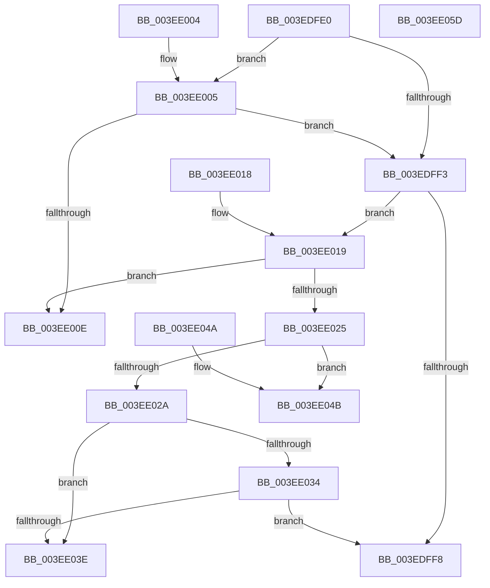

# RtlSidDominatesForTrust

- RVA: `0x003EDFE0`–`0x003EE05E` (길이 `126` bytes)
- VA: `0x00000001403EDFE0`
- 실행 섹션: `.text`
- PDB 이름 있음: `예`; PDB Function 태그: `아니요`
- unwind 정보 RVA: `0x000969A0`
- 디코드: `46`개 명령, `126/126` bytes 표시
- 미해석 바이트: `0` (있으면 어셈블리에 `.byte`로 보존)

> 이 문서는 커널 이미지의 기계어와 PDB 기호를 분석해 생성했습니다. 4번과 5번은 함수 원형과 자료형을 바이너리 사용 방식에서 추정한 C 해석이며 원본 소스 복구 결과는 아닙니다.

## 1. Dependencies

- 직접 호출 지점: **2**; 고유 호출 대상: **1**
- 직접 호출자로 확인된 함수: **7**
- RIP 상대 이미지 참조: **0**

### Outgoing calls
- `0x003EE005` → [RtlIsValidProcessTrustLabelSid](RtlIsValidProcessTrustLabelSid_function_003EE070.md) (function, `0x003EE070`)
- `0x003EE01C` → [RtlIsValidProcessTrustLabelSid](RtlIsValidProcessTrustLabelSid_function_003EE070.md) (function, `0x003EE070`)

### Direct callers
- [SeCreateClientSecurityFromSubjectContextEx](../60/SeCreateClientSecurityFromSubjectContextEx_function_00609440.md) at `0x006094B5`
- [SeTokenCanImpersonate](../../page/8C/SeTokenCanImpersonate_function_008CC4C0.md) at `0x008CC59A`
- [sub_00947EF9](../../page/94/Unknown_function_00947EF9.md) at `0x00947F19`
- [sub_009A911A](../../page/9A/Unknown_function_009A911A.md) at `0x009A913F`
- [SeShouldCheckForAccessRightsFromParent](../../page/9C/SeShouldCheckForAccessRightsFromParent_function_009C40D0.md) at `0x009C4123`
- [SeIsTokenAssignableToProcess](../../page/A3/SeIsTokenAssignableToProcess_function_00A3B2C0.md) at `0x00A3B3F4`
- [SeCreateClientSecurityFromSubjectContext](../../page/A4/SeCreateClientSecurityFromSubjectContext_function_00A4D360.md) at `0x00A4D43E`

### Static image references
- 디코드된 RIP-relative 메모리 참조가 없습니다.

## 2. Other-region calls and transfers

- 다른 실행 섹션으로 향하는 call: **0**
- 별도 외부 분기/꼬리 이동을 확인하지 못했습니다.

## 3. Assembly (complete function range)

```asm
003EDFE0  48 83 EC 28                     sub rsp, 0x28
003EDFE4  41 C6 00 00                     mov byte ptr [r8], 0
003EDFE8  4C 8B CA                        mov r9, rdx
003EDFEB  4C 8B D1                        mov r10, rcx
003EDFEE  48 85 C9                        test rcx, rcx
003EDFF1  75 12                           jne 0x1403ee005
003EDFF3  4D 85 C9                        test r9, r9
003EDFF6  75 21                           jne 0x1403ee019
003EDFF8  B0 01                           mov al, 1
003EDFFA  41 88 00                        mov byte ptr [r8], al
003EDFFD  33 C0                           xor eax, eax
003EDFFF  48 83 C4 28                     add rsp, 0x28
003EE003  C3                              ret
003EE004  CC                              int3
003EE005  E8 66 00 00 00                  call 0x1403ee070
003EE00A  84 C0                           test al, al
003EE00C  75 E5                           jne 0x1403edff3
003EE00E  B8 0D 00 00 C0                  mov eax, 0xc000000d
003EE013  48 83 C4 28                     add rsp, 0x28
003EE017  C3                              ret
003EE018  CC                              int3
003EE019  49 8B C9                        mov rcx, r9
003EE01C  E8 4F 00 00 00                  call 0x1403ee070
003EE021  84 C0                           test al, al
003EE023  74 E9                           je 0x1403ee00e
003EE025  4D 85 D2                        test r10, r10
003EE028  74 21                           je 0x1403ee04b
003EE02A  41 8B 41 08                     mov eax, dword ptr [r9 + 8]
003EE02E  41 39 42 08                     cmp dword ptr [r10 + 8], eax
003EE032  72 0A                           jb 0x1403ee03e
003EE034  41 8B 41 0C                     mov eax, dword ptr [r9 + 0xc]
003EE038  41 39 42 0C                     cmp dword ptr [r10 + 0xc], eax
003EE03C  73 BA                           jae 0x1403edff8
003EE03E  32 C0                           xor al, al
003EE040  41 88 00                        mov byte ptr [r8], al
003EE043  33 C0                           xor eax, eax
003EE045  48 83 C4 28                     add rsp, 0x28
003EE049  C3                              ret
003EE04A  CC                              int3
003EE04B  41 83 79 08 00                  cmp dword ptr [r9 + 8], 0
003EE050  0F 96 C0                        setbe al
003EE053  41 88 00                        mov byte ptr [r8], al
003EE056  33 C0                           xor eax, eax
003EE058  48 83 C4 28                     add rsp, 0x28
003EE05C  C3                              ret
003EE05D  CC                              int3
```

## 4. C-style interpretation (structured pseudocode)

```c
__int64 __fastcall RtlSidDominatesForTrust(__int64 a1, __int64 a2, __int64 a3)
{
    __int64 result;
    __int64 v_rsp;

    v_rsp = (v_rsp) - (40);
    *(unsigned __int8 *)(a3) = 0;
    if (a1 != 0) goto loc_003EE005;
loc_003EDFF3:
    if (a2 != 0) goto loc_003EE019;
loc_003EDFF8:
    *(unsigned __int8 *)(a3) = 1;
    result = 0;
    v_rsp = (v_rsp) + (40);
    return result;
loc_003EE005:
    result = RtlIsValidProcessTrustLabelSid(a1, a2, a3, a2);
    if ((unsigned __int8)(result) != 0) goto loc_003EDFF3;
loc_003EE00E:
    v_rsp = (v_rsp) + (40);
    return (unsigned int)(0xC000000DULL);
loc_003EE019:
    result = RtlIsValidProcessTrustLabelSid(a2, a2, a3, a2);
    if ((unsigned __int8)(result) == 0) goto loc_003EE00E;
    if (a1 == 0) goto loc_003EE04B;
    if ((*(unsigned int *)(a1 + 8)) < ((unsigned int)((unsigned int)(*(unsigned int *)(a2 + 8))))) goto loc_003EE03E;
    if ((*(unsigned int *)(a1 + 12)) >= ((unsigned int)((unsigned int)(*(unsigned int *)(a2 + 12))))) goto loc_003EDFF8;
loc_003EE03E:
    result = 0;
    *(unsigned __int8 *)(a3) = 0;
    result = 0;
    v_rsp = (v_rsp) + (40);
    return result;
loc_003EE04B:
    result = ((*(unsigned int *)(a2 + 8)) <= 0) ? 1 : 0;
    *(unsigned __int8 *)(a3) = (unsigned __int8)(result);
    result = 0;
    v_rsp = (v_rsp) + (40);
    return result;
}
```

## 5. (Beta) C Style

```c
int64_t RtlSidDominatesForTrust(int64_t Arg1, int64_t Arg2, void *Arg3)
{
    uint8_t *arg3 = (uint8_t *)Arg3;

    int64_t result;
    int64_t local_rsp;

    local_rsp = (local_rsp) - (40);
    *(uint8_t *)(arg3) = 0;
    if (Arg1 != 0) goto loc_003EE005;
loc_003EDFF3:
    if (Arg2 != 0) goto loc_003EE019;
loc_003EDFF8:
    *(uint8_t *)(arg3) = 1;
    result = 0;
    local_rsp = (local_rsp) + (40);
    return result;
loc_003EE005:
    result = RtlIsValidProcessTrustLabelSid(Arg1, Arg2, Arg3, Arg2);
    if ((uint8_t)(result) != 0) goto loc_003EDFF3;
loc_003EE00E:
    local_rsp = (local_rsp) + (40);
    return (uint32_t)(0xC000000DULL);
loc_003EE019:
    result = RtlIsValidProcessTrustLabelSid(Arg2, Arg2, Arg3, Arg2);
    if ((uint8_t)(result) == 0) goto loc_003EE00E;
    if (Arg1 == 0) goto loc_003EE04B;
    if ((*(uint32_t *)(Arg1 + 0x8)) < ((uint32_t)((uint32_t)(*(uint32_t *)(Arg2 + 0x8))))) goto loc_003EE03E;
    if ((*(uint32_t *)(Arg1 + 0xC)) >= ((uint32_t)((uint32_t)(*(uint32_t *)(Arg2 + 0xC))))) goto loc_003EDFF8;
loc_003EE03E:
    result = 0;
    *(uint8_t *)(arg3) = 0;
    result = 0;
    local_rsp = (local_rsp) + (40);
    return result;
loc_003EE04B:
    result = ((*(uint32_t *)(Arg2 + 0x8)) <= 0) ? 1 : 0;
    *(uint8_t *)(arg3) = (uint8_t)(result);
    result = 0;
    local_rsp = (local_rsp) + (40);
    return result;
}
```

### 관측된 메모리 오프셋

구조체 형식이 확인되지 않은 접근은 인자 기준의 오프셋으로만 기록했습니다.

| 기준 인자 | 오프셋 표현 | 폭 (bit) | 접근 |
|---|---:|---:|---|
| `Arg3` | `+ 0x0` | `8` | `W` |

## 6. Execution-region graph

[열기: 2D/3D 그래프와 함수 탐색 컨트롤 패널](../../../control-panel.html?section=text&rva=0x003EDFE0&view=graph)

- 2D 그래프는 위에서 아래로 흐르고, 3D 그래프는 빈 공간을 드래그해 회전합니다. Shift+드래그는 이동, 휠은 확대·축소, 함수 노드 선택은 대상 보고서 이동입니다.

### Static fallback


