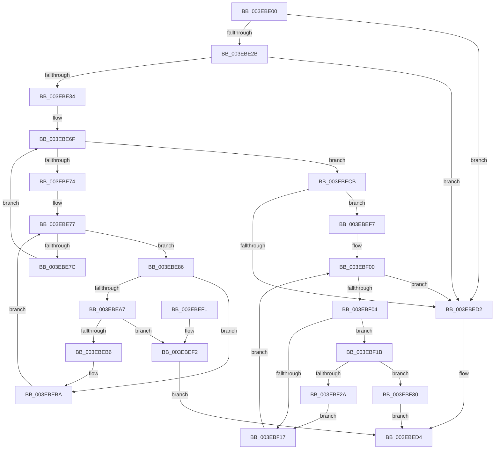

# RtlSidHashLookup

- RVA: `0x003EBE00`–`0x003EBF35` (길이 `309` bytes)
- VA: `0x00000001403EBE00`
- 실행 섹션: `.text`
- PDB 이름 있음: `예`; PDB Function 태그: `아니요`
- unwind 정보 RVA: `0x00095B08`
- 디코드: `92`개 명령, `309/309` bytes 표시
- 미해석 바이트: `0` (있으면 어셈블리에 `.byte`로 보존)

> 이 문서는 커널 이미지의 기계어와 PDB 기호를 분석해 생성했습니다. 4번과 5번은 함수 원형과 자료형을 바이너리 사용 방식에서 추정한 C 해석이며 원본 소스 복구 결과는 아닙니다.

## 1. Dependencies

- 직접 호출 지점: **2**; 고유 호출 대상: **1**
- 직접 호출자로 확인된 함수: **0**
- RIP 상대 이미지 참조: **1**

### Outgoing calls
- `0x003EBEAD` → [memcmp](../6C/memcmp_function_006C6B10.md) (function, `0x006C6B10`)
- `0x003EBF21` → [memcmp](../6C/memcmp_function_006C6B10.md) (function, `0x006C6B10`)

### Direct callers
- 이 함수 시작 RVA로 연결되는 직접 call은 확인되지 않았습니다. 간접 호출은 완전히 역산할 수 없습니다.

### Static image references
- `0x003EBE54` → RVA `0x00011DE0` (`.rdata`; read)

## 2. Other-region calls and transfers

- 다른 실행 섹션으로 향하는 call: **0**
- 별도 외부 분기/꼬리 이동을 확인하지 못했습니다.

## 3. Assembly (complete function range)

```asm
003EBE00  48 89 5C 24 10                  mov qword ptr [rsp + 0x10], rbx
003EBE05  48 89 6C 24 18                  mov qword ptr [rsp + 0x18], rbp
003EBE0A  48 89 74 24 20                  mov qword ptr [rsp + 0x20], rsi
003EBE0F  57                              push rdi
003EBE10  41 54                           push r12
003EBE12  41 55                           push r13
003EBE14  41 56                           push r14
003EBE16  41 57                           push r15
003EBE18  48 83 EC 20                     sub rsp, 0x20
003EBE1C  4C 8B F2                        mov r14, rdx
003EBE1F  48 8B F1                        mov rsi, rcx
003EBE22  48 85 C9                        test rcx, rcx
003EBE25  0F 84 A7 00 00 00               je 0x1403ebed2
003EBE2B  48 85 D2                        test rdx, rdx
003EBE2E  0F 84 9E 00 00 00               je 0x1403ebed2
003EBE34  0F B6 42 01                     movzx eax, byte ptr [rdx + 1]
003EBE38  44 0F B7 2A                     movzx r13d, word ptr [rdx]
003EBE3C  44 0F B6 44 82 04               movzx r8d, byte ptr [rdx + rax*4 + 4]
003EBE42  8D 0C 85 08 00 00 00            lea ecx, [rax*4 + 8]
003EBE49  41 8B D8                        mov ebx, r8d
003EBE4C  89 4C 24 50                     mov dword ptr [rsp + 0x50], ecx
003EBE50  48 C1 EB 04                     shr rbx, 4
003EBE54  48 8D 15 85 5F C2 FF            lea rdx, [rip - 0x3da07b]
003EBE5B  41 83 E0 0F                     and r8d, 0xf
003EBE5F  48 8B 9C DE 90 00 00 00         mov rbx, qword ptr [rsi + rbx*8 + 0x90]
003EBE67  4A 23 5C C6 10                  and rbx, qword ptr [rsi + r8*8 + 0x10]
003EBE6C  40 32 ED                        xor bpl, bpl
003EBE6F  48 85 DB                        test rbx, rbx
003EBE72  74 57                           je 0x1403ebecb
003EBE74  0F B6 FB                        movzx edi, bl
003EBE77  40 84 FF                        test dil, dil
003EBE7A  75 0A                           jne 0x1403ebe86
003EBE7C  40 80 C5 08                     add bpl, 8
003EBE80  48 C1 EB 08                     shr rbx, 8
003EBE84  EB E9                           jmp 0x1403ebe6f
003EBE86  44 0F B6 FD                     movzx r15d, bpl
003EBE8A  40 0F B6 C7                     movzx eax, dil
003EBE8E  44 0F B6 24 10                  movzx r12d, byte ptr [rax + rdx]
003EBE93  45 03 FC                        add r15d, r12d
003EBE96  49 C1 E7 04                     shl r15, 4
003EBE9A  4C 03 7E 08                     add r15, qword ptr [rsi + 8]
003EBE9E  49 8B 17                        mov rdx, qword ptr [r15]
003EBEA1  66 44 39 2A                     cmp word ptr [rdx], r13w
003EBEA5  75 13                           jne 0x1403ebeba
003EBEA7  44 8B C1                        mov r8d, ecx
003EBEAA  49 8B CE                        mov rcx, r14
003EBEAD  E8 5E AC 2D 00                  call 0x1406c6b10
003EBEB2  85 C0                           test eax, eax
003EBEB4  74 3C                           je 0x1403ebef2
003EBEB6  8B 4C 24 50                     mov ecx, dword ptr [rsp + 0x50]
003EBEBA  40 0F B6 FF                     movzx edi, dil
003EBEBE  48 8D 15 1B 5F C2 FF            lea rdx, [rip - 0x3da0e5]
003EBEC5  44 0F BB E7                     btc edi, r12d
003EBEC9  EB AC                           jmp 0x1403ebe77
003EBECB  8B 1E                           mov ebx, dword ptr [rsi]
003EBECD  83 FB 40                        cmp ebx, 0x40
003EBED0  77 25                           ja 0x1403ebef7
003EBED2  33 C0                           xor eax, eax
003EBED4  48 8B 5C 24 58                  mov rbx, qword ptr [rsp + 0x58]
003EBED9  48 8B 6C 24 60                  mov rbp, qword ptr [rsp + 0x60]
003EBEDE  48 8B 74 24 68                  mov rsi, qword ptr [rsp + 0x68]
003EBEE3  48 83 C4 20                     add rsp, 0x20
003EBEE7  41 5F                           pop r15
003EBEE9  41 5E                           pop r14
003EBEEB  41 5D                           pop r13
003EBEED  41 5C                           pop r12
003EBEEF  5F                              pop rdi
003EBEF0  C3                              ret
003EBEF1  CC                              int3
003EBEF2  49 8B C7                        mov rax, r15
003EBEF5  EB DD                           jmp 0x1403ebed4
003EBEF7  BD 40 00 00 00                  mov ebp, 0x40
003EBEFC  0F 1F 40 00                     nop dword ptr [rax]
003EBF00  3B EB                           cmp ebp, ebx
003EBF02  73 CE                           jae 0x1403ebed2
003EBF04  8B FD                           mov edi, ebp
003EBF06  48 C1 E7 04                     shl rdi, 4
003EBF0A  48 03 7E 08                     add rdi, qword ptr [rsi + 8]
003EBF0E  48 8B 17                        mov rdx, qword ptr [rdi]
003EBF11  66 44 39 2A                     cmp word ptr [rdx], r13w
003EBF15  74 04                           je 0x1403ebf1b
003EBF17  FF C5                           inc ebp
003EBF19  EB E5                           jmp 0x1403ebf00
003EBF1B  44 8B C1                        mov r8d, ecx
003EBF1E  49 8B CE                        mov rcx, r14
003EBF21  E8 EA AB 2D 00                  call 0x1406c6b10
003EBF26  85 C0                           test eax, eax
003EBF28  74 06                           je 0x1403ebf30
003EBF2A  8B 4C 24 50                     mov ecx, dword ptr [rsp + 0x50]
003EBF2E  EB E7                           jmp 0x1403ebf17
003EBF30  48 8B C7                        mov rax, rdi
003EBF33  EB 9F                           jmp 0x1403ebed4
```

## 4. C-style interpretation (structured pseudocode)

```c
__int64 __fastcall RtlSidHashLookup(__int64 a1, __int64 a2)
{
    __int64 result;
    __int64 v_r15;
    __int64 v_rbp;
    __int64 v_rbx;
    __int64 v_rdi;
    __int64 v_rsp;
    unsigned __int64 v_stack_p10;
    unsigned __int64 v_stack_p18;
    unsigned __int64 v_stack_p20;
    unsigned int v_stack_p50;
    unsigned int v_stack_p8;

    v_stack_p10 = v_rbx;
    v_stack_p18 = v_rbp;
    v_stack_p20 = v_rsi;
    v_rsp = (v_rsp) - (32);
    if (a1 == 0) goto loc_003EBED2;
    if (a2 == 0) goto loc_003EBED2;
    v_stack_p8 = (unsigned int)(*(unsigned __int8 *)(a2 + 1) * 4 + 8);
    v_rbx = ((unsigned int)((unsigned int)(*(unsigned __int8 *)(a2 + *(unsigned __int8 *)(a2 + 1) * 4 + 4)))) >> (4);
    a3 = (unsigned int)((*(unsigned __int8 *)(a2 + *(unsigned __int8 *)(a2 + 1) * 4 + 4)) & (15));
    v_rbx = (*(unsigned __int64 *)(a1 + v_rbx * 8 + 144)) & (*(unsigned __int64 *)(a1 + a3 * 8 + 16));
    v_rbp = 0;
loc_003EBE6F:
    if (v_rbx == 0) goto loc_003EBECB;
loc_003EBE77:
    if ((unsigned __int8)((unsigned __int8)(v_rbx)) != 0) goto loc_003EBE86;
    v_rbp = (unsigned __int8)((v_rbp) + (8));
    v_rbx = (v_rbx) >> (8);
    goto loc_003EBE6F;
loc_003EBE86:
    v_r15 = (unsigned int)(((unsigned __int8)(v_rbp)) + ((unsigned int)(*(unsigned __int8 *)((unsigned __int8)((unsigned __int8)(v_rbx)) + v_rip - 4038779 * 1))));
    v_r15 = (v_r15) << (4);
    v_r15 = (v_r15) + (*(unsigned __int64 *)(a1 + 8));
    if ((*(unsigned __int16 *)(*(unsigned __int64 *)(v_r15))) != ((unsigned __int16)(*(unsigned __int16 *)(a2)))) goto loc_003EBEBA;
    result = memcmp(a2, *(unsigned __int64 *)(v_r15), (unsigned int)((unsigned int)(*(unsigned __int8 *)(a2 + 1) * 4 + 8)), a4);
    if ((unsigned int)(result) == 0) goto loc_003EBEF2;
loc_003EBEBA:
    goto loc_003EBE77;
loc_003EBECB:
    if (((unsigned int)((unsigned int)(*(unsigned int *)(a1)))) > 64) goto loc_003EBEF7;
loc_003EBED2:
    result = 0;
loc_003EBED4:
    v_rsp = (v_rsp) + (32);
    return result;
loc_003EBEF2:
    goto loc_003EBED4;
loc_003EBEF7:
loc_003EBF00:
    if (64 >= ((unsigned int)(v_stack_p10))) goto loc_003EBED2;
    v_rdi = (64) << (4);
    v_rdi = (v_rdi) + (*(unsigned __int64 *)(v_stack_p20 + 8));
    if ((*(unsigned __int16 *)(*(unsigned __int64 *)(v_rdi))) == ((unsigned __int16)(*(unsigned __int16 *)(a2)))) goto loc_003EBF1B;
loc_003EBF17:
    v_rbp = (unsigned int)((64) + 1);
    goto loc_003EBF00;
loc_003EBF1B:
    result = memcmp(a2, *(unsigned __int64 *)(v_rdi), (unsigned int)((unsigned int)((unsigned int)(v_stack_p8))), a4);
    if ((unsigned int)(result) == 0) goto loc_003EBF30;
    goto loc_003EBF17;
loc_003EBF30:
    goto loc_003EBED4;
}
```

## 5. (Beta) C Style

```c
int64_t RtlSidHashLookup(void *Arg1, int64_t Arg2)
{
    uint8_t *arg1 = (uint8_t *)Arg1;

    int64_t result;
    int64_t local_r15;
    int64_t local_rbp;
    int64_t local_rbx;
    int64_t local_rdi;
    int64_t local_rsp;
    uint64_t v_stack_p10;
    uint64_t v_stack_p18;
    uint64_t v_stack_p20;
    uint32_t v_stack_p50;
    uint32_t v_stack_p8;

    v_stack_p10 = local_rbx;
    v_stack_p18 = local_rbp;
    v_stack_p20 = local_rsi;
    local_rsp = (local_rsp) - (32);
    if (Arg1 == NULL) goto loc_003EBED2;
    if (Arg2 == 0) goto loc_003EBED2;
    v_stack_p8 = (uint32_t)(*(uint8_t *)(Arg2 + 0x1) * 4 + 8);
    local_rbx = ((uint32_t)((uint32_t)(*(uint8_t *)(Arg2 + *(uint8_t *)(Arg2 + 0x1) * 4 + 0x4)))) >> (4);
    a3 = (uint32_t)((*(uint8_t *)(Arg2 + *(uint8_t *)(Arg2 + 0x1) * 4 + 0x4)) & (15));
    local_rbx = (*(uint64_t *)(arg1 + local_rbx * 8 + 0x90)) & (*(uint64_t *)(arg1 + a3 * 8 + 0x10));
    local_rbp = 0;
loc_003EBE6F:
    if (local_rbx == 0) goto loc_003EBECB;
loc_003EBE77:
    if ((uint8_t)((uint8_t)(local_rbx)) != 0) goto loc_003EBE86;
    local_rbp = (uint8_t)((local_rbp) + (8));
    local_rbx = (local_rbx) >> (8);
    goto loc_003EBE6F;
loc_003EBE86:
    local_r15 = (uint32_t)(((uint8_t)(local_rbp)) + ((uint32_t)(*(uint8_t *)((uint8_t)((uint8_t)(local_rbx)) + v_rip - 0x3DA07B * 1))));
    local_r15 = (local_r15) << (4);
    local_r15 = (local_r15) + (*(uint64_t *)(arg1 + 0x8));
    if ((*(uint16_t *)(*(uint64_t *)(local_r15))) != ((uint16_t)(*(uint16_t *)(Arg2)))) goto loc_003EBEBA;
    result = memcmp(Arg2, *(uint64_t *)(local_r15), (uint32_t)((uint32_t)(*(uint8_t *)(Arg2 + 0x1) * 4 + 8)), a4);
    if ((uint32_t)(result) == 0) goto loc_003EBEF2;
loc_003EBEBA:
    goto loc_003EBE77;
loc_003EBECB:
    if (((uint32_t)((uint32_t)(*(uint32_t *)(arg1)))) > 64) goto loc_003EBEF7;
loc_003EBED2:
    result = 0;
loc_003EBED4:
    local_rsp = (local_rsp) + (32);
    return result;
loc_003EBEF2:
    goto loc_003EBED4;
loc_003EBEF7:
loc_003EBF00:
    if (64 >= ((uint32_t)(v_stack_p10))) goto loc_003EBED2;
    local_rdi = (64) << (4);
    local_rdi = (local_rdi) + (*(uint64_t *)(v_stack_p20 + 0x8));
    if ((*(uint16_t *)(*(uint64_t *)(local_rdi))) == ((uint16_t)(*(uint16_t *)(Arg2)))) goto loc_003EBF1B;
loc_003EBF17:
    local_rbp = (uint32_t)((64) + 1);
    goto loc_003EBF00;
loc_003EBF1B:
    result = memcmp(Arg2, *(uint64_t *)(local_rdi), (uint32_t)((uint32_t)((uint32_t)(v_stack_p8))), a4);
    if ((uint32_t)(result) == 0) goto loc_003EBF30;
    goto loc_003EBF17;
loc_003EBF30:
    goto loc_003EBED4;
}
```

### 관측된 메모리 오프셋

구조체 형식이 확인되지 않은 접근은 인자 기준의 오프셋으로만 기록했습니다.

| 기준 인자 | 오프셋 표현 | 폭 (bit) | 접근 |
|---|---:|---:|---|
| `Arg1` | `+ 0x0` | `32` | `R` |
| `Arg1` | `+ 0x8` | `64` | `R` |
| `Arg1` | `+ 0x10 + r8*8` | `64` | `R` |
| `Arg1` | `+ 0x90 + rbx*8` | `64` | `R` |

## 6. Execution-region graph

[열기: 2D/3D 그래프와 함수 탐색 컨트롤 패널](../../../control-panel.html?section=text&rva=0x003EBE00&view=graph)

- 2D 그래프는 위에서 아래로 흐르고, 3D 그래프는 빈 공간을 드래그해 회전합니다. Shift+드래그는 이동, 휠은 확대·축소, 함수 노드 선택은 대상 보고서 이동입니다.

### Static fallback


