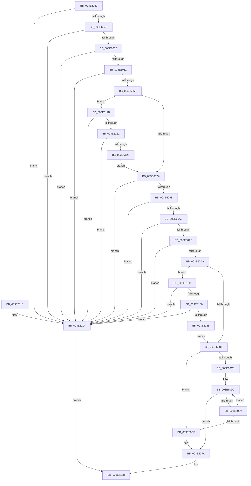

# RtlUnicodeStringCat

- RVA: `0x003E6030`–`0x003E613A` (길이 `266` bytes)
- VA: `0x00000001403E6030`
- 실행 섹션: `.text`
- PDB 이름 있음: `예`; PDB Function 태그: `아니요`
- unwind 정보 RVA: `0x0008B470`
- 디코드: `75`개 명령, `266/266` bytes 표시
- 미해석 바이트: `0` (있으면 어셈블리에 `.byte`로 보존)

> 이 문서는 커널 이미지의 기계어와 PDB 기호를 분석해 생성했습니다. 4번과 5번은 함수 원형과 자료형을 바이너리 사용 방식에서 추정한 C 해석이며 원본 소스 복구 결과는 아닙니다.

## 1. Dependencies

- 직접 호출 지점: **0**; 고유 호출 대상: **0**
- 직접 호출자로 확인된 함수: **9**
- RIP 상대 이미지 참조: **0**

### Outgoing calls
- 직접 디코드된 call 명령이 없습니다.

### Direct callers
- [CmpIsFileInSystemConfig](../../page/7F/CmpIsFileInSystemConfig_function_007F1F80.md) at `0x007F20D3`
- [sub_00857CAB](../../page/85/Unknown_function_00857CAB.md) at `0x00857D02`
- [sub_0094AD50](../../page/94/Unknown_function_0094AD50.md) at `0x0094AE8B`
- [CmpLogTransactionAbortedWithChildName](../../page/9A/CmpLogTransactionAbortedWithChildName_function_009AED70.md) at `0x009AEE4D`
- [SshpGenerateDeviceFriendlyName](../../page/A2/SshpGenerateDeviceFriendlyName_function_00A2E184.md) at `0x00A2E384`
- [SshpGenerateDeviceFriendlyName](../../page/A2/SshpGenerateDeviceFriendlyName_function_00A2E184.md) at `0x00A2E3C6`
- [CmpVEExecuteVirtualStoreParseLogic](../../page/A7/CmpVEExecuteVirtualStoreParseLogic_function_00A76A20.md) at `0x00A76B2A`
- [PopPowerRequestStatsIdConcat](../../page/A8/PopPowerRequestStatsIdConcat_function_00A80018.md) at `0x00A800EA`
- [PopIdleWakeGenerateInterruptDescriptionString](../../page/A9/PopIdleWakeGenerateInterruptDescriptionString_function_00A98748.md) at `0x00A9892C`
- [PopGenerateDeviceFriendlyName](../../page/A9/PopGenerateDeviceFriendlyName_function_00A98968.md) at `0x00A989DE`
- [PopGenerateDeviceFriendlyName](../../page/A9/PopGenerateDeviceFriendlyName_function_00A98968.md) at `0x00A98BBF`

### Static image references
- 디코드된 RIP-relative 메모리 참조가 없습니다.

## 2. Other-region calls and transfers

- 다른 실행 섹션으로 향하는 call: **0**
- 별도 외부 분기/꼬리 이동을 확인하지 못했습니다.

## 3. Assembly (complete function range)

```asm
003E6030  48 89 5C 24 08                  mov qword ptr [rsp + 8], rbx
003E6035  48 89 7C 24 10                  mov qword ptr [rsp + 0x10], rdi
003E603A  44 0F B7 09                     movzx r9d, word ptr [rcx]
003E603E  48 8B F9                        mov rdi, rcx
003E6041  41 F6 C1 01                     test r9b, 1
003E6045  0F 85 C9 00 00 00               jne 0x1403e6114
003E604B  0F B7 41 02                     movzx eax, word ptr [rcx + 2]
003E604F  A8 01                           test al, 1
003E6051  0F 85 BD 00 00 00               jne 0x1403e6114
003E6057  66 44 3B C8                     cmp r9w, ax
003E605B  0F 87 B3 00 00 00               ja 0x1403e6114
003E6061  BB FE FF 00 00                  mov ebx, 0xfffe
003E6066  66 3B C3                        cmp ax, bx
003E6069  0F 87 A5 00 00 00               ja 0x1403e6114
003E606F  48 83 79 08 00                  cmp qword ptr [rcx + 8], 0
003E6074  0F 84 A1 00 00 00               je 0x1403e611b
003E607A  44 0F B7 41 02                  movzx r8d, word ptr [rcx + 2]
003E607F  4D 8B D9                        mov r11, r9
003E6082  4C 8B 51 08                     mov r10, qword ptr [rcx + 8]
003E6086  0F B7 0A                        movzx ecx, word ptr [rdx]
003E6089  49 D1 E8                        shr r8, 1
003E608C  49 D1 EB                        shr r11, 1
003E608F  F6 C1 01                        test cl, 1
003E6092  0F 85 7C 00 00 00               jne 0x1403e6114
003E6098  0F B7 42 02                     movzx eax, word ptr [rdx + 2]
003E609C  A8 01                           test al, 1
003E609E  75 74                           jne 0x1403e6114
003E60A0  66 3B C3                        cmp ax, bx
003E60A3  77 6F                           ja 0x1403e6114
003E60A5  66 3B C8                        cmp cx, ax
003E60A8  77 6A                           ja 0x1403e6114
003E60AA  48 83 7A 08 00                  cmp qword ptr [rdx + 8], 0
003E60AF  74 7A                           je 0x1403e612b
003E60B1  48 8B 42 08                     mov rax, qword ptr [rdx + 8]
003E60B5  BB 00 00 00 00                  mov ebx, 0
003E60BA  48 8B D1                        mov rdx, rcx
003E60BD  44 8B CB                        mov r9d, ebx
003E60C0  48 D1 EA                        shr rdx, 1
003E60C3  4D 2B C3                        sub r8, r11
003E60C6  74 27                           je 0x1403e60ef
003E60C8  4B 8D 0C 1B                     lea rcx, [r11 + r11]
003E60CC  48 2B C8                        sub rcx, rax
003E60CF  4C 03 D1                        add r10, rcx
003E60D2  48 85 D2                        test rdx, rdx
003E60D5  74 23                           je 0x1403e60fa
003E60D7  0F B7 08                        movzx ecx, word ptr [rax]
003E60DA  48 FF CA                        dec rdx
003E60DD  66 41 89 0C 02                  mov word ptr [r10 + rax], cx
003E60E2  49 FF C1                        inc r9
003E60E5  48 83 C0 02                     add rax, 2
003E60E9  49 83 E8 01                     sub r8, 1
003E60ED  75 E3                           jne 0x1403e60d2
003E60EF  48 85 D2                        test rdx, rdx
003E60F2  B8 05 00 00 80                  mov eax, 0x80000005
003E60F7  0F 45 D8                        cmovne ebx, eax
003E60FA  66 45 03 D9                     add r11w, r9w
003E60FE  8B C3                           mov eax, ebx
003E6100  66 45 03 DB                     add r11w, r11w
003E6104  66 44 89 1F                     mov word ptr [rdi], r11w
003E6108  48 8B 5C 24 08                  mov rbx, qword ptr [rsp + 8]
003E610D  48 8B 7C 24 10                  mov rdi, qword ptr [rsp + 0x10]
003E6112  C3                              ret
003E6113  CC                              int3
003E6114  B8 0D 00 00 C0                  mov eax, 0xc000000d
003E6119  EB ED                           jmp 0x1403e6108
003E611B  66 45 85 C9                     test r9w, r9w
003E611F  75 F3                           jne 0x1403e6114
003E6121  66 85 C0                        test ax, ax
003E6124  75 EE                           jne 0x1403e6114
003E6126  E9 4F FF FF FF                  jmp 0x1403e607a
003E612B  66 85 C9                        test cx, cx
003E612E  75 E4                           jne 0x1403e6114
003E6130  66 85 C0                        test ax, ax
003E6133  75 DF                           jne 0x1403e6114
003E6135  E9 77 FF FF FF                  jmp 0x1403e60b1
```

## 4. C-style interpretation (structured pseudocode)

```c
__int64 __fastcall RtlUnicodeStringCat(__int64 a1, __int64 a2)
{
    __int64 result;
    __int64 v_r10;
    __int64 v_r11;
    __int64 v_rbx;
    unsigned __int64 v_stack_p10;
    unsigned __int64 v_stack_p8;

    v_stack_p8 = v_rbx;
    v_stack_p10 = v_rdi;
    if ((((unsigned __int8)(*(unsigned __int16 *)(a1))) & (1)) != 0) goto loc_003E6114;
    if ((((unsigned __int8)(*(unsigned __int16 *)(a1 + 2))) & (1)) != 0) goto loc_003E6114;
    if (((unsigned __int16)(*(unsigned __int16 *)(a1))) > ((unsigned __int16)(*(unsigned __int16 *)(a1 + 2)))) goto loc_003E6114;
    if (((unsigned __int16)(*(unsigned __int16 *)(a1 + 2))) > ((unsigned __int16)((unsigned int)(0xFFFEULL)))) goto loc_003E6114;
    if ((*(unsigned __int64 *)(a1 + 8)) == 0) goto loc_003E611B;
loc_003E607A:
    a3 = (*(unsigned __int16 *)(a1 + 2)) >> (1);
    v_r11 = (*(unsigned __int16 *)(a1)) >> (1);
    if ((((unsigned __int8)(*(unsigned __int16 *)(a2))) & (1)) != 0) goto loc_003E6114;
    if ((((unsigned __int8)(*(unsigned __int16 *)(a2 + 2))) & (1)) != 0) goto loc_003E6114;
    if (((unsigned __int16)(*(unsigned __int16 *)(a2 + 2))) > ((unsigned __int16)((unsigned int)(0xFFFEULL)))) goto loc_003E6114;
    if (((unsigned __int16)(*(unsigned __int16 *)(a2))) > ((unsigned __int16)(*(unsigned __int16 *)(a2 + 2)))) goto loc_003E6114;
    if ((*(unsigned __int64 *)(a2 + 8)) == 0) goto loc_003E612B;
loc_003E60B1:
    a2 = (*(unsigned __int16 *)(a2)) >> (1);
    a3 = (a3) - (v_r11);
    if (condition_is_equal) goto loc_003E60EF;
    a1 = (v_r11 + v_r11 * 1) - (*(unsigned __int64 *)(a2 + 8));
    v_r10 = (*(unsigned __int64 *)(a1 + 8)) + (a1);
loc_003E60D2:
    if (a2 == 0) goto loc_003E60FA;
    a2 = (a2) - 1;
    *(unsigned __int16 *)(v_r10 + *(unsigned __int64 *)(a2 + 8) * 1) = (unsigned __int16)(*(unsigned __int16 *)(*(unsigned __int64 *)(a2 + 8)));
    a4 = (0) + 1;
    result = (*(unsigned __int64 *)(a2 + 8)) + (2);
    a3 = (a3) - (1);
    if (condition_is_not_equal) goto loc_003E60D2;
loc_003E60EF:
    v_rbx = 0;
    if (a2 != 0) { v_rbx = (unsigned int)((unsigned int)(0x80000005ULL)); }
loc_003E60FA:
    v_r11 = (unsigned __int16)((v_r11) + ((unsigned __int16)(a4)));
    v_r11 = (unsigned __int16)((v_r11) + ((unsigned __int16)(v_r11)));
    *(unsigned __int16 *)(a1) = (unsigned __int16)(v_r11);
loc_003E6108:
    return (unsigned int)((unsigned int)(v_rbx));
loc_003E6114:
    goto loc_003E6108;
loc_003E611B:
    if ((unsigned __int16)(a4) != 0) goto loc_003E6114;
    if ((unsigned __int16)((unsigned int)(0xC000000DULL)) != 0) goto loc_003E6114;
    goto loc_003E607A;
loc_003E612B:
    if ((unsigned __int16)(*(unsigned __int16 *)(*(unsigned __int64 *)(a2 + 8))) != 0) goto loc_003E6114;
    if ((unsigned __int16)((unsigned int)(0xC000000DULL)) != 0) goto loc_003E6114;
    goto loc_003E60B1;
}
```

## 5. (Beta) C Style

```c
int64_t RtlUnicodeStringCat(void *Arg1, void *Arg2)
{
    uint8_t *arg1 = (uint8_t *)Arg1;
    uint8_t *arg2 = (uint8_t *)Arg2;

    int64_t result;
    int64_t local_r10;
    int64_t local_r11;
    int64_t local_rbx;
    uint64_t v_stack_p10;
    uint64_t v_stack_p8;

    v_stack_p8 = local_rbx;
    v_stack_p10 = local_rdi;
    if ((((uint8_t)(*(uint16_t *)(arg1))) & (1)) != 0) goto loc_003E6114;
    if ((((uint8_t)(*(uint16_t *)(arg1 + 0x2))) & (1)) != 0) goto loc_003E6114;
    if (((uint16_t)(*(uint16_t *)(arg1))) > ((uint16_t)(*(uint16_t *)(arg1 + 0x2)))) goto loc_003E6114;
    if (((uint16_t)(*(uint16_t *)(arg1 + 0x2))) > ((uint16_t)((uint32_t)(0xFFFEULL)))) goto loc_003E6114;
    if ((*(uint64_t *)(arg1 + 0x8)) == 0) goto loc_003E611B;
loc_003E607A:
    a3 = (*(uint16_t *)(arg1 + 0x2)) >> (1);
    local_r11 = (*(uint16_t *)(arg1)) >> (1);
    if ((((uint8_t)(*(uint16_t *)(arg2))) & (1)) != 0) goto loc_003E6114;
    if ((((uint8_t)(*(uint16_t *)(arg2 + 0x2))) & (1)) != 0) goto loc_003E6114;
    if (((uint16_t)(*(uint16_t *)(arg2 + 0x2))) > ((uint16_t)((uint32_t)(0xFFFEULL)))) goto loc_003E6114;
    if (((uint16_t)(*(uint16_t *)(arg2))) > ((uint16_t)(*(uint16_t *)(arg2 + 0x2)))) goto loc_003E6114;
    if ((*(uint64_t *)(arg2 + 0x8)) == 0) goto loc_003E612B;
loc_003E60B1:
    Arg2 = (*(uint16_t *)(arg2)) >> (1);
    a3 = (a3) - (local_r11);
    if (condition_is_equal) goto loc_003E60EF;
    Arg1 = (local_r11 + local_r11 * 1) - (*(uint64_t *)(arg2 + 0x8));
    local_r10 = (*(uint64_t *)(arg1 + 0x8)) + (Arg1);
loc_003E60D2:
    if (Arg2 == NULL) goto loc_003E60FA;
    Arg2 = (Arg2) - 1;
    *(uint16_t *)(local_r10 + *(uint64_t *)(arg2 + 0x8) * 1) = (uint16_t)(*(uint16_t *)(*(uint64_t *)(arg2 + 0x8)));
    a4 = (0) + 1;
    result = (*(uint64_t *)(arg2 + 0x8)) + (2);
    a3 = (a3) - (1);
    if (condition_is_not_equal) goto loc_003E60D2;
loc_003E60EF:
    local_rbx = 0;
    if (Arg2 != NULL) { local_rbx = (uint32_t)((uint32_t)(0x80000005ULL)); }
loc_003E60FA:
    local_r11 = (uint16_t)((local_r11) + ((uint16_t)(a4)));
    local_r11 = (uint16_t)((local_r11) + ((uint16_t)(local_r11)));
    *(uint16_t *)(arg1) = (uint16_t)(local_r11);
loc_003E6108:
    return (uint32_t)((uint32_t)(local_rbx));
loc_003E6114:
    goto loc_003E6108;
loc_003E611B:
    if ((uint16_t)(a4) != 0) goto loc_003E6114;
    if ((uint16_t)((uint32_t)(0xC000000DULL)) != 0) goto loc_003E6114;
    goto loc_003E607A;
loc_003E612B:
    if ((uint16_t)(*(uint16_t *)(*(uint64_t *)(arg2 + 0x8))) != 0) goto loc_003E6114;
    if ((uint16_t)((uint32_t)(0xC000000DULL)) != 0) goto loc_003E6114;
    goto loc_003E60B1;
}
```

### 관측된 메모리 오프셋

구조체 형식이 확인되지 않은 접근은 인자 기준의 오프셋으로만 기록했습니다.

| 기준 인자 | 오프셋 표현 | 폭 (bit) | 접근 |
|---|---:|---:|---|
| `Arg1` | `+ 0x0` | `16` | `R` |
| `Arg1` | `+ 0x0` | `16` | `W` |
| `Arg1` | `+ 0x2` | `16` | `R` |
| `Arg1` | `+ 0x8` | `64` | `R` |
| `Arg2` | `+ 0x0` | `16` | `R` |
| `Arg2` | `+ 0x2` | `16` | `R` |
| `Arg2` | `+ 0x8` | `64` | `R` |

## 6. Execution-region graph

[열기: 2D/3D 그래프와 함수 탐색 컨트롤 패널](../../../control-panel.html?section=text&rva=0x003E6030&view=graph)

- 2D 그래프는 위에서 아래로 흐르고, 3D 그래프는 빈 공간을 드래그해 회전합니다. Shift+드래그는 이동, 휠은 확대·축소, 함수 노드 선택은 대상 보고서 이동입니다.

### Static fallback


