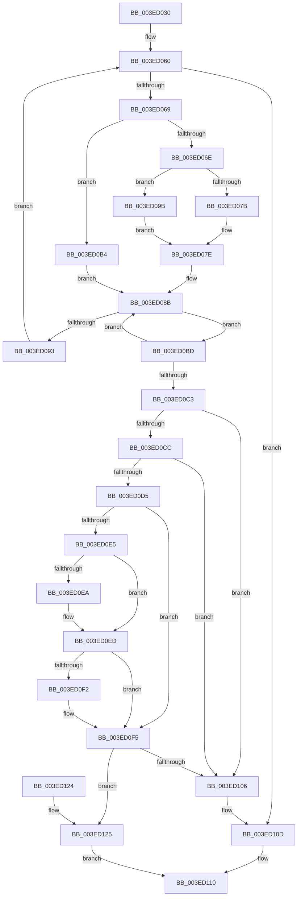

# RtlWeaklyEnumerateEntryHashTable

- RVA: `0x003ED030`–`0x003ED135` (길이 `261` bytes)
- VA: `0x00000001403ED030`
- 실행 섹션: `.text`
- PDB 이름 있음: `예`; PDB Function 태그: `아니요`
- unwind 정보 RVA: `0x000968AC`
- 디코드: `79`개 명령, `261/261` bytes 표시
- 미해석 바이트: `0` (있으면 어셈블리에 `.byte`로 보존)

> 이 문서는 커널 이미지의 기계어와 PDB 기호를 분석해 생성했습니다. 4번과 5번은 함수 원형과 자료형을 바이너리 사용 방식에서 추정한 C 해석이며 원본 소스 복구 결과는 아닙니다.

## 1. Dependencies

- 직접 호출 지점: **0**; 고유 호출 대상: **0**
- 직접 호출자로 확인된 함수: **0**
- RIP 상대 이미지 참조: **0**

### Outgoing calls
- 직접 디코드된 call 명령이 없습니다.

### Direct callers
- 이 함수 시작 RVA로 연결되는 직접 call은 확인되지 않았습니다. 간접 호출은 완전히 역산할 수 없습니다.

### Static image references
- 디코드된 RIP-relative 메모리 참조가 없습니다.

## 2. Other-region calls and transfers

- 다른 실행 섹션으로 향하는 call: **0**
- 별도 외부 분기/꼬리 이동을 확인하지 못했습니다.

## 3. Assembly (complete function range)

```asm
003ED030  48 89 5C 24 10                  mov qword ptr [rsp + 0x10], rbx
003ED035  48 89 6C 24 18                  mov qword ptr [rsp + 0x18], rbp
003ED03A  48 89 74 24 20                  mov qword ptr [rsp + 0x20], rsi
003ED03F  57                              push rdi
003ED040  8B 5A 20                        mov ebx, dword ptr [rdx + 0x20]
003ED043  48 8B F2                        mov rsi, rdx
003ED046  44 8B 59 08                     mov r11d, dword ptr [rcx + 8]
003ED04A  48 8B F9                        mov rdi, rcx
003ED04D  44 8B C3                        mov r8d, ebx
003ED050  33 ED                           xor ebp, ebp
003ED052  44 8D 93 80 00 00 00            lea r10d, [rbx + 0x80]
003ED059  0F 1F 80 00 00 00 00            nop dword ptr [rax]
003ED060  45 3B C3                        cmp r8d, r11d
003ED063  0F 83 A4 00 00 00               jae 0x1403ed10d
003ED069  44 3B C3                        cmp r8d, ebx
003ED06C  74 46                           je 0x1403ed0b4
003ED06E  48 8B 57 20                     mov rdx, qword ptr [rdi + 0x20]
003ED072  41 81 FB 80 00 00 00            cmp r11d, 0x80
003ED079  77 20                           ja 0x1403ed09b
003ED07B  45 8B C8                        mov r9d, r8d
003ED07E  41 8B C1                        mov eax, r9d
003ED081  48 C1 E0 04                     shl rax, 4
003ED085  48 03 C2                        add rax, rdx
003ED088  48 8B D0                        mov rdx, rax
003ED08B  48 8B 12                        mov rdx, qword ptr [rdx]
003ED08E  48 3B D0                        cmp rdx, rax
003ED091  75 2A                           jne 0x1403ed0bd
003ED093  41 FF C0                        inc r8d
003ED096  41 FF C2                        inc r10d
003ED099  EB C5                           jmp 0x1403ed060
003ED09B  41 0F BD CA                     bsr ecx, r10d
003ED09F  41 B9 01 00 00 00               mov r9d, 1
003ED0A5  41 D3 E1                        shl r9d, cl
003ED0A8  45 33 CA                        xor r9d, r10d
003ED0AB  8D 41 F9                        lea eax, [rcx - 7]
003ED0AE  48 8B 14 C2                     mov rdx, qword ptr [rdx + rax*8]
003ED0B2  EB CA                           jmp 0x1403ed07e
003ED0B4  48 8B 46 18                     mov rax, qword ptr [rsi + 0x18]
003ED0B8  48 8B D6                        mov rdx, rsi
003ED0BB  EB CE                           jmp 0x1403ed08b
003ED0BD  48 39 6A 10                     cmp qword ptr [rdx + 0x10], rbp
003ED0C1  74 C8                           je 0x1403ed08b
003ED0C3  48 8B 0E                        mov rcx, qword ptr [rsi]
003ED0C6  48 39 71 08                     cmp qword ptr [rcx + 8], rsi
003ED0CA  75 3A                           jne 0x1403ed106
003ED0CC  4C 8B 4E 08                     mov r9, qword ptr [rsi + 8]
003ED0D0  49 39 31                        cmp qword ptr [r9], rsi
003ED0D3  75 31                           jne 0x1403ed106
003ED0D5  49 89 09                        mov qword ptr [r9], rcx
003ED0D8  4C 89 49 08                     mov qword ptr [rcx + 8], r9
003ED0DC  48 8B 4E 18                     mov rcx, qword ptr [rsi + 0x18]
003ED0E0  48 3B C8                        cmp rcx, rax
003ED0E3  74 10                           je 0x1403ed0f5
003ED0E5  48 39 09                        cmp qword ptr [rcx], rcx
003ED0E8  75 03                           jne 0x1403ed0ed
003ED0EA  FF 4F 18                        dec dword ptr [rdi + 0x18]
003ED0ED  48 39 00                        cmp qword ptr [rax], rax
003ED0F0  75 03                           jne 0x1403ed0f5
003ED0F2  FF 47 18                        inc dword ptr [rdi + 0x18]
003ED0F5  44 89 46 20                     mov dword ptr [rsi + 0x20], r8d
003ED0F9  48 89 46 18                     mov qword ptr [rsi + 0x18], rax
003ED0FD  48 8B 02                        mov rax, qword ptr [rdx]
003ED100  48 39 50 08                     cmp qword ptr [rax + 8], rdx
003ED104  74 1F                           je 0x1403ed125
003ED106  B9 03 00 00 00                  mov ecx, 3
003ED10B  CD 29                           int 0x29
003ED10D  48 8B D5                        mov rdx, rbp
003ED110  48 8B 5C 24 18                  mov rbx, qword ptr [rsp + 0x18]
003ED115  48 8B C2                        mov rax, rdx
003ED118  48 8B 6C 24 20                  mov rbp, qword ptr [rsp + 0x20]
003ED11D  48 8B 74 24 28                  mov rsi, qword ptr [rsp + 0x28]
003ED122  5F                              pop rdi
003ED123  C3                              ret
003ED124  CC                              int3
003ED125  48 89 06                        mov qword ptr [rsi], rax
003ED128  48 89 56 08                     mov qword ptr [rsi + 8], rdx
003ED12C  48 89 70 08                     mov qword ptr [rax + 8], rsi
003ED130  48 89 32                        mov qword ptr [rdx], rsi
003ED133  EB DB                           jmp 0x1403ed110
```

## 4. C-style interpretation (structured pseudocode)

```c
__int64 __fastcall RtlWeaklyEnumerateEntryHashTable(__int64 a1, __int64 a2)
{
    __int64 result;
    __int64 v_r10;
    __int64 v_rbp;
    unsigned __int64 v_stack_p10;
    unsigned __int64 v_stack_p18;
    unsigned __int64 v_stack_p20;

    v_stack_p10 = v_rbx;
    v_stack_p18 = v_rbp;
    v_stack_p20 = v_rsi;
    v_rbp = 0;
loc_003ED060:
    if (((unsigned int)((unsigned int)((unsigned int)((unsigned int)(*(unsigned int *)(a2 + 32)))))) >= ((unsigned int)((unsigned int)(*(unsigned int *)(a1 + 8))))) goto loc_003ED10D;
    if (((unsigned int)((unsigned int)((unsigned int)((unsigned int)(*(unsigned int *)(a2 + 32)))))) == ((unsigned int)((unsigned int)(*(unsigned int *)(a2 + 32))))) goto loc_003ED0B4;
    if (((unsigned int)((unsigned int)(*(unsigned int *)(a1 + 8)))) > 128) goto loc_003ED09B;
loc_003ED07E:
    result = ((unsigned int)((unsigned int)((unsigned int)((unsigned int)((unsigned int)((unsigned int)((unsigned int)(*(unsigned int *)(a2 + 32))))))))) << (4);
    result = (result) + (*(unsigned __int64 *)(a1 + 32));
loc_003ED08B:
    if ((*(unsigned __int64 *)(result)) != result) goto loc_003ED0BD;
    a3 = (unsigned int)(((unsigned int)((unsigned int)((unsigned int)(*(unsigned int *)(a2 + 32))))) + 1);
    v_r10 = (unsigned int)(((unsigned int)(*(unsigned int *)(a2 + 32)) + 128) + 1);
    goto loc_003ED060;
loc_003ED09B:
    a4 = (unsigned int)((1) << ((unsigned __int8)(a1)));
    a4 = (unsigned int)((a4) ^ ((unsigned int)(v_r10)));
    goto loc_003ED07E;
loc_003ED0B4:
    goto loc_003ED08B;
loc_003ED0BD:
    if ((*(unsigned __int64 *)(a2 + 16)) == 0) goto loc_003ED08B;
    if ((*(unsigned __int64 *)(*(unsigned __int64 *)(a2) + 8)) != a2) goto loc_003ED106;
    if ((*(unsigned __int64 *)(*(unsigned __int64 *)(a2 + 8))) != a2) goto loc_003ED106;
    *(unsigned __int64 *)(*(unsigned __int64 *)(a2 + 8)) = *(unsigned __int64 *)(a2);
    *(unsigned __int64 *)(*(unsigned __int64 *)(a2) + 8) = *(unsigned __int64 *)(a2 + 8);
    if ((*(unsigned __int64 *)(a2 + 24)) == (*(unsigned __int64 *)(a2 + 24))) goto loc_003ED0F5;
    if ((*(unsigned __int64 *)(*(unsigned __int64 *)(a2 + 24))) == (*(unsigned __int64 *)(a2 + 24))) {
    }
    if ((*(unsigned __int64 *)(*(unsigned __int64 *)(a2 + 24))) == (*(unsigned __int64 *)(a2 + 24))) {
    }
    *(unsigned int *)(a2 + 32) = (unsigned int)(a3);
    *(unsigned __int64 *)(a2 + 24) = *(unsigned __int64 *)(a2 + 24);
    if ((*(unsigned __int64 *)(*(unsigned __int64 *)(a2) + 8)) == a2) goto loc_003ED125;
loc_003ED106:
loc_003ED10D:
loc_003ED110:
    return 0;
loc_003ED125:
    *(unsigned __int64 *)(v_stack_p20) = 0;
    *(unsigned __int64 *)(v_stack_p20 + 8) = 0;
    *(unsigned __int64 *)(0 + 8) = v_stack_p20;
    *(unsigned __int64 *)(0) = v_stack_p20;
    goto loc_003ED110;
}
```

## 5. (Beta) C Style

```c
int64_t RtlWeaklyEnumerateEntryHashTable(void *Arg1, void *Arg2)
{
    uint8_t *arg1 = (uint8_t *)Arg1;
    uint8_t *arg2 = (uint8_t *)Arg2;

    int64_t result;
    int64_t local_r10;
    int64_t local_rbp;
    uint64_t v_stack_p10;
    uint64_t v_stack_p18;
    uint64_t v_stack_p20;

    v_stack_p10 = local_rbx;
    v_stack_p18 = local_rbp;
    v_stack_p20 = local_rsi;
    local_rbp = 0;
loc_003ED060:
    if (((uint32_t)((uint32_t)((uint32_t)((uint32_t)(*(uint32_t *)(arg2 + 0x20)))))) >= ((uint32_t)((uint32_t)(*(uint32_t *)(arg1 + 0x8))))) goto loc_003ED10D;
    if (((uint32_t)((uint32_t)((uint32_t)((uint32_t)(*(uint32_t *)(arg2 + 0x20)))))) == ((uint32_t)((uint32_t)(*(uint32_t *)(arg2 + 0x20))))) goto loc_003ED0B4;
    if (((uint32_t)((uint32_t)(*(uint32_t *)(arg1 + 0x8)))) > 128) goto loc_003ED09B;
loc_003ED07E:
    result = ((uint32_t)((uint32_t)((uint32_t)((uint32_t)((uint32_t)((uint32_t)((uint32_t)(*(uint32_t *)(arg2 + 0x20))))))))) << (4);
    result = (result) + (*(uint64_t *)(arg1 + 0x20));
loc_003ED08B:
    if ((*(uint64_t *)(result)) != result) goto loc_003ED0BD;
    a3 = (uint32_t)(((uint32_t)((uint32_t)((uint32_t)(*(uint32_t *)(arg2 + 0x20))))) + 1);
    local_r10 = (uint32_t)(((uint32_t)(*(uint32_t *)(arg2 + 0x20)) + 128) + 1);
    goto loc_003ED060;
loc_003ED09B:
    a4 = (uint32_t)((1) << ((uint8_t)(Arg1)));
    a4 = (uint32_t)((a4) ^ ((uint32_t)(local_r10)));
    goto loc_003ED07E;
loc_003ED0B4:
    goto loc_003ED08B;
loc_003ED0BD:
    if ((*(uint64_t *)(arg2 + 0x10)) == 0) goto loc_003ED08B;
    if ((*(uint64_t *)(*(uint64_t *)(arg2) + 0x8)) != Arg2) goto loc_003ED106;
    if ((*(uint64_t *)(*(uint64_t *)(arg2 + 0x8))) != Arg2) goto loc_003ED106;
    *(uint64_t *)(*(uint64_t *)(arg2 + 0x8)) = *(uint64_t *)(arg2);
    *(uint64_t *)(*(uint64_t *)(arg2) + 0x8) = *(uint64_t *)(arg2 + 0x8);
    if ((*(uint64_t *)(arg2 + 0x18)) == (*(uint64_t *)(arg2 + 0x18))) goto loc_003ED0F5;
    if ((*(uint64_t *)(*(uint64_t *)(arg2 + 0x18))) == (*(uint64_t *)(arg2 + 0x18))) {
    }
    if ((*(uint64_t *)(*(uint64_t *)(arg2 + 0x18))) == (*(uint64_t *)(arg2 + 0x18))) {
    }
    *(uint32_t *)(arg2 + 0x20) = (uint32_t)(a3);
    *(uint64_t *)(arg2 + 0x18) = *(uint64_t *)(arg2 + 0x18);
    if ((*(uint64_t *)(*(uint64_t *)(arg2) + 0x8)) == Arg2) goto loc_003ED125;
loc_003ED106:
loc_003ED10D:
loc_003ED110:
    return 0;
loc_003ED125:
    *(uint64_t *)(v_stack_p20) = 0;
    *(uint64_t *)(v_stack_p20 + 0x8) = 0;
    *(uint64_t *)(0 + 0x8) = v_stack_p20;
    *(uint64_t *)(0) = v_stack_p20;
    goto loc_003ED110;
}
```

### 관측된 메모리 오프셋

구조체 형식이 확인되지 않은 접근은 인자 기준의 오프셋으로만 기록했습니다.

| 기준 인자 | 오프셋 표현 | 폭 (bit) | 접근 |
|---|---:|---:|---|
| `Arg1` | `+ 0x8` | `32` | `R` |
| `Arg1` | `+ 0x18` | `32` | `R/W` |
| `Arg1` | `+ 0x20` | `64` | `R` |
| `Arg2` | `+ 0x0` | `64` | `R` |
| `Arg2` | `+ 0x0` | `64` | `W` |
| `Arg2` | `+ 0x8` | `64` | `R` |
| `Arg2` | `+ 0x8` | `64` | `W` |
| `Arg2` | `+ 0x18` | `64` | `R` |
| `Arg2` | `+ 0x18` | `64` | `W` |
| `Arg2` | `+ 0x20` | `32` | `R` |
| `Arg2` | `+ 0x20` | `32` | `W` |

## 6. Execution-region graph

[열기: 2D/3D 그래프와 함수 탐색 컨트롤 패널](../../../control-panel.html?section=text&rva=0x003ED030&view=graph)

- 2D 그래프는 위에서 아래로 흐르고, 3D 그래프는 빈 공간을 드래그해 회전합니다. Shift+드래그는 이동, 휠은 확대·축소, 함수 노드 선택은 대상 보고서 이동입니다.

### Static fallback


