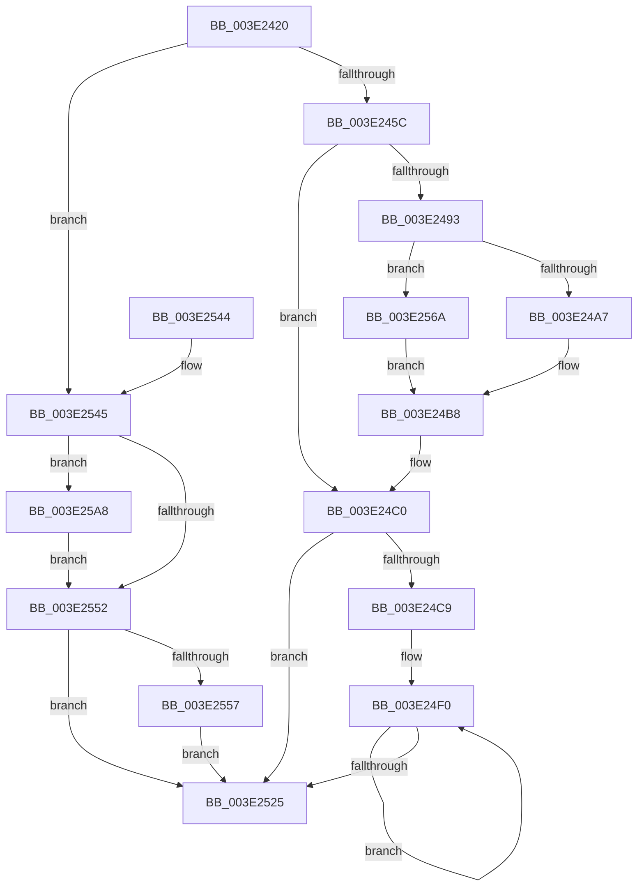

# RtlpCopyBitMapTailToHead

- RVA: `0x003E2420`–`0x003E25D9` (길이 `441` bytes)
- VA: `0x00000001403E2420`
- 실행 섹션: `.text`
- PDB 이름 있음: `예`; PDB Function 태그: `아니요`
- unwind 정보 RVA: `0x00094B98`
- 디코드: `146`개 명령, `441/441` bytes 표시
- 미해석 바이트: `0` (있으면 어셈블리에 `.byte`로 보존)

> 이 문서는 커널 이미지의 기계어와 PDB 기호를 분석해 생성했습니다. 4번과 5번은 함수 원형과 자료형을 바이너리 사용 방식에서 추정한 C 해석이며 원본 소스 복구 결과는 아닙니다.

## 1. Dependencies

- 직접 호출 지점: **1**; 고유 호출 대상: **1**
- 직접 호출자로 확인된 함수: **1**
- RIP 상대 이미지 참조: **0**

### Outgoing calls
- `0x003E2563` → [memcpy](../6C/memcpy_function_006C6840.md) (function, `0x006C6840`)

### Direct callers
- [RtlCopyBitMap](RtlCopyBitMap_function_003E2210.md) at `0x003E2270`

### Static image references
- 디코드된 RIP-relative 메모리 참조가 없습니다.

## 2. Other-region calls and transfers

- 다른 실행 섹션으로 향하는 call: **0**
- 별도 외부 분기/꼬리 이동을 확인하지 못했습니다.

## 3. Assembly (complete function range)

```asm
003E2420  48 8B C4                        mov rax, rsp
003E2423  48 89 58 08                     mov qword ptr [rax + 8], rbx
003E2427  48 89 68 10                     mov qword ptr [rax + 0x10], rbp
003E242B  48 89 70 18                     mov qword ptr [rax + 0x18], rsi
003E242F  48 89 78 20                     mov qword ptr [rax + 0x20], rdi
003E2433  41 54                           push r12
003E2435  41 56                           push r14
003E2437  41 57                           push r15
003E2439  48 83 EC 20                     sub rsp, 0x20
003E243D  41 8B F0                        mov esi, r8d
003E2440  48 8D 59 08                     lea rbx, [rcx + 8]
003E2444  48 C1 EE 03                     shr rsi, 3
003E2448  48 8D 7A 08                     lea rdi, [rdx + 8]
003E244C  45 8B D8                        mov r11d, r8d
003E244F  45 8B D1                        mov r10d, r9d
003E2452  41 F6 C0 07                     test r8b, 7
003E2456  0F 84 E9 00 00 00               je 0x1403e2545
003E245C  48 8B 07                        mov rax, qword ptr [rdi]
003E245F  45 8B C3                        mov r8d, r11d
003E2462  41 8B CA                        mov ecx, r10d
003E2465  49 C1 EB 05                     shr r11, 5
003E2469  49 C1 EA 05                     shr r10, 5
003E246D  BF 20 00 00 00                  mov edi, 0x20
003E2472  4D 03 DA                        add r11, r10
003E2475  41 83 E0 1F                     and r8d, 0x1f
003E2479  83 E1 1F                        and ecx, 0x1f
003E247C  4E 8D 3C 98                     lea r15, [rax + r11*4]
003E2480  48 8B 03                        mov rax, qword ptr [rbx]
003E2483  44 8D 5F E1                     lea r11d, [rdi - 0x1f]
003E2487  49 8B F7                        mov rsi, r15
003E248A  4E 8D 0C 90                     lea r9, [rax + r10*4]
003E248E  48 85 C9                        test rcx, rcx
003E2491  74 2D                           je 0x1403e24c0
003E2493  41 8B 29                        mov ebp, dword ptr [r9]
003E2496  8B DF                           mov ebx, edi
003E2498  49 2B D8                        sub rbx, r8
003E249B  41 8B D3                        mov edx, r11d
003E249E  48 3B CB                        cmp rcx, rbx
003E24A1  0F 87 C3 00 00 00               ja 0x1403e256a
003E24A7  D3 E2                           shl edx, cl
003E24A9  41 8B C8                        mov ecx, r8d
003E24AC  FF CA                           dec edx
003E24AE  8B C2                           mov eax, edx
003E24B0  23 D5                           and edx, ebp
003E24B2  D3 E0                           shl eax, cl
003E24B4  F7 D0                           not eax
003E24B6  D3 E2                           shl edx, cl
003E24B8  41 23 07                        and eax, dword ptr [r15]
003E24BB  0B C2                           or eax, edx
003E24BD  41 89 07                        mov dword ptr [r15], eax
003E24C0  49 83 E9 04                     sub r9, 4
003E24C4  4D 85 D2                        test r10, r10
003E24C7  74 5C                           je 0x1403e2525
003E24C9  41 8B 1F                        mov ebx, dword ptr [r15]
003E24CC  49 2B F8                        sub rdi, r8
003E24CF  48 8B CF                        mov rcx, rdi
003E24D2  45 8B FB                        mov r15d, r11d
003E24D5  41 D3 E7                        shl r15d, cl
003E24D8  45 8B E3                        mov r12d, r11d
003E24DB  49 8B C8                        mov rcx, r8
003E24DE  41 D3 E4                        shl r12d, cl
003E24E1  41 FF CC                        dec r12d
003E24E4  45 8B F4                        mov r14d, r12d
003E24E7  41 8D 6F FF                     lea ebp, [r15 - 1]
003E24EB  41 F7 D6                        not r14d
003E24EE  F7 D5                           not ebp
003E24F0  48 8B CF                        mov rcx, rdi
003E24F3  8B D5                           mov edx, ebp
003E24F5  41 23 11                        and edx, dword ptr [r9]
003E24F8  41 8B C6                        mov eax, r14d
003E24FB  23 C3                           and eax, ebx
003E24FD  D3 EA                           shr edx, cl
003E24FF  0B C2                           or eax, edx
003E2501  49 8B C8                        mov rcx, r8
003E2504  89 06                           mov dword ptr [rsi], eax
003E2506  48 8D 76 FC                     lea rsi, [rsi - 4]
003E250A  8B 1E                           mov ebx, dword ptr [rsi]
003E250C  41 8D 47 FF                     lea eax, [r15 - 1]
003E2510  41 23 01                        and eax, dword ptr [r9]
003E2513  41 23 DC                        and ebx, r12d
003E2516  D3 E0                           shl eax, cl
003E2518  4D 8D 49 FC                     lea r9, [r9 - 4]
003E251C  0B D8                           or ebx, eax
003E251E  89 1E                           mov dword ptr [rsi], ebx
003E2520  4D 2B D3                        sub r10, r11
003E2523  75 CB                           jne 0x1403e24f0
003E2525  48 8B 5C 24 40                  mov rbx, qword ptr [rsp + 0x40]
003E252A  48 8B 6C 24 48                  mov rbp, qword ptr [rsp + 0x48]
003E252F  48 8B 74 24 50                  mov rsi, qword ptr [rsp + 0x50]
003E2534  48 8B 7C 24 58                  mov rdi, qword ptr [rsp + 0x58]
003E2539  48 83 C4 20                     add rsp, 0x20
003E253D  41 5F                           pop r15
003E253F  41 5E                           pop r14
003E2541  41 5C                           pop r12
003E2543  C3                              ret
003E2544  CC                              int3
003E2545  4D 8B CA                        mov r9, r10
003E2548  49 C1 E9 03                     shr r9, 3
003E254C  41 83 E2 07                     and r10d, 7
003E2550  77 56                           ja 0x1403e25a8
003E2552  4D 85 C9                        test r9, r9
003E2555  74 CE                           je 0x1403e2525
003E2557  48 8B 0F                        mov rcx, qword ptr [rdi]
003E255A  4D 8B C1                        mov r8, r9
003E255D  48 8B 13                        mov rdx, qword ptr [rbx]
003E2560  48 03 CE                        add rcx, rsi
003E2563  E8 D8 42 2E 00                  call 0x1406c6840
003E2568  EB BB                           jmp 0x1403e2525
003E256A  80 C1 E0                        add cl, 0xe0
003E256D  41 02 C8                        add cl, r8b
003E2570  D3 E2                           shl edx, cl
003E2572  48 8B CB                        mov rcx, rbx
003E2575  FF CA                           dec edx
003E2577  8B C2                           mov eax, edx
003E2579  F7 D2                           not edx
003E257B  41 23 57 04                     and edx, dword ptr [r15 + 4]
003E257F  D3 E0                           shl eax, cl
003E2581  23 C5                           and eax, ebp
003E2583  D3 E8                           shr eax, cl
003E2585  0B C2                           or eax, edx
003E2587  41 8B D3                        mov edx, r11d
003E258A  D3 E2                           shl edx, cl
003E258C  49 8B C8                        mov rcx, r8
003E258F  41 89 47 04                     mov dword ptr [r15 + 4], eax
003E2593  41 2B D3                        sub edx, r11d
003E2596  41 23 11                        and edx, dword ptr [r9]
003E2599  41 8B C3                        mov eax, r11d
003E259C  D3 E2                           shl edx, cl
003E259E  D3 E0                           shl eax, cl
003E25A0  41 2B C3                        sub eax, r11d
003E25A3  E9 10 FF FF FF                  jmp 0x1403e24b8
003E25A8  48 8B 03                        mov rax, qword ptr [rbx]
003E25AB  41 BB 01 00 00 00               mov r11d, 1
003E25B1  4C 8B 07                        mov r8, qword ptr [rdi]
003E25B4  49 8B CA                        mov rcx, r10
003E25B7  4C 03 C6                        add r8, rsi
003E25BA  41 8B D3                        mov edx, r11d
003E25BD  D2 E2                           shl dl, cl
003E25BF  41 8A 0C 01                     mov cl, byte ptr [r9 + rax]
003E25C3  41 2A D3                        sub dl, r11b
003E25C6  22 CA                           and cl, dl
003E25C8  F6 D2                           not dl
003E25CA  43 22 14 08                     and dl, byte ptr [r8 + r9]
003E25CE  0A D1                           or dl, cl
003E25D0  43 88 14 08                     mov byte ptr [r8 + r9], dl
003E25D4  E9 79 FF FF FF                  jmp 0x1403e2552
```

## 4. C-style interpretation (structured pseudocode)

```c
__int64 __fastcall RtlpCopyBitMapTailToHead(__int64 a1, __int64 a2, int a3, int a4)
{
    __int64 result;
    __int64 v_r10;
    __int64 v_r11;
    __int64 v_r12;
    __int64 v_r14;
    __int64 v_r15;
    __int64 v_rbp;
    __int64 v_rbx;
    __int64 v_rdi;
    __int64 v_rsi;
    __int64 v_rsp;
    unsigned __int64 v_stack_p10;
    unsigned __int64 v_stack_p18;
    unsigned __int64 v_stack_p20;
    unsigned __int64 v_stack_p8;

    *(unsigned __int64 *)(v_rsp + 8) = v_rbx;
    *(unsigned __int64 *)(v_rsp + 16) = v_rbp;
    *(unsigned __int64 *)(v_rsp + 24) = v_rsi;
    *(unsigned __int64 *)(v_rsp + 32) = v_rdi;
    v_rsp = (v_rsp) - (32);
    v_rsi = ((unsigned int)(a3)) >> (3);
    if ((((unsigned __int8)(a3)) & (7)) == 0) goto loc_003E2545;
    v_r11 = ((unsigned int)(a3)) >> (5);
    v_r10 = ((unsigned int)(a4)) >> (5);
    v_r11 = (v_r11) + (v_r10);
    a3 = (unsigned int)(((unsigned int)((unsigned int)((unsigned int)(a3)))) & (31));
    a1 = (unsigned int)(((unsigned int)((unsigned int)((unsigned int)(a4)))) & (31));
    if (a1 == 0) goto loc_003E24C0;
    v_rbx = (32) - (a3);
    if (a1 > v_rbx) goto loc_003E256A;
    a2 = (unsigned int)(((unsigned int)((unsigned int)(32 - 31))) << ((unsigned __int8)(a1)));
    a2 = (unsigned int)((a2) - 1);
    a2 = (unsigned int)((a2) & ((unsigned int)((unsigned int)(*(unsigned int *)(*(unsigned __int64 *)(a1 + 8) + v_r10 * 4)))));
    result = (unsigned int)(((unsigned int)((unsigned int)(a2))) << ((unsigned __int8)((unsigned int)(a3))));
    result = (unsigned int)(~(result));
    a2 = (unsigned int)((a2) << ((unsigned __int8)((unsigned int)(a3))));
loc_003E24B8:
    result = (unsigned int)((result) & (*(unsigned int *)(*(unsigned __int64 *)(a2 + 8) + v_r11 * 4)));
    result = (unsigned int)((result) | ((unsigned int)(a2)));
    *(unsigned int *)(*(unsigned __int64 *)(a2 + 8) + v_r11 * 4) = (unsigned int)(result);
loc_003E24C0:
    a4 = (*(unsigned __int64 *)(a1 + 8) + v_r10 * 4) - (4);
    if (v_r10 == 0) goto loc_003E2525;
    v_rdi = (32) - (a3);
    v_r15 = (unsigned int)(((unsigned int)((unsigned int)(32 - 31))) << ((unsigned __int8)(v_rdi)));
    v_r12 = (unsigned int)(((unsigned int)((unsigned int)(32 - 31))) << ((unsigned __int8)(a3)));
    v_r12 = (unsigned int)((v_r12) - 1);
    v_r14 = (unsigned int)(~((unsigned int)((unsigned int)(v_r12))));
    v_rbp = (unsigned int)(~(v_r15 - 1));
loc_003E24F0:
    a2 = (unsigned int)(((unsigned int)((unsigned int)(v_rbp))) & (*(unsigned int *)(a4)));
    result = (unsigned int)(((unsigned int)((unsigned int)(v_r14))) & ((unsigned int)((unsigned int)(*(unsigned int *)(*(unsigned __int64 *)(a2 + 8) + v_r11 * 4)))));
    a2 = (unsigned int)((a2) >> ((unsigned __int8)(v_rdi)));
    result = (unsigned int)((result) | ((unsigned int)(a2)));
    *(unsigned int *)(*(unsigned __int64 *)(a2 + 8) + v_r11 * 4) = (unsigned int)(result);
    result = (unsigned int)((v_r15 - 1) & (*(unsigned int *)(a4)));
    v_rbx = (unsigned int)(((unsigned int)(*(unsigned int *)(*(unsigned __int64 *)(a2 + 8) + v_r11 * 4 - 4))) & ((unsigned int)(v_r12)));
    result = (unsigned int)((result) << ((unsigned __int8)(a3)));
    v_rbx = (unsigned int)((v_rbx) | ((unsigned int)(result)));
    *(unsigned int *)(*(unsigned __int64 *)(a2 + 8) + v_r11 * 4 - 4) = (unsigned int)(v_rbx);
    v_r10 = (v_r10) - (32 - 31);
    if (condition_is_not_equal) goto loc_003E24F0;
loc_003E2525:
    v_rsp = (v_rsp) + (32);
    return result;
loc_003E2545:
    a4 = (v_r10) >> (3);
    v_r10 = (unsigned int)((v_r10) & (7));
    if (condition_is_above) goto loc_003E25A8;
loc_003E2552:
    if (a4 == 0) goto loc_003E2525;
    a1 = (*(unsigned __int64 *)(v_stack_p20)) + (v_stack_p18);
    result = memcpy(a1, *(unsigned __int64 *)(v_stack_p8), a4, a4);
    goto loc_003E2525;
loc_003E256A:
    a1 = (unsigned __int8)((a1) + (224));
    a1 = (unsigned __int8)((a1) + ((unsigned __int8)(a4)));
    a2 = (unsigned int)((*(unsigned __int64 *)(v_stack_p8)) << ((unsigned __int8)(a1)));
    a2 = (unsigned int)((a2) - 1);
    a2 = (unsigned int)(~(a2));
    a2 = (unsigned int)((a2) & (*(unsigned int *)(v_r15 + 4)));
    result = (unsigned int)(((unsigned int)((unsigned int)(a2))) << ((unsigned __int8)(v_stack_p8)));
    result = (unsigned int)((result) & ((unsigned int)(v_stack_p10)));
    result = (unsigned int)((result) >> ((unsigned __int8)(v_stack_p8)));
    result = (unsigned int)((result) | ((unsigned int)(a2)));
    a2 = (unsigned int)(((unsigned int)((unsigned int)(32 - 31))) << ((unsigned __int8)(v_stack_p8)));
    *(unsigned int *)(v_r15 + 4) = (unsigned int)(result);
    a2 = (unsigned int)((a2) - ((unsigned int)(32 - 31)));
    a2 = (unsigned int)((a2) & (*(unsigned int *)(a4)));
    a2 = (unsigned int)((a2) << ((unsigned __int8)(a4)));
    result = (unsigned int)(((unsigned int)((unsigned int)(32 - 31))) << ((unsigned __int8)(a4)));
    result = (unsigned int)((result) - ((unsigned int)(32 - 31)));
    goto loc_003E24B8;
loc_003E25A8:
    a3 = (*(unsigned __int64 *)(v_stack_p20)) + (v_stack_p18);
    a2 = (unsigned __int8)((1) << ((unsigned __int8)(v_r10)));
    a2 = (unsigned __int8)((a2) - (1));
    a1 = (unsigned __int8)((*(unsigned __int8 *)(a4 + *(unsigned __int64 *)(v_stack_p8) * 1)) & ((unsigned __int8)(a2)));
    a2 = (unsigned __int8)(~(a2));
    a2 = (unsigned __int8)((a2) & (*(unsigned __int8 *)(a3 + a4 * 1)));
    a2 = (unsigned __int8)((a2) | ((unsigned __int8)(a1)));
    *(unsigned __int8 *)(a3 + a4 * 1) = (unsigned __int8)(a2);
    goto loc_003E2552;
}
```

## 5. (Beta) C Style

```c
int64_t RtlpCopyBitMapTailToHead(void *Arg1, void *Arg2, int32_t Arg3, int32_t Arg4)
{
    uint8_t *arg1 = (uint8_t *)Arg1;
    uint8_t *arg2 = (uint8_t *)Arg2;

    int64_t result;
    int64_t local_r10;
    int64_t local_r11;
    int64_t local_r12;
    int64_t local_r14;
    int64_t local_r15;
    int64_t local_rbp;
    int64_t local_rbx;
    int64_t local_rdi;
    int64_t local_rsi;
    int64_t local_rsp;
    uint64_t v_stack_p10;
    uint64_t v_stack_p18;
    uint64_t v_stack_p20;
    uint64_t v_stack_p8;

    *(uint64_t *)(local_rsp + 0x8) = local_rbx;
    *(uint64_t *)(local_rsp + 0x10) = local_rbp;
    *(uint64_t *)(local_rsp + 0x18) = local_rsi;
    *(uint64_t *)(local_rsp + 0x20) = local_rdi;
    local_rsp = (local_rsp) - (32);
    local_rsi = ((uint32_t)(Arg3)) >> (3);
    if ((((uint8_t)(Arg3)) & (7)) == 0) goto loc_003E2545;
    local_r11 = ((uint32_t)(Arg3)) >> (5);
    local_r10 = ((uint32_t)(Arg4)) >> (5);
    local_r11 = (local_r11) + (local_r10);
    Arg3 = (uint32_t)(((uint32_t)((uint32_t)((uint32_t)(Arg3)))) & (31));
    Arg1 = (uint32_t)(((uint32_t)((uint32_t)((uint32_t)(Arg4)))) & (31));
    if (Arg1 == NULL) goto loc_003E24C0;
    local_rbx = (32) - (Arg3);
    if (Arg1 > local_rbx) goto loc_003E256A;
    Arg2 = (uint32_t)(((uint32_t)((uint32_t)(32 - 31))) << ((uint8_t)(Arg1)));
    Arg2 = (uint32_t)((Arg2) - 1);
    Arg2 = (uint32_t)((Arg2) & ((uint32_t)((uint32_t)(*(uint32_t *)(*(uint64_t *)(arg1 + 0x8) + local_r10 * 4)))));
    result = (uint32_t)(((uint32_t)((uint32_t)(Arg2))) << ((uint8_t)((uint32_t)(Arg3))));
    result = (uint32_t)(~(result));
    Arg2 = (uint32_t)((Arg2) << ((uint8_t)((uint32_t)(Arg3))));
loc_003E24B8:
    result = (uint32_t)((result) & (*(uint32_t *)(*(uint64_t *)(arg2 + 0x8) + local_r11 * 4)));
    result = (uint32_t)((result) | ((uint32_t)(Arg2)));
    *(uint32_t *)(*(uint64_t *)(arg2 + 0x8) + local_r11 * 4) = (uint32_t)(result);
loc_003E24C0:
    Arg4 = (*(uint64_t *)(arg1 + 0x8) + local_r10 * 4) - (4);
    if (local_r10 == 0) goto loc_003E2525;
    local_rdi = (32) - (Arg3);
    local_r15 = (uint32_t)(((uint32_t)((uint32_t)(32 - 31))) << ((uint8_t)(local_rdi)));
    local_r12 = (uint32_t)(((uint32_t)((uint32_t)(32 - 31))) << ((uint8_t)(Arg3)));
    local_r12 = (uint32_t)((local_r12) - 1);
    local_r14 = (uint32_t)(~((uint32_t)((uint32_t)(local_r12))));
    local_rbp = (uint32_t)(~(local_r15 - 1));
loc_003E24F0:
    Arg2 = (uint32_t)(((uint32_t)((uint32_t)(local_rbp))) & (*(uint32_t *)(Arg4)));
    result = (uint32_t)(((uint32_t)((uint32_t)(local_r14))) & ((uint32_t)((uint32_t)(*(uint32_t *)(*(uint64_t *)(arg2 + 0x8) + local_r11 * 4)))));
    Arg2 = (uint32_t)((Arg2) >> ((uint8_t)(local_rdi)));
    result = (uint32_t)((result) | ((uint32_t)(Arg2)));
    *(uint32_t *)(*(uint64_t *)(arg2 + 0x8) + local_r11 * 4) = (uint32_t)(result);
    result = (uint32_t)((local_r15 - 1) & (*(uint32_t *)(Arg4)));
    local_rbx = (uint32_t)(((uint32_t)(*(uint32_t *)(*(uint64_t *)(arg2 + 0x8) + local_r11 * 4 - 0x4))) & ((uint32_t)(local_r12)));
    result = (uint32_t)((result) << ((uint8_t)(Arg3)));
    local_rbx = (uint32_t)((local_rbx) | ((uint32_t)(result)));
    *(uint32_t *)(*(uint64_t *)(arg2 + 0x8) + local_r11 * 4 - 0x4) = (uint32_t)(local_rbx);
    local_r10 = (local_r10) - (32 - 31);
    if (condition_is_not_equal) goto loc_003E24F0;
loc_003E2525:
    local_rsp = (local_rsp) + (32);
    return result;
loc_003E2545:
    Arg4 = (local_r10) >> (3);
    local_r10 = (uint32_t)((local_r10) & (7));
    if (condition_is_above) goto loc_003E25A8;
loc_003E2552:
    if (Arg4 == 0) goto loc_003E2525;
    Arg1 = (*(uint64_t *)(v_stack_p20)) + (v_stack_p18);
    result = memcpy(Arg1, *(uint64_t *)(v_stack_p8), Arg4, Arg4);
    goto loc_003E2525;
loc_003E256A:
    Arg1 = (uint8_t)((Arg1) + (224));
    Arg1 = (uint8_t)((Arg1) + ((uint8_t)(Arg4)));
    Arg2 = (uint32_t)((*(uint64_t *)(v_stack_p8)) << ((uint8_t)(Arg1)));
    Arg2 = (uint32_t)((Arg2) - 1);
    Arg2 = (uint32_t)(~(Arg2));
    Arg2 = (uint32_t)((Arg2) & (*(uint32_t *)(local_r15 + 0x4)));
    result = (uint32_t)(((uint32_t)((uint32_t)(Arg2))) << ((uint8_t)(v_stack_p8)));
    result = (uint32_t)((result) & ((uint32_t)(v_stack_p10)));
    result = (uint32_t)((result) >> ((uint8_t)(v_stack_p8)));
    result = (uint32_t)((result) | ((uint32_t)(Arg2)));
    Arg2 = (uint32_t)(((uint32_t)((uint32_t)(32 - 31))) << ((uint8_t)(v_stack_p8)));
    *(uint32_t *)(local_r15 + 0x4) = (uint32_t)(result);
    Arg2 = (uint32_t)((Arg2) - ((uint32_t)(32 - 31)));
    Arg2 = (uint32_t)((Arg2) & (*(uint32_t *)(Arg4)));
    Arg2 = (uint32_t)((Arg2) << ((uint8_t)(Arg4)));
    result = (uint32_t)(((uint32_t)((uint32_t)(32 - 31))) << ((uint8_t)(Arg4)));
    result = (uint32_t)((result) - ((uint32_t)(32 - 31)));
    goto loc_003E24B8;
loc_003E25A8:
    Arg3 = (*(uint64_t *)(v_stack_p20)) + (v_stack_p18);
    Arg2 = (uint8_t)((1) << ((uint8_t)(local_r10)));
    Arg2 = (uint8_t)((Arg2) - (1));
    Arg1 = (uint8_t)((*(uint8_t *)(Arg4 + *(uint64_t *)(v_stack_p8) * 1)) & ((uint8_t)(Arg2)));
    Arg2 = (uint8_t)(~(Arg2));
    Arg2 = (uint8_t)((Arg2) & (*(uint8_t *)(Arg3 + Arg4 * 1)));
    Arg2 = (uint8_t)((Arg2) | ((uint8_t)(Arg1)));
    *(uint8_t *)(Arg3 + Arg4 * 1) = (uint8_t)(Arg2);
    goto loc_003E2552;
}
```

### 관측된 메모리 오프셋

구조체 형식이 확인되지 않은 접근은 인자 기준의 오프셋으로만 기록했습니다.

| 기준 인자 | 오프셋 표현 | 폭 (bit) | 접근 |
|---|---:|---:|---|
| `Arg1` | `+ 0x0` | `64` | `R` |
| `Arg1` | `+ 0x8` | `64` | `R` |
| `Arg2` | `+ 0x0` | `64` | `R` |
| `Arg2` | `+ 0x8` | `64` | `R` |

## 6. Execution-region graph

[열기: 2D/3D 그래프와 함수 탐색 컨트롤 패널](../../../control-panel.html?section=text&rva=0x003E2420&view=graph)

- 2D 그래프는 위에서 아래로 흐르고, 3D 그래프는 빈 공간을 드래그해 회전합니다. Shift+드래그는 이동, 휠은 확대·축소, 함수 노드 선택은 대상 보고서 이동입니다.

### Static fallback


