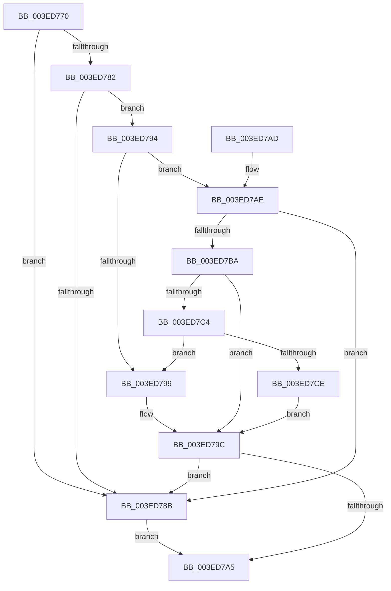

# RtlpValidTrustSubjectContext

- RVA: `0x003ED770`–`0x003ED7D0` (길이 `96` bytes)
- VA: `0x00000001403ED770`
- 실행 섹션: `.text`
- PDB 이름 있음: `예`; PDB Function 태그: `아니요`
- unwind 정보 RVA: `0x00096940`
- 디코드: `32`개 명령, `96/96` bytes 표시
- 미해석 바이트: `0` (있으면 어셈블리에 `.byte`로 보존)

> 이 문서는 커널 이미지의 기계어와 PDB 기호를 분석해 생성했습니다. 4번과 5번은 함수 원형과 자료형을 바이너리 사용 방식에서 추정한 C 해석이며 원본 소스 복구 결과는 아닙니다.

## 1. Dependencies

- 직접 호출 지점: **2**; 고유 호출 대상: **1**
- 직접 호출자로 확인된 함수: **4**
- RIP 상대 이미지 참조: **0**

### Outgoing calls
- `0x003ED782` → [RtlIsValidProcessTrustLabelSid](RtlIsValidProcessTrustLabelSid_function_003EE070.md) (function, `0x003EE070`)
- `0x003ED7B1` → [RtlIsValidProcessTrustLabelSid](RtlIsValidProcessTrustLabelSid_function_003EE070.md) (function, `0x003EE070`)

### Direct callers
- [sub_008BBC01](../../page/8B/Unknown_function_008BBC01.md) at `0x008BC1E7`
- [sub_008BC3C4](../../page/8B/Unknown_function_008BC3C4.md) at `0x008BC6DE`
- [RtlpValidFilterAclSubjectContext](../../page/8B/RtlpValidFilterAclSubjectContext_function_008BCE60.md) at `0x008BCEF7`
- [RtlpNewSecurityObject](../../page/92/RtlpNewSecurityObject_function_0092AB50.md) at `0x0092CB58`
- [RtlpNewSecurityObject](../../page/92/RtlpNewSecurityObject_function_0092AB50.md) at `0x0092CCF5`

### Static image references
- 디코드된 RIP-relative 메모리 참조가 없습니다.

## 2. Other-region calls and transfers

- 다른 실행 섹션으로 향하는 call: **0**
- 별도 외부 분기/꼬리 이동을 확인하지 못했습니다.

## 3. Assembly (complete function range)

```asm
003ED770  48 83 EC 28                     sub rsp, 0x28
003ED774  45 32 C0                        xor r8b, r8b
003ED777  4C 8B D2                        mov r10, rdx
003ED77A  4C 8B D9                        mov r11, rcx
003ED77D  48 85 C9                        test rcx, rcx
003ED780  74 09                           je 0x1403ed78b
003ED782  E8 E9 08 00 00                  call 0x1403ee070
003ED787  84 C0                           test al, al
003ED789  75 09                           jne 0x1403ed794
003ED78B  41 C7 01 22 00 00 C0            mov dword ptr [r9], 0xc0000022
003ED792  EB 11                           jmp 0x1403ed7a5
003ED794  4D 85 D2                        test r10, r10
003ED797  75 15                           jne 0x1403ed7ae
003ED799  41 B0 01                        mov r8b, 1
003ED79C  41 83 21 00                     and dword ptr [r9], 0
003ED7A0  45 84 C0                        test r8b, r8b
003ED7A3  74 E6                           je 0x1403ed78b
003ED7A5  41 8A C0                        mov al, r8b
003ED7A8  48 83 C4 28                     add rsp, 0x28
003ED7AC  C3                              ret
003ED7AD  CC                              int3
003ED7AE  49 8B CA                        mov rcx, r10
003ED7B1  E8 BA 08 00 00                  call 0x1403ee070
003ED7B6  84 C0                           test al, al
003ED7B8  74 D1                           je 0x1403ed78b
003ED7BA  41 8B 42 08                     mov eax, dword ptr [r10 + 8]
003ED7BE  41 39 43 08                     cmp dword ptr [r11 + 8], eax
003ED7C2  72 D8                           jb 0x1403ed79c
003ED7C4  41 8B 42 0C                     mov eax, dword ptr [r10 + 0xc]
003ED7C8  41 39 43 0C                     cmp dword ptr [r11 + 0xc], eax
003ED7CC  73 CB                           jae 0x1403ed799
003ED7CE  EB CC                           jmp 0x1403ed79c
```

## 4. C-style interpretation (structured pseudocode)

```c
__int64 __fastcall RtlpValidTrustSubjectContext(__int64 a1, __int64 a2, unsigned __int8 a3, __int64 a4)
{
    __int64 result;
    __int64 v_rsp;

    v_rsp = (v_rsp) - (40);
    a3 = 0;
    if (a1 == 0) goto loc_003ED78B;
    result = RtlIsValidProcessTrustLabelSid(a1, a2, a3, a4);
    if ((unsigned __int8)(result) != 0) goto loc_003ED794;
loc_003ED78B:
    *(unsigned int *)(a4) = 0xC0000022ULL;
    goto loc_003ED7A5;
loc_003ED794:
    if (a2 != 0) goto loc_003ED7AE;
loc_003ED799:
loc_003ED79C:
    if (1 == 0) goto loc_003ED78B;
loc_003ED7A5:
    v_rsp = (v_rsp) + (40);
    return 1;
loc_003ED7AE:
    result = RtlIsValidProcessTrustLabelSid(a2, a2, 1, a4);
    if ((unsigned __int8)(result) == 0) goto loc_003ED78B;
    if ((*(unsigned int *)(a1 + 8)) < ((unsigned int)((unsigned int)(*(unsigned int *)(a2 + 8))))) goto loc_003ED79C;
    if ((*(unsigned int *)(a1 + 12)) >= ((unsigned int)((unsigned int)(*(unsigned int *)(a2 + 12))))) goto loc_003ED799;
    goto loc_003ED79C;
}
```

## 5. (Beta) C Style

```c
int64_t RtlpValidTrustSubjectContext(int64_t Arg1, int64_t Arg2, uint8_t Arg3, int64_t Arg4)
{
    int64_t result;
    int64_t local_rsp;

    local_rsp = (local_rsp) - (40);
    Arg3 = 0;
    if (Arg1 == 0) goto loc_003ED78B;
    result = RtlIsValidProcessTrustLabelSid(Arg1, Arg2, Arg3, Arg4);
    if ((uint8_t)(result) != 0) goto loc_003ED794;
loc_003ED78B:
    *(uint32_t *)(Arg4) = 0xC0000022ULL;
    goto loc_003ED7A5;
loc_003ED794:
    if (Arg2 != 0) goto loc_003ED7AE;
loc_003ED799:
loc_003ED79C:
    if (1 == 0) goto loc_003ED78B;
loc_003ED7A5:
    local_rsp = (local_rsp) + (40);
    return 1;
loc_003ED7AE:
    result = RtlIsValidProcessTrustLabelSid(Arg2, Arg2, 1, Arg4);
    if ((uint8_t)(result) == 0) goto loc_003ED78B;
    if ((*(uint32_t *)(Arg1 + 0x8)) < ((uint32_t)((uint32_t)(*(uint32_t *)(Arg2 + 0x8))))) goto loc_003ED79C;
    if ((*(uint32_t *)(Arg1 + 0xC)) >= ((uint32_t)((uint32_t)(*(uint32_t *)(Arg2 + 0xC))))) goto loc_003ED799;
    goto loc_003ED79C;
}
```

## 6. Execution-region graph

[열기: 2D/3D 그래프와 함수 탐색 컨트롤 패널](../../../control-panel.html?section=text&rva=0x003ED770&view=graph)

- 2D 그래프는 위에서 아래로 흐르고, 3D 그래프는 빈 공간을 드래그해 회전합니다. Shift+드래그는 이동, 휠은 확대·축소, 함수 노드 선택은 대상 보고서 이동입니다.

### Static fallback


