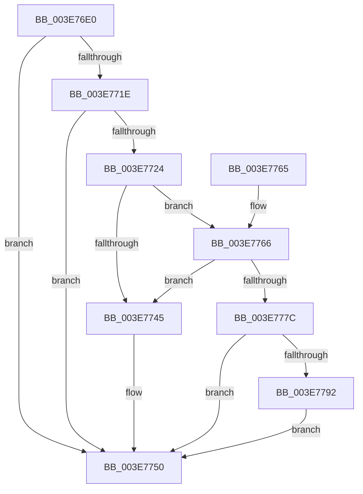

# SMKM_STORE&lt;SM_TRAITS&gt;::SmStUnmapPhysicalRegion

- RVA: `0x003E76E0`–`0x003E77A6` (길이 `198` bytes)
- VA: `0x00000001403E76E0`
- 실행 섹션: `.text`
- PDB 이름 있음: `예`; PDB Function 태그: `아니요`
- unwind 정보 RVA: `0x000676D8`
- 디코드: `55`개 명령, `198/198` bytes 표시
- 미해석 바이트: `0` (있으면 어셈블리에 `.byte`로 보존)

> 이 문서는 커널 이미지의 기계어와 PDB 기호를 분석해 생성했습니다. 4번과 5번은 함수 원형과 자료형을 바이너리 사용 방식에서 추정한 C 해석이며 원본 소스 복구 결과는 아닙니다.

## 1. Dependencies

- 직접 호출 지점: **4**; 고유 호출 대상: **4**
- 직접 호출자로 확인된 함수: **4**
- RIP 상대 이미지 참조: **0**

### Outgoing calls
- `0x003E774B` → [MmUnmapLockedPages](../24/MmUnmapLockedPages_function_00246E60.md) (function, `0x00246E60`)
- `0x003E7771` → [SmpFpReleaseResource](../4F/SmpFpReleaseResource_function_004FAC90.md) (function, `0x004FAC90`)
- `0x003E7787` → [MmUnmapReservedMapping](MmUnmapReservedMapping_function_003E7BE0.md) (function, `0x003E7BE0`)
- `0x003E779F` → [KeSetEvent](../33/KeSetEvent_function_0033F310.md) (function, `0x0033F310`)

### Direct callers
- [ST_STORE&lt;SM_TRAITS&gt;::StUnlockAndUnmapRegion](../34/ST_STORE_SM_TRAITS_StUnlockAndUnmapRegion_function_0034C7F0.md) at `0x0034C867`
- [ST_STORE&lt;SM_TRAITS&gt;::StUnlockAndUnmapRegion](../34/ST_STORE_SM_TRAITS_StUnlockAndUnmapRegion_function_0034C7F0.md) at `0x0034C86E`
- [sub_0034CBA6](../34/Unknown_function_0034CBA6.md) at `0x0034CBE4`
- [SMKM_STORE&lt;SM_TRAITS&gt;::SmStCompareRegionDataCallback](../34/SMKM_STORE_SM_TRAITS_SmStCompareRegionDataCallback_function_0034D390.md) at `0x0034D716`
- [SMKM_STORE&lt;SM_TRAITS&gt;::SmStCompareRegionDataCallback](../34/SMKM_STORE_SM_TRAITS_SmStCompareRegionDataCallback_function_0034D390.md) at `0x0034D720`
- [ST_STORE&lt;SM_TRAITS&gt;::StMapAndLockRegion](../4E/ST_STORE_SM_TRAITS_StMapAndLockRegion_function_004EC090.md) at `0x004EC1F2`

### Static image references
- 디코드된 RIP-relative 메모리 참조가 없습니다.

## 2. Other-region calls and transfers

- 다른 실행 섹션으로 향하는 call: **0**
- 별도 외부 분기/꼬리 이동을 확인하지 못했습니다.

## 3. Assembly (complete function range)

```asm
003E76E0  48 89 5C 24 08                  mov qword ptr [rsp + 8], rbx
003E76E5  48 89 6C 24 10                  mov qword ptr [rsp + 0x10], rbp
003E76EA  48 89 74 24 18                  mov qword ptr [rsp + 0x18], rsi
003E76EF  57                              push rdi
003E76F0  48 83 EC 20                     sub rsp, 0x20
003E76F4  8B 44 24 58                     mov eax, dword ptr [rsp + 0x58]
003E76F8  44 8B C2                        mov r8d, edx
003E76FB  24 04                           and al, 4
003E76FD  48 8B 91 68 1B 00 00            mov rdx, qword ptr [rcx + 0x1b68]
003E7704  F6 D8                           neg al
003E7706  4D 1B C9                        sbb r9, r9
003E7709  49 83 C1 FE                     add r9, -2
003E770D  4A 8B 3C C2                     mov rdi, qword ptr [rdx + r8*8]
003E7711  4C 23 CF                        and r9, rdi
003E7714  4E 89 0C C2                     mov qword ptr [rdx + r8*8], r9
003E7718  41 F6 C1 02                     test r9b, 2
003E771C  75 32                           jne 0x1403e7750
003E771E  41 F6 C1 01                     test r9b, 1
003E7722  75 2C                           jne 0x1403e7750
003E7724  65 48 8B 14 25 88 01 00 00      mov rdx, qword ptr gs:[0x188]
003E772D  48 8D 99 18 1D 00 00            lea rbx, [rcx + 0x1d18]
003E7734  48 8B 43 70                     mov rax, qword ptr [rbx + 0x70]
003E7738  48 83 E7 F8                     and rdi, 0xfffffffffffffff8
003E773C  48 8B 6F 18                     mov rbp, qword ptr [rdi + 0x18]
003E7740  48 3B C2                        cmp rax, rdx
003E7743  74 21                           je 0x1403e7766
003E7745  48 8B D7                        mov rdx, rdi
003E7748  48 8B CD                        mov rcx, rbp
003E774B  E8 10 F7 E5 FF                  call 0x140246e60
003E7750  48 8B 5C 24 30                  mov rbx, qword ptr [rsp + 0x30]
003E7755  48 8B 6C 24 38                  mov rbp, qword ptr [rsp + 0x38]
003E775A  48 8B 74 24 40                  mov rsi, qword ptr [rsp + 0x40]
003E775F  48 83 C4 20                     add rsp, 0x20
003E7763  5F                              pop rdi
003E7764  C3                              ret
003E7765  CC                              int3
003E7766  4C 8B C5                        mov r8, rbp
003E7769  BA 05 00 00 00                  mov edx, 5
003E776E  48 8B CB                        mov rcx, rbx
003E7771  E8 1A 35 11 00                  call 0x1404fac90
003E7776  33 F6                           xor esi, esi
003E7778  85 C0                           test eax, eax
003E777A  74 C9                           je 0x1403e7745
003E777C  4C 8B C7                        mov r8, rdi
003E777F  BA 73 6D 52 6D                  mov edx, 0x6d526d73
003E7784  48 8B CD                        mov rcx, rbp
003E7787  E8 54 04 00 00                  call 0x1403e7be0
003E778C  40 38 73 5E                     cmp byte ptr [rbx + 0x5e], sil
003E7790  75 BE                           jne 0x1403e7750
003E7792  48 87 73 70                     xchg qword ptr [rbx + 0x70], rsi
003E7796  48 8D 4B 08                     lea rcx, [rbx + 8]
003E779A  45 33 C0                        xor r8d, r8d
003E779D  33 D2                           xor edx, edx
003E779F  E8 6C 7B F5 FF                  call 0x14033f310
003E77A4  EB AA                           jmp 0x1403e7750
```

## 4. C-style interpretation (structured pseudocode)

```c
__int64 __fastcall SMKM_STORE_SM_TRAITS___SmStUnmapPhysicalRegion(__int64 a1, int a2, __int64 a3, __int64 a4, __int64 a5, unsigned int a6)
{
    __int64 result;
    __int64 v_rdi;
    __int64 v_rsi;
    __int64 v_rsp;
    unsigned __int64 v_stack_p10;
    unsigned __int64 v_stack_p18;
    unsigned __int64 v_stack_p8;

    v_stack_p8 = v_rbx;
    v_stack_p10 = v_rbp;
    v_stack_p18 = v_rsi;
    v_rsp = (v_rsp) - (32);
    result = (unsigned __int8)(((unsigned int)(a6)) & (4));
    result = (unsigned __int8)(-(result));
    a4 = (a4) + (-2);
    a4 = (a4) & (*(unsigned __int64 *)(*(unsigned __int64 *)(a1 + 7016) + (unsigned int)(a2) * 8));
    *(unsigned __int64 *)(*(unsigned __int64 *)(a1 + 7016) + (unsigned int)(a2) * 8) = a4;
    if ((((unsigned __int8)(a4)) & (2)) != 0) goto loc_003E7750;
    if ((((unsigned __int8)(a4)) & (1)) != 0) goto loc_003E7750;
    v_rdi = (*(unsigned __int64 *)(*(unsigned __int64 *)(a1 + 7016) + (unsigned int)(a2) * 8)) & (-8);
    if ((*(unsigned __int64 *)(a1 + 7448 + 112)) == (*(unsigned __int64 *)(gs_base + (0 + 392)))) goto loc_003E7766;
loc_003E7745:
    result = MmUnmapLockedPages(*(unsigned __int64 *)(v_rdi + 24), v_rdi, (unsigned int)(a2), a4);
loc_003E7750:
    v_rsp = (v_rsp) + (32);
    return result;
loc_003E7766:
    result = SmpFpReleaseResource(v_stack_p8, 5, v_stack_p10, a4);
    v_rsi = 0;
    if ((unsigned int)(result) == 0) goto loc_003E7745;
    result = MmUnmapReservedMapping(v_stack_p10, (unsigned int)(0x6D526D73ULL), v_rdi, a4);
    if ((*(unsigned __int8 *)(v_stack_p8 + 94)) != 0) goto loc_003E7750;
    a3 = 0;
    a2 = 0;
    result = KeSetEvent(v_stack_p8 + 8, a2, a3, a4);
    goto loc_003E7750;
}
```

## 5. (Beta) C Style

```c
int64_t SMKM_STORE_SM_TRAITS___SmStUnmapPhysicalRegion(void *Arg1, int32_t Arg2, int64_t Arg3, int64_t Arg4, uint64_t Arg5, uint32_t Arg6)
{
    uint8_t *arg1 = (uint8_t *)Arg1;

    int64_t result;
    int64_t local_rdi;
    int64_t local_rsi;
    int64_t local_rsp;
    uint64_t v_stack_p10;
    uint64_t v_stack_p18;
    uint64_t v_stack_p8;

    v_stack_p8 = local_rbx;
    v_stack_p10 = local_rbp;
    v_stack_p18 = local_rsi;
    local_rsp = (local_rsp) - (32);
    result = (uint8_t)(((uint32_t)(Arg6)) & (4));
    result = (uint8_t)(-(result));
    Arg4 = (Arg4) + (-2);
    Arg4 = (Arg4) & (*(uint64_t *)(*(uint64_t *)(arg1 + 0x1B68) + (uint32_t)(Arg2) * 8));
    *(uint64_t *)(*(uint64_t *)(arg1 + 0x1B68) + (uint32_t)(Arg2) * 8) = Arg4;
    if ((((uint8_t)(Arg4)) & (2)) != 0) goto loc_003E7750;
    if ((((uint8_t)(Arg4)) & (1)) != 0) goto loc_003E7750;
    local_rdi = (*(uint64_t *)(*(uint64_t *)(arg1 + 0x1B68) + (uint32_t)(Arg2) * 8)) & (-8);
    if ((*(uint64_t *)(arg1 + 0x1D18 + 0x70)) == (*(uint64_t *)(gs_base + (0 + 0x188)))) goto loc_003E7766;
loc_003E7745:
    result = MmUnmapLockedPages(*(uint64_t *)(local_rdi + 0x18), local_rdi, (uint32_t)(Arg2), Arg4);
loc_003E7750:
    local_rsp = (local_rsp) + (32);
    return result;
loc_003E7766:
    result = SmpFpReleaseResource(v_stack_p8, 5, v_stack_p10, Arg4);
    local_rsi = 0;
    if ((uint32_t)(result) == 0) goto loc_003E7745;
    result = MmUnmapReservedMapping(v_stack_p10, (uint32_t)(0x6D526D73ULL), local_rdi, Arg4);
    if ((*(uint8_t *)(v_stack_p8 + 0x5E)) != 0) goto loc_003E7750;
    Arg3 = 0;
    Arg2 = 0;
    result = KeSetEvent(v_stack_p8 + 8, Arg2, Arg3, Arg4);
    goto loc_003E7750;
}
```

### 관측된 메모리 오프셋

구조체 형식이 확인되지 않은 접근은 인자 기준의 오프셋으로만 기록했습니다.

| 기준 인자 | 오프셋 표현 | 폭 (bit) | 접근 |
|---|---:|---:|---|
| `Arg1` | `+ 0x8` | `64` | `R` |
| `Arg1` | `+ 0x5E` | `8` | `R` |
| `Arg1` | `+ 0x70` | `64` | `R` |
| `Arg1` | `+ 0x70` | `64` | `R/W` |
| `Arg1` | `+ 0x1B68` | `64` | `R` |
| `Arg1` | `+ 0x1D18` | `64` | `R` |

## 6. Execution-region graph

[열기: 2D/3D 그래프와 함수 탐색 컨트롤 패널](../../../control-panel.html?section=text&rva=0x003E76E0&view=graph)

- 2D 그래프는 위에서 아래로 흐르고, 3D 그래프는 빈 공간을 드래그해 회전합니다. Shift+드래그는 이동, 휠은 확대·축소, 함수 노드 선택은 대상 보고서 이동입니다.

### Static fallback


