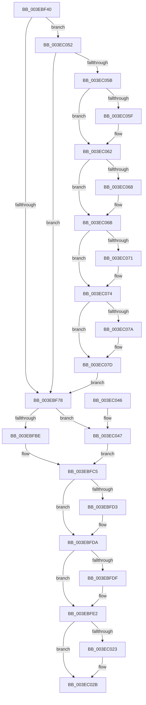

# SepCreateAccessStateFromSubjectContext

- RVA: `0x003EBF40`–`0x003EC088` (길이 `328` bytes)
- VA: `0x00000001403EBF40`
- 실행 섹션: `.text`
- PDB 이름 있음: `예`; PDB Function 태그: `아니요`
- unwind 정보 RVA: `0x00095B28`
- 디코드: `86`개 명령, `328/328` bytes 표시
- 미해석 바이트: `0` (있으면 어셈블리에 `.byte`로 보존)

> 이 문서는 커널 이미지의 기계어와 PDB 기호를 분석해 생성했습니다. 4번과 5번은 함수 원형과 자료형을 바이너리 사용 방식에서 추정한 C 해석이며 원본 소스 복구 결과는 아닙니다.

## 1. Dependencies

- 직접 호출 지점: **2**; 고유 호출 대상: **1**
- 직접 호출자로 확인된 함수: **11**
- RIP 상대 이미지 참조: **2**

### Outgoing calls
- `0x003EBF83` → [memset](../6C/memset_function_006C6C40.md) (function, `0x006C6C40`)
- `0x003EBF93` → [memset](../6C/memset_function_006C6C40.md) (function, `0x006C6C40`)

### Direct callers
- [sub_0089A903](../../page/89/Unknown_function_0089A903.md) at `0x0089AA2D`
- [PspCombineSecurityDomains](../../page/8A/PspCombineSecurityDomains_function_008A18C0.md) at `0x008A19E4`
- [PspCombineSecurityDomains](../../page/8A/PspCombineSecurityDomains_function_008A18C0.md) at `0x008A1AD4`
- [PspOneDirectionSecurityDomainCombine](../../page/8A/PspOneDirectionSecurityDomainCombine_function_008A23BC.md) at `0x008A24C2`
- [sub_008B4B26](../../page/8B/Unknown_function_008B4B26.md) at `0x008B4BF2`
- [sub_008B756E](../../page/8B/Unknown_function_008B756E.md) at `0x008B7591`
- [ObInsertObjectEx](../../page/8B/ObInsertObjectEx_function_008B97A0.md) at `0x008B99EE`
- [ObReferenceObjectByName](../../page/8C/ObReferenceObjectByName_function_008C4A00.md) at `0x008C4B28`
- [sub_008C6B47](../../page/8C/Unknown_function_008C6B47.md) at `0x008C6B5A`
- [sub_00947AF7](../../page/94/Unknown_function_00947AF7.md) at `0x00947B17`
- [SeCreateAccessStateFromSubjectContext](../../page/A8/SeCreateAccessStateFromSubjectContext_function_00A8B12C.md) at `0x00A8B173`
- [SeSubProcessToken](../../page/AA/SeSubProcessToken_function_00AAD570.md) at `0x00AADD40`

### Static image references
- `0x003EBFE8` → RVA `0x00012D08` (`.rdata`; read)
- `0x003EC007` → RVA `0x00E0EBF0` (`.data`; read/write)

## 2. Other-region calls and transfers

- 다른 실행 섹션으로 향하는 call: **0**
- 별도 외부 분기/꼬리 이동을 확인하지 못했습니다.

## 3. Assembly (complete function range)

```asm
003EBF40  48 89 5C 24 08                  mov qword ptr [rsp + 8], rbx
003EBF45  48 89 6C 24 10                  mov qword ptr [rsp + 0x10], rbp
003EBF4A  48 89 74 24 18                  mov qword ptr [rsp + 0x18], rsi
003EBF4F  48 89 7C 24 20                  mov qword ptr [rsp + 0x20], rdi
003EBF54  41 56                           push r14
003EBF56  48 83 EC 20                     sub rsp, 0x20
003EBF5A  48 8B 6C 24 50                  mov rbp, qword ptr [rsp + 0x50]
003EBF5F  41 8B F9                        mov edi, r9d
003EBF62  49 8B F0                        mov rsi, r8
003EBF65  48 8B DA                        mov rbx, rdx
003EBF68  4C 8B F1                        mov r14, rcx
003EBF6B  41 F7 C1 00 00 00 F0            test r9d, 0xf0000000
003EBF72  0F 85 DA 00 00 00               jne 0x1403ec052
003EBF78  33 D2                           xor edx, edx
003EBF7A  41 B8 A0 00 00 00               mov r8d, 0xa0
003EBF80  48 8B CB                        mov rcx, rbx
003EBF83  E8 B8 AC 2D 00                  call 0x1406c6c40
003EBF88  33 D2                           xor edx, edx
003EBF8A  41 B8 E0 00 00 00               mov r8d, 0xe0
003EBF90  48 8B CE                        mov rcx, rsi
003EBF93  E8 A8 AC 2D 00                  call 0x1406c6c40
003EBF98  48 89 73 48                     mov qword ptr [rbx + 0x48], rsi
003EBF9C  48 8D 53 30                     lea rdx, [rbx + 0x30]
003EBFA0  41 0F 10 06                     movups xmm0, xmmword ptr [r14]
003EBFA4  0F 11 43 20                     movups xmmword ptr [rbx + 0x20], xmm0
003EBFA8  41 0F 10 4E 10                  movups xmm1, xmmword ptr [r14 + 0x10]
003EBFAD  0F 11 4B 30                     movups xmmword ptr [rbx + 0x30], xmm1
003EBFB1  48 8B 4B 20                     mov rcx, qword ptr [rbx + 0x20]
003EBFB5  48 85 C9                        test rcx, rcx
003EBFB8  0F 85 89 00 00 00               jne 0x1403ec047
003EBFBE  4C 8B 43 30                     mov r8, qword ptr [rbx + 0x30]
003EBFC2  49 8B C0                        mov rax, r8
003EBFC5  8B 40 48                        mov eax, dword ptr [rax + 0x48]
003EBFC8  41 23 40 40                     and eax, dword ptr [r8 + 0x40]
003EBFCC  48 0F BA E0 17                  bt rax, 0x17
003EBFD1  73 07                           jae 0x1403ebfda
003EBFD3  C7 43 0C 01 00 00 00            mov dword ptr [rbx + 0xc], 1
003EBFDA  48 85 C9                        test rcx, rcx
003EBFDD  75 03                           jne 0x1403ebfe2
003EBFDF  48 8B 0A                        mov rcx, qword ptr [rdx]
003EBFE2  8B 81 C8 00 00 00               mov eax, dword ptr [rcx + 0xc8]
003EBFE8  48 8B 0D 19 6D C2 FF            mov rcx, qword ptr [rip - 0x3d92e7]
003EBFEF  25 10 08 00 00                  and eax, 0x810
003EBFF4  09 43 0C                        or dword ptr [rbx + 0xc], eax
003EBFF7  48 8D 43 50                     lea rax, [rbx + 0x50]
003EBFFB  89 7B 10                        mov dword ptr [rbx + 0x10], edi
003EBFFE  89 7B 18                        mov dword ptr [rbx + 0x18], edi
003EC001  48 89 06                        mov qword ptr [rsi], rax
003EC004  48 8B C1                        mov rax, rcx
003EC007  F0 48 0F C1 05 E0 2B A2 00      lock xadd qword ptr [rip + 0xa22be0], rax
003EC010  48 03 C1                        add rax, rcx
003EC013  89 03                           mov dword ptr [rbx], eax
003EC015  48 C1 E8 20                     shr rax, 0x20
003EC019  89 43 04                        mov dword ptr [rbx + 4], eax
003EC01C  33 C0                           xor eax, eax
003EC01E  48 85 ED                        test rbp, rbp
003EC021  74 08                           je 0x1403ec02b
003EC023  0F 10 45 00                     movups xmm0, xmmword ptr [rbp]
003EC027  0F 11 46 08                     movups xmmword ptr [rsi + 8], xmm0
003EC02B  48 8B 5C 24 30                  mov rbx, qword ptr [rsp + 0x30]
003EC030  48 8B 6C 24 38                  mov rbp, qword ptr [rsp + 0x38]
003EC035  48 8B 74 24 40                  mov rsi, qword ptr [rsp + 0x40]
003EC03A  48 8B 7C 24 48                  mov rdi, qword ptr [rsp + 0x48]
003EC03F  48 83 C4 20                     add rsp, 0x20
003EC043  41 5E                           pop r14
003EC045  C3                              ret
003EC046  CC                              int3
003EC047  48 8B C1                        mov rax, rcx
003EC04A  4C 8B C1                        mov r8, rcx
003EC04D  E9 73 FF FF FF                  jmp 0x1403ebfc5
003EC052  48 85 ED                        test rbp, rbp
003EC055  0F 84 1D FF FF FF               je 0x1403ebf78
003EC05B  85 FF                           test edi, edi
003EC05D  79 03                           jns 0x1403ec062
003EC05F  0B 7D 00                        or edi, dword ptr [rbp]
003EC062  0F BA E7 1E                     bt edi, 0x1e
003EC066  73 03                           jae 0x1403ec06b
003EC068  0B 7D 04                        or edi, dword ptr [rbp + 4]
003EC06B  0F BA E7 1D                     bt edi, 0x1d
003EC06F  73 03                           jae 0x1403ec074
003EC071  0B 7D 08                        or edi, dword ptr [rbp + 8]
003EC074  0F BA E7 1C                     bt edi, 0x1c
003EC078  73 03                           jae 0x1403ec07d
003EC07A  0B 7D 0C                        or edi, dword ptr [rbp + 0xc]
003EC07D  81 E7 FF FF FF 0F               and edi, 0xfffffff
003EC083  E9 F0 FE FF FF                  jmp 0x1403ebf78
```

## 4. C-style interpretation (structured pseudocode)

```c
__int64 __fastcall SepCreateAccessStateFromSubjectContext(__int64 a1, __int64 a2, __int64 a3, int a4, __int64 a5)
{
    __int64 result;
    __int64 v_rdi;
    __int64 v_rsp;
    unsigned __int64 v_stack_p10;
    unsigned __int64 v_stack_p18;
    unsigned __int64 v_stack_p20;
    unsigned __int64 v_stack_p8;

    v_stack_p8 = v_rbx;
    v_stack_p10 = v_rbp;
    v_stack_p18 = v_rsi;
    v_stack_p20 = v_rdi;
    v_rsp = (v_rsp) - (32);
    if (((a4) & (0xF0000000ULL)) != 0) goto loc_003EC052;
loc_003EBF78:
    a2 = 0;
    result = memset(0, a2, 160, a4);
    a2 = 0;
    result = memset(a3, a2, 224, a4);
    *(unsigned __int64 *)(a2 + 72) = a3;
    *(unsigned __int64 *)(a2 + 32) = v_xmm0;
    *(unsigned __int64 *)(a2 + 48) = v_xmm1;
    if (*(unsigned __int64 *)(a2 + 32) != 0) goto loc_003EC047;
loc_003EBFC5:
    result = (unsigned int)(((unsigned int)(*(unsigned int *)(*(unsigned __int64 *)(a2 + 48) + 72))) & (*(unsigned int *)(*(unsigned __int64 *)(a2 + 48) + 64)));
    if (!(condition_is_above_or_equal)) {
        *(unsigned int *)(a2 + 12) = 1;
    }
    if (*(unsigned __int64 *)(a2 + 32) == 0) {
        a1 = *(unsigned __int64 *)(a2 + 48);
    }
    result = (unsigned int)(((unsigned int)(*(unsigned int *)(a1 + 200))) & (0x810ULL));
    *(unsigned int *)(a2 + 16) = (unsigned int)((unsigned int)(a4));
    *(unsigned int *)(a2 + 24) = (unsigned int)((unsigned int)(a4));
    *(unsigned __int64 *)(a3) = a2 + 80;
    result = (*(unsigned __int64 *)(v_rip - 4035303)) + (*(unsigned __int64 *)(v_rip - 4035303));
    *(unsigned int *)(a2) = (unsigned int)(result);
    result = (result) >> (32);
    *(unsigned int *)(a2 + 4) = (unsigned int)(result);
    result = 0;
    if (a5 != 0) {
        *(unsigned __int64 *)(a3 + 8) = v_xmm0;
    }
    v_rsp = (v_rsp) + (32);
    return result;
loc_003EC047:
    goto loc_003EBFC5;
loc_003EC052:
    if (v_stack_p10 == 0) goto loc_003EBF78;
    v_rdi = v_stack_p20;
    if (sign_flag) {
        v_rdi = (unsigned int)((v_stack_p20) | (*(unsigned int *)(v_stack_p10)));
    }
    if (!(condition_is_above_or_equal)) {
        v_rdi = (unsigned int)((v_rdi) | (*(unsigned int *)(v_stack_p10 + 4)));
    }
    if (!(condition_is_above_or_equal)) {
        v_rdi = (unsigned int)((v_rdi) | (*(unsigned int *)(v_stack_p10 + 8)));
    }
    if (!(condition_is_above_or_equal)) {
        v_rdi = (unsigned int)((v_rdi) | (*(unsigned int *)(v_stack_p10 + 12)));
    }
    v_rdi = (unsigned int)((v_rdi) & (0xFFFFFFFULL));
    goto loc_003EBF78;
}
```

## 5. (Beta) C Style

```c
int64_t SepCreateAccessStateFromSubjectContext(void *Arg1, void *Arg2, void *Arg3, int32_t Arg4, int64_t Arg5)
{
    uint8_t *arg1 = (uint8_t *)Arg1;
    uint8_t *arg2 = (uint8_t *)Arg2;
    uint8_t *arg3 = (uint8_t *)Arg3;

    int64_t result;
    int64_t local_rdi;
    int64_t local_rsp;
    uint64_t v_stack_p10;
    uint64_t v_stack_p18;
    uint64_t v_stack_p20;
    uint64_t v_stack_p8;

    v_stack_p8 = local_rbx;
    v_stack_p10 = local_rbp;
    v_stack_p18 = local_rsi;
    v_stack_p20 = local_rdi;
    local_rsp = (local_rsp) - (32);
    if (((Arg4) & (0xF0000000ULL)) != 0) goto loc_003EC052;
loc_003EBF78:
    Arg2 = 0;
    result = memset(0, Arg2, 160, Arg4);
    Arg2 = 0;
    result = memset(Arg3, Arg2, 224, Arg4);
    *(void **)(arg2 + 0x48) = Arg3;
    *(uint64_t *)(arg2 + 0x20) = v_xmm0;
    *(uint64_t *)(arg2 + 0x30) = v_xmm1;
    if (*(uint64_t *)(arg2 + 0x20) != 0) goto loc_003EC047;
loc_003EBFC5:
    result = (uint32_t)(((uint32_t)(*(uint32_t *)(*(uint64_t *)(arg2 + 0x30) + 0x48))) & (*(uint32_t *)(*(uint64_t *)(arg2 + 0x30) + 0x40)));
    if (!(condition_is_above_or_equal)) {
        *(uint32_t *)(arg2 + 0xC) = 1;
    }
    if (*(uint64_t *)(arg2 + 0x20) == 0) {
        Arg1 = *(uint64_t *)(arg2 + 0x30);
    }
    result = (uint32_t)(((uint32_t)(*(uint32_t *)(arg1 + 0xC8))) & (0x810ULL));
    *(uint32_t *)(arg2 + 0x10) = (uint32_t)((uint32_t)(Arg4));
    *(uint32_t *)(arg2 + 0x18) = (uint32_t)((uint32_t)(Arg4));
    *(void **)(arg3) = Arg2 + 80;
    result = (*(uint64_t *)(v_rip - 0x3D92E7)) + (*(uint64_t *)(v_rip - 0x3D92E7));
    *(uint32_t *)(arg2) = (uint32_t)(result);
    result = (result) >> (32);
    *(uint32_t *)(arg2 + 0x4) = (uint32_t)(result);
    result = 0;
    if (Arg5 != 0) {
        *(uint64_t *)(arg3 + 0x8) = v_xmm0;
    }
    local_rsp = (local_rsp) + (32);
    return result;
loc_003EC047:
    goto loc_003EBFC5;
loc_003EC052:
    if (v_stack_p10 == 0) goto loc_003EBF78;
    local_rdi = v_stack_p20;
    if (sign_flag) {
        local_rdi = (uint32_t)((v_stack_p20) | (*(uint32_t *)(v_stack_p10)));
    }
    if (!(condition_is_above_or_equal)) {
        local_rdi = (uint32_t)((local_rdi) | (*(uint32_t *)(v_stack_p10 + 0x4)));
    }
    if (!(condition_is_above_or_equal)) {
        local_rdi = (uint32_t)((local_rdi) | (*(uint32_t *)(v_stack_p10 + 0x8)));
    }
    if (!(condition_is_above_or_equal)) {
        local_rdi = (uint32_t)((local_rdi) | (*(uint32_t *)(v_stack_p10 + 0xC)));
    }
    local_rdi = (uint32_t)((local_rdi) & (0xFFFFFFFULL));
    goto loc_003EBF78;
}
```

### 관측된 메모리 오프셋

구조체 형식이 확인되지 않은 접근은 인자 기준의 오프셋으로만 기록했습니다.

| 기준 인자 | 오프셋 표현 | 폭 (bit) | 접근 |
|---|---:|---:|---|
| `Arg1` | `+ 0x0` | `128` | `R` |
| `Arg1` | `+ 0x10` | `128` | `R` |
| `Arg2` | `+ 0x0` | `32` | `W` |
| `Arg2` | `+ 0x0` | `64` | `R` |
| `Arg2` | `+ 0x4` | `32` | `W` |
| `Arg2` | `+ 0xC` | `32` | `R/W` |
| `Arg2` | `+ 0xC` | `32` | `W` |
| `Arg2` | `+ 0x10` | `32` | `W` |
| `Arg2` | `+ 0x18` | `32` | `W` |
| `Arg2` | `+ 0x20` | `64` | `R` |
| `Arg2` | `+ 0x20` | `128` | `R` |
| `Arg2` | `+ 0x30` | `64` | `R` |
| `Arg2` | `+ 0x30` | `128` | `R` |
| `Arg2` | `+ 0x48` | `64` | `W` |
| `Arg2` | `+ 0x50` | `64` | `R` |
| `Arg3` | `+ 0x0` | `64` | `W` |
| `Arg3` | `+ 0x8` | `128` | `R` |

## 6. Execution-region graph

[열기: 2D/3D 그래프와 함수 탐색 컨트롤 패널](../../../control-panel.html?section=text&rva=0x003EBF40&view=graph)

- 2D 그래프는 위에서 아래로 흐르고, 3D 그래프는 빈 공간을 드래그해 회전합니다. Shift+드래그는 이동, 휠은 확대·축소, 함수 노드 선택은 대상 보고서 이동입니다.

### Static fallback


