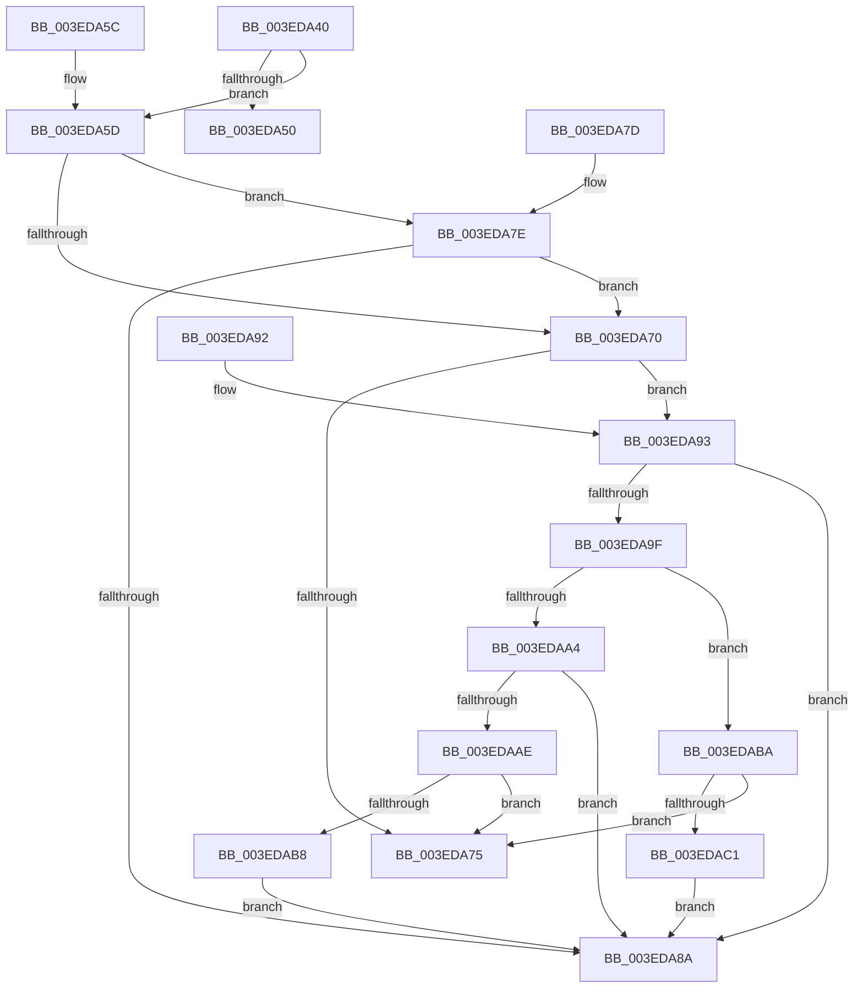

# SepLocateTokenTrustLevel

- RVA: `0x003EDA40`–`0x003EDAC3` (길이 `131` bytes)
- VA: `0x00000001403EDA40`
- 실행 섹션: `.text`
- PDB 이름 있음: `예`; PDB Function 태그: `아니요`
- unwind 정보 RVA: `0x00096968`
- 디코드: `43`개 명령, `131/131` bytes 표시
- 미해석 바이트: `0` (있으면 어셈블리에 `.byte`로 보존)

> 이 문서는 커널 이미지의 기계어와 PDB 기호를 분석해 생성했습니다. 4번과 5번은 함수 원형과 자료형을 바이너리 사용 방식에서 추정한 C 해석이며 원본 소스 복구 결과는 아닙니다.

## 1. Dependencies

- 직접 호출 지점: **2**; 고유 호출 대상: **1**
- 직접 호출자로 확인된 함수: **8**
- RIP 상대 이미지 참조: **0**

### Outgoing calls
- `0x003EDA81` → [RtlIsValidProcessTrustLabelSid](RtlIsValidProcessTrustLabelSid_function_003EE070.md) (function, `0x003EE070`)
- `0x003EDA96` → [RtlIsValidProcessTrustLabelSid](RtlIsValidProcessTrustLabelSid_function_003EE070.md) (function, `0x003EE070`)

### Direct callers
- [SeAccessCheckWithHint](../3A/SeAccessCheckWithHint_function_003A6C30.md) at `0x003A7677`
- [SeAccessCheckWithHint](../3A/SeAccessCheckWithHint_function_003A6C30.md) at `0x003A773A`
- [SepCommonAccessCheckEx](../47/SepCommonAccessCheckEx_function_0047602C.md) at `0x00476342`
- [SepCommonAccessCheckEx](../47/SepCommonAccessCheckEx_function_0047602C.md) at `0x00477284`
- [sub_008BBC01](../../page/8B/Unknown_function_008BBC01.md) at `0x008BBDC8`
- [RtlpNewSecurityObject](../../page/92/RtlpNewSecurityObject_function_0092AB50.md) at `0x0092AD90`
- [sub_00947EF9](../../page/94/Unknown_function_00947EF9.md) at `0x00947F06`
- [sub_009A911A](../../page/9A/Unknown_function_009A911A.md) at `0x009A912C`
- [SeShouldCheckForAccessRightsFromParent](../../page/9C/SeShouldCheckForAccessRightsFromParent_function_009C40D0.md) at `0x009C4113`
- [SepAccessCheckAndAuditAlarm](../../page/A1/SepAccessCheckAndAuditAlarm_function_00A1AF4C.md) at `0x00A1CF15`

### Static image references
- 디코드된 RIP-relative 메모리 참조가 없습니다.

## 2. Other-region calls and transfers

- 다른 실행 섹션으로 향하는 call: **0**
- 별도 외부 분기/꼬리 이동을 확인하지 못했습니다.

## 3. Assembly (complete function range)

```asm
003EDA40  48 83 EC 28                     sub rsp, 0x28
003EDA44  4C 8B 09                        mov r9, qword ptr [rcx]
003EDA47  4C 8B 41 10                     mov r8, qword ptr [rcx + 0x10]
003EDA4B  4D 85 C9                        test r9, r9
003EDA4E  75 0D                           jne 0x1403eda5d
003EDA50  49 8B 80 50 04 00 00            mov rax, qword ptr [r8 + 0x450]
003EDA57  48 83 C4 28                     add rsp, 0x28
003EDA5B  C3                              ret
003EDA5C  CC                              int3
003EDA5D  4D 8B 98 50 04 00 00            mov r11, qword ptr [r8 + 0x450]
003EDA64  4D 8B 91 50 04 00 00            mov r10, qword ptr [r9 + 0x450]
003EDA6B  4D 85 DB                        test r11, r11
003EDA6E  75 0E                           jne 0x1403eda7e
003EDA70  4D 85 D2                        test r10, r10
003EDA73  75 1E                           jne 0x1403eda93
003EDA75  49 8B C2                        mov rax, r10
003EDA78  48 83 C4 28                     add rsp, 0x28
003EDA7C  C3                              ret
003EDA7D  CC                              int3
003EDA7E  49 8B CB                        mov rcx, r11
003EDA81  E8 EA 05 00 00                  call 0x1403ee070
003EDA86  84 C0                           test al, al
003EDA88  75 E6                           jne 0x1403eda70
003EDA8A  49 8B C3                        mov rax, r11
003EDA8D  48 83 C4 28                     add rsp, 0x28
003EDA91  C3                              ret
003EDA92  CC                              int3
003EDA93  49 8B CA                        mov rcx, r10
003EDA96  E8 D5 05 00 00                  call 0x1403ee070
003EDA9B  84 C0                           test al, al
003EDA9D  74 EB                           je 0x1403eda8a
003EDA9F  4D 85 DB                        test r11, r11
003EDAA2  74 16                           je 0x1403edaba
003EDAA4  41 8B 42 08                     mov eax, dword ptr [r10 + 8]
003EDAA8  41 39 43 08                     cmp dword ptr [r11 + 8], eax
003EDAAC  72 DC                           jb 0x1403eda8a
003EDAAE  41 8B 42 0C                     mov eax, dword ptr [r10 + 0xc]
003EDAB2  41 39 43 0C                     cmp dword ptr [r11 + 0xc], eax
003EDAB6  73 BD                           jae 0x1403eda75
003EDAB8  EB D0                           jmp 0x1403eda8a
003EDABA  41 83 7A 08 00                  cmp dword ptr [r10 + 8], 0
003EDABF  76 B4                           jbe 0x1403eda75
003EDAC1  EB C7                           jmp 0x1403eda8a
```

## 4. C-style interpretation (structured pseudocode)

```c
__int64 __fastcall SepLocateTokenTrustLevel(__int64 a1)
{
    __int64 result;
    __int64 v_rsp;

    v_rsp = (v_rsp) - (40);
    if (*(unsigned __int64 *)(a1) != 0) goto loc_003EDA5D;
    v_rsp = (v_rsp) + (40);
    return *(unsigned __int64 *)(*(unsigned __int64 *)(a1 + 16) + 1104);
loc_003EDA5D:
    if (*(unsigned __int64 *)(*(unsigned __int64 *)(a1 + 16) + 1104) != 0) goto loc_003EDA7E;
loc_003EDA70:
    if (*(unsigned __int64 *)(*(unsigned __int64 *)(a1) + 1104) != 0) goto loc_003EDA93;
loc_003EDA75:
    v_rsp = (v_rsp) + (40);
    return *(unsigned __int64 *)(*(unsigned __int64 *)(a1) + 1104);
loc_003EDA7E:
    result = RtlIsValidProcessTrustLabelSid(*(unsigned __int64 *)(*(unsigned __int64 *)(a1 + 16) + 1104), a2, *(unsigned __int64 *)(a1 + 16), *(unsigned __int64 *)(a1));
    if ((unsigned __int8)(result) != 0) goto loc_003EDA70;
loc_003EDA8A:
    v_rsp = (v_rsp) + (40);
    return *(unsigned __int64 *)(*(unsigned __int64 *)(a1 + 16) + 1104);
loc_003EDA93:
    result = RtlIsValidProcessTrustLabelSid(*(unsigned __int64 *)(*(unsigned __int64 *)(a1) + 1104), a2, *(unsigned __int64 *)(a1 + 16), *(unsigned __int64 *)(a1));
    if ((unsigned __int8)(result) == 0) goto loc_003EDA8A;
    if (*(unsigned __int64 *)(*(unsigned __int64 *)(a1 + 16) + 1104) == 0) goto loc_003EDABA;
    if ((*(unsigned int *)(*(unsigned __int64 *)(*(unsigned __int64 *)(a1 + 16) + 1104) + 8)) < ((unsigned int)((unsigned int)(*(unsigned int *)(*(unsigned __int64 *)(*(unsigned __int64 *)(a1) + 1104) + 8))))) goto loc_003EDA8A;
    if ((*(unsigned int *)(*(unsigned __int64 *)(*(unsigned __int64 *)(a1 + 16) + 1104) + 12)) >= ((unsigned int)((unsigned int)(*(unsigned int *)(*(unsigned __int64 *)(*(unsigned __int64 *)(a1) + 1104) + 12))))) goto loc_003EDA75;
    goto loc_003EDA8A;
loc_003EDABA:
    if ((*(unsigned int *)(*(unsigned __int64 *)(*(unsigned __int64 *)(a1) + 1104) + 8)) <= 0) goto loc_003EDA75;
    goto loc_003EDA8A;
}
```

## 5. (Beta) C Style

```c
int64_t SepLocateTokenTrustLevel(void *Arg1)
{
    uint8_t *arg1 = (uint8_t *)Arg1;

    int64_t result;
    int64_t local_rsp;

    local_rsp = (local_rsp) - (40);
    if (*(uint64_t *)(arg1) != 0) goto loc_003EDA5D;
    local_rsp = (local_rsp) + (40);
    return *(uint64_t *)(*(uint64_t *)(arg1 + 0x10) + 0x450);
loc_003EDA5D:
    if (*(uint64_t *)(*(uint64_t *)(arg1 + 0x10) + 0x450) != 0) goto loc_003EDA7E;
loc_003EDA70:
    if (*(uint64_t *)(*(uint64_t *)(arg1) + 0x450) != 0) goto loc_003EDA93;
loc_003EDA75:
    local_rsp = (local_rsp) + (40);
    return *(uint64_t *)(*(uint64_t *)(arg1) + 0x450);
loc_003EDA7E:
    result = RtlIsValidProcessTrustLabelSid(*(uint64_t *)(*(uint64_t *)(arg1 + 0x10) + 0x450), a2, *(uint64_t *)(arg1 + 0x10), *(uint64_t *)(arg1));
    if ((uint8_t)(result) != 0) goto loc_003EDA70;
loc_003EDA8A:
    local_rsp = (local_rsp) + (40);
    return *(uint64_t *)(*(uint64_t *)(arg1 + 0x10) + 0x450);
loc_003EDA93:
    result = RtlIsValidProcessTrustLabelSid(*(uint64_t *)(*(uint64_t *)(arg1) + 0x450), a2, *(uint64_t *)(arg1 + 0x10), *(uint64_t *)(arg1));
    if ((uint8_t)(result) == 0) goto loc_003EDA8A;
    if (*(uint64_t *)(*(uint64_t *)(arg1 + 0x10) + 0x450) == 0) goto loc_003EDABA;
    if ((*(uint32_t *)(*(uint64_t *)(*(uint64_t *)(arg1 + 0x10) + 0x450) + 0x8)) < ((uint32_t)((uint32_t)(*(uint32_t *)(*(uint64_t *)(*(uint64_t *)(arg1) + 0x450) + 0x8))))) goto loc_003EDA8A;
    if ((*(uint32_t *)(*(uint64_t *)(*(uint64_t *)(arg1 + 0x10) + 0x450) + 0xC)) >= ((uint32_t)((uint32_t)(*(uint32_t *)(*(uint64_t *)(*(uint64_t *)(arg1) + 0x450) + 0xC))))) goto loc_003EDA75;
    goto loc_003EDA8A;
loc_003EDABA:
    if ((*(uint32_t *)(*(uint64_t *)(*(uint64_t *)(arg1) + 0x450) + 0x8)) <= 0) goto loc_003EDA75;
    goto loc_003EDA8A;
}
```

### 관측된 메모리 오프셋

구조체 형식이 확인되지 않은 접근은 인자 기준의 오프셋으로만 기록했습니다.

| 기준 인자 | 오프셋 표현 | 폭 (bit) | 접근 |
|---|---:|---:|---|
| `Arg1` | `+ 0x0` | `64` | `R` |
| `Arg1` | `+ 0x10` | `64` | `R` |

## 6. Execution-region graph

[열기: 2D/3D 그래프와 함수 탐색 컨트롤 패널](../../../control-panel.html?section=text&rva=0x003EDA40&view=graph)

- 2D 그래프는 위에서 아래로 흐르고, 3D 그래프는 빈 공간을 드래그해 회전합니다. Shift+드래그는 이동, 휠은 확대·축소, 함수 노드 선택은 대상 보고서 이동입니다.

### Static fallback


