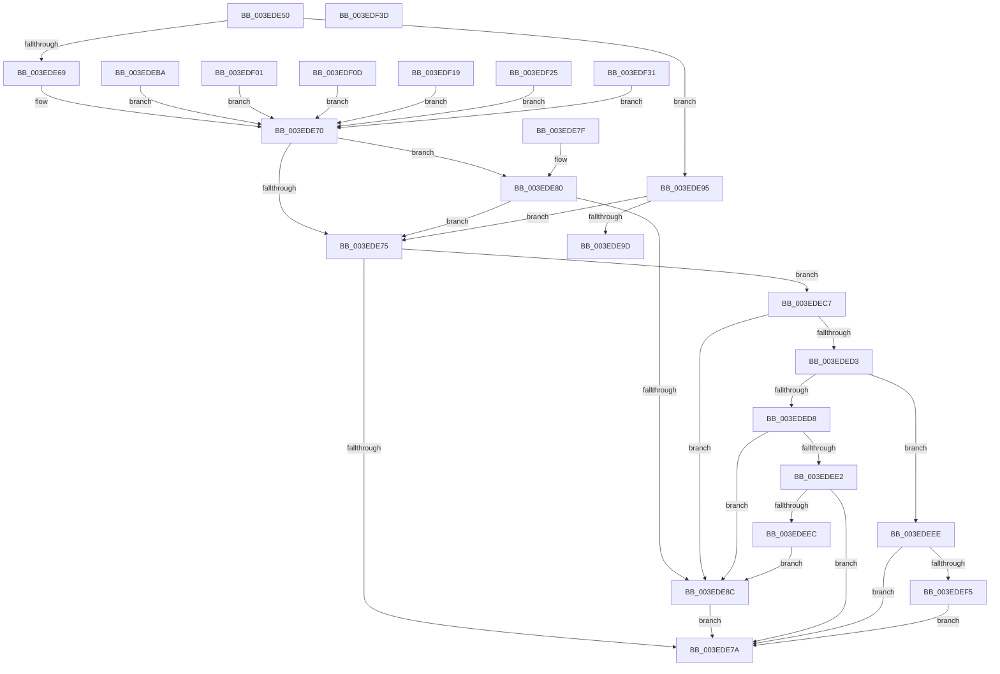

# SepReconcileTrustSidWithProcessProtection

- RVA: `0x003EDE50`–`0x003EDFD0` (길이 `384` bytes)
- VA: `0x00000001403EDE50`
- 실행 섹션: `.text`
- PDB 이름 있음: `예`; PDB Function 태그: `아니요`
- unwind 정보 RVA: `0x00096994`
- 디코드: `182`개 명령, `384/384` bytes 표시
- 미해석 바이트: `100` (있으면 어셈블리에 `.byte`로 보존)

> 이 문서는 커널 이미지의 기계어와 PDB 기호를 분석해 생성했습니다. 4번과 5번은 함수 원형과 자료형을 바이너리 사용 방식에서 추정한 C 해석이며 원본 소스 복구 결과는 아닙니다.

## 1. Dependencies

- 직접 호출 지점: **2**; 고유 호출 대상: **1**
- 직접 호출자로 확인된 함수: **5**
- RIP 상대 이미지 참조: **9**

### Outgoing calls
- `0x003EDE83` → [RtlIsValidProcessTrustLabelSid](RtlIsValidProcessTrustLabelSid_function_003EE070.md) (function, `0x003EE070`)
- `0x003EDECA` → [RtlIsValidProcessTrustLabelSid](RtlIsValidProcessTrustLabelSid_function_003EE070.md) (function, `0x003EE070`)

### Direct callers
- [AlpcpCreateSecurityContext](../../page/89/AlpcpCreateSecurityContext_function_00890D94.md) at `0x00890EE2`
- [SeCreateClientSecurity](../../page/89/SeCreateClientSecurity_function_008911B0.md) at `0x0089124F`
- [AlpcpExposeTokenAttribute](../../page/89/AlpcpExposeTokenAttribute_function_00891390.md) at `0x008914D5`
- [sub_00891777](../../page/89/Unknown_function_00891777.md) at `0x00891806`
- [sub_00891A05](../../page/89/Unknown_function_00891A05.md) at `0x00891A89`

### Static image references
- `0x003EDE69` → RVA `0x00F05828` (`.data`; read)
- `0x003EDE9D` → RVA `0x00000000` (`image boundary/outside`; read)
- `0x003EDEBE` → RVA `0x00F04F50` (`.data`; read)
- `0x003EDF01` → RVA `0x00F04F58` (`.data`; read)
- `0x003EDF0D` → RVA `0x00F05860` (`.data`; read)
- `0x003EDF19` → RVA `0x00F05830` (`.data`; read)
- `0x003EDF25` → RVA `0x00F05858` (`.data`; read)
- `0x003EDF31` → RVA `0x00F05848` (`.data`; read)
- `0x003EDF47` → RVA `0x193F1E2C` (`image boundary/outside`; read/write)

## 2. Other-region calls and transfers

- 다른 실행 섹션으로 향하는 call: **0**
- 별도 외부 분기/꼬리 이동을 확인하지 못했습니다.

## 3. Assembly (complete function range)

```asm
003EDE50  48 83 EC 28                     sub rsp, 0x28
003EDE54  0F B6 02                        movzx eax, byte ptr [rdx]
003EDE57  45 33 D2                        xor r10d, r10d
003EDE5A  41 C6 00 00                     mov byte ptr [r8], 0
003EDE5E  4C 8B D9                        mov r11, rcx
003EDE61  4D 89 11                        mov qword ptr [r9], r10
003EDE64  83 F8 62                        cmp eax, 0x62
003EDE67  75 2C                           jne 0x1403ede95
003EDE69  4C 8B 15 B8 79 B1 00            mov r10, qword ptr [rip + 0xb179b8]
003EDE70  4D 85 D2                        test r10, r10
003EDE73  75 0B                           jne 0x1403ede80
003EDE75  4D 85 DB                        test r11, r11
003EDE78  75 4D                           jne 0x1403edec7
003EDE7A  48 83 C4 28                     add rsp, 0x28
003EDE7E  C3                              ret
003EDE7F  CC                              int3
003EDE80  49 8B CA                        mov rcx, r10
003EDE83  E8 E8 01 00 00                  call 0x1403ee070
003EDE88  84 C0                           test al, al
003EDE8A  75 E9                           jne 0x1403ede75
003EDE8C  41 C6 00 01                     mov byte ptr [r8], 1
003EDE90  4D 89 11                        mov qword ptr [r9], r10
003EDE93  EB E5                           jmp 0x1403ede7a
003EDE95  83 C0 EE                        add eax, -0x12
003EDE98  83 F8 6F                        cmp eax, 0x6f
003EDE9B  77 D8                           ja 0x1403ede75
003EDE9D  48 8D 15 5C 21 C1 FF            lea rdx, [rip - 0x3edea4]
003EDEA4  48 98                           cdqe
003EDEA6  0F B6 84 02 60 DF 3E 00         movzx eax, byte ptr [rdx + rax + 0x3edf60]
003EDEAE  8B 8C 82 40 DF 3E 00            mov ecx, dword ptr [rdx + rax*4 + 0x3edf40]
003EDEB5  48 03 CA                        add rcx, rdx
003EDEB8  FF E1                           jmp rcx
003EDEBA  CC                              int3
003EDEBB  CC                              int3
003EDEBC  CC                              int3
003EDEBD  CC                              int3
003EDEBE  4C 8B 15 8B 70 B1 00            mov r10, qword ptr [rip + 0xb1708b]
003EDEC5  EB A9                           jmp 0x1403ede70
003EDEC7  49 8B CB                        mov rcx, r11
003EDECA  E8 A1 01 00 00                  call 0x1403ee070
003EDECF  84 C0                           test al, al
003EDED1  74 B9                           je 0x1403ede8c
003EDED3  4D 85 D2                        test r10, r10
003EDED6  74 16                           je 0x1403edeee
003EDED8  41 8B 43 08                     mov eax, dword ptr [r11 + 8]
003EDEDC  41 39 42 08                     cmp dword ptr [r10 + 8], eax
003EDEE0  72 AA                           jb 0x1403ede8c
003EDEE2  41 8B 43 0C                     mov eax, dword ptr [r11 + 0xc]
003EDEE6  41 39 42 0C                     cmp dword ptr [r10 + 0xc], eax
003EDEEA  73 8E                           jae 0x1403ede7a
003EDEEC  EB 9E                           jmp 0x1403ede8c
003EDEEE  41 83 7B 08 00                  cmp dword ptr [r11 + 8], 0
003EDEF3  76 85                           jbe 0x1403ede7a
003EDEF5  41 C6 00 01                     mov byte ptr [r8], 1
003EDEF9  4D 89 11                        mov qword ptr [r9], r10
003EDEFC  E9 79 FF FF FF                  jmp 0x1403ede7a
003EDF01  4C 8B 15 50 70 B1 00            mov r10, qword ptr [rip + 0xb17050]
003EDF08  E9 63 FF FF FF                  jmp 0x1403ede70
003EDF0D  4C 8B 15 4C 79 B1 00            mov r10, qword ptr [rip + 0xb1794c]
003EDF14  E9 57 FF FF FF                  jmp 0x1403ede70
003EDF19  4C 8B 15 10 79 B1 00            mov r10, qword ptr [rip + 0xb17910]
003EDF20  E9 4B FF FF FF                  jmp 0x1403ede70
003EDF25  4C 8B 15 2C 79 B1 00            mov r10, qword ptr [rip + 0xb1792c]
003EDF2C  E9 3F FF FF FF                  jmp 0x1403ede70
003EDF31  4C 8B 15 10 79 B1 00            mov r10, qword ptr [rip + 0xb17910]
003EDF38  E9 33 FF FF FF                  jmp 0x1403ede70
003EDF3D  0F 1F 00                        nop dword ptr [rax]
003EDF40  25 DF 3E 00 BE                  and eax, 0xbe003edf
003EDF45  DE 3E                           fidivr word ptr [rsi]
003EDF47  00 0D DF 3E 00 19               add byte ptr [rip + 0x19003edf], cl
003EDF4D  DF 3E                           fistp qword ptr [rsi]
003EDF4F  00 01                           add byte ptr [rcx], al
003EDF51  DF 3E                           fistp qword ptr [rsi]
003EDF53  00 69 DE                        add byte ptr [rcx - 0x22], ch
003EDF56  3E 00 31                        add byte ptr ds:[rcx], dh
003EDF59  DF 3E                           fistp qword ptr [rsi]
003EDF5B  00 75 DE                        add byte ptr [rbp - 0x22], dh
003EDF5E  3E 00 00                        add byte ptr ds:[rax], al
003EDF61  07                              .byte 0x07
003EDF62  07                              .byte 0x07
003EDF63  07                              .byte 0x07
003EDF64  07                              .byte 0x07
003EDF65  07                              .byte 0x07
003EDF66  07                              .byte 0x07
003EDF67  07                              .byte 0x07
003EDF68  07                              .byte 0x07
003EDF69  07                              .byte 0x07
003EDF6A  07                              .byte 0x07
003EDF6B  07                              .byte 0x07
003EDF6C  07                              .byte 0x07
003EDF6D  07                              .byte 0x07
003EDF6E  07                              .byte 0x07
003EDF6F  07                              .byte 0x07
003EDF70  07                              .byte 0x07
003EDF71  07                              .byte 0x07
003EDF72  07                              .byte 0x07
003EDF73  07                              .byte 0x07
003EDF74  07                              .byte 0x07
003EDF75  07                              .byte 0x07
003EDF76  07                              .byte 0x07
003EDF77  07                              .byte 0x07
003EDF78  07                              .byte 0x07
003EDF79  07                              .byte 0x07
003EDF7A  07                              .byte 0x07
003EDF7B  07                              .byte 0x07
003EDF7C  07                              .byte 0x07
003EDF7D  07                              .byte 0x07
003EDF7E  07                              .byte 0x07
003EDF7F  01 07                           add dword ptr [rdi], eax
003EDF81  07                              .byte 0x07
003EDF82  07                              .byte 0x07
003EDF83  07                              .byte 0x07
003EDF84  07                              .byte 0x07
003EDF85  07                              .byte 0x07
003EDF86  07                              .byte 0x07
003EDF87  07                              .byte 0x07
003EDF88  07                              .byte 0x07
003EDF89  07                              .byte 0x07
003EDF8A  07                              .byte 0x07
003EDF8B  07                              .byte 0x07
003EDF8C  07                              .byte 0x07
003EDF8D  07                              .byte 0x07
003EDF8E  07                              .byte 0x07
003EDF8F  07                              .byte 0x07
003EDF90  07                              .byte 0x07
003EDF91  07                              .byte 0x07
003EDF92  07                              .byte 0x07
003EDF93  07                              .byte 0x07
003EDF94  07                              .byte 0x07
003EDF95  07                              .byte 0x07
003EDF96  07                              .byte 0x07
003EDF97  07                              .byte 0x07
003EDF98  07                              .byte 0x07
003EDF99  07                              .byte 0x07
003EDF9A  07                              .byte 0x07
003EDF9B  07                              .byte 0x07
003EDF9C  07                              .byte 0x07
003EDF9D  07                              .byte 0x07
003EDF9E  07                              .byte 0x07
003EDF9F  02 03                           add al, byte ptr [rbx]
003EDFA1  07                              .byte 0x07
003EDFA2  07                              .byte 0x07
003EDFA3  07                              .byte 0x07
003EDFA4  07                              .byte 0x07
003EDFA5  07                              .byte 0x07
003EDFA6  07                              .byte 0x07
003EDFA7  07                              .byte 0x07
003EDFA8  07                              .byte 0x07
003EDFA9  07                              .byte 0x07
003EDFAA  07                              .byte 0x07
003EDFAB  07                              .byte 0x07
003EDFAC  07                              .byte 0x07
003EDFAD  07                              .byte 0x07
003EDFAE  07                              .byte 0x07
003EDFAF  04 07                           add al, 7
003EDFB1  07                              .byte 0x07
003EDFB2  07                              .byte 0x07
003EDFB3  07                              .byte 0x07
003EDFB4  07                              .byte 0x07
003EDFB5  07                              .byte 0x07
003EDFB6  07                              .byte 0x07
003EDFB7  07                              .byte 0x07
003EDFB8  07                              .byte 0x07
003EDFB9  07                              .byte 0x07
003EDFBA  07                              .byte 0x07
003EDFBB  07                              .byte 0x07
003EDFBC  07                              .byte 0x07
003EDFBD  07                              .byte 0x07
003EDFBE  07                              .byte 0x07
003EDFBF  07                              .byte 0x07
003EDFC0  05 07 07 07 07                  add eax, 0x7070707
003EDFC5  07                              .byte 0x07
003EDFC6  07                              .byte 0x07
003EDFC7  07                              .byte 0x07
003EDFC8  07                              .byte 0x07
003EDFC9  07                              .byte 0x07
003EDFCA  07                              .byte 0x07
003EDFCB  07                              .byte 0x07
003EDFCC  07                              .byte 0x07
003EDFCD  07                              .byte 0x07
003EDFCE  07                              .byte 0x07
003EDFCF  06                              .byte 0x06
```

## 4. C-style interpretation (structured pseudocode)

```c
__int64 __fastcall SepReconcileTrustSidWithProcessProtection(__int64 a1, __int64 a2, __int64 a3, __int64 a4)
{
    __int64 result;
    __int64 v_r10;
    __int64 v_rsp;

    v_rsp = (v_rsp) - (40);
    v_r10 = 0;
    *(unsigned __int8 *)(a3) = 0;
    *(unsigned __int64 *)(a4) = 0;
    if (((unsigned int)(*(unsigned __int8 *)(a2))) != 98) goto loc_003EDE95;
loc_003EDE70:
    if (*(unsigned __int64 *)(v_rip + 11631032) != 0) goto loc_003EDE80;
loc_003EDE75:
    if (a1 != 0) goto loc_003EDEC7;
loc_003EDE7A:
    v_rsp = (v_rsp) + (40);
    return *(unsigned __int8 *)(a2);
loc_003EDE80:
    result = RtlIsValidProcessTrustLabelSid(*(unsigned __int64 *)(v_rip + 11631032), a2, a3, a4);
    if ((unsigned __int8)(result) != 0) goto loc_003EDE75;
loc_003EDE8C:
    *(unsigned __int8 *)(a3) = 1;
    *(unsigned __int64 *)(a4) = *(unsigned __int64 *)(v_rip + 11631032);
    goto loc_003EDE7A;
loc_003EDE95:
    result = (unsigned int)((result) + (-18));
    if (((unsigned int)(result)) > 111) goto loc_003EDE75;
    a1 = ((unsigned int)(*(unsigned int *)(v_rip - 4120228 + *(unsigned __int8 *)(v_rip - 4120228 + result * 1 + 4120416) * 4 + 4120384))) + (v_rip - 4120228);
loc_003EDEC7:
    result = RtlIsValidProcessTrustLabelSid(a1, v_rip - 4120228, a3, a4);
    if ((unsigned __int8)(result) == 0) goto loc_003EDE8C;
    if (*(unsigned __int64 *)(v_rip + 11631032) == 0) goto loc_003EDEEE;
    if ((*(unsigned int *)(*(unsigned __int64 *)(v_rip + 11631032) + 8)) < ((unsigned int)((unsigned int)(*(unsigned int *)(a1 + 8))))) goto loc_003EDE8C;
    if ((*(unsigned int *)(*(unsigned __int64 *)(v_rip + 11631032) + 12)) >= ((unsigned int)((unsigned int)(*(unsigned int *)(a1 + 12))))) goto loc_003EDE7A;
    goto loc_003EDE8C;
loc_003EDEEE:
    if ((*(unsigned int *)(a1 + 8)) <= 0) goto loc_003EDE7A;
    *(unsigned __int8 *)(a3) = 1;
    *(unsigned __int64 *)(a4) = *(unsigned __int64 *)(v_rip + 11631032);
    goto loc_003EDE7A;
}
```

## 5. (Beta) C Style

```c
int64_t SepReconcileTrustSidWithProcessProtection(int64_t Arg1, void *Arg2, void *Arg3, void *Arg4)
{
    uint8_t *arg2 = (uint8_t *)Arg2;
    uint8_t *arg3 = (uint8_t *)Arg3;
    uint8_t *arg4 = (uint8_t *)Arg4;

    int64_t result;
    int64_t local_r10;
    int64_t local_rsp;

    local_rsp = (local_rsp) - (40);
    local_r10 = 0;
    *(uint8_t *)(arg3) = 0;
    *(uint64_t *)(arg4) = 0;
    if (((uint32_t)(*(uint8_t *)(arg2))) != 98) goto loc_003EDE95;
loc_003EDE70:
    if (*(uint64_t *)(v_rip + 0xB179B8) != 0) goto loc_003EDE80;
loc_003EDE75:
    if (Arg1 != 0) goto loc_003EDEC7;
loc_003EDE7A:
    local_rsp = (local_rsp) + (40);
    return *(uint8_t *)(arg2);
loc_003EDE80:
    result = RtlIsValidProcessTrustLabelSid(*(uint64_t *)(v_rip + 0xB179B8), Arg2, Arg3, Arg4);
    if ((uint8_t)(result) != 0) goto loc_003EDE75;
loc_003EDE8C:
    *(uint8_t *)(arg3) = 1;
    *(uint64_t *)(arg4) = *(uint64_t *)(v_rip + 0xB179B8);
    goto loc_003EDE7A;
loc_003EDE95:
    result = (uint32_t)((result) + (-18));
    if (((uint32_t)(result)) > 111) goto loc_003EDE75;
    Arg1 = ((uint32_t)(*(uint32_t *)(v_rip - 0x3EDEA4 + *(uint8_t *)(v_rip - 0x3EDEA4 + result * 1 + 0x3EDF60) * 4 + 0x3EDF40))) + (v_rip - 4120228);
loc_003EDEC7:
    result = RtlIsValidProcessTrustLabelSid(Arg1, v_rip - 4120228, Arg3, Arg4);
    if ((uint8_t)(result) == 0) goto loc_003EDE8C;
    if (*(uint64_t *)(v_rip + 0xB179B8) == 0) goto loc_003EDEEE;
    if ((*(uint32_t *)(*(uint64_t *)(v_rip + 0xB179B8) + 0x8)) < ((uint32_t)((uint32_t)(*(uint32_t *)(Arg1 + 0x8))))) goto loc_003EDE8C;
    if ((*(uint32_t *)(*(uint64_t *)(v_rip + 0xB179B8) + 0xC)) >= ((uint32_t)((uint32_t)(*(uint32_t *)(Arg1 + 0xC))))) goto loc_003EDE7A;
    goto loc_003EDE8C;
loc_003EDEEE:
    if ((*(uint32_t *)(Arg1 + 0x8)) <= 0) goto loc_003EDE7A;
    *(uint8_t *)(arg3) = 1;
    *(uint64_t *)(arg4) = *(uint64_t *)(v_rip + 0xB179B8);
    goto loc_003EDE7A;
}
```

### 관측된 메모리 오프셋

구조체 형식이 확인되지 않은 접근은 인자 기준의 오프셋으로만 기록했습니다.

| 기준 인자 | 오프셋 표현 | 폭 (bit) | 접근 |
|---|---:|---:|---|
| `Arg2` | `+ 0x0` | `8` | `R` |
| `Arg3` | `+ 0x0` | `8` | `W` |
| `Arg4` | `+ 0x0` | `64` | `W` |

## 6. Execution-region graph

[열기: 2D/3D 그래프와 함수 탐색 컨트롤 패널](../../../control-panel.html?section=text&rva=0x003EDE50&view=graph)

- 2D 그래프는 위에서 아래로 흐르고, 3D 그래프는 빈 공간을 드래그해 회전합니다. Shift+드래그는 이동, 휠은 확대·축소, 함수 노드 선택은 대상 보고서 이동입니다.

### Static fallback


