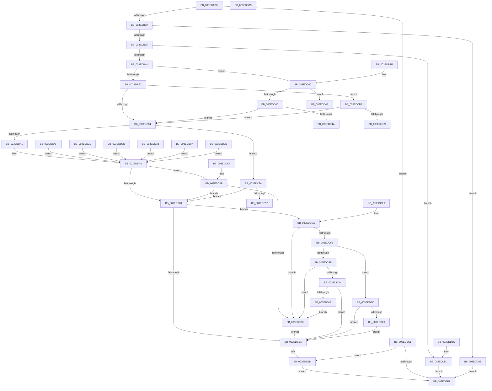

# SepReferenceTokenByHandle

- RVA: `0x003EDAD0`–`0x003EDE3C` (길이 `876` bytes)
- VA: `0x00000001403EDAD0`
- 실행 섹션: `.text`
- PDB 이름 있음: `예`; PDB Function 태그: `아니요`
- unwind 정보 RVA: `0x00096978`
- 디코드: `293`개 명령, `876/876` bytes 표시
- 미해석 바이트: `100` (있으면 어셈블리에 `.byte`로 보존)

> 이 문서는 커널 이미지의 기계어와 PDB 기호를 분석해 생성했습니다. 4번과 5번은 함수 원형과 자료형을 바이너리 사용 방식에서 추정한 C 해석이며 원본 소스 복구 결과는 아닙니다.

## 1. Dependencies

- 직접 호출 지점: **8**; 고유 호출 대상: **6**
- 직접 호출자로 확인된 함수: **4**
- RIP 상대 이미지 참조: **9**

### Outgoing calls
- `0x003EDB6E` → [PsReferenceEffectiveToken](../../page/9A/PsReferenceEffectiveToken_function_009A2B40.md) (function, `0x009A2B40`)
- `0x003EDBE6` → [ObReferenceObjectByHandleWithTag](../../page/86/ObReferenceObjectByHandleWithTag_function_00869610.md) (function, `0x00869610`)
- `0x003EDC2F` → [PsReferenceImpersonationTokenEx](../../page/99/PsReferenceImpersonationTokenEx_function_0099C7B0.md) (function, `0x0099C7B0`)
- `0x003EDC52` → [ObfDereferenceObjectWithTag](../2F/ObfDereferenceObjectWithTag_function_002F78E0.md) (function, `0x002F78E0`)
- `0x003EDC6E` → [RtlIsValidProcessTrustLabelSid](RtlIsValidProcessTrustLabelSid_function_003EE070.md) (function, `0x003EE070`)
- `0x003EDCD1` → [ObfDereferenceObjectWithTag](../2F/ObfDereferenceObjectWithTag_function_002F78E0.md) (function, `0x002F78E0`)
- `0x003EDCED` → [RtlIsValidProcessTrustLabelSid](RtlIsValidProcessTrustLabelSid_function_003EE070.md) (function, `0x003EE070`)
- `0x003EDD69` → [PsReferencePrimaryTokenWithTag](../20/PsReferencePrimaryTokenWithTag_function_0020FF80.md) (function, `0x0020FF80`)

### Direct callers
- [SeAccessCheckByType](../44/SeAccessCheckByType_function_00440BC8.md) at `0x004410EA`
- [SeSetSessionIdTokenWithLinked](../../page/79/SeSetSessionIdTokenWithLinked_function_0079CF90.md) at `0x0079CFE4`
- [NtQuerySecurityAttributesToken](../../page/97/NtQuerySecurityAttributesToken_function_00972C80.md) at `0x00972E0F`
- [NtQueryInformationToken](../../page/AE/NtQueryInformationToken_function_00AECDD0.md) at `0x00AECF68`
- [NtQueryInformationToken](../../page/AE/NtQueryInformationToken_function_00AECDD0.md) at `0x00AED066`
- [NtQueryInformationToken](../../page/AE/NtQueryInformationToken_function_00AECDD0.md) at `0x00AED17E`
- [NtQueryInformationToken](../../page/AE/NtQueryInformationToken_function_00AECDD0.md) at `0x00AED286`
- [NtQueryInformationToken](../../page/AE/NtQueryInformationToken_function_00AECDD0.md) at `0x00AED3F2`
- [NtQueryInformationToken](../../page/AE/NtQueryInformationToken_function_00AECDD0.md) at `0x00AED599`
- [NtQueryInformationToken](../../page/AE/NtQueryInformationToken_function_00AECDD0.md) at `0x00AED82F`
- [NtQueryInformationToken](../../page/AE/NtQueryInformationToken_function_00AECDD0.md) at `0x00AED9A9`
- [NtQueryInformationToken](../../page/AE/NtQueryInformationToken_function_00AECDD0.md) at `0x00AEDB2F`
- [NtQueryInformationToken](../../page/AE/NtQueryInformationToken_function_00AECDD0.md) at `0x00AEDC94`
- [NtQueryInformationToken](../../page/AE/NtQueryInformationToken_function_00AECDD0.md) at `0x00AEDD51`
- [NtQueryInformationToken](../../page/AE/NtQueryInformationToken_function_00AECDD0.md) at `0x00AEDDF6`
- [NtQueryInformationToken](../../page/AE/NtQueryInformationToken_function_00AECDD0.md) at `0x00AEDE9D`
- [NtQueryInformationToken](../../page/AE/NtQueryInformationToken_function_00AECDD0.md) at `0x00AEDF9E`
- [NtQueryInformationToken](../../page/AE/NtQueryInformationToken_function_00AECDD0.md) at `0x00AEE052`
- [NtQueryInformationToken](../../page/AE/NtQueryInformationToken_function_00AECDD0.md) at `0x00AEE10C`
- [NtQueryInformationToken](../../page/AE/NtQueryInformationToken_function_00AECDD0.md) at `0x00AEE1FF`
- [NtQueryInformationToken](../../page/AE/NtQueryInformationToken_function_00AECDD0.md) at `0x00AEE290`
- [NtQueryInformationToken](../../page/AE/NtQueryInformationToken_function_00AECDD0.md) at `0x00AEE530`
- [NtQueryInformationToken](../../page/AE/NtQueryInformationToken_function_00AECDD0.md) at `0x00AEEABF`
- [NtQueryInformationToken](../../page/AE/NtQueryInformationToken_function_00AECDD0.md) at `0x00AEEB4F`
- [NtQueryInformationToken](../../page/AE/NtQueryInformationToken_function_00AECDD0.md) at `0x00AEED44`
- [NtQueryInformationToken](../../page/AE/NtQueryInformationToken_function_00AECDD0.md) at `0x00AEEE03`
- [NtQueryInformationToken](../../page/AE/NtQueryInformationToken_function_00AECDD0.md) at `0x00AEEEAA`
- [NtQueryInformationToken](../../page/AE/NtQueryInformationToken_function_00AECDD0.md) at `0x00AEF034`
- [NtQueryInformationToken](../../page/AE/NtQueryInformationToken_function_00AECDD0.md) at `0x00AEF196`
- [NtQueryInformationToken](../../page/AE/NtQueryInformationToken_function_00AECDD0.md) at `0x00AEF338`
- [NtQueryInformationToken](../../page/AE/NtQueryInformationToken_function_00AECDD0.md) at `0x00AEF3E3`
- [NtQueryInformationToken](../../page/AE/NtQueryInformationToken_function_00AECDD0.md) at `0x00AEF51C`
- [NtQueryInformationToken](../../page/AE/NtQueryInformationToken_function_00AECDD0.md) at `0x00AEF662`
- [NtQueryInformationToken](../../page/AE/NtQueryInformationToken_function_00AECDD0.md) at `0x00AEF7EB`
- [NtQueryInformationToken](../../page/AE/NtQueryInformationToken_function_00AECDD0.md) at `0x00AEF9A5`
- [NtQueryInformationToken](../../page/AE/NtQueryInformationToken_function_00AECDD0.md) at `0x00AEFABE`
- [NtQueryInformationToken](../../page/AE/NtQueryInformationToken_function_00AECDD0.md) at `0x00AEFBF0`
- [NtQueryInformationToken](../../page/AE/NtQueryInformationToken_function_00AECDD0.md) at `0x00AEFCCD`
- [NtQueryInformationToken](../../page/AE/NtQueryInformationToken_function_00AECDD0.md) at `0x00AEFE3F`
- [NtQueryInformationToken](../../page/AE/NtQueryInformationToken_function_00AECDD0.md) at `0x00AEFFC1`
- [NtQueryInformationToken](../../page/AE/NtQueryInformationToken_function_00AECDD0.md) at `0x00AF0163`
- [NtQueryInformationToken](../../page/AE/NtQueryInformationToken_function_00AECDD0.md) at `0x00AF029C`

### Static image references
- `0x003EDBA1` → RVA `0x00F05828` (`.data`; read)
- `0x003EDBCD` → RVA `0x00FD8020` (`PAGEDATA`; read)
- `0x003EDC92` → RVA `0x00000000` (`image boundary/outside`; read)
- `0x003EDCB3` → RVA `0x00F04F50` (`.data`; read)
- `0x003EDD31` → RVA `0x00F04F58` (`.data`; read)
- `0x003EDD3D` → RVA `0x00F05860` (`.data`; read)
- `0x003EDD7B` → RVA `0x00F05830` (`.data`; read)
- `0x003EDD87` → RVA `0x00F05858` (`.data`; read)
- `0x003EDD9D` → RVA `0x00F05848` (`.data`; read)

## 2. Other-region calls and transfers

- 다른 실행 섹션으로 향하는 call: **3**
  - `0x003EDB6E` → [PsReferenceEffectiveToken](../../page/9A/PsReferenceEffectiveToken_function_009A2B40.md) (`.text` → `PAGE`)
  - `0x003EDBE6` → [ObReferenceObjectByHandleWithTag](../../page/86/ObReferenceObjectByHandleWithTag_function_00869610.md) (`.text` → `PAGE`)
  - `0x003EDC2F` → [PsReferenceImpersonationTokenEx](../../page/99/PsReferenceImpersonationTokenEx_function_0099C7B0.md) (`.text` → `PAGE`)
- 별도 외부 분기/꼬리 이동을 확인하지 못했습니다.

## 3. Assembly (complete function range)

```asm
003EDAD0  4C 8B DC                        mov r11, rsp
003EDAD3  49 89 5B 10                     mov qword ptr [r11 + 0x10], rbx
003EDAD7  45 89 4B 20                     mov dword ptr [r11 + 0x20], r9d
003EDADB  56                              push rsi
003EDADC  57                              push rdi
003EDADD  41 56                           push r14
003EDADF  48 83 EC 40                     sub rsp, 0x40
003EDAE3  48 8B BC 24 88 00 00 00         mov rdi, qword ptr [rsp + 0x88]
003EDAEB  48 8D 41 06                     lea rax, [rcx + 6]
003EDAEF  48 8B B4 24 90 00 00 00         mov rsi, qword ptr [rsp + 0x90]
003EDAF7  33 DB                           xor ebx, ebx
003EDAF9  C6 07 00                        mov byte ptr [rdi], 0
003EDAFC  48 89 1E                        mov qword ptr [rsi], rbx
003EDAFF  48 83 F8 02                     cmp rax, 2
003EDB03  0F 87 B8 00 00 00               ja 0x1403edbc1
003EDB09  F7 C2 E7 FF FF FF               test edx, 0xffffffe7
003EDB0F  0F 85 7E 02 00 00               jne 0x1403edd93
003EDB15  4C 8B B4 24 80 00 00 00         mov r14, qword ptr [rsp + 0x80]
003EDB1D  89 5C 24 60                     mov dword ptr [rsp + 0x60], ebx
003EDB21  41 89 5B 38                     mov dword ptr [r11 + 0x38], ebx
003EDB25  88 5C 24 78                     mov byte ptr [rsp + 0x78], bl
003EDB29  49 89 1E                        mov qword ptr [r14], rbx
003EDB2C  88 1F                           mov byte ptr [rdi], bl
003EDB2E  48 89 1E                        mov qword ptr [rsi], rbx
003EDB31  65 48 8B 04 25 88 01 00 00      mov rax, qword ptr gs:[0x188]
003EDB3A  48 83 F9 FC                     cmp rcx, -4
003EDB3E  0F 84 19 02 00 00               je 0x1403edd5d
003EDB44  48 83 F9 FB                     cmp rcx, -5
003EDB48  49 8D 4B 20                     lea rcx, [r11 + 0x20]
003EDB4C  0F 84 AE 00 00 00               je 0x1403edc00
003EDB52  49 89 4B D0                     mov qword ptr [r11 - 0x30], rcx
003EDB56  4D 8D 4B 30                     lea r9, [r11 + 0x30]
003EDB5A  49 8D 4B 08                     lea rcx, [r11 + 8]
003EDB5E  BA 53 68 72 74                  mov edx, 0x74726853
003EDB63  49 89 4B C8                     mov qword ptr [r11 - 0x38], rcx
003EDB67  4D 8D 43 38                     lea r8, [r11 + 0x38]
003EDB6B  48 8B C8                        mov rcx, rax
003EDB6E  E8 CD 4F 5B 00                  call 0x1409a2b40
003EDB73  83 BC 24 90 00 00 00 02         cmp dword ptr [rsp + 0x90], 2
003EDB7B  4C 8B C0                        mov r8, rax
003EDB7E  0F 84 3B 01 00 00               je 0x1403edcbf
003EDB84  4D 8B 90 50 04 00 00            mov r10, qword ptr [r8 + 0x450]
003EDB8B  4C 8B CB                        mov r9, rbx
003EDB8E  0F B6 44 24 78                  movzx eax, byte ptr [rsp + 0x78]
003EDB93  88 1F                           mov byte ptr [rdi], bl
003EDB95  48 89 1E                        mov qword ptr [rsi], rbx
003EDB98  83 F8 62                        cmp eax, 0x62
003EDB9B  0F 85 E5 00 00 00               jne 0x1403edc86
003EDBA1  4C 8B 0D 80 7C B1 00            mov r9, qword ptr [rip + 0xb17c80]
003EDBA8  4D 85 C9                        test r9, r9
003EDBAB  0F 85 BA 00 00 00               jne 0x1403edc6b
003EDBB1  4D 85 D2                        test r10, r10
003EDBB4  0F 85 30 01 00 00               jne 0x1403edcea
003EDBBA  4D 89 06                        mov qword ptr [r14], r8
003EDBBD  8B C3                           mov eax, ebx
003EDBBF  EB 30                           jmp 0x1403edbf1
003EDBC1  48 8B 84 24 80 00 00 00         mov rax, qword ptr [rsp + 0x80]
003EDBC9  45 0F B6 C8                     movzx r9d, r8b
003EDBCD  4C 8B 05 4C A4 BE 00            mov r8, qword ptr [rip + 0xbea44c]
003EDBD4  48 89 5C 24 30                  mov qword ptr [rsp + 0x30], rbx
003EDBD9  48 89 44 24 28                  mov qword ptr [rsp + 0x28], rax
003EDBDE  C7 44 24 20 53 68 72 74         mov dword ptr [rsp + 0x20], 0x74726853
003EDBE6  E8 25 BA 47 00                  call 0x140869610
003EDBEB  8B D8                           mov ebx, eax
003EDBED  85 C0                           test eax, eax
003EDBEF  79 CC                           jns 0x1403edbbd
003EDBF1  48 8B 5C 24 68                  mov rbx, qword ptr [rsp + 0x68]
003EDBF6  48 83 C4 40                     add rsp, 0x40
003EDBFA  41 5E                           pop r14
003EDBFC  5F                              pop rdi
003EDBFD  5E                              pop rsi
003EDBFE  C3                              ret
003EDBFF  CC                              int3
003EDC00  48 89 4C 24 30                  mov qword ptr [rsp + 0x30], rcx
003EDC05  4C 8D 8C 24 90 00 00 00         lea r9, [rsp + 0x90]
003EDC0D  48 8D 4C 24 60                  lea rcx, [rsp + 0x60]
003EDC12  33 D2                           xor edx, edx
003EDC14  48 89 4C 24 28                  mov qword ptr [rsp + 0x28], rcx
003EDC19  41 B8 53 68 72 74               mov r8d, 0x74726853
003EDC1F  48 8D 8C 24 88 00 00 00         lea rcx, [rsp + 0x88]
003EDC27  48 89 4C 24 20                  mov qword ptr [rsp + 0x20], rcx
003EDC2C  48 8B C8                        mov rcx, rax
003EDC2F  E8 7C EB 5A 00                  call 0x14099c7b0
003EDC34  4C 8B C0                        mov r8, rax
003EDC37  48 85 C0                        test rax, rax
003EDC3A  0F 84 09 01 00 00               je 0x1403edd49
003EDC40  39 5C 24 60                     cmp dword ptr [rsp + 0x60], ebx
003EDC44  0F 85 3A FF FF FF               jne 0x1403edb84
003EDC4A  BA 44 66 6C 74                  mov edx, 0x746c6644
003EDC4F  48 8B C8                        mov rcx, rax
003EDC52  E8 89 9C F0 FF                  call 0x1402f78e0
003EDC57  B8 A6 00 00 C0                  mov eax, 0xc00000a6
003EDC5C  48 8B 5C 24 68                  mov rbx, qword ptr [rsp + 0x68]
003EDC61  48 83 C4 40                     add rsp, 0x40
003EDC65  41 5E                           pop r14
003EDC67  5F                              pop rdi
003EDC68  5E                              pop rsi
003EDC69  C3                              ret
003EDC6A  CC                              int3
003EDC6B  49 8B C9                        mov rcx, r9
003EDC6E  E8 FD 03 00 00                  call 0x1403ee070
003EDC73  84 C0                           test al, al
003EDC75  0F 85 36 FF FF FF               jne 0x1403edbb1
003EDC7B  C6 07 01                        mov byte ptr [rdi], 1
003EDC7E  4C 89 0E                        mov qword ptr [rsi], r9
003EDC81  E9 34 FF FF FF                  jmp 0x1403edbba
003EDC86  83 C0 EE                        add eax, -0x12
003EDC89  83 F8 6F                        cmp eax, 0x6f
003EDC8C  0F 87 1F FF FF FF               ja 0x1403edbb1
003EDC92  48 8D 15 67 23 C1 FF            lea rdx, [rip - 0x3edc99]
003EDC99  48 98                           cdqe
003EDC9B  0F B6 84 02 CC DD 3E 00         movzx eax, byte ptr [rdx + rax + 0x3eddcc]
003EDCA3  8B 8C 82 AC DD 3E 00            mov ecx, dword ptr [rdx + rax*4 + 0x3eddac]
003EDCAA  48 03 CA                        add rcx, rdx
003EDCAD  FF E1                           jmp rcx
003EDCAF  CC                              int3
003EDCB0  CC                              int3
003EDCB1  CC                              int3
003EDCB2  CC                              int3
003EDCB3  4C 8B 0D 96 72 B1 00            mov r9, qword ptr [rip + 0xb17296]
003EDCBA  E9 E9 FE FF FF                  jmp 0x1403edba8
003EDCBF  39 5C 24 60                     cmp dword ptr [rsp + 0x60], ebx
003EDCC3  0F 85 BB FE FF FF               jne 0x1403edb84
003EDCC9  BA 53 68 72 74                  mov edx, 0x74726853
003EDCCE  48 8B C8                        mov rcx, rax
003EDCD1  E8 0A 9C F0 FF                  call 0x1402f78e0
003EDCD6  B8 A6 00 00 C0                  mov eax, 0xc00000a6
003EDCDB  48 8B 5C 24 68                  mov rbx, qword ptr [rsp + 0x68]
003EDCE0  48 83 C4 40                     add rsp, 0x40
003EDCE4  41 5E                           pop r14
003EDCE6  5F                              pop rdi
003EDCE7  5E                              pop rsi
003EDCE8  C3                              ret
003EDCE9  CC                              int3
003EDCEA  49 8B CA                        mov rcx, r10
003EDCED  E8 7E 03 00 00                  call 0x1403ee070
003EDCF2  84 C0                           test al, al
003EDCF4  74 85                           je 0x1403edc7b
003EDCF6  4D 85 C9                        test r9, r9
003EDCF9  74 21                           je 0x1403edd1c
003EDCFB  41 8B 42 08                     mov eax, dword ptr [r10 + 8]
003EDCFF  41 39 41 08                     cmp dword ptr [r9 + 8], eax
003EDD03  0F 82 72 FF FF FF               jb 0x1403edc7b
003EDD09  41 8B 42 0C                     mov eax, dword ptr [r10 + 0xc]
003EDD0D  41 39 41 0C                     cmp dword ptr [r9 + 0xc], eax
003EDD11  0F 83 A3 FE FF FF               jae 0x1403edbba
003EDD17  E9 5F FF FF FF                  jmp 0x1403edc7b
003EDD1C  41 39 5A 08                     cmp dword ptr [r10 + 8], ebx
003EDD20  0F 86 94 FE FF FF               jbe 0x1403edbba
003EDD26  C6 07 01                        mov byte ptr [rdi], 1
003EDD29  4C 89 0E                        mov qword ptr [rsi], r9
003EDD2C  E9 89 FE FF FF                  jmp 0x1403edbba
003EDD31  4C 8B 0D 20 72 B1 00            mov r9, qword ptr [rip + 0xb17220]
003EDD38  E9 6B FE FF FF                  jmp 0x1403edba8
003EDD3D  4C 8B 0D 1C 7B B1 00            mov r9, qword ptr [rip + 0xb17b1c]
003EDD44  E9 5F FE FF FF                  jmp 0x1403edba8
003EDD49  48 8B 5C 24 68                  mov rbx, qword ptr [rsp + 0x68]
003EDD4E  B8 7C 00 00 C0                  mov eax, 0xc000007c
003EDD53  48 83 C4 40                     add rsp, 0x40
003EDD57  41 5E                           pop r14
003EDD59  5F                              pop rdi
003EDD5A  5E                              pop rsi
003EDD5B  C3                              ret
003EDD5C  CC                              int3
003EDD5D  48 8B 88 B8 00 00 00            mov rcx, qword ptr [rax + 0xb8]
003EDD64  BA 53 68 72 74                  mov edx, 0x74726853
003EDD69  E8 12 22 E2 FF                  call 0x14020ff80
003EDD6E  4C 8B C0                        mov r8, rax
003EDD71  49 89 06                        mov qword ptr [r14], rax
003EDD74  8B C3                           mov eax, ebx
003EDD76  E9 76 FE FF FF                  jmp 0x1403edbf1
003EDD7B  4C 8B 0D AE 7A B1 00            mov r9, qword ptr [rip + 0xb17aae]
003EDD82  E9 21 FE FF FF                  jmp 0x1403edba8
003EDD87  4C 8B 0D CA 7A B1 00            mov r9, qword ptr [rip + 0xb17aca]
003EDD8E  E9 15 FE FF FF                  jmp 0x1403edba8
003EDD93  B8 22 00 00 C0                  mov eax, 0xc0000022
003EDD98  E9 54 FE FF FF                  jmp 0x1403edbf1
003EDD9D  4C 8B 0D A4 7A B1 00            mov r9, qword ptr [rip + 0xb17aa4]
003EDDA4  E9 FF FD FF FF                  jmp 0x1403edba8
003EDDA9  0F 1F 00                        nop dword ptr [rax]
003EDDAC  87 DD                           xchg ebp, ebx
003EDDAE  3E 00 B3 DC 3E 00 3D            add byte ptr ds:[rbx + 0x3d003edc], dh
003EDDB5  DD 3E                           fnstsw word ptr [rsi]
003EDDB7  00 7B DD                        add byte ptr [rbx - 0x23], bh
003EDDBA  3E 00 31                        add byte ptr ds:[rcx], dh
003EDDBD  DD 3E                           fnstsw word ptr [rsi]
003EDDBF  00 A1 DB 3E 00 9D               add byte ptr [rcx - 0x62ffc125], ah
003EDDC5  DD 3E                           fnstsw word ptr [rsi]
003EDDC7  00 B1 DB 3E 00 00               add byte ptr [rcx + 0x3edb], dh
003EDDCD  07                              .byte 0x07
003EDDCE  07                              .byte 0x07
003EDDCF  07                              .byte 0x07
003EDDD0  07                              .byte 0x07
003EDDD1  07                              .byte 0x07
003EDDD2  07                              .byte 0x07
003EDDD3  07                              .byte 0x07
003EDDD4  07                              .byte 0x07
003EDDD5  07                              .byte 0x07
003EDDD6  07                              .byte 0x07
003EDDD7  07                              .byte 0x07
003EDDD8  07                              .byte 0x07
003EDDD9  07                              .byte 0x07
003EDDDA  07                              .byte 0x07
003EDDDB  07                              .byte 0x07
003EDDDC  07                              .byte 0x07
003EDDDD  07                              .byte 0x07
003EDDDE  07                              .byte 0x07
003EDDDF  07                              .byte 0x07
003EDDE0  07                              .byte 0x07
003EDDE1  07                              .byte 0x07
003EDDE2  07                              .byte 0x07
003EDDE3  07                              .byte 0x07
003EDDE4  07                              .byte 0x07
003EDDE5  07                              .byte 0x07
003EDDE6  07                              .byte 0x07
003EDDE7  07                              .byte 0x07
003EDDE8  07                              .byte 0x07
003EDDE9  07                              .byte 0x07
003EDDEA  07                              .byte 0x07
003EDDEB  01 07                           add dword ptr [rdi], eax
003EDDED  07                              .byte 0x07
003EDDEE  07                              .byte 0x07
003EDDEF  07                              .byte 0x07
003EDDF0  07                              .byte 0x07
003EDDF1  07                              .byte 0x07
003EDDF2  07                              .byte 0x07
003EDDF3  07                              .byte 0x07
003EDDF4  07                              .byte 0x07
003EDDF5  07                              .byte 0x07
003EDDF6  07                              .byte 0x07
003EDDF7  07                              .byte 0x07
003EDDF8  07                              .byte 0x07
003EDDF9  07                              .byte 0x07
003EDDFA  07                              .byte 0x07
003EDDFB  07                              .byte 0x07
003EDDFC  07                              .byte 0x07
003EDDFD  07                              .byte 0x07
003EDDFE  07                              .byte 0x07
003EDDFF  07                              .byte 0x07
003EDE00  07                              .byte 0x07
003EDE01  07                              .byte 0x07
003EDE02  07                              .byte 0x07
003EDE03  07                              .byte 0x07
003EDE04  07                              .byte 0x07
003EDE05  07                              .byte 0x07
003EDE06  07                              .byte 0x07
003EDE07  07                              .byte 0x07
003EDE08  07                              .byte 0x07
003EDE09  07                              .byte 0x07
003EDE0A  07                              .byte 0x07
003EDE0B  02 03                           add al, byte ptr [rbx]
003EDE0D  07                              .byte 0x07
003EDE0E  07                              .byte 0x07
003EDE0F  07                              .byte 0x07
003EDE10  07                              .byte 0x07
003EDE11  07                              .byte 0x07
003EDE12  07                              .byte 0x07
003EDE13  07                              .byte 0x07
003EDE14  07                              .byte 0x07
003EDE15  07                              .byte 0x07
003EDE16  07                              .byte 0x07
003EDE17  07                              .byte 0x07
003EDE18  07                              .byte 0x07
003EDE19  07                              .byte 0x07
003EDE1A  07                              .byte 0x07
003EDE1B  04 07                           add al, 7
003EDE1D  07                              .byte 0x07
003EDE1E  07                              .byte 0x07
003EDE1F  07                              .byte 0x07
003EDE20  07                              .byte 0x07
003EDE21  07                              .byte 0x07
003EDE22  07                              .byte 0x07
003EDE23  07                              .byte 0x07
003EDE24  07                              .byte 0x07
003EDE25  07                              .byte 0x07
003EDE26  07                              .byte 0x07
003EDE27  07                              .byte 0x07
003EDE28  07                              .byte 0x07
003EDE29  07                              .byte 0x07
003EDE2A  07                              .byte 0x07
003EDE2B  07                              .byte 0x07
003EDE2C  05 07 07 07 07                  add eax, 0x7070707
003EDE31  07                              .byte 0x07
003EDE32  07                              .byte 0x07
003EDE33  07                              .byte 0x07
003EDE34  07                              .byte 0x07
003EDE35  07                              .byte 0x07
003EDE36  07                              .byte 0x07
003EDE37  07                              .byte 0x07
003EDE38  07                              .byte 0x07
003EDE39  07                              .byte 0x07
003EDE3A  07                              .byte 0x07
003EDE3B  06                              .byte 0x06
```

## 4. C-style interpretation (structured pseudocode)

```c
__int64 __fastcall SepReferenceTokenByHandle(__int64 a1, int a2, __int64 a3, int a4, __int64 a5, __int64 a6, unsigned int a7)
{
    __int64 result;
    __int64 v_rbx;
    __int64 v_rsp;
    unsigned __int64 v_stack_m28;
    unsigned __int64 v_stack_m30;
    unsigned int v_stack_m38;
    unsigned __int64 v_stack_p10;
    unsigned __int64 v_stack_p118;
    unsigned __int8 v_stack_p20;
    unsigned __int64 v_stack_p28;
    unsigned __int64 v_stack_p30;
    unsigned __int64 v_stack_p60;
    unsigned __int64 v_stack_p68;
    unsigned int v_stack_p8;
    unsigned int v_stack_pB8;
    unsigned __int64 v_stack_pC0;

    *(unsigned __int64 *)(v_rsp + 16) = v_rbx;
    *(unsigned int *)(v_rsp + 32) = a4;
    v_rsp = (v_rsp) - (64);
    v_rbx = 0;
    *(unsigned __int8 *)(a6) = 0;
    *(unsigned __int64 *)(a7) = 0;
    if ((a1 + 6) > 2) goto loc_003EDBC1;
    if (((a2) & (0xFFFFFFE7ULL)) != 0) goto loc_003EDD93;
    v_stack_p8 = 0;
    *(unsigned int *)(v_rsp + 56) = 0;
    v_stack_p20 = 0;
    *(unsigned __int64 *)(a5) = 0;
    *(unsigned __int8 *)(a6) = 0;
    *(unsigned __int64 *)(a7) = 0;
    if (a1 == -4) goto loc_003EDD5D;
    if (a1 == -5) goto loc_003EDC00;
    *(unsigned __int64 *)(v_rsp - 48) = v_rsp + 32;
    *(unsigned __int64 *)(v_rsp - 56) = v_rsp + 8;
    result = PsReferenceEffectiveToken(*(unsigned __int64 *)(gs_base + (0 + 392)), (unsigned int)(0x74726853ULL), v_rsp + 56, v_rsp + 48);
    if (a7 == 2) goto loc_003EDCBF;
loc_003EDB84:
    *(unsigned __int8 *)(a6) = 0;
    *(unsigned __int64 *)(a7) = 0;
    if (((unsigned int)(v_stack_p20)) != 98) goto loc_003EDC86;
loc_003EDBA8:
    if (*(unsigned __int64 *)(v_rip + 11631744) != 0) goto loc_003EDC6B;
loc_003EDBB1:
    if (*(unsigned __int64 *)(result + 1104) != 0) goto loc_003EDCEA;
loc_003EDBBA:
    *(unsigned __int64 *)(a5) = result;
loc_003EDBBD:
    goto loc_003EDBF1;
loc_003EDBC1:
    v_stack_m28 = 0;
    v_stack_m30 = a5;
    v_stack_m38 = 0x74726853ULL;
    result = ObReferenceObjectByHandleWithTag(*(unsigned __int64 *)(gs_base + (0 + 392)), (unsigned int)(0x74726853ULL), *(unsigned __int64 *)(v_rip + 12493900), (unsigned __int8)(result));
    if (!sign_flag) goto loc_003EDBBD;
loc_003EDBF1:
    v_rsp = (v_rsp) + (64);
    return result;
loc_003EDC00:
    v_stack_p30 = *(unsigned __int64 *)(gs_base + (0 + 392));
    a2 = 0;
    v_stack_p28 = v_stack_p60;
    v_stack_p20 = a6;
    result = PsReferenceImpersonationTokenEx(result, a2, (unsigned int)(0x74726853ULL), a7);
    if (result == 0) goto loc_003EDD49;
    if (v_stack_p60 != ((unsigned int)(v_stack_p10))) goto loc_003EDB84;
    result = ObfDereferenceObjectWithTag(result, (unsigned int)(0x746C6644ULL), result, a7);
    v_rsp = (v_rsp) + (64);
    return (unsigned int)(0xC00000A6ULL);
loc_003EDC6B:
    result = RtlIsValidProcessTrustLabelSid(a7, (unsigned int)(0x746C6644ULL), result, a7);
    if ((unsigned __int8)(result) != 0) goto loc_003EDBB1;
loc_003EDC7B:
    *(unsigned __int8 *)(a6) = 1;
    *(unsigned __int64 *)(a7) = a7;
    goto loc_003EDBBA;
loc_003EDC86:
    result = (unsigned int)((result) + (-18));
    if (((unsigned int)(result)) > 111) goto loc_003EDBB1;
    a1 = ((unsigned int)(*(unsigned int *)(v_rip - 4119705 + *(unsigned __int8 *)(v_rip - 4119705 + result * 1 + 4120012) * 4 + 4119980))) + (v_rip - 4119705);
loc_003EDCBF:
    if (v_stack_pB8 != ((unsigned int)(v_stack_p68))) goto loc_003EDB84;
    result = ObfDereferenceObjectWithTag(*(unsigned __int8 *)(v_rip - 4119705 + result * 1 + 4120012), (unsigned int)(0x74726853ULL), result, a7);
    v_rsp = (v_rsp) + (64);
    return (unsigned int)(0xC00000A6ULL);
loc_003EDCEA:
    result = RtlIsValidProcessTrustLabelSid(*(unsigned __int64 *)(result + 1104), (unsigned int)(0x74726853ULL), result, a7);
    if ((unsigned __int8)(result) == 0) goto loc_003EDC7B;
    if (a7 == 0) goto loc_003EDD1C;
    if ((*(unsigned int *)(a7 + 8)) < ((unsigned int)((unsigned int)(*(unsigned int *)(*(unsigned __int64 *)(result + 1104) + 8))))) goto loc_003EDC7B;
    if ((*(unsigned int *)(a7 + 12)) >= ((unsigned int)((unsigned int)(*(unsigned int *)(*(unsigned __int64 *)(result + 1104) + 12))))) goto loc_003EDBBA;
    goto loc_003EDC7B;
loc_003EDD1C:
    if ((*(unsigned int *)(*(unsigned __int64 *)(result + 1104) + 8)) <= ((unsigned int)(v_stack_pC0))) goto loc_003EDBBA;
    *(unsigned __int8 *)(a6) = 1;
    *(unsigned __int64 *)(a7) = a7;
    goto loc_003EDBBA;
loc_003EDD49:
    v_rsp = (v_rsp) + (64);
    return (unsigned int)(0xC000007CULL);
loc_003EDD5D:
    result = PsReferencePrimaryTokenWithTag(*(unsigned __int64 *)((unsigned int)(0xC000007CULL) + 184), (unsigned int)(0x74726853ULL), result, a7);
    *(unsigned __int64 *)(a5) = result;
    goto loc_003EDBF1;
loc_003EDD93:
    goto loc_003EDBF1;
}
```

## 5. (Beta) C Style

```c
int64_t SepReferenceTokenByHandle(void *Arg1, int32_t Arg2, int64_t Arg3, int32_t Arg4, void *Arg5, void *Arg6, void *Arg7)
{
    uint8_t *arg1 = (uint8_t *)Arg1;
    uint8_t *arg5 = (uint8_t *)Arg5;
    uint8_t *arg6 = (uint8_t *)Arg6;
    uint8_t *arg7 = (uint8_t *)Arg7;

    int64_t result;
    int64_t local_rbx;
    int64_t local_rsp;
    uint64_t v_stack_m28;
    uint64_t v_stack_m30;
    uint32_t v_stack_m38;
    uint64_t v_stack_p10;
    uint64_t v_stack_p118;
    uint8_t v_stack_p20;
    uint64_t v_stack_p28;
    uint64_t v_stack_p30;
    uint64_t v_stack_p60;
    uint64_t v_stack_p68;
    uint32_t v_stack_p8;
    uint32_t v_stack_pB8;
    uint64_t v_stack_pC0;

    *(uint64_t *)(local_rsp + 0x10) = local_rbx;
    *(uint32_t *)(local_rsp + 0x20) = Arg4;
    local_rsp = (local_rsp) - (64);
    local_rbx = 0;
    *(uint8_t *)(arg6) = 0;
    *(uint64_t *)(arg7) = 0;
    if ((Arg1 + 6) > 2) goto loc_003EDBC1;
    if (((Arg2) & (0xFFFFFFE7ULL)) != 0) goto loc_003EDD93;
    v_stack_p8 = 0;
    *(uint32_t *)(local_rsp + 0x38) = 0;
    v_stack_p20 = 0;
    *(uint64_t *)(arg5) = 0;
    *(uint8_t *)(arg6) = 0;
    *(uint64_t *)(arg7) = 0;
    if (Arg1 == -4) goto loc_003EDD5D;
    if (Arg1 == -5) goto loc_003EDC00;
    *(uint64_t *)(local_rsp - 0x30) = local_rsp + 32;
    *(uint64_t *)(local_rsp - 0x38) = local_rsp + 8;
    result = PsReferenceEffectiveToken(*(uint64_t *)(gs_base + (0 + 0x188)), (uint32_t)(0x74726853ULL), local_rsp + 56, local_rsp + 48);
    if (Arg7 == 2) goto loc_003EDCBF;
loc_003EDB84:
    *(uint8_t *)(arg6) = 0;
    *(uint64_t *)(arg7) = 0;
    if (((uint32_t)(v_stack_p20)) != 98) goto loc_003EDC86;
loc_003EDBA8:
    if (*(uint64_t *)(v_rip + 0xB17C80) != 0) goto loc_003EDC6B;
loc_003EDBB1:
    if (*(uint64_t *)(result + 0x450) != 0) goto loc_003EDCEA;
loc_003EDBBA:
    *(uint64_t *)(arg5) = result;
loc_003EDBBD:
    goto loc_003EDBF1;
loc_003EDBC1:
    v_stack_m28 = 0;
    v_stack_m30 = Arg5;
    v_stack_m38 = 0x74726853ULL;
    result = ObReferenceObjectByHandleWithTag(*(uint64_t *)(gs_base + (0 + 0x188)), (uint32_t)(0x74726853ULL), *(uint64_t *)(v_rip + 0xBEA44C), (uint8_t)(result));
    if (!sign_flag) goto loc_003EDBBD;
loc_003EDBF1:
    local_rsp = (local_rsp) + (64);
    return result;
loc_003EDC00:
    v_stack_p30 = *(uint64_t *)(gs_base + (0 + 0x188));
    Arg2 = 0;
    v_stack_p28 = v_stack_p60;
    v_stack_p20 = Arg6;
    result = PsReferenceImpersonationTokenEx(result, Arg2, (uint32_t)(0x74726853ULL), Arg7);
    if (result == 0) goto loc_003EDD49;
    if (v_stack_p60 != ((uint32_t)(v_stack_p10))) goto loc_003EDB84;
    result = ObfDereferenceObjectWithTag(result, (uint32_t)(0x746C6644ULL), result, Arg7);
    local_rsp = (local_rsp) + (64);
    return (uint32_t)(0xC00000A6ULL);
loc_003EDC6B:
    result = RtlIsValidProcessTrustLabelSid(Arg7, (uint32_t)(0x746C6644ULL), result, Arg7);
    if ((uint8_t)(result) != 0) goto loc_003EDBB1;
loc_003EDC7B:
    *(uint8_t *)(arg6) = 1;
    *(void **)(arg7) = Arg7;
    goto loc_003EDBBA;
loc_003EDC86:
    result = (uint32_t)((result) + (-18));
    if (((uint32_t)(result)) > 111) goto loc_003EDBB1;
    Arg1 = ((uint32_t)(*(uint32_t *)(v_rip - 0x3EDC99 + *(uint8_t *)(v_rip - 0x3EDC99 + result * 1 + 0x3EDDCC) * 4 + 0x3EDDAC))) + (v_rip - 4119705);
loc_003EDCBF:
    if (v_stack_pB8 != ((uint32_t)(v_stack_p68))) goto loc_003EDB84;
    result = ObfDereferenceObjectWithTag(*(uint8_t *)(v_rip - 0x3EDC99 + result * 1 + 0x3EDDCC), (uint32_t)(0x74726853ULL), result, Arg7);
    local_rsp = (local_rsp) + (64);
    return (uint32_t)(0xC00000A6ULL);
loc_003EDCEA:
    result = RtlIsValidProcessTrustLabelSid(*(uint64_t *)(result + 0x450), (uint32_t)(0x74726853ULL), result, Arg7);
    if ((uint8_t)(result) == 0) goto loc_003EDC7B;
    if (Arg7 == NULL) goto loc_003EDD1C;
    if ((*(uint32_t *)(arg7 + 0x8)) < ((uint32_t)((uint32_t)(*(uint32_t *)(*(uint64_t *)(result + 0x450) + 0x8))))) goto loc_003EDC7B;
    if ((*(uint32_t *)(arg7 + 0xC)) >= ((uint32_t)((uint32_t)(*(uint32_t *)(*(uint64_t *)(result + 0x450) + 0xC))))) goto loc_003EDBBA;
    goto loc_003EDC7B;
loc_003EDD1C:
    if ((*(uint32_t *)(*(uint64_t *)(result + 0x450) + 0x8)) <= ((uint32_t)(v_stack_pC0))) goto loc_003EDBBA;
    *(uint8_t *)(arg6) = 1;
    *(void **)(arg7) = Arg7;
    goto loc_003EDBBA;
loc_003EDD49:
    local_rsp = (local_rsp) + (64);
    return (uint32_t)(0xC000007CULL);
loc_003EDD5D:
    result = PsReferencePrimaryTokenWithTag(*(uint64_t *)((uint32_t)(0xC000007CULL) + 0xB8), (uint32_t)(0x74726853ULL), result, Arg7);
    *(uint64_t *)(arg5) = result;
    goto loc_003EDBF1;
loc_003EDD93:
    goto loc_003EDBF1;
}
```

### 관측된 메모리 오프셋

구조체 형식이 확인되지 않은 접근은 인자 기준의 오프셋으로만 기록했습니다.

| 기준 인자 | 오프셋 표현 | 폭 (bit) | 접근 |
|---|---:|---:|---|
| `Arg1` | `+ 0x6` | `64` | `R` |
| `Arg5` | `+ 0x0` | `64` | `W` |
| `Arg6` | `+ 0x0` | `8` | `W` |
| `Arg7` | `+ 0x0` | `64` | `W` |

## 6. Execution-region graph

[열기: 2D/3D 그래프와 함수 탐색 컨트롤 패널](../../../control-panel.html?section=text&rva=0x003EDAD0&view=graph)

- 2D 그래프는 위에서 아래로 흐르고, 3D 그래프는 빈 공간을 드래그해 회전합니다. Shift+드래그는 이동, 휠은 확대·축소, 함수 노드 선택은 대상 보고서 이동입니다.

### Static fallback


