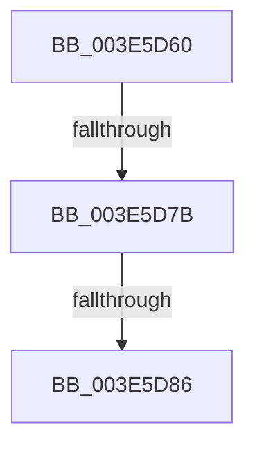

# SepTokenIsOwner

- RVA: `0x003E5D60`–`0x003E5D8A` (길이 `42` bytes)
- VA: `0x00000001403E5D60`
- 실행 섹션: `.text`
- PDB 이름 있음: `예`; PDB Function 태그: `아니요`
- unwind 정보 RVA: `0x00094F78`
- 디코드: `12`개 명령, `42/42` bytes 표시
- 미해석 바이트: `0` (있으면 어셈블리에 `.byte`로 보존)

> 이 문서는 커널 이미지의 기계어와 PDB 기호를 분석해 생성했습니다. 4번과 5번은 함수 원형과 자료형을 바이너리 사용 방식에서 추정한 C 해석이며 원본 소스 복구 결과는 아닙니다.

## 1. Dependencies

- 직접 호출 지점: **0**; 고유 호출 대상: **0**
- 직접 호출자로 확인된 함수: **4**
- RIP 상대 이미지 참조: **0**

### Outgoing calls
- 직접 디코드된 call 명령이 없습니다.

### Direct callers
- [SeAccessCheckWithHint](../3A/SeAccessCheckWithHint_function_003A6C30.md) at `0x003A7063`
- [SeAccessCheckByType](../44/SeAccessCheckByType_function_00440BC8.md) at `0x004416ED`
- [SepCommonAccessCheckEx](../47/SepCommonAccessCheckEx_function_0047602C.md) at `0x004766C8`
- [SepAccessCheckAndAuditAlarm](../../page/A1/SepAccessCheckAndAuditAlarm_function_00A1AF4C.md) at `0x00A1BB2E`

### Static image references
- 디코드된 RIP-relative 메모리 참조가 없습니다.

## 2. Other-region calls and transfers

- 다른 실행 섹션으로 향하는 call: **0**
- call이 아닌 외부 분기/꼬리 이동: **2**
  - `0x003E5D75` → [sub_003E5FDA](Unknown_function_003E5FDA.md) (`tail-transfer`)
  - `0x003E5D80` → [sub_003E6023](Unknown_function_003E6023.md) (`tail-transfer`)

## 3. Assembly (complete function range)

```asm
003E5D60  44 88 44 24 18                  mov byte ptr [rsp + 0x18], r8b
003E5D65  55                              push rbp
003E5D66  56                              push rsi
003E5D67  41 56                           push r14
003E5D69  48 83 EC 40                     sub rsp, 0x40
003E5D6D  66 83 7A 02 00                  cmp word ptr [rdx + 2], 0
003E5D72  48 8B E9                        mov rbp, rcx
003E5D75  0F 8D 5F 02 00 00               jge 0x1403e5fda
003E5D7B  8B 42 04                        mov eax, dword ptr [rdx + 4]
003E5D7E  85 C0                           test eax, eax
003E5D80  0F 84 9D 02 00 00               je 0x1403e6023
003E5D86  48 8D 34 02                     lea rsi, [rdx + rax]
```

## 4. C-style interpretation (structured pseudocode)

```c
__int64 __fastcall SepTokenIsOwner(__int64 a1, __int64 a2, unsigned __int8 a3)
{
    __int64 v_rsp;
    unsigned __int8 v_stack_p18;

    v_stack_p18 = a3;
    v_rsp = (v_rsp) - (64);
    return (unsigned int)(*(unsigned int *)(a2 + 4));
}
```

## 5. (Beta) C Style

```c
int64_t SepTokenIsOwner(int64_t Arg1, void *Arg2, uint8_t Arg3)
{
    uint8_t *arg2 = (uint8_t *)Arg2;

    int64_t local_rsp;
    uint8_t v_stack_p18;

    v_stack_p18 = Arg3;
    local_rsp = (local_rsp) - (64);
    return (uint32_t)(*(uint32_t *)(arg2 + 0x4));
}
```

### 관측된 메모리 오프셋

구조체 형식이 확인되지 않은 접근은 인자 기준의 오프셋으로만 기록했습니다.

| 기준 인자 | 오프셋 표현 | 폭 (bit) | 접근 |
|---|---:|---:|---|
| `Arg2` | `+ 0x0 + rax*1` | `64` | `R` |
| `Arg2` | `+ 0x2` | `16` | `R` |
| `Arg2` | `+ 0x4` | `32` | `R` |

## 6. Execution-region graph

[열기: 2D/3D 그래프와 함수 탐색 컨트롤 패널](../../../control-panel.html?section=text&rva=0x003E5D60&view=graph)

- 2D 그래프는 위에서 아래로 흐르고, 3D 그래프는 빈 공간을 드래그해 회전합니다. Shift+드래그는 이동, 휠은 확대·축소, 함수 노드 선택은 대상 보고서 이동입니다.

### Static fallback


